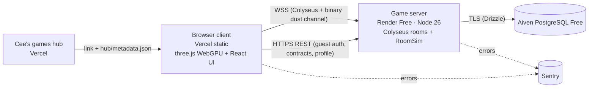

# Moon Cleanup

> The Moon is filthy. Brightside Facilities Co. has handed you a complimentary Desk Duster.
> Clean all 163,842 plots — solo or with up to 15 friends — in your browser.

A real-time co-op moon-cleaning game for the web: sweep regolith grime by hand, upgrade through brooms and
electrostatic tools, drive cleaning vehicles, deploy robot fleets and build glide-rail automation until the
Shine Index hits 100%. Bright, readable stylized realism on WebGPU (with WebGL2 fallback), persistent moons,
drop-in multiplayer, $0 hosting.

**Status:** planning complete — implementation starts at milestone M0. See [docs/STATUS.md](docs/STATUS.md).

## Stack

| Area | Choice |
| --- | --- |
| Language / tooling | TypeScript 6 · Node 26 LTS · pnpm 11 workspaces · Turborepo · Vite 8 |
| Rendering | three.js r187 `WebGPURenderer` + TSL (automatic WebGL2 backend) |
| UI | React 19 + Motion, DOM overlay, CSS Modules + design tokens |
| Multiplayer | Colyseus 0.18 on uWebSockets.js, custom binary channel for dust; authoritative server |
| Simulation | Shared pure-TS kinematic sim (client prediction + server authority) |
| Data | Aiven PostgreSQL (free) · Drizzle ORM |
| Hosting | Vercel (static client) · Render (game server) · Aiven (DB) — all free tiers |
| Testing | Vitest · Playwright · 16-bot headless load tests · network conditioner |

Full rationale: [docs/architecture/tech-stack.md](docs/architecture/tech-stack.md) and [docs/adr/](docs/adr/).

## Architecture



Details: [docs/architecture/system-overview.md](docs/architecture/system-overview.md).

## Repository layout

```
apps/client        browser game (Vite)              apps/server        Colyseus + REST server
packages/shared    contracts (types, protocol, schemas)  packages/protocol  binary codecs, client session
packages/sim       shared room simulation           packages/world     plot grid, terrain sampling, dust ledger
packages/game-data balance & content tables         packages/db        Drizzle schema + migrations
packages/config    tsconfig/eslint/vitest presets   tools/*            bots, netsim, screenshots, asset & terrain pipelines, perf, balance-sim
tests/e2e          Playwright flows                  assets/            small source assets (see ADR-0017)
prototypes/        competing-approach scratch space  docs/              research, design, architecture, ADRs, roadmap, handoff
```

Every folder has a README naming its owning agent role.

## Local setup

1. Install Node **26.13.1** (`nvm use`) and pnpm **11.28.9** (`npm i -g pnpm@11.28.9`; Corepack is no longer bundled with Node 26).
2. `pnpm install --frozen-lockfile` (the first lockfile is created by the agent task M0-W0-T02, the one named exception to "agents never install"; until it exists there is nothing to install)
3. Copy `apps/client/.env.example` → `apps/client/.env.local` and `apps/server/.env.example` → `apps/server/.env` and fill local values (see [docs/architecture/environments.md](docs/architecture/environments.md)).
4. `pnpm dev` — client on http://localhost:5173, server on :2567.
5. `pnpm verify` before handing work over.

## Deploy overview

`main` → staging (Render `moon-cleanup-server-staging`, Vercel branch URL) · `release` → production
(Render `moon-cleanup-server`, Vercel production). Manual one-time setup: [docs/SETUP_CHECKLIST.md](docs/SETUP_CHECKLIST.md).
Git workflow and commit conventions: [docs/handoff/WORKFLOW.md](docs/handoff/WORKFLOW.md).

## How the agent team works

A Claude Fable **lead** plans each wave, launches up to five specialist subagents in parallel on disjoint folders
(installs, then contracts, first), sends every task through independent reviewers, integrates, runs bot/visual/perf gates, and hands
Cee a commit plan. No agent ever runs git. Start here: [docs/handoff/FABLE_KICKOFF.md](docs/handoff/FABLE_KICKOFF.md) ·
[docs/handoff/AGENT_ORCHESTRATION.md](docs/handoff/AGENT_ORCHESTRATION.md) · [CLAUDE.md](CLAUDE.md).

## Docs

- Design: [GDD](docs/design/GDD.md) · [naming bible](docs/design/naming-bible.md) · [progression & economy](docs/design/progression-and-economy.md) · [scope tiers](docs/design/scope-tiers.md) · [visual target](docs/design/visual-target.md) · [art direction](docs/design/art-direction.md) · [audio direction](docs/design/audio-direction.md)
- Architecture: [overview](docs/architecture/system-overview.md) · [modules & ownership](docs/architecture/module-boundaries.md) · [netcode](docs/architecture/netcode.md) · [world & dust](docs/architecture/world-and-dust-simulation.md) · [rendering](docs/architecture/rendering-pipeline.md) · [data model](docs/architecture/data-model.md) · [security](docs/architecture/security.md) · [performance budgets](docs/architecture/performance-budgets.md) · [environments](docs/architecture/environments.md)
- Planning: [roadmap](docs/ROADMAP.md) · [milestones](docs/milestones/) · [open questions](docs/OPEN_QUESTIONS.md) · [research](docs/research/README.md) · [asset licenses](docs/ASSET_LICENSES.md)

## Credits & licensing

Lunar terrain derived from NASA LRO LOLA data and imagery courtesy of NASA's Scientific Visualization Studio
(public domain; no NASA endorsement implied). Star positions from the HYG database (CC BY-SA 4.0).
All third-party assets are recorded in [docs/ASSET_LICENSES.md](docs/ASSET_LICENSES.md). Project license: see
[docs/OPEN_QUESTIONS.md](docs/OPEN_QUESTIONS.md) Q9.
