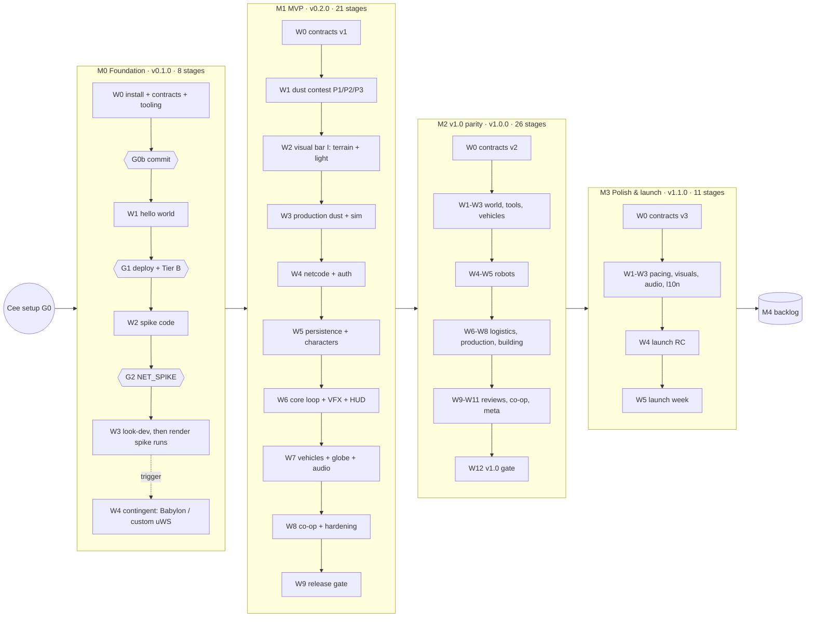

# Roadmap — Moon Cleanup

Owner: **lead** · Status: **Plan v1 (2026-11-12)** · Executed by a Claude Fable 5.2 lead + specialist subagents per [AGENT_ORCHESTRATION.md](handoff/AGENT_ORCHESTRATION.md).
Task-level plans: [docs/milestones/](milestones/README.md) · Scope (canonical): [scope-tiers.md](design/scope-tiers.md) · Ownership (canonical): [module-boundaries.md](architecture/module-boundaries.md) · Versions: [WORKFLOW.md §6](handoff/WORKFLOW.md#6-releases-and-versions).

## 1. Milestones

| Milestone | Goal | Exit criteria (summary — full list in the milestone file) | Waves | Stages (= usage windows) | Version tag | File |
| --- | --- | --- | --- | --- | --- | --- |
| **M0 Foundation** | Green, deployable monorepo; contracts v0; hello world on Vercel + `/healthz` on Render; three r187 docs vendored; git-blocking hook; **render, netcode and terrain-bake spikes** decide the stack's open risks; first look-dev **before** the render spike is captured | CI green with sources; deploys verified; render spike verdict taken after look-dev v0 on the real baked height cube (Tier A/B/WebGL2, Babylon trigger evaluated); netcode spike verdict (16 bots on real Render Free at 20/10 Hz, CPU %, bandwidth, uWS HTTP routing); LOLA bake passes slope acceptance; VT-M0-01…14 | W0–W3 (+W4 contingent) | **8** (+1 contingent) | `v0.1.0` | [M0-foundation.md](milestones/M0-foundation.md) |
| **M1 MVP** | Boreal Pilot Area vertical slice that **already meets the visual bar** in a small area: dust feel, 16-player shared world, persistence across cold starts, first 2–3 h pacing | Dust contest decided (ADR); no cracks/pops to the Pilot Fence; visual-target §4.2 V1 all pass + VM-01…09; 16 bots within tick/bandwidth budgets on Render Free; ≤ 30 s loss on restart; Pilot Review at 2.3–2.8 h solo; playtests P1 (≥ 4/5) and P2 (Crescent Squeegee in 5–10 min unaided) | W0–W9 | **21** | `v0.2.0` | [M1-mvp.md](milestones/M1-mvp.md) |
| **M2 v1.0 parity** | Every scope-tiers §2 system + ★ improvements on the whole Moon within free-tier budgets | Parity matrix rows done; balance-sim meets all pacing targets (30–35 h solo); 16 bots + 64 robots and 400-robot scenario within budgets; save size fits 1 GB plan; VT-M2 V1 pass incl. Safari 26 and Ultra; accessibility per GDD §13 | W0–W12 | **26** | `v1.0.0` | [M2-v1-parity.md](milestones/M2-v1-parity.md) |
| **M3 Polish & launch** | No new systems: pacing from playtests, onboarding, photo mode, Beacon Run, VT-M3 polish, audio + localization pipeline, production launch | P50 pacing in bands (P10–P90 ± 20 %); VT-M3 V2 pass; perf with max permits; string tables complete; launch checklist go; launch week stable | W0–W5 | **11** | `v1.1.0` (proposed) | [M3-polish-launch.md](milestones/M3-polish-launch.md) |
| **M4 Post-launch** | Backlog themes (Offline Solo, Moonlet, Night Shift, account linking, mobile, events, …) — not promised | Planned per theme when Cee picks one | — | — | `v1.x` | [M4-post-launch.md](milestones/M4-post-launch.md) |

## 2. How the work is cut

- **Milestone → waves → stages → tasks.** Every milestone starts with **W0 installs-then-contracts** (`devops-engineer`'s install task runs first and alone — M0-W0-T02 performs the very first install — then `contracts-architect` alone on `packages/shared`). Later waves have **≤ 6 specialist tasks** on disjoint paths (≤ 3 running at once per stage) and end with an **`integrator` task** (`/integrate`) plus the wave's review gate.
- **Stage = one 5-hour usage window** ([AGENT_ORCHESTRATION §14](handoff/AGENT_ORCHESTRATION.md#14-staged-sessions--working-within-usage-limits-mandatory)): ≤ 3 implementation agents + their reviewers + (in the wave's last stage) the integration pass. Tasks are sized to ≤ 60–90 min of agent time; bigger ones are split before launch. Stages are numbered per milestone (`M1-S1` …).
- A new session always runs exactly one stage: *"Resume as lead. Read CLAUDE.md, docs/STATUS.md and the current milestone file, recover any in-progress tasks per AGENT_ORCHESTRATION §14, then run the next stage only."*
- `/commit-plan` after every wave; Cee commits; tasks become `done` only after Cee's commit.

## 3. Stage-based schedule

| Milestone | Planned stages | Fix-cycle buffer | Contingent | Total usage windows | Cee gates inside the milestone |
| --- | --- | --- | --- | --- | --- |
| M0 | 8 | +2 | +1 (render or netcode revisit) | **8–11** | G0 setup, G0b commit M0-W0, G1 deploy (Aiven/Sentry/Render/Vercel) + **Tier B device owner gate (Q21)**, Blender decision (Q23) before M0-S2, G2 `NET_SPIKE` on staging, G3 tag |
| M1 | 21 | +4 (incl. a re-plan if P1/P3 wins) | — | **21–25** | commits per wave, staging bot-test (G-M1-1), playtest P1, soak + playtest P2, tag |
| M2 | 26 | +5 | Offline Solo wave if Cee pulls Q16 into v1.0 (+2) | **26–33** | commits per wave, robot playtest, pacing playtest, staging soak, tag |
| M3 | 11 | +2 | hotfix tasks in W5 | **11–13** | external playtest batch, launch go/no-go, production promotion |
| **Total** | **66** | **+13** | **+3** | **≈ 66–82** | |

**Calendar (assumption, Cee to correct):** at ~10 usage windows per week (two per working day, weekly cap permitting) M0 ≈ 1 week, M1 ≈ 2–2.5 weeks, M2 ≈ 3 weeks, M3 ≈ 1–1.5 weeks — about **8 weeks** to `v1.1.0`. At ~6 windows/week (tighter weekly cap) it is about **13–14 weeks**. When little budget is left in a window, the lead does housekeeping (`/status`, `/commit-plan`) instead of starting a stage.

### Visuals are scheduled early, not as polish

| When | Visual gate | What must already look right |
| --- | --- | --- |
| M0-S7/S8 | VT-M0-01…16 (incl. 04b grazing sun, 15 horizon map, 16 fill) | One hard sun + filtered CSM, black sky, stars, Earth, AgX/bloom, regolith grime vs clean, crisp DOM UI. **Look-dev v0 (S7) lands before the render capture (S8), which runs on the real material and real baked height cube** |
| M1-S5 | Dust contest BENCHMARK | Trail crispness, berms, readability from distance (VT-M1-03/04/05) decide the dust architecture |
| M1-S7 | **V-M1a** (before any gameplay) | Hero terrain + light at Boreal: dawn drama, ground-bounce fill, night, Earth phase, stars, regolith detail, rocks, no LOD pops |
| M1-S9 | **V-M1b** (first playable) | Production dust trails, berms, lane stripes, no shimmer, **under the W2 light/sky/regolith, with a blockout custodian (art-direction §13.4 bar) + Desk Duster and grime-tinted grains**; interim comparator CMP-02/05 on Tier A High, Tier B Medium and Tier C Low; VT-M1-30 `webgl2` parity run |
| M1-S11 | Asset-quality review | Production custodian suit + four hand tools (1080p turntables meeting the art-direction §13.3 bar, VT-M1-35) — 3D art is produced by the D5 pipeline, not left for polish |
| M1-S15 | **V-M1c** | Ballistic dust, Stamp VFX, custodian, tools, outpost palette, HUD crispness and motion |
| M1-S21 | Final M1 | All VT-M1 + VM-01…09 + comparator CMP-02/05/07/15 |
| M2-S26 / M3-S5 | VT-M2 / VT-M3 | Full comparator, Safari, Ultra / polish items |

## 4. Risk register (top 10)

Likelihood (L) and impact (I): **H**igh / **M**edium / **L**ow. "Trigger" is the observable event that makes the owner act.

| # | Risk | L | I | Mitigation (planned in) | Owner | Trigger |
| --- | --- | --- | --- | --- | --- | --- |
| R1 | **Visual quality vs browser performance** — hitting the "not a cheap browser game" bar while holding 60 FPS Tier A / 30 FPS Tier B | M | H | Look-dev in M0-W3 and a visual gate (V-M1a) **before** gameplay; per-subsystem budgets; presets + dynamic resolution (M1-W2-T03); `/visual-check` + `/perf-check` every visible wave; "Low preset dignity" (VT-M1-31) | technical-artist (look) + rendering-engineer (budget); lead arbitrates | Any VT V1 failure, or Tier B average frame > 33.3 ms after warm-up, in two consecutive waves → lead schedules a look/budget trade-off ADR (cut knobs per preset, never the bar on High) |
| R2 | **three.js WebGPU CPU overhead** (#30560 per-object UBO cost, "experimental" WebGPU path) | M | H | Draw budget ≤ 600 A / ≤ 350 B, BatchedMesh/instancing, render bundles, one-draw CDLOD, ban-list lint, vendored r187 docs, M0 render spike (M0-W2-T02, M0-W3-T02) | rendering-engineer | Render CPU > 6 ms on Tier B at the MVP scene, or a blocking WebGPURenderer bug persisting > 2 releases → **M0-W4-T01** Babylon prototype under the competing-approach rule |
| R3 | **Dust simulation at scale** (163,842 plots, crisp shared trails, robots as ledger ops) | M | H | P1/P2/P3 contest with fixed pass bars (M1-W1); exact integer ledger + golden vectors; atlas eviction; server dust ≤ 8 ms/s; 400-robot scenario (M2-W5-T04); CPU shedding order (world-and-dust §11) | terrain-dust-engineer | P2 misses a server bar by > 2× or loses the blind visual test (decision rule) → switch winner; 400-robot run > 10 % of 0.1 CPU → robot intent caps / scheduler limits before M2-W6 |
| R4 | **Netcode at 16 players on 0.1 CPU** (Render Free) | M | H | No server physics, 20/10 Hz, Schema encode-once without StateView, bit-packed bytes channel, interest management, admission control; real-host spike in M0-W3-T01; `/bot-test` gate on every multiplayer wave | netcode-engineer | One 16-bot room > 50 % of the 0.1-CPU budget at 20 Hz → **M0-W4-T02** custom uWS edge; any `/bot-test` tick p95 > 3.5 ms → wave blocked until fixed |
| R5 | **Render 5 GB/month egress → service suspension** (owner **accepted** the risk; no cap logic, OPEN_QUESTIONS Q4) | M (H if the game spreads) | H (game offline until month end) | Bandwidth budgets (≤ 6.5 KB/s/client busy), bit-packed deltas, interest radii; per-room bytes + month-to-date total logged (M0-W1-T02, M1-W5-T01); weekly usage review (M3-W4-T01); Offline Solo (M4-T1 / Q16) removes Solo traffic | devops-engineer (monitoring); **Cee** (decision) | Month-to-date projection > 4 GB, or egress per room-hour > 120 % of performance-budgets §6.2 → lead raises an OPEN_QUESTION for Cee (card on file, pause Open Shifts, lower `SNAPSHOT_HZ`) |
| R6 | **Aiven PostgreSQL Free: 1 GB storage, powers off when idle** | M | M–H | Overwrite-in-place compressed saves, save only when dirty, chunked rows, retention + compaction (M3-W4-T04); lazy connect + backoff; running rooms survive DB power-off, new rooms refused (M1-W5-T01); save-size check with 4,000 structures (M2-W10-T02) | backend-data-engineer | DB size > 700 MB, a single save > 1 MB, or checkpoint failures during a soak → compaction/retention task pulled forward; > 900 MB → refuse new contracts + Cee decision |
| R7 | **Render Free cold starts (~1 min) and restarts "at any time"** | H (certain) | M | "Waking the moon…" screen behind asset download; checkpoint ≤ 30 s + SIGTERM drain ≤ 25 s; seat-hold reconnect; restart + cold-start scenarios in `/bot-test` and e2e (M1-W5-T02); staging left asleep; optional launch-week pinger (Q11) | netcode-engineer (client flow) + backend-data-engineer (persistence) | Restart scenario loses > 30 s or rejoin < 100 %; cold start to playable > 90 s → fix before the wave closes |
| R8 | **Parallel-agent integration conflicts** (shared files, drifting interfaces) | M | M | One owner per path (module-boundaries §3); disjoint owned-file lists checked by the lead; ≤ 5 per wave / ≤ 3 per stage; contracts frozen per wave and changed only in W0/mini-waves; barrel rule; integrator-only composition roots; `/verify` after every stage | lead + integrator | Integration FAIL in two consecutive waves, or a task needing a third fix cycle → split the wave smaller, run a contracts mini-wave, or re-scope the task |
| R9 | **Usage-limit interruptions** (5-hour window + weekly cap) | H | M | Staged sessions (§14): tasks ≤ 90 min, incremental agent reports, STATUS.md log per report, `SendMessage` resume, `/commit-plan` per wave, `sonnet` for mechanical roles, no exploratory research in build sessions | lead | A stage fails to finish inside its window twice → shrink stages to 2 agents; weekly cap reached → housekeeping only until reset; any task cut off twice → split it |
| R10 | **Scope creep vs parity** (ideas beyond scope-tiers; or parity gaps discovered late) | H | H | scope-tiers is canonical; M3 = no new systems; new ideas go to M4 or OPEN_QUESTIONS; parity matrix used as the M2 checklist (M2-W12-T04); every card states its scope row | game-designer (scope tables) + lead (gatekeeper); Cee approves tier changes | A task brief adds a feature not in scope-tiers, or a milestone's stage count grows > 20 % over plan → lead stops, logs an OPEN_QUESTION with a recommended default, re-plans |

## 5. Open issues found while planning (for the lead / Cee)

| # | Issue | Recommended default | Where |
| --- | --- | --- | --- |
| 1 | *(resolved)* `docs/STATUS.md` and `docs/handoff/FABLE_KICKOFF.md` exist | — | — |
| 2 | Root and app build files still need explicit rows in module-boundaries §3 (`pnpm-lock.yaml`, `eslint.config.*`, Prettier files, `.editorconfig`, `.gitignore`, `.gitattributes`, `apps/*/package.json` scripts, `vite.config.ts`, `index.html`, `src/main.ts`, server build config, the two M0-W0-T03 bootstrap stubs) | Owner devops-engineer (lead-delegated in the M0 cards); cross-file item for the owner of module-boundaries | M0-W0-T02/T03 |
| 3 | MVP outpost: scope-tiers says Boreal; visual-target scenes say Dawnside; VT-M2-11 gives polar outposts a permanent ≈ 2° sun vs the MVP 30/30 day/night | Capture M1 scenes at Boreal with a gameplay sun path (game-designer) | M1 D1 |
| 4 | *(resolved)* Earth apparent size is 2.4° (visual-target and rendering-pipeline §20 agree) | — | — |
| 5 | Offline Solo: OPEN_QUESTIONS Q16 says v1.0, scope-tiers says post-launch | Follow scope-tiers (M4-T1) unless Cee confirms Q16 | M2 notes |
| 6 | *(resolved)* `MAX_ROOMS` is a **hard ceiling of 3** with admission by measured tick budget (`TICK_BUDGET_MS` 3.5), the same value in render.yaml, netcode §15, performance-budgets §6 and environments (ADR-0025) | Revisit only after the M0 netcode spike numbers | — |
| 7 | Tier B reference hardware (OPEN_QUESTIONS Q21) is an **owner gate** | Cee names the device at Gate G1; fallback: the Tier A laptop's iGPU forced to power-saving via Windows graphics settings, Tier B marked provisional | M0-W3-T02 |
| 9 | Original 3D art has no production path (technical-artist has no DCC tool) | D5 / OPEN_QUESTIONS Q23 / ADR-0027: scripted procedural modelling in `tools/asset-pipeline` (headless Blender if Cee installs it when the M0 proof starts), proven in M0-W0-T06; art-direction §13.4 placeholder bar; tasks M1-W3-T07 and M1-W4-T07 | M0, M1 |
| 8 | Free-text chat vs quick-chat only (netcode §18 item 4) | Quick-chat only until Cee decides | before M2-W10 |
