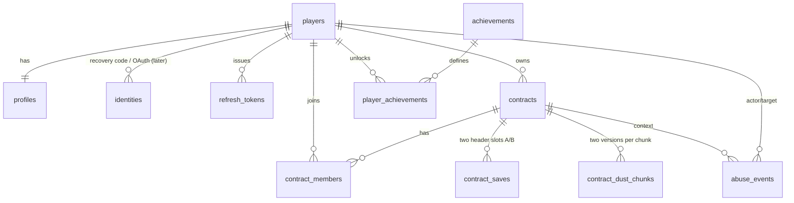

# Data model — Moon Cleanup

Status: **Planning baseline (2026-11-12)** · Owner: backend-data-engineer (`packages/db`, `apps/server/src/persistence`, `apps/server/src/api`) · Save layout contract: `packages/shared/src/save/format.ts` (contracts-architect).
Canonical: [tech-stack.md](tech-stack.md) (Aiven PostgreSQL Free, Drizzle ORM 0.45.x, drizzle-kit 0.31.x, `postgres` driver, migrations in the Render build command, two logical DBs). Evidence: [data-auth-observability.md §4–5](../research/tech/data-auth-observability.md), [platform-limits.md §C](../research/tech/platform-limits.md), [terrain-and-dust-techniques.md §7](../research/tech/terrain-and-dust-techniques.md), [moon-sweepers-reception.md §8](../research/moon-sweepers-reception.md) (save-loss lessons).

## 1. Conventions

| Topic | Rule |
| --- | --- |
| IDs | `uuid`, generated in the app as **UUIDv7** (time-ordered → good B-tree locality). Achievement IDs are text game-data IDs. Log tables use `bigint` identity |
| Enums | `text` + `CHECK` constraint (not PG enum types) so expand/contract migrations can add values without type rewrites |
| Time | `timestamptz`, UTC, set by the app — **except leases and token grace windows, which always use the database clock (`now()`)** so instances with skewed clocks cannot both believe they own a Contract |
| Money-like | Lumens in the sim are float64; DB mirrors use `double precision`. Commendations and Tenure points are integers (`integer` / `bigint`) |
| Deletes | `ON DELETE CASCADE` from `players` to personal rows; `SET NULL` on log/audit references |
| Naming | snake_case tables and columns, plural table names |
| Blob I/O | Never `SELECT *` on `contract_saves`; list/profile queries never read blobs |
| Access | Only `apps/server` (via `packages/db` repositories). The client never talks to the DB |

## 2. Entity overview

Standalone ops tables: `ops_usage_daily`, `ops_jobs`.

## 3. Tables

### 3.1 `players`

| Column | Type | Null | Notes |
| --- | --- | --- | --- |
| `id` | uuid | no | PK (UUIDv7) |
| `status` | text | no | `active` · `deleted` (tombstone for ≤ 24 h during async purge) |
| `is_guest` | boolean | no | true until an OAuth identity is linked (post-launch) |
| `created_at` | timestamptz | no | |
| `last_seen_at` | timestamptz | no | Updated at most once per hour per player (avoid write churn) |

Indexes: PK; `(last_seen_at)` for retention purge.

### 3.2 `identities`

| Column | Type | Null | Notes |
| --- | --- | --- | --- |
| `id` | uuid | no | PK |
| `player_id` | uuid | no | FK → players, cascade |
| `provider` | text | no | `recovery_code` (MVP) · `discord` · `google` · `github` (post-launch) |
| `subject` | text | no | For `recovery_code`: hex HMAC-SHA256(code, `REFRESH_TOKEN_PEPPER`); the code is **≥ 80 bits** of CSPRNG output, shown as 16 Crockford base32 characters (4 groups of 4). For OAuth: provider user ID |
| `created_at`, `last_used_at` | timestamptz | no / yes | |

Indexes: unique `(provider, subject)`; `(player_id)`. A guest is a player with only a `recovery_code` identity ([data-auth-observability.md §5.4](../research/tech/data-auth-observability.md)).

### 3.3 `refresh_tokens`

| Column | Type | Null | Notes |
| --- | --- | --- | --- |
| `id` | uuid | no | PK |
| `player_id` | uuid | no | FK → players, cascade |
| `family_id` | uuid | no | Rotation lineage; reuse of a replaced token **outside the grace window** revokes the family ([security.md §3](security.md#3-authentication-and-token-lifecycle)) |
| `token_hash` | bytea (32 B) | no | HMAC-SHA256(token, `REFRESH_TOKEN_PEPPER`); raw token never stored |
| `created_at` | timestamptz | no | |
| `expires_at` | timestamptz | no | created + 180 days (sliding: each rotation issues a new 180-day token) |
| `last_used_at` | timestamptz | yes | |
| `replaced_by` | uuid | yes | Next token in family |
| `replaced_at` | timestamptz | yes | DB `now()` at rotation; the 60 s reuse grace window is measured from it |
| `revoked_at` | timestamptz | yes | |
| `revoke_reason` | text | yes | `logout` · `reuse_detected` · `superseded` (unused successor replaced inside the grace window) · `player_deleted` · `admin` |

Indexes: unique `(token_hash)`; `(player_id)`; `(family_id)`; `(expires_at)`.

### 3.4 `profiles` (persists across Contracts)

| Column | Type | Null | Notes |
| --- | --- | --- | --- |
| `player_id` | uuid | no | PK, FK → players, cascade |
| `display_name` | text | no | 3–20 chars, validated (see [security.md §6](security.md#6-input-validation)); not unique |
| `tenure_level` | smallint | no | Tenure |
| `tenure_points` | bigint | no | From lifetime Lumens earned + plots Polished (formula in game-data) |
| `commendations` | integer | no | Spendable meta currency, ≥ 0 (CHECK) |
| `lifetime_lumens` | double precision | no | |
| `lifetime_plots_polished` | integer | no | |
| `cosmetics_owned` | text[] | no | game-data cosmetic IDs |
| `equipped_cosmetics` | jsonb | no | `{slot: cosmeticId}`; ≤ 1 KB (CHECK on `pg_column_size`) |
| `version` | integer | no | Optimistic concurrency for REST edits vs in-room flushes |
| `updated_at` | timestamptz | no | |

### 3.5 `contracts`

| Column | Type | Null | Notes |
| --- | --- | --- | --- |
| `id` | uuid | no | PK |
| `owner_player_id` | uuid | no | FK → players, cascade |
| `name` | text | no | 3–32 chars |
| `shift_type` | text | no | `solo` · `private` · `open`; a change applies to the live room (one room name `shift`, [netcode.md §9.3](netcode.md)) |
| `max_players` | smallint | no | 1 for solo, ≤ 16 otherwise (CHECK) |
| `grid_m` | smallint | no | 128 (Standard, 163,842 plots); 64 if Moonlet ships |
| `plot_count` | integer | no | 10·m²+2 |
| `seed` | bigint | no | Procedural detail, Stray Cargo placement |
| `invite_code` | text | yes | 8 chars Crockford base32; null for solo |
| `invite_code_rotated_at` | timestamptz | yes | |
| `temp_permissions` | jsonb | no | `{tempCanBuild, tempCanSpendShared, tempCanDriveShared}` (what Temps may do beyond GDD §7.5 defaults; defaults false) |
| `status` | text | no | `active` · `fulfilled` (Contract Fulfilled, showcase moon) · `deleted` |
| `storage_tier` | text | no | `full` · `compacted_logs` · `compacted_ledgers` (capacity policy §5.1) |
| `stored_bytes` | integer | no | Sum of `blob_size` of both header slots and all chunk versions; maintained by each checkpoint (per-Contract cap, §5.1) |
| `shine_polished` | integer | no | Mirror of Polished plot count (for lists / Shine Index %) |
| `wallet_lumens` | double precision | no | Mirror for lists |
| `game_data_version` | text | no | Balance data version last used |
| `playtime_s` | bigint | no | Sum of player-seconds |
| `created_at`, `last_played_at` | timestamptz | no | |
| `lease_instance` | text | yes | `<ENV_NAME>:<BUILD_VERSION>:<boot uuid>` of the instance hosting the live room |
| `lease_room_id` | text | yes | Colyseus room id holding the lease; the CAS key together with `lease_instance` |
| `lease_expires_at` | timestamptz | yes | DB `now()` + 35 s, renewed every 10 s by **compare-and-set** ([netcode.md §9.3](netcode.md)) |

Indexes: `(owner_player_id)`; unique `(invite_code)` where not null; `(status, last_played_at)` for retention and compaction. Quota: **≤ 3 non-deleted Contracts owned per player** ([GDD](../design/GDD.md) "hold up to 3 Contracts"; checked in the API and part of the capacity policy, §5.1).

Lease statement (the only one allowed; never read-then-write):
`UPDATE contracts SET lease_instance=$me, lease_room_id=$room, lease_expires_at=now()+interval '35 seconds' WHERE id=$c AND (lease_instance IS NULL OR lease_expires_at < now() OR (lease_instance=$me AND lease_room_id=$room)) RETURNING id`. Zero rows = someone else owns it. Release: `… SET lease_instance=NULL, lease_room_id=NULL WHERE id=$c AND lease_room_id=$room`.

### 3.6 `contract_members`

| Column | Type | Null | Notes |
| --- | --- | --- | --- |
| `contract_id` | uuid | no | PK part, FK → contracts, cascade |
| `player_id` | uuid | no | PK part, FK → players, cascade |
| `role` | text | no | `holder` (contract owner) · `supervisor` (appointed by Holder) · `staff` (Private invite) · `temp` (Open Shift drop-in) — names and permissions per [GDD §7.5](../design/GDD.md) |
| `status` | text | no | `active` · `banned` |
| `joined_at`, `last_seen_at` | timestamptz | no | |
| `playtime_s` | bigint | no | |
| `banned_at` | timestamptz | yes | |
| `banned_by` | uuid | yes | FK → players, set null |
| `ban_reason` | text | yes | `griefing` · `harassment` · `cheating` · `other` |

Indexes: PK `(contract_id, player_id)`; `(player_id, last_seen_at desc)` for "my Contracts". Kicks are **not** persisted (in-memory 15-min block); bans are.

### 3.7 `contract_saves` (two alternating save slots A/B per Contract)

| Column | Type | Null | Notes |
| --- | --- | --- | --- |
| `contract_id` | uuid | no | PK part, FK → contracts, cascade |
| `slot` | char(1) | no | PK part, CHECK `A` or `B` |
| `save_format_version` | smallint | no | `SAVE_FORMAT_VERSION` of the blob |
| `game_data_version` | text | no | |
| `codec` | text | no | `gzip` (RFC 1952: Node `zlib` on the server, `CompressionStream` in a browser worker for v1.0 offline Solo) |
| `raw_size` | integer | no | Uncompressed bytes |
| `blob_size` | integer | no | Compressed bytes |
| `checksum` | integer | no | CRC32 of the raw (uncompressed) bytes |
| `blob` | bytea | no | Column storage set to `EXTERNAL` (already compressed → skip TOAST pglz) |
| `save_seq` | bigint | no | Monotonic per Contract, +1 per write (newest = highest). Optimistic concurrency / split-brain guard |
| `sim_tick` | bigint | no | Tick at capture |
| `saved_at` | timestamptz | no | |
| `saved_by` | text | no | Lease instance string |

**This section and §3.7b are the canonical save layout** (lead decision 2026-11-12; [world-and-dust-simulation.md §6](world-and-dust-simulation.md) defines only the dust chunk payload and defers here).

**Scope of the header slots:** the A/B slot blob is the *header save*: wallet, unlocks, Promotions Board, suit gear, vehicles, robots, buildings, rails, players, Performance Reviews, Shine mirror. It contains **no per-plot dust data** — plot states, remaining values, ledgers and stroke logs live only in `contract_dust_chunks` (§3.7b), so a checkpoint writes the header plus only the dirty chunks (typically 1–20) instead of the whole dust state.

Write rules (one checkpoint = **one transaction**):
1. `BEGIN`.
2. Header first: upsert into the **older** slot (missing slot = oldest; first save goes to A) with `save_seq = newest + 1`, guarded by `WHERE save_seq = <the older slot's expected seq>`. The newer slot is never touched, so a failed or corrupt write cannot destroy the last good header.
3. **Zero rows updated → `ROLLBACK` of the whole transaction** (no chunk rows are written), Sentry alert, room closes with 4108. A zero-row guard means another instance or room owns the Contract.
4. For every dirty chunk, overwrite that chunk's **older version** (§3.7b) with the new payload stamped with the same `save_seq`.
5. Update the `contracts` mirrors (`last_played_at`, `shine_polished`, `wallet_lumens`, `playtime_s`, `stored_bytes`) and `COMMIT`.

"Older" slot/version means the one that does **not** hold the room's current state: normally the lower `save_seq`; after a fallback load (below) it is the rejected slot or ignored chunk version, so a corrupt or orphaned write is always the first thing overwritten. The new `save_seq` is the maximum seen in either slot + 1.

### 3.7b `contract_dust_chunks` (dust chunks, two versions per chunk)

| Column | Type | Null | Notes |
| --- | --- | --- | --- |
| `contract_id` | uuid | no | PK part, FK → contracts, cascade |
| `chunk_id` | smallint | no | PK part, **0–640** (WDS §2.4: 640 chunks of 16 × 16 plots + chunk 640 for the poles); CHECK `chunk_id BETWEEN 0 AND 640` |
| `ver` | smallint | no | PK part, 0 or 1 (two alternating versions per chunk) |
| `save_seq` | bigint | no | `save_seq` of the header checkpoint (same transaction) that wrote this version |
| `codec` / `raw_size` / `blob_size` / `checksum` | text / integer / integer / integer | no | deflate, CRC32 of the raw payload |
| `blob` | bytea | no | Dust chunk payload of [WDS §6](world-and-dust-simulation.md): the chunk's 256 plot states and remaining bytes **plus** each touched plot's ledger, contributions and ≤ 32 recent strokes. Plot state lives with its ledger, so a chunk version is self-consistent. `EXTERNAL` storage |
| `saved_at` | timestamptz | no | |

Indexes: PK `(contract_id, chunk_id, ver)` only. A chunk that has never been touched has no rows (pristine).

**Load rule (crash-safe):**
1. Read both header slots; discard any whose CRC32 or envelope header fails. H = the valid header with the highest `save_seq`. None valid → Contract unavailable (4108), Sentry alert.
2. For every chunk id, read both versions and use the **valid version with the highest `save_seq` ≤ H.save_seq**. Versions with `save_seq` > H (written in the same transaction as a newer header that failed validation) are ignored. No qualifying version → the chunk is pristine as of H.
3. L0 remaining values, plot states and the Shine Index are rebuilt from the chosen chunk versions; the header's Shine mirror is only used for lists.

Why this is consistent: a chunk keeps its two most recent writes. If the newest of them (seq b) is ≤ H, no write happened between b and H, so b is the chunk's state at H. If b > H, then b = H + 1 (the failed header's transaction) and the older version a ≤ H is the state at H for the same reason; if a does not exist the chunk was first touched in H + 1 and is pristine at H. Header and chunks therefore always come from the same checkpoint. A chosen version that fails its own CRC (bit rot) falls back to the other version if its `save_seq` ≤ H, with a `chunk_fallback` Sentry warning (that chunk may roll back by one checkpoint; never forward).

### 3.8 `achievements` (catalog, seeded from `packages/game-data`)

| Column | Type | Notes |
| --- | --- | --- |
| `id` | text | PK, game-data ID (e.g. `ach.first_light` for First Light) |
| `commendations_reward` | integer | |
| `hidden` | boolean | |
| `sort_order` | smallint | |
| `retired` | boolean | Never delete rows that players may hold |

Seeded idempotently (upsert) by the build step after migrations (§8). Display names stay in game-data (naming bible), not in the DB.

### 3.9 `player_achievements`

| Column | Type | Notes |
| --- | --- | --- |
| `player_id` | uuid | PK part, FK → players, cascade |
| `achievement_id` | text | PK part, FK → achievements |
| `contract_id` | uuid | Null-able FK → contracts, set null (where it was earned) |
| `unlocked_at` | timestamptz | |

Index: PK only (lookups are per player).

### 3.10 Leaderboards

No table in the MVP. If a leaderboard screen ships, it reads `profiles (tenure_points desc)` and `contracts (shine_polished desc)` with a 5-minute in-memory cache, after adding the matching indexes in an expand migration.

### 3.11 `abuse_events` (audit)

| Column | Type | Notes |
| --- | --- | --- |
| `id` | bigint identity | PK |
| `at` | timestamptz | |
| `kind` | text | `kick` · `ban` · `unban` · `vote_kick` · `role_changed` · `invite_rotated` · `report` · `rate_limited` · `invalid_message` · `speed_violation` · `teleport_violation` · `purchase_rejected_suspicious` · `guest_create_limited` · `token_reuse` · `recover_failed` · `recover_global_lock` · `holder_transferred` · `contract_compacted` |
| `contract_id` | uuid | Null-able, set null |
| `actor_player_id`, `target_player_id` | uuid | Null-able, set null |
| `ip_hash` | bytea | HMAC-SHA256(IP, pepper + current month) — linkable within a month only; null if not relevant |
| `details` | jsonb | ≤ 1 KB (CHECK); never tokens or raw IPs |

Indexes: `(at)`; `(contract_id, at)`; `(target_player_id, at)`. Writes are rate-limited per kind (≤ 1 per player per kind per 10 s) so a flood cannot fill the disk.

### 3.12 `ops_usage_daily` and `ops_jobs`

| Table | Columns | Purpose |
| --- | --- | --- |
| `ops_usage_daily` | `day` date PK, `bytes_out` bigint, `bytes_in` bigint, `bot_bytes_out` bigint (staging bot runs), `instance_seconds` bigint (process uptime → Render instance-hours), `room_seconds` bigint, `player_seconds` bigint, `peak_clients` smallint, `peak_rooms` smallint, `rooms_refused` integer, `boots` smallint, `db_bytes` bigint, `saves_bytes` bigint, `contracts_by_tier` jsonb, `updated_at` | Month-to-date bandwidth, instance-hours, admission refusals and DB size that survive restarts (owner: log, no cap). Upserted every 10 min and on shutdown; each environment writes its own DB. Month-to-date values are shown on `/status` ([system-overview.md §2.1](system-overview.md)) |
| `ops_jobs` | `name` text PK, `last_run_at` timestamptz, `last_result` text | Daily maintenance (retention, compaction, size metrics) runs at boot or on a 24 h timer if `last_run_at` > 24 h (the server is not always awake); sliced so it never costs a live room more than 1.5 ms per tick |

## 4. Size math against 1 GB

Aiven Free = 1 GB storage for **both** logical DBs plus WAL and catalogs ([platform-limits.md §C1](../research/tech/platform-limits.md)).

Per-row estimates (row + index, PostgreSQL ~24 B tuple header):

| Item | Estimate |
| --- | --- |
| Player (players + profile + 1 identity + achievements ≈ 10) | ≈ 1.5 KB |
| Refresh tokens (rotated rows kept 7 days; ~4 rotations per hour played) | ≈ 1 KB idle player, ≈ 15 KB very active player |
| Contract + 4 members | ≈ 1 KB |
| Header blob, compressed — pristine moon | ≈ 2–5 KB per slot |
| Header blob — mid/late game (structures, robots, rails, players) | ≈ 20–300 KB per slot |
| Dust chunk versions (WDS §6: ≈ 0.4 KB per Opened plot per version) | typical 3,000 Opened ≈ 1.2 MB per version, ≈ 2.4 MB both versions |
| **One typical mid-game Contract** (2 header slots + both chunk versions + 30 % bloat) | **≈ 3–3.5 MB** |
| One pristine or barely touched Contract | ≈ 10–50 KB |

Budget split (single source; WDS defers here):

| Bucket | Budget | Holds |
| --- | --- | --- |
| Reserve: WAL, catalogs, autovacuum headroom | 200 MB | — |
| `moon_staging` | 100 MB | Test data; wiped freely |
| `moon_prod` players/tokens/achievements/audit/ops | 100 MB | ≈ 50,000 players |
| `moon_prod` saves (headers + dust chunks) | 600 MB | ≈ 170 typical active Contracts at full tier, far more once compaction applies (§5.1) |
| **Total** | **1,000 MB** | |

Capacity thresholds (daily job logs a `db_size` line, writes `ops_usage_daily.db_bytes/saves_bytes`, Sentry warns): **warn** at total > 700 MB or any Contract over its soft cap; **refuse new Contract creation** at total > 800 MB (`POST /v1/contracts` → 507 `STORAGE_FULL`, `/readyz` and `/status` report `storage: "full"`; existing Contracts keep playing and saving); **emergency compaction** at > 900 MB (§5.1 stages applied to the largest idle Contracts first). Real per-Contract sizes are **measured in P2 and before launch** and these numbers updated.

## 5. Retention

| Data | Rule | Job |
| --- | --- | --- |
| `refresh_tokens` | Delete rows expired, or revoked/replaced more than 7 days ago | Daily |
| Guest players | Inactive (`last_seen_at`) > 365 days → **first transfer Holder of every owned Contract that has other members** (most recently active Supervisor, else most active Staff member seen within 90 days; `holder_transferred` audit, members see a notice), then delete the player (cascade profile, tokens, identities, achievements, memberships, and owned Contracts that had no eligible successor) | Daily, ≤ 500 per run |
| Contracts | `status = deleted` → hard delete immediately (cascade saves and chunks); an owner's account deletion transfers Holder as above before cascading | On request |
| Temp memberships | `role = temp`, not banned, unseen 90 days → delete | Daily |
| `abuse_events` | 90 days (bans live in `contract_members`) | Daily |
| `ops_usage_daily` | 400 days | Daily |
| Player data deletion request | `DELETE /v1/me` → immediate cascade; audit rows keep `null` actor | Synchronous |

The 365-day guest rule and the Contract storage rules below are shown in the Locker and the Contracts screen ("Guest accounts unused for 12 months are removed"; "Contracts nobody has played for 90 days keep their progress but forget fine dust detail"). See [security.md §9](security.md#9-privacy).

### 5.1 Capacity policy for the 1 GB database (owner-visible)

| Rule | Value | Enforcement |
| --- | --- | --- |
| Contracts per player | ≤ 3 non-deleted owned (GDD); joining others' is unlimited | API on `POST /v1/contracts` |
| Contract creation rate | 10 per player per day ([security.md §5](security.md#5-rate-limiting)) | API |
| Per-Contract **soft cap** | `stored_bytes` ≤ 4 MB | Above it the next checkpoints write chunk payloads **without stroke logs** for plots not touched in the last 10 min (stage 1 for that Contract only) |
| Per-Contract **hard cap** | `stored_bytes` ≤ 8 MB | Above it chunk payloads are written ledger-only for all plots; if still above, Opened plots with ≤ 10 % remaining are stored as state + remaining only (their ledger re-initialises uniformly on load, dust "resettles") and an ops alert fires. The header slot itself is capped at 1 MB (validate-before-write fails above it) |
| Abandoned Contracts, stage 1 | No session for **30 days** → `storage_tier = compacted_logs`: stroke logs dropped from all chunk versions (old edges re-soften on next visit, as after a log cap) | Daily job, ≤ 20 Contracts per run, sliced |
| Abandoned Contracts, stage 2 | No session for **90 days** → `compacted_ledgers`: ledgers dropped, plot states and remaining bytes kept (≈ 50 KB per Contract) | Daily job |
| Abandoned Contracts, stage 3 | Owner deleted or expired with no successor (§5) | Cascade delete |
| Global refusal | Total DB > 800 MB → no new Contracts (507 `STORAGE_FULL`) | API, `/readyz`, `/status` |
| Admin metrics | Daily `db_size` log line: total, per DB, per table, top 10 Contracts by `stored_bytes`, Contracts per `storage_tier`, compactions run; same numbers in `ops_usage_daily` and `/status` | Daily job |

Compaction rewrites a Contract's chunk rows only while no room is live for it (lease free) and takes the lease for the duration, so it never races a room.

## 6. Save format and versioning

| Item | Rule |
| --- | --- |
| Header envelope (slot blob) | Magic `MCSV`, `SAVE_FORMAT_VERSION` u16, `gridM` u16, `radiusM` u16, `plotCount` u32, `bakeHash` (terrain + grid golden hash, 32 B), `dustModelVersion` u16, `simTick` u64, section table; trailer CRC32 of everything before it |
| Header sections (each: id u16, section version u16, length u32; unknown ids skipped) | `META` (wallet, shared upgrades, suit gear, beacons, visited outposts, Temp permissions, Stray Cargo 150-bit set, Survey Points 24-bit set, Contract Fulfilled, Shine mirror, stats) · `PLAYERS` (per member: tools owned, equipped tool, Holster loadout, Dust Cell levels, Cell fill, mg accumulator, last pose, owned vehicles) · `VEHICLES` · `ROBOTS` (type, Roost/Nest, state, cargo, pose, current lane plan) · `STRUCTURES` · `RAILS` · `MACHINES` · `PUCKS` (capped count). **No `PLOTS` or `LEDGERS` section**: all per-plot dust data is in chunk rows |
| Dust chunk payload (chunk rows) | Format `DUST_CHUNK` defined in [WDS §6](world-and-dust-simulation.md), own payload version, deflate per row, CRC32 in the row |
| Compression | gzip of the whole header envelope; deflate per chunk payload |
| Ownership | `packages/shared/src/save/format.ts` defines layout + versions; `packages/world` and `packages/sim` write/read their sections (`apps/server/src/world` the chunk payloads); `apps/server/src/persistence` compresses and stores |
| Upgrades | Loader runs an in-memory chain `vN → vN+1 → … → current`; the next checkpoint writes the current version. Each step is owned by the package that changed its section |
| Downgrades | **Never.** A server whose `SAVE_FORMAT_VERSION` is older than a blob refuses it (4108). So a code rollback after a save-format bump makes touched Contracts unavailable until roll-forward. Release rule: save-format bumps ship alone, soak 48 h on staging |
| Fixtures | One golden save per historical version, committed as test fixtures; CI loads every fixture with the current loader |
| Validation before write | Encode → decode header + section table → CRC32 → size sanity (header ≤ 1 MB, each chunk payload ≤ 256 KB, Contract within its hard cap, §5.1) before the write; failure skips the write, leaves both slots and all chunk versions untouched and alerts |
| Game-data changes | Balance changes need no save migration; IDs are never reused; removed IDs need an explicit mapping in game-data |

## 7. Checkpoint cadence and write volume

| Write | When | Size |
| --- | --- | --- |
| Header blob (older slot) + dirty chunk versions, one transaction | Every ≤ 30 s **only if dirty**; on room empty; on SIGTERM; priority events (Contract Fulfilled, capstone purchase, ban) coalesced ≥ 5 s apart | header 0.002–0.3 MB + 1–20 chunks × 1–30 KB |
| Lease renewal (CAS) | Every 10 s per live room | tiny |
| Profiles | Per player every 60 s if changed, and on leave | < 1 KB |
| Player achievements | On unlock (batched per second) | tiny |
| `contracts` mirrors (`last_played_at`, `shine_polished`, `wallet_lumens`, `playtime_s`) | With each save | tiny |
| `ops_usage_daily` | 10 min | tiny |

Write volume per busy room-hour ≈ 120 checkpoints × (≈ 0.1 MB header + ≈ 0.15 MB chunks) ≈ 30 MB (plus WAL of the same order). Ten room-hours/day ≈ 0.3 GB/day of writes; disk stays bounded because header slots and chunk versions are overwritten alternately, but WAL retention on the free plan is **unverified** — watch the Aiven disk graph during the M0 spike.

## 8. Migration strategy

| Step | Rule |
| --- | --- |
| Author | Only backend-data-engineer runs `drizzle-kit generate` (on up-to-date `main`). Other agents propose schema changes in reports |
| Review | Generated SQL committed under `packages/db/migrations/`, reviewed by Cee in the PR. Checklist: primary key on every table; no destructive change without an expand/contract plan; no long locks |
| Apply | Render **build command** runs `pnpm --filter @moon-cleanup/db run migrate` — the **programmatic** Drizzle migrator (`packages/db/src/migrate.ts`, `drizzle-orm/postgres-js/migrator`), never the `drizzle-kit migrate` CLI, because only the programmatic path sets the session limits below — with `DATABASE_URL` + `DATABASE_CA_CERT`, after the build and before the new instance starts; then `pnpm --filter @moon-cleanup/server run seed` (achievements upsert from game-data; lives in the server because `packages/db` must not import `game-data`). Failure fails the build → old instance keeps serving |
| Session limits | `lock_timeout = 5s`, `statement_timeout = 60s` for the migration connection |
| Expand/contract | Migration N must work with code N−1 (old instance keeps running during the build). Add nullable/defaulted columns first → code writes them → backfill → constraint in a later release. Drop columns ≥ 2 releases after code stops reading them. Renames = add + copy + drop |
| Never | `drizzle-kit push` against Aiven (local Docker only); editing an applied migration |
| Backups | Before any risky migration Cee takes a manual `pg_dump` of `moon_prod` (free-tier backup policy unverified) |
| Order across envs | Merge to `main` → staging build migrates `moon_staging`; fast-forward `release` → prod build migrates `moon_prod` |

## 9. Two logical databases

| Item | Plan | Fallback |
| --- | --- | --- |
| Layout | One Aiven PG Free service; databases `moon_prod` and `moon_staging`; roles `mc_prod`, `mc_staging`, each with `CONNECT` only on its own DB (revoked from `PUBLIC`) | If Aiven Free does not allow extra databases/roles (unverified, [platform-limits.md §C1](../research/tech/platform-limits.md)): one `defaultdb` with schemas `prod` and `staging`, selected via the connection's `search_path` option, one Drizzle migrations table per schema |
| Connections | Pools: prod max 4 (×2 during deploy overlap), staging max 2, migrations 1, admin 1 → ≤ 14 | Aiven Free `max_connections` is unpublished (PG Developer = 20) |
| Shared limits | 1 GB storage and CPU are shared; a runaway staging test can starve prod — staging budget 100 MB, wipe at will | — |

## 10. Open issues

1. **Write amplification / WAL on 1 GB** is unmeasured; if disk climbs, lengthen the cadence to 60 s (dirty-chunk rows are already the design, ADR-0016 amendment).
2. **Per-Contract sizes** (§4) are estimates; P2 measures real header and chunk sizes and the capacity thresholds of §5.1 are re-derived from them before launch.
3. **Aiven Free facts unverified:** extra databases/roles, `max_connections`, backups, WAL retention, idle power-off threshold.
4. **Moonlet size** (`grid_m = 64`) is supported by the schema but not confirmed by game-design.
