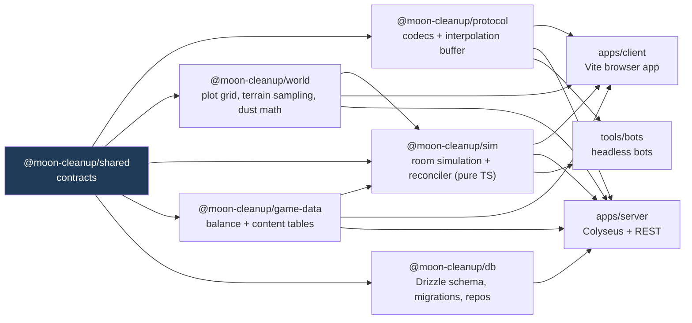

# Module boundaries, contracts and file ownership

Status: **Canonical.** This file is the single source of truth for *which agent role owns which path* and *how modules talk to each other*.
Changes: only by the lead, between waves, recorded in `docs/STATUS.md`. Role definitions: [`.claude/agents/`](../../.claude/agents/).
Package scope: `@moon-cleanup/*` (workspace-only, never published).

## 1. Package map and dependency direction

Rules (enforced by ESLint `no-restricted-imports` + TS project references, set up in M0):
1. `packages/*` never import from `apps/*` or `tools/*`.
2. `packages/shared` imports nothing from the workspace. Pure types, constants and zod schemas.
3. `packages/sim`, `packages/world`, `packages/protocol` are **environment-agnostic**: no DOM, no Node APIs, no three.js, no Colyseus. They must run in a browser main thread, a Web Worker and Node.
4. `apps/client` never imports `packages/db`. `apps/server` never imports three.js.
5. Cross-module communication inside an app goes through the **typed event bus** or the **service registry** defined in `packages/shared` — never by reaching into another module's internals.
6. Deep imports (`@moon-cleanup/x/src/...`) are banned; each package exposes an `index.ts` barrel.

## 2. Contracts (owned by `contracts-architect`, changed only between waves)

All live in `packages/shared/src/` (one folder per row group: `ids`, `units`, `protocol`, `sim`, `world`, `events`, `client`, `ui`, `audio`, `render`, `config`, `api`, `save`; the `units/` folder is created by M0-W0-T01). Each contract file starts with a header comment stating its version.

| Contract | File (planned) | Consumers |
| --- | --- | --- |
| IDs & units (PlayerId, PlotId, EntityId, ContractId, branded types; meters, seconds, kg, Lumens) | `ids.ts`, `units.ts` | all |
| Protocol catalog: message type enum, payload shapes, channel (schema vs bytes), direction, rate, `PROTOCOL_VERSION` — **one catalog, written as the first Wave-0 task before any codec work** ([netcode.md §4](netcode.md)) | `protocol/messages.ts`, `protocol/channels.ts` | protocol, client/net, server/net, bots |
| Input command format (per-tick player input, sequence numbers, tool actions) | `sim/input.ts` | sim, protocol, client/gameplay, bots |
| Entity component shapes (Transform, Avatar, Vehicle, Robot, Tool, Cargo, Building) | `sim/components.ts` | sim, client, server |
| Room sim interface (`RoomSim`: `step(dt)`, `applyInput`, `snapshot()`, `onEvent`) | `sim/room-sim.ts` | sim (implements), server/sim, client (offline solo later) |
| Plot grid interface (`PlotGrid`: `plotAt(dir)`, `neighbors(id)`, `center(id)`, `count`, chunk ids 0–640) + dust state and dust class enums | `world/plot-grid.ts`, `world/dust.ts` | world, sim, client/terrain, server/world |
| Stroke format (anchor plot, start/end in plot-local int16 mm, width, depth16, toolId, tick, actorSlot, inputSeq — [WDS §4.4](world-and-dust-simulation.md)) | `world/stroke.ts` | world, protocol, client/terrain, server/world |
| Event catalog (typed names + payloads: `dust.collected`, `cargo.sold`, `plot.polished`, `purchase.completed`, `unlock.granted`, `vehicle.entered` …) | `events/catalog.ts` | gameplay emits; ui, audio, visuals, animation listen |
| Client module interface (`ClientModule { id; init(ctx); update(frame); resize?(); dispose() }`) + service registry keys | `client/module.ts` | every client module; `apps/client/src/app` composes |
| UI store shape (HUD state slices, menus, notifications) | `ui/store.ts` | ui (reads), gameplay/net (write via actions) |
| Audio cue IDs and parameters | `audio/cues.ts` | audio (implements), gameplay/ui/visuals (trigger via events) |
| Render quality presets (Low/Medium/High/Ultra knobs) | `render/quality.ts` | render, visuals, terrain, ui (settings screen) |
| Balance config schemas (zod) for every table in `packages/game-data` | `config/*.schema.ts` | game-data (data), sim (reads), balance-sim |
| REST DTOs (guest auth, contracts list, profile, save metadata) | `api/rest.ts` | server/api, client/net |
| Save format (world blob layout + `SAVE_FORMAT_VERSION`) | `save/format.ts` | server/persistence, sim, world |

**Contract change process:** an agent that needs a change writes a *proposal* in its report (never edits `shared`). Between waves the lead batches proposals into a Wave-0-style task for `contracts-architect`, who applies them, bumps versions, updates this table and lists affected consumers. Breaking protocol/save changes bump `PROTOCOL_VERSION` / `SAVE_FORMAT_VERSION` and require a migration note.

## 3. File ownership map

One owner per path. Unit tests live next to the code they test and belong to the same owner. "Shared root files" may only be changed by their owner **between waves**.

| Path | Owner role | Notes |
| --- | --- | --- |
| `packages/shared/**` | contracts-architect | Contracts only; no logic beyond zod schemas and constants |
| `packages/protocol/**` | netcode-engineer | Bit-packed codecs (encode/decode only), compact snapshot/dust/stroke formats per WDS, interpolation buffer, codec test vectors. No prediction or session logic |
| `packages/sim/**` | gameplay-systems-engineer | Movement, low-g kinematics, jet pack, vehicles, tools (incl. sweep phase from `inputSeq`), cargo, economy rules, robots' behavior, unlock logic, `RoomSim` implementation, **reconciler** (input ring, replay on ack, correction smoothing; used by `client/net` and `tools/bots`) |
| `packages/world/**` | terrain-dust-engineer | Plot grid (GP(m,0)), point→plot, neighbors, height sampling, stroke rasterization into the coarse ledger, coverage math |
| `packages/game-data/**` | game-designer | JSON/TS tables validated by `shared/config` schemas; content definitions (names come from the naming bible) |
| `packages/db/**` | backend-data-engineer | Drizzle schema, generated SQL migrations, repositories |
| `packages/config/**` | devops-engineer | ESLint flat config (incl. import & ban-list rules), Vitest presets, Prettier config. TypeScript compiler options live in the repo-root `tsconfig.base.json` (root-owned, see the shared root files row; M0-W0-T02) |
| `apps/client/src/app/**` | integrator | Composition root: boot, module registration, game loop scheduling, scene graph roots, error boundary. **Exception:** the T03 bootstrap stub `apps/client/src/app/boot.ts` is owned by devops-engineer (lead-delegated) until M0-W1-T06, then the integrator |
| `apps/client/src/render/**` | rendering-engineer | Renderer setup/backend detection, frame orchestration, camera rendering, culling/LOD infra, instancing/BatchedMesh helpers, quality presets, dynamic resolution, GPU resource lifetime |
| `apps/client/src/visuals/**` | technical-artist | TSL materials, sun/earthshine/lamp lighting rig, sky (stars, Earth, sun disk), post pipeline look (tone map, bloom, AO, AA tuning, grading), VFX (dust particles, trails, sparkles) |
| `apps/client/src/terrain/**` | terrain-dust-engineer | CDLOD sphere terrain, regolith material hooks, dust tile atlas, stroke replay (GPU), detail ring, footprints/tracks, orbit coverage |
| `apps/client/src/animation/**` | animation-engineer | Skeleton/clip loading, blend trees, additive layers, procedural foot IK, low-g bounce, vehicle suspension visuals, robot/machine motion |
| `apps/client/src/ui/**` | ui-ux-motion-designer | React HUD/menus/shop/promotions board/map, design tokens, motion system, accessibility, input-prompt glyphs |
| `apps/client/src/audio/**` | audio-engineer | Web Audio graph, buses, helmet-muffle filter, cue playback, music system |
| `apps/client/src/gameplay/**` | gameplay-systems-engineer | Input mapping (KBM + gamepad), interaction, camera rig & feel (easing, shake, FOV kicks), tool aiming |
| `apps/client/src/net/**` | netcode-engineer | Colyseus SDK wiring, transport, session state machine (wake-up on first title interaction, join via REST, reconnect), wiring codec ↔ `packages/sim` reconciler ↔ transport, visibility messages |
| `apps/client/src/debug/**` | performance-profiler | Perf HUD (F3), GPU timestamp capture, stats export |
| `apps/client/public/**` | technical-artist (assets) · devops-engineer (`public/hub/**`, headers) | Generated web assets land in `public/assets/` from the pipeline and the terrain bake, **content-hashed in the file name** (plus one short-TTL `manifest.json`); Vite's own build output goes to `/_app/` so the two never collide ([environments.md §4.2](environments.md)) |
| `apps/server/src/app/**` | integrator | Server composition root, boot, graceful shutdown wiring. **Exception:** the T03 bootstrap stub `apps/server/src/app/index.ts` is owned by devops-engineer (lead-delegated) until M0-W1-T06, then the integrator |
| `apps/server/src/net/**` | netcode-engineer | Colyseus `shift` room (thin adapter over `RoomSim`), `contractId → roomId` registry, REST join handler + seat reservation + join ticket, admission control, lobby listing, auth hook, bytes channel, **`InterestService`** (entity and dust sets, horizon-aware) |
| `apps/server/src/sim/**` | gameplay-systems-engineer | Fixed-step loop driver, input validation against sim rules, robot scheduling budget |
| `apps/server/src/world/**` | terrain-dust-engineer | Authoritative dust state, fixed-order ledger op sequencing, plot completion, dust records filtered by `InterestService` sets, chunk hashes, dust chunk payload serialization |
| `apps/server/src/api/**` | backend-data-engineer | REST: guest auth, profile, contracts list/create/join codes, health |
| `apps/server/src/persistence/**` | backend-data-engineer | Save/load/checkpoint services (header slots + chunk versions, load rule), lease CAS, write coalescing, capacity policy jobs |
| `apps/server/src/ops/**` | devops-engineer | Env parsing (zod), pino logger, room-stats metrics line, bandwidth counters |
| `tools/bots/**` | qa-test-engineer | Headless bot clients, 16-player scenarios, reports |
| `tools/netsim/**` | qa-test-engineer | Network conditioner (latency/jitter/loss), Toxiproxy configs |
| `tools/screenshots/**` | qa-test-engineer (harness) · visual-qa-reviewer (scene list & comparisons) | Playwright capture scenes, camera paths |
| `tests/e2e/**` | qa-test-engineer | Playwright end-to-end flows |
| `tools/asset-pipeline/**` | technical-artist | glTF-Transform/KTX2 scripts, budgets check |
| `tools/terrain-bake/**` | terrain-dust-engineer | LOLA → height cube map baking, manifest with checksums |
| `tools/perf/**` | performance-profiler | Benchmarks, capture scripts |
| `tools/balance-sim/**` | game-designer | Pacing simulator producing time-to-unlock curves |
| `assets/models/**`, `assets/textures/**` | technical-artist | Small source files only; big source art lives outside git (ADR-0017). Includes `assets/models/**/blockout/**` (M1-W3-T07 blockout custodian and tools; production art path: [ADR-0027](../adr/0027-3d-art-production-path.md), [art-direction §13](../design/art-direction.md)) |
| `assets/animations/**` | animation-engineer | Original/CC0 clips only (no Mixamo files in git) |
| `assets/audio/**` | audio-engineer | CC0/CC-BY/original only |
| `assets/ui/**` | ui-ux-motion-designer | SVG icons, OFL fonts |
| `assets/terrain/**` | terrain-dust-engineer | Baked derivatives + manifest (`raw/` is git-ignored) |
| `prototypes/<topic>/<approach>/**` | assigned per contest by the lead | See `prototypes/README.md` |
| `.github/**`, `vercel.json`, `render.yaml`, `turbo.json`, `pnpm-workspace.yaml`, `pnpm-lock.yaml`, `tsconfig.base.json`, root `tsconfig.json`, root `eslint.config.*`, root `vitest.config.*`, root Prettier files, `.prettierignore`, `.editorconfig`, `.gitignore`, `.gitattributes`, `.nvmrc`, root `package.json`, `**/.env.example` | devops-engineer | Shared root files: change between waves only. The lockfile has one writer at a time (M0-W0-T02 creates it) |
| App build files: `apps/*/vite.config.ts`, `apps/client/index.html`, `apps/client/src/main.ts` (one-line import of `./app/boot`), `apps/server/build.config.*`; `scripts` fields of every workspace `package.json` (except `packages/config`) | devops-engineer (lead-delegated) | M0-W0-T03; no logic |
| `.claude/**`, `CLAUDE.md` | lead (via docs-keeper for wording) | Agent definitions and commands |
| `.claude/hooks/**` + the `hooks` block of `.claude/settings.json` | devops-engineer (lead-delegated) | Git-blocking PreToolUse hook; never touch `permissions` |
| `docs/vendor/**` | devops-engineer (lead-delegated) | Vendored API docs (three r187 snapshot) |
| `docs/design/GDD.md`, `naming-bible.md`, `progression-and-economy.md`, `scope-tiers.md` | game-designer | |
| `docs/design/visual-target.md`, `art-direction.md` | technical-artist | Reviewed by visual-qa-reviewer |
| `docs/design/audio-direction.md` | audio-engineer | |
| `docs/architecture/**`, `docs/adr/**` | lead (authors may draft via brief) | ADRs are append-only |
| `docs/STATUS.md`, `docs/ROADMAP.md`, `docs/OPEN_QUESTIONS.md`, `docs/milestones/**` (structure) | lead | Agents edit only their own task row |
| `docs/agent-reports/**` | each agent writes its own files | |
| `docs/visual-reviews/**` | visual-qa-reviewer | Milestone screenshots (PNG, native resolution) |
| `docs/research/**`, `README.md`, `docs/README.md`, `docs/ASSET_LICENSES.md`, `docs/SETUP_CHECKLIST.md`, `docs/REVIEW_LOG.md` | docs-keeper | Asset ledger rows are appended by the agent adding an asset |

**Dependencies (`package.json` `dependencies`)**: owned by the package owner, but **installs happen only between waves** by `devops-engineer` (one lockfile writer at a time). A new dependency needs an ADR ([ADR-0028](../adr/0028-dependency-policy.md)).

## 4. Runtime interfaces inside the client

- **Composition root** (`app/`) builds a `ServiceRegistry` (renderer, scene roots, event bus, UI store, input, net session, sim instance, asset loader, quality settings) and registers `ClientModule`s in a fixed order: render → visuals → terrain → animation → gameplay → net → audio → ui → debug.
- **Frame contract:** `update(frame)` receives `{ dt, time, alpha (sim interpolation factor), simTick, quality }`. Order per frame: input → net ingest → sim predict (fixed step) → gameplay → animation → terrain/dust → visuals/VFX → render → audio → UI flush (UI store updates throttled to ≤ 15 Hz except tick-ups).
- **Events:** emitted by sim/gameplay/net; consumed by ui/audio/visuals/animation. Consumers never mutate sim state.
- **Assets:** loaded through one `AssetLoader` service (KTX2, meshopt, audio decode) with a budget-aware cache owned by `render`.

## 5. Runtime interfaces on the server

- `apps/server/src/net` Colyseus `Room` ⇄ `RoomSim` (from `packages/sim`): the room forwards validated inputs, steps the sim from the fixed-step driver (`apps/server/src/sim`), mirrors compact entity state into Schema (encode-once, patched from the driver), and sends one per-client `FRAME` that carries entity records plus the dust sections produced by `apps/server/src/world`, filtered by the single `InterestService`.
- Persistence: `sim` produces the header blob and `world` the dirty dust chunk payloads via `shared/save/format.ts`; `persistence` writes them in one transaction (coalesced, only when dirty) every ≤ 30 s, on room empty, and on SIGTERM ([data-model.md §3.7/§3.7b](data-model.md)).

## 6. Port allocation for parallel agents

Each agent brief assigns a port offset `N` (0–9) so parallel dev servers never collide: client dev `5173+N`, server `2567+N`, test DB schema suffix `_aN`.
