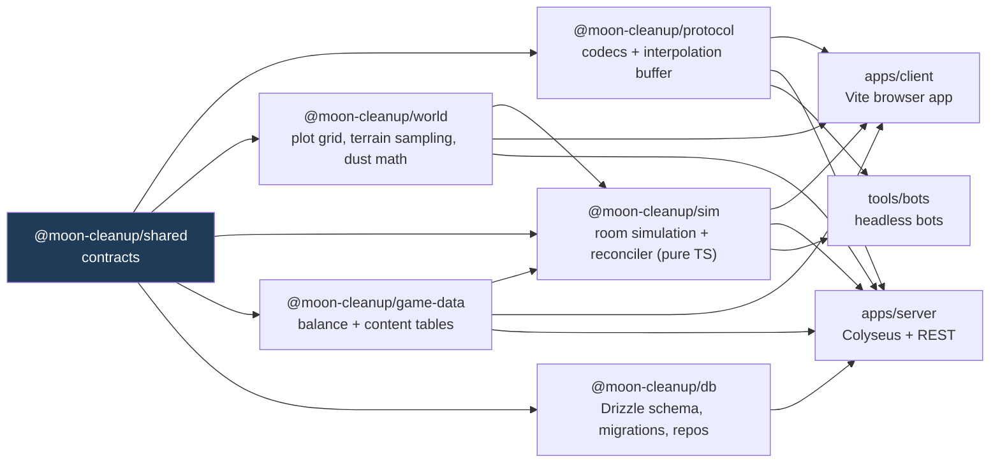

# Module boundaries, contracts and file ownership

Direction: `docs/design/REFERENCE_TARGET.md` overrides retired naming/style/custom-gate rules.

Status: **Canonical.** This file is the single source of truth for *which agent role owns which path* and *how modules talk to each other*.
Changes: coordinated by the lead when technically needed; record changed contracts/owners compactly in STATUS. Role definitions: [`.claude/agents/`](../../.claude/agents/).
Package scope: `@moon-cleanup/*` (workspace-only, never published).

## 1. Package map and dependency direction

Rules (enforced by ESLint `no-restricted-imports` + TS project references, set up in M0):
1. `packages/*` never import from `apps/*` or `tools/*`.
2. `packages/shared` imports nothing from the workspace. Pure types, constants and zod schemas.
3. `packages/sim`, `packages/world`, `packages/protocol` are **environment-agnostic**: no DOM, no Node APIs, no three.js, no Colyseus. They must run in a browser main thread, a Web Worker and Node.
4. `apps/client` never imports `packages/db`. `apps/server` never imports three.js.
5. Cross-module communication inside an app goes through the **typed event bus** or the **service registry** defined in `packages/shared` — never by reaching into another module's internals.
6. Deep imports (`@moon-cleanup/x/src/...`) are banned; each package exposes an `index.ts` barrel.

## 2. Contracts (owned by `contracts-architect`, changed sequentially with affected consumers coordinated)

All live in `packages/shared/src/` (one folder per row group: `ids`, `units`, `protocol`, `sim`, `world`, `events`, `client`, `ui`, `audio`, `render`, `config`, `api`, `save`; the `units/` folder is created by M0-W0-T01). Each contract file starts with a header comment stating its version.

| Contract | File (planned) | Consumers |
| --- | --- | --- |
| IDs & units (PlayerId, PlotId, EntityId, ContractId, branded types; meters, seconds, kg, Lumens) | `ids/ids.ts`, `units/units.ts` (ids v1, units v1) | all |
| Protocol catalog: message type enum, payload shapes, channel (schema vs bytes), direction, rate, `PROTOCOL_VERSION` (**v1: `PROTOCOL_VERSION = 1`**, 46 entries: 24 active, 19 post-MVP reserved, 3 spike). Files: `messages.ts` (catalog), `channels.ts` (channels, bit packing, `QUANT`), `payloads.ts` (zod payloads), `limits.ts` (rate limits), `close-codes.ts` (ours 4100-4108 + `FOREIGN_CLOSE_CODES`), `shift-state-schema.ts` (Schema field table), `frame.ts` (FRAME header, Self, slot, entity tables), `vectors.ts` (golden vectors). See [netcode.md §4](netcode.md) | `protocol/{messages,channels,payloads,limits,close-codes,shift-state-schema,frame,vectors}.ts` (all v1) | protocol, client/net, server/net, client/sim-host (one decode path), bots |
| Input command format (per-tick player input: 16 logical buttons carried as **levels**, `INPUT_WIRE` 10 B, `INPUT_SEQUENCING`, `ControlIntent` / `IntentResult`) | `sim/input.ts` (v1) | sim, protocol, client/gameplay, bots |
| Entity component shapes (Transform, Avatar, Vehicle, Robot, Tool, Cargo, Building; `MOVE_STATES`, `AVATAR_ACTION_STATES`) and plain `ShiftState` / `ShiftStateView` | `sim/components.ts`, `sim/shift-state.ts` (v1) | sim, client, server |
| Room sim interface (`RoomSim`: `step(dt)`, `tick`, `applyInput`, `applyIntent`, `addActor`, `removeActor`, `snapshot()`, `onEvent`). The hot-path frame source is an open item (`readSelf(actor, out)` proposal, M1-W0-T02 report) | `sim/room-sim.ts` (v1) | sim (implements), server/sim, client/sim-host (Solo LocalRoom, ADR-0031) |
| Room host interface (`RoomHost` = `LocalRoomHost` \| `RemoteRoomHost`, `RoomHostFrame` pooled buffer, `RoomHostService` facade registered as the `roomHost` service key, `LocalCheckpointMeta`) (ADR-0031) | `client/room-host.ts` (v1) | client/sim-host and client/net (implement); gameplay, terrain, ui, debug (consume); client/app (registers the facade) |
| Plot grid interface (`PlotGrid`: `plotAt(dir)`, `neighbors(id)`, `center(id)`, `count`, chunk ids 0-640) + dust state, dust class enums and dust wire payload schemas (`Dust*PayloadSchema`, `RobotPlotIntentSchema`) | `world/plot-grid.ts`, `world/dust.ts` (v1) | world, sim, client/terrain, server/world, protocol |
| Stroke format (anchor plot, start/end in plot-local int16 mm, width, depth16, toolId, tick, actorSlot, inputSeq, chain widths - [WDS §4.4](world-and-dust-simulation.md)) and golden vectors (ledger hash FNV-1a 32, chunk mix) | `world/stroke.ts`, `world/vectors.ts` (v1) | world, protocol, client/terrain, server/world |
| Event catalog: sim events (`SimEventMap`, 29 names, all carry `tick`), presentation events (`PresentationEventMap`, 9) and the `EventMap` union | `events/catalog.ts` (v1.1), `events/gameplay.ts` (v1) | gameplay emits; ui, audio, visuals, animation listen; sim (`RoomSimEvent`) |
| Save/sync events (client side only, no sim tick): `save.checkpointed`, `save.queued`, `save.synced`, `save.upload_failed`, `save.conflict`, `save.resolved`, `save.restored`, `save.backup_stored`, `save.storage_warning` | `events/save.ts` (v1) | client/sim-host, client/net (emit); ui (listens) |
| Client module interface (`ClientModule { id; init(ctx); update(frame); resize?(); dispose() }`) + service registry keys (`SERVICE_KEYS` now 10, incl. `roomHost`) | `client/module.ts` (v1) | every client module; `apps/client/src/app` composes |
| UI store shape: 26 slices (session, profile, shift, wallet, shine, compass, holster, suit, vehicle, checklist, nextReq, interaction, roster, plotCard, assay, achievements, desk, board, motorPool, equipment, dot, notices, menus, settings, input, saveSync), `<slice>.set` actions + 10 special actions (`wallet.delta`, `notices.push/dismiss`, `dot.say/next`, `menus.open/back/closeAll/modal`, `compass.ping`, `checklist.complete`, `saveSync.resolveConflict/restoreBackup`) | `ui/slices.ts` (v1.1), `ui/store.ts` (v1.1) | ui (reads), gameplay/net/sim-host (write via actions), client/app (store + `ui-reducer`) |
| Audio cue IDs and parameters (63 cues, typed params, bus/priority/voices table, `AUDIO_EVENT_CUES`) | `audio/cues.ts` (v1) | audio (implements), gameplay/ui/visuals (trigger via events) |
| Render quality presets (every row of [rendering-pipeline §14.1](rendering-pipeline.md): lights, terrain, dust atlas/ring/residency, particles, sky, budgets, distances, ui) | `render/quality.ts` (v1) | render, visuals, terrain, ui (settings screen) |
| Balance config schemas (zod) for every table in `packages/game-data` | `config/*.schema.ts` (bundle v1.2) | game-data (data), sim (reads), balance-sim |
| MVP scope constants (4 tools, 10 board nodes, Cell III, Holster L1 / Lamp L1, Trundle, Sandpiper, Roost cap 3, 3 achievements, 6 Near Parcels, 900 m fence) | `config/mvp-scope.schema.ts` (v1) | sim, balance-sim (policy `mvp`), server/sim, bots, game-data (id coverage test) |
| REST DTOs (guest auth, contracts list, profile, save metadata, **solo checkpoint** upload/verify/download DTOs, `CHECKPOINT_REJECT_REASONS`, `QUOTA_EXCEEDED`, `PUT` for checkpoint parts, ADR-0031) | `api/rest.ts` (v0.2.0) | server/api, client/net |
| Save format (world blob layout, 92 B header with `generation` / `parentGeneration` / `originKind` / `originId`, **`SAVE_FORMAT_VERSION = 1`**, v0 to v1 migration note), dust chunk codec, `MCCK` checkpoint package (download continuation pages have headerLen 0; upload parts are raw slices), golden vectors | `save/format.ts`, `save/dust-chunk.ts`, `save/checkpoint-package.ts`, `save/{vectors,dust-chunk-vectors,checkpoint-vectors}.ts` (v1) | server/persistence, sim, world, client/sim-host, client/net |
| Local-first sync vocabulary and the **normative conflict prompt rule** (6 rules: fast-forward by `baseGeneration`, strict descendant wins silently, divergence prompts with no default, `keep_local` / `use_server` back up the loser first, Open to friends needs an accepted upload, offline is not a conflict) | `save/sync-rules.ts` (v1) | client/net (sync module), client/sim-host, ui (prompt), server/api (rules 1 and 4) |

### Contract versions (end of M1-W0, 2026-11-14)

`PROTOCOL_VERSION = 1` (strict equality: a v0 client is refused with 4100), `SAVE_FORMAT_VERSION = 1`, `GAME_DATA_SCHEMA_VERSION` unchanged. Versions are the `@contract` header of each file; this lists every contract file by area.

| Area | Files and versions |
| --- | --- |
| `ids`, `units` | `ids/ids` v1, `ids/index` v0, `units/units` v1, `units/index` v0 |
| `protocol` | `messages`, `channels`, `payloads`, `limits`, `close-codes`, `shift-state-schema`, `frame`, `vectors`, `index`: all v1 |
| `sim` | `input`, `components`, `shift-state`, `room-sim`, `index`: all v1 |
| `world` | `plot-grid`, `dust`, `stroke`, `vectors`, `index`: all v1 (`PLOT_GRID_GOLDEN_HASHES` ship `null` until `packages/world` exists) |
| `save` | `format`, `dust-chunk`, `dust-chunk-vectors`, `checkpoint-package`, `checkpoint-vectors`, `vectors`, `sync-rules`, `index`: all v1 |
| `events` | `catalog` v1.1, `gameplay` v1, `save` v1, `index` v1 |
| `client` | `module` v1, `room-host` v1, `index` v1 |
| `ui` | `slices` v1.1, `store` v1.1, `index` v1 |
| `audio` | `cues` v1, `index` v1 |
| `render` | `quality` v1; `backend` v0, `index` v0 |
| `config` | `bundle.schema` v1.2, `common`, `economy`, `logistics`, `movement`, `pacing-targets`, `robots` v1.2; `promotions-board`, `traits`, `vehicles`, `index` v1.1; `mvp-scope` v1; the other schemas v1 |
| `api` | `rest` v0.2.0, `index` v0 |
| root | `index` v1 |

**Contract change process:** an agent asks the lead for the needed interface change in a short message (never races another shared writer). The lead assigns `contracts-architect` to apply it when needed, update versions and coordinate affected consumers; no new wave/report is required. Breaking protocol/save changes bump `PROTOCOL_VERSION` / `SAVE_FORMAT_VERSION` and require a migration note.

## 3. File ownership map

One owner per path. Unit tests live next to the code they test and belong to the same owner. "Shared root files" have one designated writer; coordinate affected consumers before changing them.

| Path | Owner role | Notes |
| --- | --- | --- |
| `packages/shared/**` | contracts-architect | Contracts only; no logic beyond zod schemas and constants |
| `packages/protocol/**` | netcode-engineer | Bit-packed codecs (encode/decode only), compact snapshot/dust/stroke formats per WDS, interpolation buffer, codec test vectors. No prediction or session logic |
| `packages/sim/**` | gameplay-systems-engineer | Movement, low-g kinematics, jet pack, vehicles, tools (incl. sweep phase from `inputSeq`), cargo, economy rules, robots' behavior, unlock logic, `RoomSim` implementation, **reconciler** (input ring, replay on ack, correction smoothing; used by `client/net` and `tools/bots`), input rules, **save envelope encode/decode + CRC32** (pure; both hosts, ADR-0031) |
| `packages/world/**` | terrain-dust-engineer | Plot grid (GP(m,0)), point→plot, neighbors, height sampling, stroke rasterization into the coarse ledger, coverage math, **authoritative dust state, fixed-order ledger sequencing, plot completion, chunk hashes, dust chunk payload codec, dust interest sets** (pure, so the Solo worker and the server run the same code, ADR-0031) |
| `packages/game-data/**` | game-designer | JSON/TS tables validated by `shared/config` schemas; content definitions (names come from the naming bible) |
| `packages/db/**` | backend-data-engineer | Drizzle schema, generated SQL migrations, repositories |
| `packages/config/**` | devops-engineer | ESLint flat config (incl. import & ban-list rules), Vitest presets, Prettier config. TypeScript compiler options live in the repo-root `tsconfig.base.json` (root-owned, see the shared root files row; M0-W0-T02) |
| `apps/client/src/app/**` | integrator | Composition root: boot, module registration, game loop scheduling, scene graph roots, error boundary. **Exception:** the T03 bootstrap stub `apps/client/src/app/boot.ts` is owned by devops-engineer (lead-delegated) until M0-W1-T06, then the integrator |
| `apps/client/src/render/**` | rendering-engineer | Renderer setup/backend detection, frame orchestration, camera rendering, culling/LOD infra, instancing/BatchedMesh helpers, quality presets, dynamic resolution, GPU resource lifetime |
| `apps/client/src/visuals/**` | technical-artist | TSL materials, sun/earthshine/lamp lighting rig, sky (stars, Earth, sun disk), post pipeline look (tone map, bloom, AO, AA tuning, grading), VFX (dust particles, trails, sparkles) |
| `apps/client/src/terrain/**` | terrain-dust-engineer | CDLOD sphere terrain, regolith material hooks, dust tile atlas, stroke replay (GPU), detail ring, footprints/tracks, orbit coverage |
| `apps/client/src/animation/**` | animation-engineer | Skeleton/clip loading, blend trees, additive layers, procedural foot IK, low-g bounce, vehicle suspension visuals, robot/machine motion |
| `apps/client/src/ui/**` | ui-ux-motion-designer | React HUD/menus/shop/promotions board/map, design tokens, motion system, accessibility, input-prompt glyphs |
| `apps/client/src/audio/**` | audio-engineer | Web Audio graph, buses, helmet-muffle filter, cue playback, music system |
| `apps/client/src/gameplay/**` | gameplay-systems-engineer | Input mapping (KBM + gamepad), interaction, camera rig & feel (easing, shake, FOV kicks), tool aiming |
| `apps/client/src/net/**` | netcode-engineer | Colyseus SDK wiring, transport, session state machine (wake-up on first title interaction, join via REST, reconnect), wiring codec ↔ `packages/sim` reconciler ↔ transport, visibility messages, `RemoteRoomHost`, **solo save sync** (upload queue, head check, download/restore, conflict detection; ADR-0031, data-model §3.7c), Open-to-friends / Return-to-solo handoff |
| `apps/client/src/sim-host/**` | gameplay-systems-engineer | **New (ADR-0031):** `LocalRoomHost` and its module Web Worker: fixed-step driver, `RoomSim` + world wiring, pooled transferable-buffer messaging (no `SharedArrayBuffer`), FRAME encoding via `packages/protocol`, local checkpoints (`CompressionStream` + IndexedDB, Web Locks), worker crash recovery. Imports `packages/sim`, `world`, `protocol`, `game-data`, `shared` only (no three.js, no Colyseus); sim/world stay dependency-free |
| `apps/client/src/debug/**` | performance-profiler | Perf HUD (F3), GPU timestamp capture, stats export |
| `apps/client/public/**` | technical-artist (assets) · devops-engineer (`public/hub/**`, headers) | Generated web assets land in `public/assets/` from the pipeline and the terrain bake, **content-hashed in the file name** (plus one short-TTL `manifest.json`); Vite's own build output goes to `/_app/` so the two never collide ([environments.md §4.2](environments.md)) |
| `apps/server/src/app/**` | integrator | Server composition root, boot, graceful shutdown wiring. **Exception:** the T03 bootstrap stub `apps/server/src/app/index.ts` is owned by devops-engineer (lead-delegated) until M0-W1-T06, then the integrator |
| `apps/server/src/net/**` | netcode-engineer | Colyseus `shift` room (thin adapter over `RoomSim`), `contractId → roomId` registry, REST join handler + seat reservation + join ticket, admission control, lobby listing, auth hook, bytes channel, **`InterestService`** (entity and dust sets, horizon-aware) |
| `apps/server/src/sim/**` | gameplay-systems-engineer | Fixed-step loop driver, input validation wiring (rules themselves in `packages/sim`), robot scheduling budget |
| `apps/server/src/world/**` | terrain-dust-engineer | Server adapter over the `packages/world` dust authority: dust records filtered by `InterestService` sets, bulk dust messages, chunk-row hand-off to persistence (the pure logic lives in `packages/world`, ADR-0031) |
| `apps/server/src/api/**` | backend-data-engineer | REST: guest auth, profile, contracts list/create/join codes, health, solo checkpoint upload/head/download routes (ADR-0031) |
| `apps/server/src/persistence/**` | backend-data-engineer | Save/load/checkpoint services (header slots + chunk versions, load rule), lease CAS, write coalescing, capacity policy jobs, solo upload verification + fast-forward write + in-memory part staging (data-model §3.7c) |
| `apps/server/src/ops/**` | devops-engineer | Env parsing (zod), pino logger, room-stats metrics line, bandwidth counters |
| `tools/bots/**` | qa-test-engineer | Headless bot clients, 6-player scenarios, reports |
| `tools/netsim/**` | qa-test-engineer | Network conditioner (latency/jitter/loss), Toxiproxy configs |
| `tools/screenshots/**` | qa-test-engineer (harness) · visual-qa-reviewer (scene list & comparisons) | Playwright capture scenes, camera paths |
| `tests/e2e/**` | qa-test-engineer | Playwright end-to-end flows |
| `tools/asset-pipeline/**` | technical-artist | glTF-Transform/KTX2 scripts, budgets check |
| `tools/terrain-bake/**` | terrain-dust-engineer | LOLA → height cube map baking, manifest with checksums |
| `tools/perf/**` | performance-profiler | Benchmarks, capture scripts |
| `tools/balance-sim/**` | game-designer | Pacing simulator producing time-to-unlock curves |
| `assets/models/**`, `assets/textures/**` | technical-artist | Small source files only; big source art lives outside git (ADR-0017). Includes `assets/models/**/blockout/**` (M1-W3-T07 blockout custodian and tools; production art path: [ADR-0027](../adr/0027-3d-art-production-path.md), [art-direction §13](../design/art-direction.md)) |
| `assets/animations/**` | animation-engineer | Original/CC0 clips only (no Mixamo files in git) |
| `assets/audio/**` | audio-engineer | CC0/CC-BY/original only |
| `assets/ui/**` | ui-ux-motion-designer | SVG icons, OFL fonts |
| `assets/terrain/**` | terrain-dust-engineer | Baked derivatives + manifest (`raw/` is git-ignored) |
| `prototypes/<topic>/<approach>/**` | assigned per contest by the lead | See `prototypes/README.md` |
| `.github/**`, `vercel.json`, `render.yaml`, `turbo.json`, `pnpm-workspace.yaml`, `pnpm-lock.yaml`, `tsconfig.base.json`, root `tsconfig.json`, root `eslint.config.*`, root `vitest.config.*`, root Prettier files, `.prettierignore`, `.editorconfig`, `.gitignore`, `.gitattributes`, `.nvmrc`, root `package.json`, `**/.env.example` | devops-engineer | Shared root files: one writer; coordinate consumers. The lockfile has one writer at a time (M0-W0-T02 creates it) |
| App build files: `apps/*/vite.config.ts`, `apps/client/index.html`, `apps/client/src/main.ts` (one-line import of `./app/boot`), `apps/server/build.config.*`; `scripts` fields of every workspace `package.json` (except `packages/config`) | devops-engineer (lead-delegated) | M0-W0-T03; no logic |
| `.claude/**`, `CLAUDE.md` | lead (via docs-keeper for wording) | Agent definitions and commands |
| `.claude/hooks/**` + the `hooks` block of `.claude/settings.json` | devops-engineer (lead-delegated) | Git-blocking PreToolUse hook; never touch `permissions` |
| `docs/vendor/**` | devops-engineer (lead-delegated) | Vendored API docs (three r187 snapshot) |
| `docs/design/GDD.md`, `naming-bible.md`, `progression-and-economy.md`, `scope-tiers.md` | game-designer | |
| `docs/design/visual-target.md`, `art-direction.md` | technical-artist | Reviewed by visual-qa-reviewer |
| `docs/design/audio-direction.md` | audio-engineer | |
| `docs/architecture/**`, `docs/adr/**` | lead (authors may draft via brief) | ADRs are append-only |
| `docs/STATUS.md`, `docs/ROADMAP.md`, `docs/OPEN_QUESTIONS.md`, `docs/milestones/**` (structure) | lead | Lead alone edits task rows from worker reports |
| `docs/agent-reports/**` | each agent writes its own files | |
| `docs/visual-reviews/**` | visual-qa-reviewer | Milestone screenshots (PNG, native resolution) |
| `docs/research/**`, `README.md`, `docs/README.md`, `docs/ASSET_LICENSES.md`, `docs/SETUP_CHECKLIST.md`, `docs/REVIEW_LOG.md` | docs-keeper | Asset ledger rows are appended by the agent adding an asset |

**Dependencies (`package.json` `dependencies`)**: owned by the package owner, but **installs happen sequentially when needed** by the designated `devops-engineer` lockfile writer. Routine dependencies need a rationale/license/script review; major architecture/toolchain changes need a concise ADR ([ADR-0028](../adr/0028-dependency-policy.md)).

## 4. Runtime interfaces inside the client

- **Composition root** (`app/`) builds a `ServiceRegistry` (renderer, scene roots, event bus, UI store, input, net session, sim instance, **room host** (`LocalRoomHost` for Solo, `RemoteRoomHost` for rooms; ADR-0031), asset loader, quality settings) and registers `ClientModule`s in a fixed order: render → visuals → terrain → animation → gameplay → sim-host → net → audio → ui → debug. Consumers talk to the active room host only through the `RoomHost` contract, never to the worker or the Colyseus room directly.
- **Frame contract:** `update(frame)` receives `{ dt, time, alpha (sim interpolation factor), simTick, quality }`. Order per frame: input → room-host ingest (worker frames in Solo, network frames in rooms) → sim predict (fixed step) → gameplay → animation → terrain/dust → visuals/VFX → render → audio → UI flush (UI store updates throttled to ≤ 15 Hz except tick-ups).
- **Events:** emitted by sim/gameplay/net; consumed by ui/audio/visuals/animation. Consumers never mutate sim state.
- **Assets:** loaded through one `AssetLoader` service (KTX2, meshopt, audio decode) with a budget-aware cache owned by `render`.

## 5. Runtime interfaces on the server

- `apps/server/src/net` Colyseus `Room` ⇄ `RoomSim` (from `packages/sim`): the room forwards validated inputs, steps the sim from the fixed-step driver (`apps/server/src/sim`), mirrors compact entity state into Schema (encode-once, patched from the driver), and sends one per-client `FRAME` that carries entity records plus the dust sections produced by `apps/server/src/world`, filtered by the single `InterestService`.
- Persistence: `sim` produces the header blob and `world` the dirty dust chunk payloads via `shared/save/format.ts`; `persistence` writes them in one transaction (coalesced, only when dirty) every ≤ 30 s, on room empty, and on SIGTERM ([data-model.md §3.7/§3.7b](data-model.md)). Solo checkpoints arrive by REST upload, are verified and written by the same transaction rules (data-model §3.7c, ADR-0031).

## 6. Port allocation for parallel agents

Each agent brief assigns a port offset `N` (0–9) so parallel dev servers never collide: client dev `5173+N`, server `2567+N`, test DB schema suffix `_aN`.
