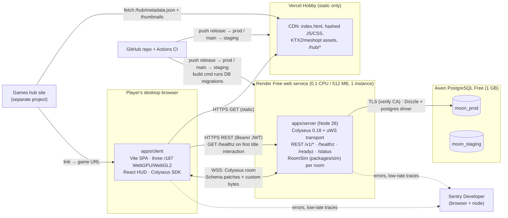

# System overview — Clean The Moon!

> **Current execution correction (2026-11-12):** [ADR-0029](../adr/0029-single-deploy-branch-main.md) governs deployment: `main` only, Vercel production + one Render service.
> Older `release`-branch, branch-promotion and separate-staging setup instructions below are superseded; do not execute them.
> Use local/test fixtures and read-only live checks; hosted load tests need an explicitly approved isolated safe fixture.
> [MODEL_POLICY](../handoff/MODEL_POLICY.md) governs model/reading/review overhead; technical acceptance criteria remain.


Status: **Planning baseline (2026-11-12)** · Owner: lead · Canonical inputs: [tech-stack.md](tech-stack.md), [module-boundaries.md](module-boundaries.md), [naming-bible.md](../design/naming-bible.md).
Companion docs: [netcode.md](netcode.md) · [data-model.md](data-model.md) · [security.md](security.md) · [performance-budgets.md](performance-budgets.md) · [environments.md](environments.md).

## 1. Deployment topology



| Component | Hosted on | Responsibility | Never does |
| --- | --- | --- | --- |
| Client (`apps/client`) | Vercel Hobby CDN | Rendering, input, prediction of own avatar/vehicle, interpolation of others, UI, audio, cold-start UX | Authoritative state, DB access, secrets |
| Game server (`apps/server`) | Render Free (one instance per environment) | Auth/REST, joins, exactly one Colyseus room per live Contract, authoritative `RoomSim`, dust authority, checkpoints, admission control | Physics engine, three.js, static asset serving |
| Database | Aiven PostgreSQL Free, one service, two logical DBs | Players, profiles, Contracts, saves, achievements, abuse log, usage log | Anything per tick |
| Sentry | Sentry Developer | Errors and ≤1% sampled REST traces from client and server | Per-tick spans |
| Games hub | External site (not in this repo) | Lists the game, links to the production URL, reads the hub metadata kit | Embeds the game (link only) |

Single-instance rule: Render Free cannot scale beyond one instance, so there is no Redis/presence layer ([netcode-case-colyseus.md §7.5](../research/tech/netcode-case-colyseus.md)). All live rooms of an environment share one 0.1-CPU process.

**Capacity, stated plainly:** the free tier hosts **only a few live Contracts at once**. Admission is decided by the measured tick budget with `MAX_ROOMS` (default **3**) as a hard ceiling ([netcode.md §15](netcode.md)); in practice that is one busy shared shift plus a couple of Solo or small shifts. Every Solo Shift is a server room in the MVP. When the server is at capacity, players are pointed at **existing Open Shifts, which share rooms**, instead of starting new ones; the v1.0 Worker-based offline Solo removes Solo rooms from the server.

## 2. Request surfaces

### 2.1 HTTP routes on the game server

All JSON bodies are validated with zod schemas from `packages/shared/src/api/rest.ts`. Auth = `Authorization: Bearer <access JWT>` unless marked public.

| Route | Auth | Purpose | Owner path |
| --- | --- | --- | --- |
| `GET /healthz` | public, CORS `*` | Liveness: `{ok, service, env, build, protocolVersion, uptimeS}`. No DB access. Used for wake-up probing | `apps/server/src/api` |
| `GET /readyz` | public, CORS allowlist | Readiness: DB reachable, not draining, room capacity left, storage. `{ready, db, draining, rooms, maxRooms, admitting, storage}` | `apps/server/src/api` |
| `GET /status` | public, CORS allowlist, cached 60 s | Ops numbers, no personal data: month-to-date egress MB and instance-hours (from `ops_usage_daily`), DB size and `storage` state, live rooms/clients, rooms refused today. Read by Cee and `/release-checklist`; never polled by the client | `apps/server/src/api` |
| `POST /v1/auth/guest` | public, rate-limited | Create guest player → refresh token + access JWT + one-time recovery code | `api` |
| `POST /v1/auth/refresh` | refresh token in body | Rotate refresh token, issue access JWT | `api` |
| `POST /v1/auth/recover` | recovery code in body | New token family for an existing player | `api` |
| `POST /v1/auth/logout` | Bearer | Revoke current token family | `api` |
| `GET /v1/me` · `PATCH /v1/me` · `DELETE /v1/me` | Bearer | Profile (Tenure, Commendations, cosmetics, display name); deletion | `api` |
| `GET /v1/me/contracts` | Bearer | Contracts the player owns or is a member of (metadata only, never blobs) | `api` |
| `GET /v1/me/achievements` | Bearer | Unlocked achievements | `api` |
| `POST /v1/contracts` | Bearer | Create a Contract (`shiftType`: solo / private / open, name); ≤ 3 owned, refused when storage is full ([data-model.md §5.1](data-model.md)) | `api` |
| `PATCH /v1/contracts/:id` · `DELETE /v1/contracts/:id` | Bearer, Holder | Rename, change shift type (applies to the live room), Temp permissions; delete | `api` |
| `POST /v1/contracts/:id/invite-code/rotate` | Bearer, Holder | New invite code; old one stops working | `api` |
| `POST /v1/contracts/join-by-code` | Bearer, rate-limited | Redeem invite code → `staff` membership → `contractId` | `api` |
| `POST /v1/contracts/:id/join` | Bearer, rate-limited | **The only way into a room**: membership/ban check (Open Shift → `temp` membership), room registry lookup by `contractId`, admission control, lease CAS, seat reservation + join ticket ([netcode.md §9.3](netcode.md)). 4105 when full or at capacity, 409 `CONTRACT_BUSY` during deploy overlap | `apps/server/src/net` (handler registered by `api`) |
| `GET /v1/contracts/:id/members` · `POST/DELETE /v1/contracts/:id/bans[/:playerId]` | Bearer, Holder (bans also Supervisor, 24 h) | Member list, persistent per-Contract bans | `api` |
| `POST /matchmake/*` (Colyseus) | **disabled for clients** (`exposedMethods` empty) | Only the server-side `matchMaker` API is used | `net` |
| `WSS /<processId>/<roomId>?sessionId=…` (Colyseus) | single-use seat reservation + join ticket | Room connection | `net` |

### 2.2 Room types (Colyseus room names)

| Room name | Naming-bible label | Max clients | How joined | Listed in lobby |
| --- | --- | --- | --- | --- |
| `shift` | Solo / Private / Open Shift (`shiftType` is room state, changeable live by the Holder) | 1 (solo) or 16 | `POST /v1/contracts/:id/join` only. Solo: Holder only. Private: members (`holder`, `supervisor`, `staff`; invite code redeemed first). Open: anyone authenticated and not banned; first join creates a `temp` membership | Only when `shiftType = open` (metadata: Contract name, Holder display name, players, free seats, Shine Index %) |
| `lobby` (Colyseus built-in) | — (Open Shifts list screen) | n/a | Client connects only while the Open Shifts screen is visible | — |

**Exactly one live room per Contract** (M4): an in-process `contractId → roomId` registry, REST-only joins (no client `joinOrCreate`), one room name so a shift-type change never spawns a second room, and a compare-and-set DB lease keyed by room id ([netcode.md §9.3](netcode.md)). Solo Shift rooms run on the server in the MVP; `RoomSim` stays environment-agnostic so v1.0 can run Solo in a Web Worker with no server.

## 3. Boot and cold-start sequence

Render Free spins the server down after 15 minutes without inbound traffic, and waking takes about a minute ([platform-limits.md §B2](../research/tech/platform-limits.md)). Assets start streaming at page load, but the client wakes the server only on the **first user interaction on the title screen** (pointer down, key press, or hovering Clock In). A wake costs at least 15 instance-minutes, so waking on every page load would let hub visitors who bounce keep production up ≈ 744 h/month, past the 600 h plan and close to the 750 h workspace limit that also suspends staging (M9). The probe is never sent by bots or crawlers (`navigator.webdriver`, bot user-agent list, prerendering, hidden tab), and automated tests never target production.

```mermaid
sequenceDiagram
  autonumber
  participant B as Browser (client)
  participant V as Vercel CDN
  participant R as Render proxy
  participant S as Game server
  participant D as Aiven PG
  B->>V: GET / (index.html, short TTL)
  V-->>B: index.html + hashed boot JS
  B->>B: title screen shown; asset streaming starts
  Note over B: First user interaction on the title screen<br/>(skipped for bots/crawlers, prerender, hidden tab)
  par Wake-up probe (starts at first interaction)
    B->>R: GET /healthz (3 s timeout, retry every 3 s)
    Note over R,S: Server asleep → Render starts instance (~60 s).<br/>Meanwhile Render may answer with its own loading page<br/>(no CORS, not our JSON) → client treats as "waking"
    R->>S: boot: parse env (zod), init Sentry, open DB pool lazily
    S->>D: SELECT 1 (TLS, CA verified) — failure ≠ crash
    S-->>R: listening on PORT
    R-->>B: 200 {ok, protocolVersion, build}
  and Asset streaming (continues from page load)
    B->>V: lobby bundle (≤ 20 MB), height map low mips, UI fonts
    B->>B: async pipeline warm-up behind lobby
  end
  B->>B: compare protocolVersion (mismatch → "update" flow)
  B->>S: GET /readyz (DB state)
  B->>S: POST /v1/auth/refresh (or /guest on first visit)
  S->>D: rotate refresh token
  S-->>B: access JWT (15 min) + new refresh token
  Note over B: Player presses Clock In.<br/>If /healthz not yet OK → "Waking the moon…" screen
  B->>S: GET /v1/me/contracts → choose / create Contract
  B->>S: POST /v1/contracts/:id/join {protocolVersion, clientBuild} (Bearer)
  S->>D: registry miss → admission → lease CAS + load header slots and chunk rows (sliced)
  S-->>B: seat reservation + join ticket → WSS connect → join snapshot stream
```

Client wake-up states (owned by `apps/client/src/net`, rendered by `ui`):

| State | Entered when | Player sees |
| --- | --- | --- |
| `idle` | Page load (assets stream, no request to the game server) | Normal title screen |
| `probing` | First user interaction on the title screen (never for bots/crawlers) | Normal title/lobby; nothing blocks |
| `awake` | `/healthz` returned our JSON with matching `protocolVersion` | Normal flow |
| `waking` | First probe failed or >2 s, or a non-JSON / non-CORS response | Only if the player presses Clock In: **"Waking the moon…"** screen with elapsed timer, "usually about a minute", DOT tips |
| `slow_wake` | 120 s without `awake` | DOT message "The servers are taking longer than usual" + Retry button; probing continues every 10 s |
| `records_offline` | `/readyz` says `db: down` | DOT message that Contract records are unavailable; Clock In disabled (see [environments.md §6](environments.md#6-aiven-postgresql-free-power-off-and-reconnect)) |
| `update_required` | Server `protocolVersion` ≠ client's | Older client: "New shift orders — reload" (reload button). Newer client (prevented by the release gate): "Brightside is updating the servers", probe every 30 s for ≤ 10 min, then stop and show "Still updating — try again in a few minutes" with Retry ([netcode.md §13](netcode.md)) |
| `at_capacity` | Join refused with 4105 at capacity / 507 storage full | DOT message: "Brightside is at capacity — join an Open Shift or try again later", Open Shifts list button |

## 4. Session lifecycle

```mermaid
sequenceDiagram
  autonumber
  participant P as Player client
  participant A as REST (api)
  participant M as Matchmaker / Room (net)
  participant W as RoomSim + world (sim, world)
  participant Q as Persistence
  participant D as Aiven PG
  P->>A: POST /v1/contracts {name, shiftType}
  A->>D: insert contracts + contract_members(owner) (no save row yet)
  A-->>P: contractId (+ inviteCode for private/open)
  P->>A: POST /v1/contracts/:id/join {protocolVersion}
  A->>M: registry lookup by contractId (existing room → reserve seat)
  M->>Q: none: admission control → lease CAS (contracts.lease_*, DB now())
  Q->>D: load header slots + chunk rows (or none → new moon from seed)
  Q-->>W: decode save, sliced across ticks (upgrade older SAVE_FORMAT_VERSION)
  A-->>P: seat reservation + join ticket
  P->>M: WSS connect; onAuth: verify ticket, JWT, protocol
  M-->>P: join → dust map + near chunks + entities (join snapshot)
  loop Play (20 Hz sim, 10 Hz frames)
    P->>M: INPUT bytes each tick
    M->>W: step(dt) → strokes, dust deltas, events
    M-->>P: FRAME bytes + Schema patches
    W-->>Q: dirty flag
    Q->>D: checkpoint ≤ every 30 s if dirty (older header slot + dirty chunk versions, one transaction, save_seq+1)
  end
  P--xM: leave / tab closed / network drop
  M->>M: seat held 60 s (allowReconnection)
  M->>Q: last client gone → final checkpoint + profile flush
  Q->>D: write save, release lease
  M->>M: room dispose
  Note over M: No inbound traffic for 15 min → Render spins the instance down (no state lost: everything is in PG)
```

| Phase | Trigger | Server action | Persistence |
| --- | --- | --- | --- |
| Create Contract | `POST /v1/contracts` | Validate quota (≤ 3 owned Contracts per player, GDD) and storage state ([data-model.md §5.1](data-model.md)), generate seed and invite code | Rows in `contracts`, `contract_members` (`holder`) |
| Room create | First `POST /v1/contracts/:id/join` with no registry entry | Admission control (tick budget, `MAX_ROOMS` ceiling), lease CAS (409 `CONTRACT_BUSY` if another instance holds it — happens only during deploy overlap), sliced save load, build `RoomSim` | Lease columns updated |
| Join | Any join | Membership/ban check, `temp` membership for Open drop-ins, seat reservation; onAuth (ticket, JWT, protocol); stream join snapshot | Membership upsert |
| Play | — | Fixed-step loop, frames, Schema patches | Dirty flag; profile deltas accumulated in memory |
| Checkpoint | Every ≤ 30 s if dirty; priority events (Contract Fulfilled, purchase of a capstone, ban) coalesced to ≤ 1 per 5 s | Serialize + gzip sliced across ticks, then one transaction | `contract_saves` older A/B slot + dirty `contract_dust_chunks` rows; `contracts.last_played_at`, Shine mirror |
| Leave | Client closes | Seat held 60 s; avatar shown as "signal lost" | Profile flush for that player |
| Room dispose | Last seat released | Final checkpoint, release lease (`WHERE lease_room_id = room`), remove registry entry, dispose | Save + lease release |
| Spin-down | 15 min without inbound traffic | Render stops instance | — |
| Restart / deploy | SIGTERM | Drain: notice → checkpoint all rooms → close code 4001 → exit ≤ 25 s | All dirty rooms saved |

## 5. Hub metadata kit (`apps/client/public/hub/`)

Owner: devops-engineer (per [module-boundaries.md §3](module-boundaries.md)). Published at `https://<production client origin>/hub/…` by the normal Vercel deploy. `vercel.json` must serve `/hub/*` with `Access-Control-Allow-Origin: *` and `Cache-Control: public, max-age=3600` (the hub site fetches it cross-origin). The hub **links** to the game; the game is not embedded (CSP `frame-ancestors 'self'`, see [security.md](security.md)).

### 5.1 `metadata.json` fields

| Field | Type | Value / rule |
| --- | --- | --- |
| `schemaVersion` | integer | `1` |
| `slug` | string | `moon-cleanup` |
| `title` | string | `Clean The Moon!` |
| `tagline` | string, ≤ 80 chars | Written by game-designer; Brightside voice |
| `descriptionShort` | string, ≤ 160 chars | For cards |
| `descriptionLong` | string, ≤ 1,200 chars, plain text | For the detail page |
| `url` | absolute URL | Production client origin (Vercel production branch `release`) |
| `status` | enum `prototype` / `alpha` / `beta` / `live` | Honest scope label ([moon-sweepers-reception.md §8](../research/moon-sweepers-reception.md), "Feels unfinished") |
| `version` | string | Same value as `VITE_BUILD_VERSION` of the release build (written by the build, not by hand) |
| `updatedAt` | ISO-8601 date-time | Build time |
| `players` | object `{min: 1, max: 16}` | |
| `modes` | array of strings | `["Solo Shift", "Private Shift", "Open Shift"]` |
| `genres` | array of strings | e.g. `["co-op", "cleaning", "automation", "sandbox"]` |
| `platforms` | array | `["desktop-web"]` (mobile post-launch, ADR-0021) |
| `controls` | array | `["keyboard-mouse", "gamepad"]` |
| `requirements` | object | `{graphics: "WebGPU preferred, WebGL2 fallback", minRamGb: 8, browsers: ["Chrome 113+", "Edge 113+", "Firefox 141+ (Windows)", "Safari 26"]}` |
| `onlineRequired` | boolean | `true` in MVP (offline Solo arrives in v1.0) |
| `coldStartNote` | string | "First visit after a quiet spell can take about a minute while the server wakes." |
| `thumbnails` | array of `{path, width, height, purpose, format}` | See §5.2; paths relative to `/hub/` |
| `screenshots` | array of `{path, width, height, caption}` | 3–6 images, 1920×1080 WebP |
| `trailer` | `{url, poster}` or `null` | Optional |
| `accentColor` | hex string | From the design tokens (Polished ivory or Brightside brand color) |
| `contentDisclosure` | string | Accurate statement of how art/audio/text were made (trust lesson C13 in [moon-sweepers-reception.md](../research/moon-sweepers-reception.md)) |
| `credits` | URL | Credits page of the client |
| `contact` | string | Repository issues URL (no personal email) |

### 5.2 Thumbnail set

| File (under `hub/thumbnails/`) | Size (px) | Format | Purpose |
| --- | --- | --- | --- |
| `hero-1920x1080.webp` | 1920×1080 | WebP (q≈85) | Hub hero banner, 16:9 |
| `card-1280x720.webp` | 1280×720 | WebP | Large card |
| `card-640x360.webp` | 640×360 | WebP | Grid card |
| `square-512.png` | 512×512 | PNG | Square tile / app icon |
| `icon-192.png` | 192×192 | PNG | Small icon (also used by the client's web manifest) |
| `og-1200x630.png` | 1200×630 | PNG | Open Graph / social preview (also referenced from `index.html`) |
| `capsule-460x215.webp` | 460×215 | WebP | Narrow list capsule |

Rules: each file ≤ 400 KB (hero ≤ 600 KB); the logo wordmark and a half-cleaned moon must read at 640×360; produced by technical-artist from real in-engine captures (`tools/screenshots`), checked by visual-qa-reviewer. Total kit ≤ 3 MB and outside the ≤ 20 MB first-load budget (it is never fetched by the game).

## 6. Observability at a glance

| Signal | Where | Cadence | Detail |
| --- | --- | --- | --- |
| Errors | Sentry (client + server) | On event | `sendDefaultPii: false`, tokens scrubbed, release = build version |
| Traces | Sentry | REST only, sample ≤ 1% | Never per tick |
| Room stats log line | Render logs (pino JSON) | 1 per room per minute | tick p50/p95/max ms, overruns, players, msgs in/out, **bytes out**, checkpoint ms/size/failures, event-loop p99, RSS/heap |
| Process usage line | Render logs | 1 per minute | Process CPU % of quota (EWMA), total bytes out since boot, rooms, clients |
| Usage persisted | `ops_usage_daily` table | Upsert every 10 min | Month-to-date bytes out, instance-seconds, rooms refused and DB size per environment survive restarts ([data-model.md §3.12](data-model.md)); shown on `/status` |
| Client perf | Sentry breadcrumbs + F3 perf HUD | On demand | FPS, frame ms, draw calls, backend (WebGPU/WebGL2) |

No bandwidth cap logic exists (owner decision): bandwidth is logged and reviewed, never enforced.

## 7. Open issues

1. **Moonlet contract size.** [tech-stack.md](tech-stack.md) lists contract sizes "Moonlet m=64 / Standard m=128"; the owner brief for these docs says one Contract = 163,842 plots. These docs size everything for Standard (163,842) and give formulas that scale down; whether Moonlet ships is a game-design decision.
2. **Production domain.** Exact Vercel production origin (`moon-cleanup.vercel.app` if the name is free) and Render hostnames are only known after the dashboards create them; record them in `docs/SETUP_CHECKLIST.md`.
3. *(Closed 2026-11-12)* **Roles** are `holder`, `supervisor`, `staff`, `temp` everywhere (GDD §7.5 names; DB, Schema, REST, control messages).
