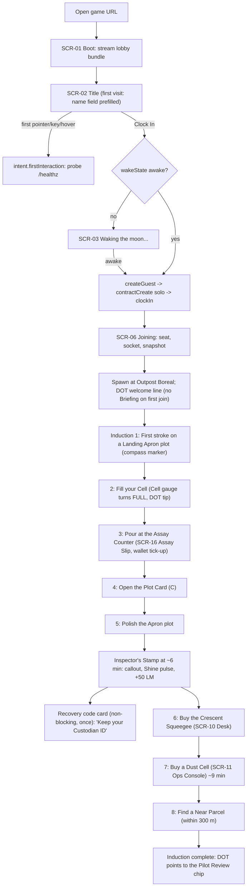
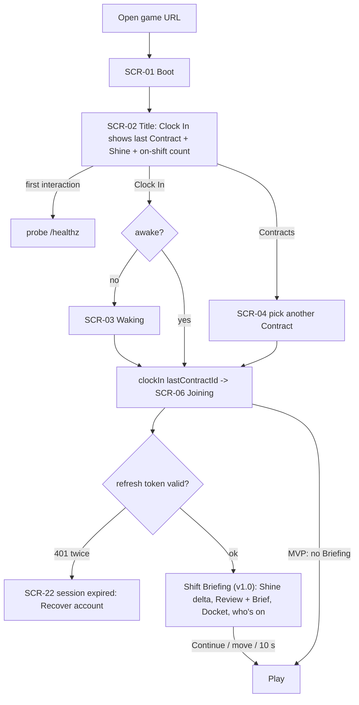
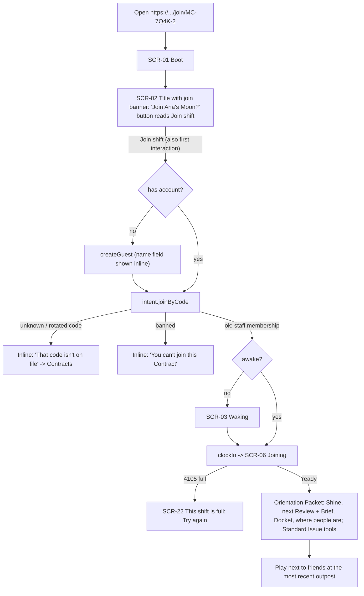
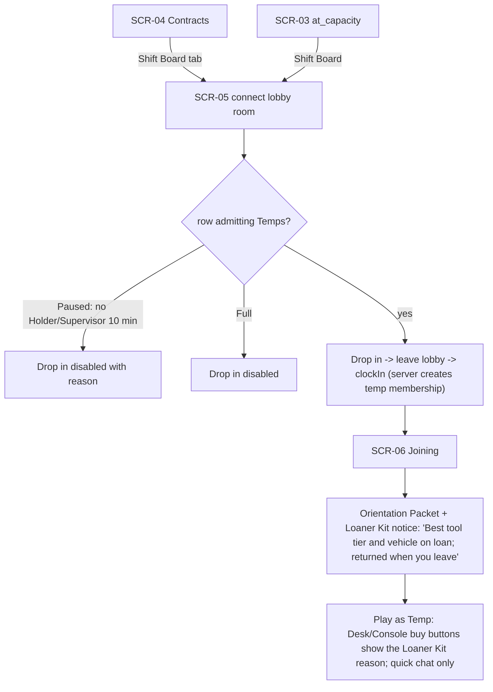
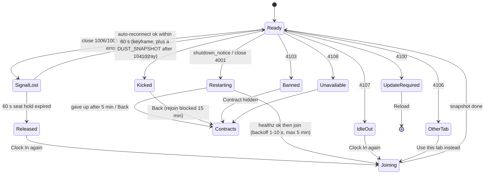
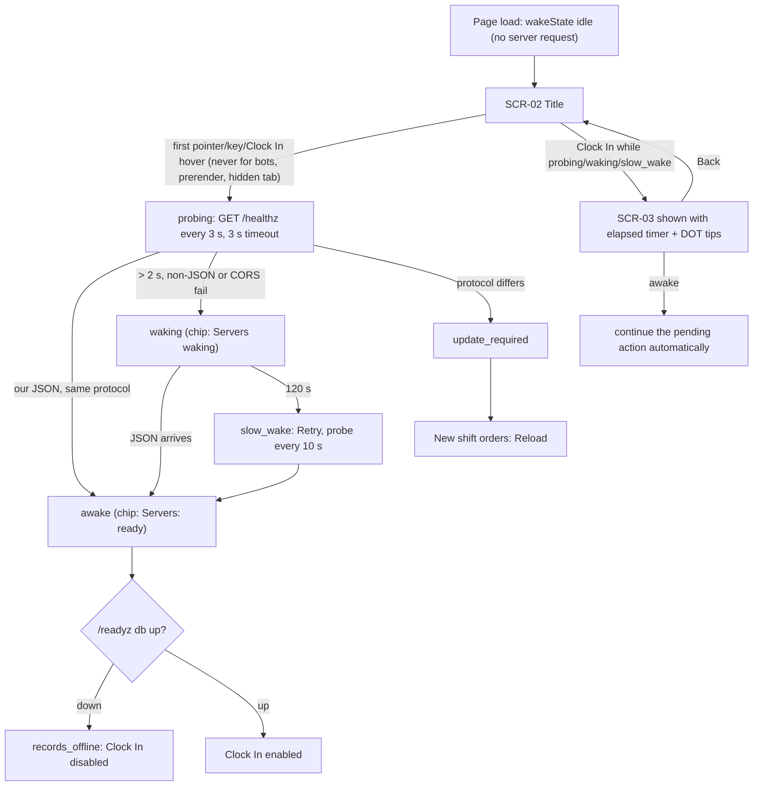

# UI screens and flows — Moon Cleanup

Status: **Draft v1 for build (planning, 2026-11-12).** Owner: ui-ux-motion-designer (builds `apps/client/src/ui/**`, `assets/ui/**`). Approver: lead. Cee (owner) may override anything.
Builds on: [GDD](GDD.md) §7, §8, §9, §10, §12–§16 · [art-direction](art-direction.md) §8 (tokens, type, motion presets, UI accessibility) · [visual-target](visual-target.md) §2.3, §6, VT-M0-10, VT-M1-24/25, VT-M3-06/07/11 · [naming-bible](naming-bible.md) (every label; UI additions in §A10) · [progression-and-economy](progression-and-economy.md) (what each shop and tree shows) · [scope-tiers](scope-tiers.md) (MVP vs v1.0) · [netcode](../architecture/netcode.md) §4, §9, §10, §12, §13, §16 · [system-overview](../architecture/system-overview.md) §2, §3, §4 · [module-boundaries](../architecture/module-boundaries.md) §2, §4 · [rendering-pipeline](../architecture/rendering-pipeline.md) §14, §15 · [audio-direction](audio-direction.md) §2.6, §5, §9 · [security](../architecture/security.md) §3, §8.

**Title.** The owner renamed the game to **Moon Cleanup**. Every player-facing string in this spec uses **Moon Cleanup**. The naming-rule risk (close variant of the banned "Moon Cleaners" / "Clean the Moon") is recorded as X14 in `docs/agent-reports/planning-fix-design.md`; it is the owner's call, and the GDD §1 mitigations apply even more strongly: the **Brightside** mark is prominent on the title screen and loading screen (§3.1, §3.2).

**What this file is.** The single build spec for every DOM screen, overlay and HUD widget: layout, data, intents, states, motion, navigation, accessibility and testable acceptance. It does not restate tokens or presets (art-direction §8 is canonical) or numbers (progression-and-economy is canonical); it names them.

---

## 0. Conventions

| Item | Convention |
| --- | --- |
| Tiers | **MVP** = `v0.2.0` (scope-tiers §1). **v1.0** = `v1.0.0`. **Polish** = between v1.0 and wide release. A widget marked MVP ships in M1; v1.0 items may be stubbed but never shown half-built to players |
| IDs | Screens `SCR-nn`, HUD widgets `HUD-nn`, components `C-nn`, flows `FL-n`, screenshot captures `UIS-nn`. Use them in task briefs, tests and reports |
| Store fields | Written `slice.field` (e.g. `wallet.lm`). §1.3 is the **proposed** shape of `packages/shared/src/ui/store.ts`; contracts-architect owns the file (M1-W0-T03) and may rename fields, in which case this doc follows |
| Intents | Written `intent.name {payload}`. The UI calls a store action; gameplay/net turn it into the wire message named in §1.4. The UI never sends network messages itself and never touches sim state (ADR-0012) |
| Events | Event-catalog names from module-boundaries §2 (`plot.polished`, `purchase.completed` …). Names not yet in the catalog are marked *(proposed)* and listed in §9 |
| Motion | Spring presets `spring-snap`, `spring-ui`, `spring-soft`, `spring-pop`, `spring-heavy` and the tweens (hover, press, fade, toast, tooltip delay) of art-direction §8.7. **Reduced motion** variants follow art-direction §8.7 (120 ms opacity fades, no shake, no overshoot, no floaters, tick-ups jump with a 1-frame highlight) and are not repeated per screen unless they differ |
| Tokens | Color, type, spacing, radius, elevation tokens of art-direction §8.2–§8.4 (`ui-glass-bg`, `type-value`, `sp-4`, `r-xl`, `e-1` …) |
| Device glyphs | `[E]` = the key bound to that action; `(X)` = the gamepad face button by position (A bottom, B right, X left, Y top, Xbox labels; PlayStation glyphs swap in automatically, §1.2) |
| Wireframes | ASCII, not to scale; proportions indicative at 1920×1080 CSS, HUD scale 100% |
| Strings | All strings live in one strings module keyed by ID (localization-ready). Names come only from the naming bible. DOT lines are dry, polite, literal (GDD §3) |

---

## 1. Global UI architecture

### 1.1 Layers (bottom → top)

| # | Layer | Contents | Pointer events | Updated by |
| --- | --- | --- | --- | --- |
| L0 | Canvas | 3D world, Survey Globe render, diegetic displays | Game input | render |
| L1 | World-label layer | Name tags, Flare Beacon labels, outpost labels, ping markers, Equipment chips, Plot Card outline label | None | Direct per-frame transform writer (rendering-pipeline §15), not React |
| L2 | HUD | §3.7 widgets | None except interactive notices while the cursor is free | Store (≤ 15 Hz) + local tick-ups + per-frame compass writer |
| L3 | Panels | Desk, Console, Motor Pool, Parts Catalog, Equipment Card, Plot Card, Roster, Time Card | Yes | Store |
| L4 | Overlays | Survey Globe chrome, Shift Briefing, Review, Shift Report, Locker, Settings, Handbook, Credits, front-end screens | Yes | Store |
| L5 | Modals | Confirms, code entry, recovery code, kick/ban | Yes (focus trapped) | Store |
| L6 | System | Connection and error overlays (§3.22), "Applying settings" | Yes (focus trapped) | Store `session.*` |
| L7 | Notices | DOT Notices (toasts), callouts, subtitles | Notices only | Store queue |
| L8 | Tooltips / focus | Tooltips, gamepad focus halo | None | Local |
| L9 | Debug | Perf HUD (F3), owned by performance-profiler | — | debug module |

Rules: at most **4** simultaneously visible `backdrop-filter` panels (art-direction §8.3); any Tier B/C device, the Low preset or "Reduce transparency" uses `ui-glass-bg-strong` without blur. ≤ 1,500 DOM nodes in the HUD (rendering-pipeline §15). Opening any L3–L6 surface releases pointer lock; closing the last one re-requests it on the next click in the canvas (browsers require a user gesture).

### 1.2 Input modes, focus and device glyphs

| Mode | When | Cursor | Game input | Notes |
| --- | --- | --- | --- | --- |
| **Play** | No L3–L6 surface open | Locked (hidden) | Yes | HUD is non-interactive; actionable notices are answered with a key (`[Y] Re-site`) |
| **Menu** | Any L3–L6 surface open | Free | Movement blocked; the world keeps running (multiplayer never pauses) | DOT Notices still arrive (§5.2) |
| **Wheel** | Ping wheel held (Z / D-pad Down hold) | Virtual pointer at center | Look frozen; movement continues | Release selects |
| **Build** | Assembly Gun drawn | Locked | Yes | Parts Catalog opens with [Tab]-style quick key (§3.13) |
| **Globe** | Survey Globe open | Free | Movement blocked | Rotate/zoom inputs go to the globe |

**Menu navigation map (all panels).**

| Action | Keyboard / mouse | Gamepad |
| --- | --- | --- |
| Move focus | Arrow keys; Tab / Shift+Tab (linear order) | D-pad, left stick (spatial) |
| Confirm / activate | Enter, Space, LMB | (A) |
| Back / close | Esc, RMB on empty space | (B) |
| Previous / next tab | Q / E | LB / RB |
| Previous / next sub-tab or page | 1–9 jump; PageUp / PageDown | LT / RT |
| Secondary action (Track, Re-site, Copy) | F or the shown key | (Y) |
| Tertiary action / details | R or the shown key | (X) |
| Scroll list | Wheel | Right stick |
| Close everything, return to Play | Esc (repeated) | (B) repeated, or Menu |

Focus rules: every surface declares an **initial focus** and a **focus order** (given per screen). Focus is restored to the opener on close (`menus.focusReturnId`). Focus never lands on a disabled control with no explanation: disabled controls stay focusable and show their reason in the tooltip/footer. The focus ring is `focus-ring` (2 px `brand-teal-hi` + 2 px offset) and is shown for keyboard and gamepad, never for mouse clicks (`:focus-visible`).

**Device glyphs.** The last-used device wins (GDD §9). `input.lastDevice ∈ {kbm, xbox, playstation, generic}` switches every prompt glyph (C-13) within one frame of the first input from the new device, with a 150 ms cross-fade. Idle gamepad axes never switch the device (deadzone 0.25, sustained 100 ms). Rebinding updates every glyph immediately.

### 1.3 UI store: proposed slices (input to M1-W0-T03)

The store is a typed external store read with `useSyncExternalStore` selectors (ADR-0012). Gameplay/net write via actions; the UI flushes at most 15 Hz (§5.1). Fields marked † are written per frame by direct DOM writers, not through the store.

| Slice | Fields (type) | Writer | Tier |
| --- | --- | --- | --- |
| `session` | `wakeState` (`idle`·`probing`·`awake`·`waking`·`slow_wake`·`records_offline`·`update_required`·`at_capacity`), `wakeElapsedS` (int), `conn` (`offline`·`reserving`·`connecting`·`streaming`·`ready`·`reconnecting`·`restarting`·`closed`), `joinProgress` (0–1), `joinStage` (`seat`·`socket`·`snapshot`·`ledgers`), `closeCode` (int\|null), `closeInfo` (`{by?, reasonCode?, until?}`), `reconnectAttempt` (int), `seatHoldRemainingS` (int), `rttMs` (int), `serverBuild`, `clientBuild`, `protocolCompat` (`ok`·`client_old`·`client_new`), `capacityNotice` (bool) | net | MVP |
| `profile` | `playerId`, `displayName`, `isGuest` (bool), `pendingRecoveryCode` (string\|null, memory only), `tenureLevel`, `tenureXp`, `tenureXpNext`, `rank`, `commendations`, `certifications` (`{owned[], active[], slots}`), `benefits` (ids[]), `liveryId`, `cosmetics` (`{owned[], equipped{}}`) | net (REST) | MVP: name, guest, recovery, Tenure stub; rest v1.0 |
| `contracts` | `items[]` (`{id, name, shiftType, shinePct, lastPlayedAt, members, online, myRole, inviteCode?}`), `ownedCount`, `maxOwned` (1 MVP, 3 v1.0), `status` (`idle`·`loading`·`error`), `error` | net (REST) | MVP |
| `shiftBoard` | `items[]` (`{contractId, name, holderName, players, maxPlayers, freeSeats, shinePct, languageTag, tempsWelcome}`), `status` | net (lobby room) | v1.0 |
| `shift` | `contractId`, `contractName`, `shiftType`, `myRole` (`holder`·`supervisor`·`staff`·`temp`), `permissions` (`{tempCanBuild, tempCanSpendShared, tempCanDriveShared}`), `inviteCode`, `briefing` (`{shineDelta, sinceLabel, changes[], nextReview, docket, people[]}`\|null), `report` (`{lm, plots, shineDelta, bestHangTimeS, docket, effortAvg, tenureXp}`\|null) | net | MVP: ids, type, role, invite; briefing/report v1.0 |
| `wallet` | `lm` (int), `lastDeltas[]` (`{amount, source, at}`, ring of 8), `pendingSpend` (int) | net | MVP |
| `onShift` | `multiplier` (float, 2 dp), `effortPct` (int), `unattended` (bool), `onBreak` (bool) | net | MVP |
| `shine` | `polished` (int), `total` (int, 163,842), `pct` (derived, 4 dp), `albedo` (float), `dustRemovedKg` (int), `nextReview` (`{label, index, thresholdPct, remainingPct, briefDone, briefTotal, briefItems[]}`), `pilot` (`{polished, target}` MVP only) | net | MVP |
| `compass` | `outposts[]` (`{id, visited, accent}`), `beacons[]` (`{index, colorId, plotId, label, workFront}`), `pings[]` (`{id, slot, kind, expiresAt}`), `fenceBearing` (MVP) ; † bearings and distances | net + † camera writer | MVP (no beacons) |
| `holster` | `slots[]` (`{toolId, owned, loaner, cellKg, cellCapKg, cellLevel}`), `active` (index), `slotCount`, `laneLock` (bool), `trait` (`{id, ready}`) | gameplay | MVP |
| `suit` | `lampLevel` (0–4), `lampMode` (`lamp`·`visor`·`off`), `visorOwned`, `hop` (`{bursts, max, rechargePct}`), `ballast` (`{owned, on}`), `day` (`{isDay, minutesToTerminator}`) | gameplay | MVP: lamp + day ring |
| `vehicle` | `seated` (bool), `vehicleId`, `payloadKg`, `payloadCapKg`, `boostPct`, `throttleLock`, `wideMouth` (0–3), `puckSlots` (`{used, max}`), `runningLamps` (0–2) | gameplay | MVP (Trundle subset) |
| `checklist` | `mode` (`induction`·`probation`·`docket`·`none`), `items[]` (`{id, label, progress, target, done}`), `stepIndex`, `nextDocketInS` | net/gameplay | MVP: induction |
| `nextReq` | `itemId`, `price`, `fundedPct`, `lastPingStep` (25/50/75) | ui + net | v1.0 |
| `interaction` | `prompt` (`{actionId, label, hold, holdMs, progress, blockedReason?}`\|null) | gameplay | MVP |
| `roster` | `players[]` (`{playerId, slot, name, colorId, role, onBreak, signalLost, effortPct, isSelf, muted, distanceM}`), `voteKick` (`{targetId, yes, needed, endsAt}`\|null) | net | MVP |
| `notices` | `queue[]` (`{id, kind, priority, textId, params, action?, count, createdAt, ttlMs}`), `visible[]` (ids, ≤ 3) | ui (from events) | MVP |
| `dot` | `line` (`{textId, params, durationMs}`\|null), `history[]` (last 50), `handbookUnread` (int) | gameplay | MVP |
| `menus` | `open` (surface id\|null), `stack[]`, `focusReturnId`, `modal` (`{id, props}`\|null) | ui | MVP |
| `desk` | `items[]` (`{itemId, category, tier, levelOwned, levelMax, listPrice, price, discounts[], standardIssue, gateReview (int or null), roleBlocked, ownedBy?}`), `pending` (requestIds) | net + game-data | MVP |
| `board` | `nodes[]` (`{nodeId, dept, kind, level, max, nextCost, prereqMet, gateReview, effects[]}`), `flightPlan[]`, `reviews[]` (`{index, thresholdPct, brief[], freeIssue, unlocks[], permits, state}`), `permits` (`{roost, flock, plant}` each `{used, cap}`), `monument` | net + game-data | MVP: 10 board nodes |
| `motorPool` | `vehicles[]` (`{vehicleId, owned, mine, out, price, repeatPrice, lines{}, refit, gate}`), `poolId` | net | MVP (Trundle) |
| `build` | `active`, `mode` (`place`·`reposition`·`reclaim`), `tab`, `pieceId`, `finishId`, `snap`, `rotDeg`, `validity` (`ok`\|reason), `costLm`, `settle` (`{seconds, progress}`), `railRun` (`{metres, cost}`\|null) | gameplay | v1.0 |
| `equipment` | `target` (`{entityId, kind, name, state, statusLine, stats[], actions[]}`\|null) | gameplay | MVP (Roost) |
| `globe` | `open`, `mode` (`browse`·`relay`·`beacon`), `layers` (`{states, heat, robots, beacons, finds, players}`), `hover` (plot summary), `selected`, `punchList[]`, `relay` (`{atPad, destinations[]}`) | ui + net | v1.0 |
| `assay` | `active`, `slot` (1–4\|null), `queuePos`, `kgPoured`, `kgRemaining`, `rate` (LM/kg after multiplier), `lmRunning`, `railshot` (`{kg, nextAtKg}`) | gameplay + net | MVP |
| `plotCard` | `open`, `plotId`, `label`, `state`, `remainingPct`, `terrain`, `creditedTo`, `escorted` | gameplay | MVP |
| `review` | `overlay` (`{kind: review·pilot·fulfilled, index, unlocks[], freeIssue, commendations, permits}`\|null) | net | MVP (Pilot Review) |
| `achievements` | `items[]` (`{id, unlockedAt?, progress?}`) | net | MVP (3) |
| `settings` | §3.21 values | ui (local + `PATCH /v1/me` for profile fields) | MVP subset |
| `input` | `lastDevice`, `bindings` | gameplay | MVP |

### 1.4 Intents (UI → action → wire)

| Intent | Wire (owner) | Reply / event the UI waits on |
| --- | --- | --- |
| `intent.firstInteraction` | Starts the `/healthz` probe (net, system-overview §3). Sent once, on the first pointer down, key press or Clock In hover on the title screen | `session.wakeState` |
| `intent.createGuest {displayName?}` | `POST /v1/auth/guest` | tokens + one-time recovery code → `profile.pendingRecoveryCode` |
| `intent.recover {code}` | `POST /v1/auth/recover` | ok / 429 |
| `intent.contractsRefresh` | `GET /v1/me/contracts` | `contracts.items` |
| `intent.contractCreate {name, shiftType}` | `POST /v1/contracts` | `contractId`, invite code |
| `intent.joinByCode {code}` | `POST /v1/contracts/join-by-code` | `contractId` → then `intent.clockIn` |
| `intent.clockIn {contractId}` | `POST /v1/contracts/:id/join {protocolVersion, clientBuild}` → seat → WSS | `session.conn` progression |
| `intent.contractRename / contractDelete / inviteRotate / shiftTypeSet` | `PATCH` / `DELETE /v1/contracts/:id`, `POST …/invite-code/rotate`; live room: control `set_shift_type` | ok / error |
| `intent.shiftBoardOpen / Close` | Connect / leave the Colyseus `lobby` room (only while SCR-05 is visible) | `shiftBoard.items` |
| `intent.purchase {itemId}` | control `purchase {requestId, itemId}` | `purchase_result {ok, code?, walletAfter?}`; event `purchase.completed` |
| `intent.buildPlace / buildReposition / buildReclaim` | control `build_place` / `build_shift` / `build_reclaim` | `build_result` |
| `intent.relayTeleport {outpostId}` | control `relay_teleport` | `teleport_result` |
| `intent.beaconSet {index, plotId\|null}` | control `beacon_set` | Schema patch |
| `intent.ping {plotId, local}` / `intent.quickChat {phraseId}` | control `ping_marker` / `quick_chat` | roster ping / chat line |
| `intent.appoint {playerId, role}` | control `appoint_role` | `role_changed` |
| `intent.kick / ban {playerId, reasonCode}` | control `kick` / `ban` | `kick_notice` to target; roster update |
| `intent.unban {playerId}` | `DELETE /v1/contracts/:id/bans/:playerId` | ok |
| `intent.voteKick {targetPlayerId, vote}` | control `vote_kick` | `vote_kick_state` |
| `intent.report {playerId, reasonCode}` | control `report_player` | `report_ack` |
| `intent.permissionsSet {…}` | control `set_permissions` (Holder) | Schema patch |
| `intent.clockOut` | Consented leave (close 4000), then report | `shift.report` |
| `intent.resite {roostId, target: nearest·here·plotId}`, `intent.ground {entityId, on}`, `intent.workFrontTag {beaconIndex}`, `intent.formationSet {mode}`, `intent.cleanupOrder {plotId}`, `intent.incidentRevert {playerId}`, `intent.convoyRecord …` | *(proposed control messages; not yet in netcode §4.1, see §9)* | *(proposed)* results |
| `intent.lockerEquip {slot, cosmeticId}`, `intent.lockerBuy {cosmeticId}`, `intent.certificationSet {slot, id}`, `intent.benefitBuy {id}`, `intent.displayNameSet {name}` | `PATCH /v1/me` (+ *(proposed)* `POST /v1/me/purchases`) | profile refresh |
| `intent.recoveryRotate` | *(proposed)* `POST /v1/me/recovery-code/rotate` | new code shown once |
| `intent.settingsSet {key, value}` | Local storage + quality service; profile-scoped keys via `PATCH /v1/me` | applied |

Every intent that hits the server carries a `requestId` (uuid) when the wire message has one, and the control that sent it shows **pending** after 150 ms without a reply (C-01 loading state). Replies older than the current surface are ignored except for wallet effects.

### 1.5 Number and text formatting

| Value | Format | Example |
| --- | --- | --- |
| Lumens | Integer with thin-space group separators up to 9,999,999; ≥ 10M → 3 significant digits + `M` (wallet keeps the full value in its tooltip and `aria-label`) | `48 210 LM`, `12.4M LM` |
| Prices | As Lumens; struck-through list price when a discount applies (Rebate, Repeat Requisition) | ~~`9 000`~~ `3 600 LM` |
| Shine Index | Percent with **4 decimals** (GDD §6), tick-ups animate at 2 decimals and land on 4 (art-direction §8.7) | `0.0372%` |
| Albedo / dust removed | Albedo 3 decimals; dust removed in kg (< 10 t) or t (1 decimal) | `albedo 0.112 · 4.8 t removed` |
| Mass | kg with 1 decimal below 100 kg, integer above; t above 10,000 kg | `7.4 kg`, `118 kg`, `2.6 t` |
| Durations | `m:ss` below 1 h, `h:mm` above | `0:42`, `1:05` |
| Multipliers | `×` + 2 decimals | `Flock ×2.04` |
| Plot ID | JetBrains Mono, `Plot 41-207` | — |
| Numerals | Always `font-variant-numeric: tabular-nums`; digit columns have a fixed width so values never shift layout | — |

---

## 2. Screen inventory

| ID | Screen / surface | Tier | Layer | Entry | Purpose |
| --- | --- | --- | --- | --- | --- |
| SCR-01 | Boot / loading | MVP | L4 | Page load | Show progress while the lobby bundle (≤ 20 MB) streams; detect backend; fail cleanly on unsupported browsers |
| SCR-02 | Title (**Clock In**) | MVP | L4 | After boot | One-click start; first-visit guest creation; wake-up probe trigger |
| SCR-03 | **Waking the moon…** (cold start) + `slow_wake`, `records_offline`, `update_required`, `at_capacity` states | MVP | L6 | Clock In while `wakeState ≠ awake` | Honest wait for the Render cold start (~60 s) |
| SCR-04 | **Contracts** (list, create, join by code, manage) | MVP (1 owned) · v1.0 (3 owned) | L4 | Title → Contracts; Clock In with no Contract | Choose, create, join or manage Contracts |
| SCR-05 | **Shift Board** (Open Shifts) | v1.0 | L4 | Contracts → Shift Board tab; `at_capacity` DOT button | Drop into a public shift |
| SCR-06 | Joining → **Shift Briefing** / **Orientation Packet** | MVP (joining) · v1.0 (briefing) | L4/L6 | `intent.clockIn` | Join progress; then a ≤ 10 s skippable catch-up. There is deliberately **no waiting lobby**: shifts are drop-in |
| SCR-07 | In-game HUD (HUD-01…HUD-20) | MVP subset · v1.0 full | L1/L2/L7 | Join `ready` | Everything a Custodian needs at a glance |
| SCR-08 | **Time Card** (pause menu) | MVP | L4 | Esc / Menu in Play | Resume, Handbook, Settings, Roster, Clock Out (the world keeps running) |
| SCR-09 | **Shift Roster** + moderation (roles, kick, ban, vote-kick, Incident Report, shift type, invite) | MVP (Holder kick/ban, invite) · v1.0 (roles, votes, Revert, Open) | L3 | Tab / hold View | Who is here; keep the shift safe |
| SCR-10 | **Requisitions Desk** | MVP | L3 | [E] at the desk | Buy tools, suit gear, Remote Assay |
| SCR-11 | **Ops Console** → **Promotions Board**, **Flight Plan**, **Reviews**, **Permits**, **Brightside Monument** | MVP (board subset, Reviews) · v1.0 | L3 | [E] at the console | Shared upgrades and contract milestones |
| SCR-12 | **Motor Pool** | MVP (Trundle) · v1.0 | L3 | [E] at a Motor Pool | Buy, recall, upgrade vehicles; Refits |
| SCR-13 | **Parts Catalog** (Assembly Gun build menu) + build-mode HUD | v1.0 | L3 + L2 | [X] draw Assembly Gun, then [Tab] | Place / Reposition / Reclaim 98 pieces in 5 tabs |
| SCR-14 | **Equipment Card** (Roost, Nest, machines, Gates, power, Motor Pool status) | MVP (Roost) · v1.0 | L3 | [E] on equipment; Survey Globe robot layer | State, "Why isn't this working?" status line, actions (Re-site, Ground) |
| SCR-15 | **Survey Globe** (plot states, heat, robots, beacons, finds, Punch List, Relay mode) | v1.0 | L0 + L4 | [M] / View; [E] at a Relay Pad (Relay mode) | Navigate the whole Moon; the last-1% toolkit |
| SCR-16 | Assay Counter pour UI (**Assay Slip**) | MVP | L2 | Hold [E] at a free pour slot | Satisfying weigh-and-pay feedback |
| SCR-17 | **Plot Card** | MVP | L2 + L1 | [C] / D-pad Up tap | Plot ID, state, % remaining, credit |
| SCR-18 | Moments: Inspector's Stamp callout, **Performance Review** / Pilot Review overlay, **Contract Fulfilled**, **Shift Report** | MVP (Stamp, Pilot Review) · v1.0 | L4/L7 | Events | Celebrate progress; close the session loop |
| SCR-19 | **Locker** (**Personnel File**, suit cosmetics, liveries, Tenure, Commendations, Certifications, Benefits Package, account) | MVP stub · v1.0 | L4 | Title → Locker; Time Card → Locker | Profile and cosmetics; nothing paid |
| SCR-20 | Achievements | MVP (3) · v1.0 (33) | L4 | Locker tab | Progress and unlocks |
| SCR-21 | **Settings** (Graphics, Controls, Audio, Accessibility, Interface) | MVP subset · v1.0 | L4 | Title / Time Card | Presets, rebinding, volumes, accessibility |
| SCR-22 | Connection and error overlays (**Signal Lost**, server restart, kicked, banned, shift full / at capacity, version mismatch, idle timeout, duplicate session, contract unavailable, rate limited, unsupported browser, generic) | MVP | L6 | `session.*` | Clear, calm, recoverable failures |
| SCR-23 | Credits (incl. NASA, LOLA, HYG attributions) | MVP | L4 | Title → Credits | Accurate credits and disclosure |
| SCR-24 | **DOT Handbook** | MVP | L4 | [H] / Time Card | Illustrated manual + DOT message log |
| SCR-25 | Chat (Private Shifts) | v1.0 | L3 | [Enter] | Rate-limited text chat with mute/report/Read Aloud; never in Open Shifts at MVP rules |

---

## 3. Screens

Each screen lists: **Purpose · Entry / exit · Wireframe · Components · Data · Actions · States · Motion · Navigation & focus · Accessibility.** Acceptance criteria and capture IDs are in §8.

### 3.1 SCR-01 Boot / loading (MVP)

**Purpose.** Cover the time from `index.html` to an interactive title screen: stream the lobby bundle, fonts and height-map low mips; detect the backend (rendering-pipeline §2); never wake the server (system-overview §3).
**Entry / exit.** Page load → SCR-02 as soon as React, fonts and the title backdrop are ready (target ≤ 4 s on 50 Mbit/s; perf-check measures). Asset streaming continues behind the title. Exit to SCR-22 "Unsupported browser" if neither WebGPU nor WebGL2 is available.

```
+--------------------------------------------------------------------------------+
|                                                                                |
|                                                                                |
|                         ( SVG wordmark: MOON CLEANUP )                         |
|                       the two O's are a half-cleaned moon                      |
|                                                                                |
|                      ======================--------------                      |
|                      Unpacking the Moon...   11.8 / 18.4 MB                    |
|                                                                                |
|                                                                                |
|  [Brightside crescent mark]  Brightside Facilities Co.             build 0.2.0 |
+--------------------------------------------------------------------------------+
```

| Components | C-07 meter (linear, determinate), wordmark SVG, Brightside lock-up, `type-caption` status line |
| --- | --- |
| Data | Loader progress (`bytesLoaded`, `bytesTotal`) from the AssetLoader (boot-local state, not the store); backend result |
| Actions | None. No request to the game server |
| States | Loading (determinate when `Content-Length` is known, otherwise an indeterminate sweep); **slow** (> 15 s: line changes to "Still unpacking — large first visit, later visits are faster"); **error** (asset 404/5xx after 3 retries: SCR-22 generic with Reload) |
| Motion | Wordmark fades in 200 ms; the meter fill is a `transform: scaleX` tween at ≤ 15 Hz updates with a 66 ms linear transition; on completion the whole screen cross-fades (fade out 160 ms) into the title. No springs before React is mounted |
| Navigation | Nothing focusable. A visually hidden `role="status"` announces "Loading, 64 percent" at most every 5 s |
| Accessibility | Reduced motion: no indeterminate sweep, the text alone updates. Contrast: text on `brand-graphite` background |

The static first paint (wordmark + background) is inline in `index.html` (devops-owned file) so it shows before any JS; the UI module replaces it seamlessly at the same pixel position (no layout shift; CLS ≤ 0.1, VT-M3-11).

### 3.2 SCR-02 Title — Clock In (MVP)

**Purpose.** Get a player into their shift with one action. Trigger the wake-up probe on the first interaction, never on load.
**Entry / exit.** From SCR-01, from Clock Out (via SCR-04) or from errors. Exits: Clock In → FL-1/FL-2; Contracts → SCR-04; Locker → SCR-19; Settings → SCR-21; Credits → SCR-23.

```
+--------------------------------------------------------------------------------+
|                                                              (orbit view of    |
|   MOON CLEANUP                                                 your Contract's |
|   Brightside Facilities Co. -- "We keep the bright side bright."   moon, Earth |
|                                                                 in frame, slow |
|   +------------------------------+                              rotation)      |
|   |  CLOCK IN                (A) |  <- primary, initial focus                  |
|   |  Contract: Luna Pilot  0.0372% Shine  * 2 on shift                         |
|   +------------------------------+                                             |
|     Contracts                                                                  |
|     Locker                                                                     |
|     Settings                                                                   |
|     Credits                                                                    |
|                                                                                |
|   First visit only:  Name on the roster [ Custodian 4821     ]  (optional)     |
|                                                                                |
|  [crescent] Brightside      Servers: ready o              build 0.2.0 · v12    |
+--------------------------------------------------------------------------------+
```

| Components | C-01 primary button (large, with sub-line), C-01 ghost buttons, C-12 text input (first visit), C-11 status chip (server state), wordmark |
| --- | --- |
| Data | `profile.displayName`, `profile.isGuest`, `contracts.items[0]` (last played), `session.wakeState`, `clientBuild` |
| Actions | First pointer down / key press / Clock In hover → `intent.firstInteraction` (exactly once per page). **Clock In**: returning player with a last-played Contract → `intent.clockIn {lastContractId}`; returning player with none → SCR-04 create sheet; first visit → `intent.createGuest {name}` → `intent.contractCreate {name: "<Name>'s Contract", shiftType: solo}` → `intent.clockIn` (FL-1). If `wakeState ≠ awake` at that moment → SCR-03 first, then continue automatically |
| States | **Server chip** (only after the first interaction): `probing` "Checking servers…", `awake` "Servers: ready", `waking` "Servers waking (about a minute)", `records_offline` "Contract records offline" (Clock In disabled with reason). **Guest creation error** (429 from per-IP limits): DOT line "Brightside's front desk is busy. Try again in a few minutes." **No backdrop yet**: graphite background with a CSS star scatter until the renderer is warm |
| Motion | Menu items enter with `spring-ui`, 40 ms stagger, 8 px rise. Clock In hover: 100 ms brighten + 2 px lift; press 0.97 (`spring-snap`); Brightside jingle plays once per session on Clock In (audio §2.6) |
| Navigation | Initial focus: Clock In. Order: Clock In → Contracts → Locker → Settings → Credits → name field (first visit). Up/Down moves; (A)/Enter activates; Esc does nothing (top level) |
| Accessibility | `<main>` landmark; Clock In `aria-describedby` the Contract sub-line; server chip `role="status"`. The orbit backdrop is decorative (`aria-hidden`), pauses under reduced motion |

**Name field.** Prefilled `Custodian NNNN` (random 4 digits); validated live against security §6 rules (3–20 chars; letters, digits, space, `-`, `_`, `.`; blocklist): invalid → inline `danger` hint, Clock In still works with the default name.

### 3.3 SCR-03 Waking the moon… (MVP)

**Purpose.** Turn the Render cold start (~60 s, up to minutes) into a calm, honest wait (system-overview §3 states).
**Entry / exit.** Shown **only** when the player presses Clock In (or joins via link) while `wakeState ∈ {probing >2 s, waking, slow_wake}`. Auto-exits to the pending action when `awake`. Back → SCR-02 (probing continues in the background).

```
+--------------------------------------------------------------------------------+
|                                                                                |
|                          .-~~~~-.                                              |
|                        /  ////   \     <- SVG moon; a terminator band          |
|                       |  ////     |       sweeps across, cleaning it           |
|                        \  ///    /                                             |
|                          '-....-'                                              |
|                                                                                |
|                       Waking the moon...                     (type-title)      |
|                       Usually about a minute.     0:37      (tabular)          |
|                                                                                |
|      DOT  The Moon has been in standby to save power. Brightside thanks        |
|           you for your patience and your lack of alternatives.                 |
|                                                                                |
|                              [ Back to title  (B) ]                            |
+--------------------------------------------------------------------------------+
```

| State (`session.wakeState`) | Headline | Body / controls |
| --- | --- | --- |
| `probing` (> 2 s) / `waking` | "Waking the moon…" | "Usually about a minute." Elapsed `m:ss`. DOT tips rotate every 8 s (from a 12-line pool; GDD §3 tone). Back |
| `slow_wake` (≥ 120 s) | "The servers are taking longer than usual" | Retry (restarts a probe immediately; probing continues every 10 s regardless), Back. Elapsed timer keeps counting |
| `records_offline` | "Contract records are offline" | DOT: "Your Contracts are safe; the filing cabinet is just switched off." Retry in 30 s countdown, Back. Clock In stays disabled until `/readyz` reports the DB up |
| `update_required` (client old) | "New shift orders" | "A newer version of Moon Cleanup is out." **Reload** (primary, initial focus) |
| `update_required` (client new) | "Brightside is updating the servers" | Probe every 30 s up to 10 min, then "Still updating — try again in a few minutes" + Retry (netcode §13) |
| `at_capacity` | "Brightside is at capacity" | "Join an Open Shift or try again later." Buttons: Shift Board (v1.0 only; hidden in MVP), Try again, Back |

| Components | C-02 glass panel (strong), C-11 timer counter, C-05 DOT line block, C-01 buttons |
| --- | --- |
| Data | `session.wakeState`, `session.wakeElapsedS`, `session.protocolCompat` |
| Actions | Back → cancel the pending Clock In (not the probe); Retry → net re-probe; Reload → `location.reload()` |
| Motion | Panel enters `spring-soft`. The terminator sweep is a continuous 6 s loop of an SVG mask (`transform: translateX` on the band, opacity only), paused when the tab is hidden. State change: headline cross-fades (fade 200/160 ms); no layout jump (fixed-height block) |
| Navigation | Initial focus: the primary button of the state (Back while waking; Retry, Reload). (B)/Esc = Back |
| Accessibility | Headline in an `aria-live="polite"` region; the timer is excluded from announcements (announce only on state change). Reduced motion: the moon is static, half-clean |

### 3.4 SCR-04 Contracts — list, create, join by code, manage (MVP)

**Purpose.** Choose which Contract to work on; create one; redeem an invite; manage the ones you hold.
**Entry / exit.** Title → Contracts; Clock In with no Contract; after Clock Out; after kick/ban. Exits: Clock In on a row → FL-2; Back → SCR-02; Shift Board tab (v1.0) → SCR-05.

```
+--------------------------------------------------------------------------------+
|  CONTRACTS                      [ My Contracts ] [ Shift Board (v1.0) ]   (B)  |
|--------------------------------------------------------------------------------|
|  +------------------------------------------------------------+  +-----------+ |
|  | > Luna Pilot             Private Shift   HOLDER             |  | DETAILS   | |
|  |   Shine 0.0372%   * 2 on shift   last played 2 h ago        |  | Luna Pilot| |
|  +------------------------------------------------------------+  | Shine ... | |
|  |   Ana's Moon             Private Shift   STAFF              |  | Members 4 | |
|  |   Shine 1.2041%   o nobody on shift   last played 3 d ago   |  | Invite    | |
|  +------------------------------------------------------------+  | MC-7Q4K-2 | |
|                                                                  | [Copy link]| |
|  [ + New Contract ]   [ Enter invite code ]                     | [Rotate]   | |
|                                                                  | Type: (o) | |
|                                                                  |  Solo     | |
|                                                                  | (*)Private| |
|                                                                  | [Rename]  | |
|                                                                  | [Delete]  | |
|  (A) Clock In   (Y) Copy invite link   (X) Details   (B) Back    +-----------+ |
+--------------------------------------------------------------------------------+
```

| Components | C-10 list (rows with C-11 chips), C-02 side panel, C-01 buttons, C-12 code input, C-09 modals (create, delete confirm), segmented control C-17 (shift type) |
| --- | --- |
| Data | `contracts.items[]`, `contracts.ownedCount`, `contracts.maxOwned`, `contracts.status`, `session.wakeState` |
| Actions | Row (A) → `intent.clockIn {id}`. **New Contract** (disabled with reason at `ownedCount = maxOwned`) → modal: name (prefilled "<Name>'s Contract", 3–32 chars), shift type Solo / Private (Open v1.0) → `intent.contractCreate`. **Enter invite code** → modal with C-12 code input (format `XX-XXXX-X`, auto-uppercase, Crockford-safe, paste-friendly) → `intent.joinByCode` → on success the new row is inserted and focused, then Clock In. Holder only: Copy link (clipboard + DOT Notice "Invite link copied"), Rotate (confirm: "The old code stops working") → `intent.inviteRotate`, shift type → `intent.shiftTypeSet`, Rename, Delete (hold-to-confirm 1.2 s, C-01 hold variant, typed name not required) → `intent.contractDelete` |
| States | **Loading**: 3 skeleton rows (C-16). **Empty** (no Contracts): illustration of a spotless model Moon + "No Contracts yet. Brightside has several moons' worth of optimism." + New Contract (focused) + Enter invite code. **Error** (REST fails): inline DOT line + Retry; if `records_offline`, the SCR-03 records state. **Code errors**: unknown/rotated code "That code isn't on file", banned "You can't join this Contract", rate limited "Too many tries. Wait a minute" (inline under the input, input keeps its value). **At capacity** on Clock In → SCR-03 `at_capacity` |
| Motion | Rows enter `spring-ui` 30 ms stagger (max 8 animated, the rest appear); the details panel slides 16 px + fade (`spring-ui`); invite copy: chip pulses `spring-pop`; delete: row collapses height via `transform: scaleY` + fade after the server confirms |
| Navigation | Initial focus: the last-played row (or New Contract when empty). Order: tabs → rows → New Contract → Enter invite code → details panel controls. Right from a row moves into the details panel; (B) returns to rows |
| Accessibility | List is `role="listbox"`, rows `role="option"` with full text labels ("Luna Pilot, Private Shift, you are Holder, Shine 0.0372 percent, 2 on shift"). Invite code read character-by-character on request (`aria-label` with spaces) |

**Invite links.** Format `https://<game origin>/join/<code>`. Opening one runs FL-3: boot → title shows a **join banner** ("Join Ana's Moon? Invited by Ana") with Clock In relabelled **Join shift**; the code is redeemed only after the click (wake-up and guest creation happen in the same gesture).

### 3.5 SCR-05 Shift Board — Open Shifts (v1.0)

**Purpose.** Find a public shift to drop into as a **Temp** (GDD §7.4–7.5). Also the relief valve when Brightside is at capacity (netcode §15: Open Shifts share rooms).
**Entry / exit.** Contracts → Shift Board tab; `at_capacity` → Shift Board. The client connects to the `lobby` room **only while this screen is visible** and leaves on exit.

```
+--------------------------------------------------------------------------------+
|  CONTRACTS                      [ My Contracts ] [ Shift Board ]          (B)  |
|  Filter: [Any language v]  [x] Temps welcome  [ ] Hide nearly full    Sort: Seats v |
|--------------------------------------------------------------------------------|
|  NAME               HOLDER      SHINE       ON SHIFT   SEATS   LANG            |
|  > Night Owls Moon  Rosa        12.4410%    9 / 16     7 free  EN   TEMPS OK   |
|    Big Clean        K.          0.8812%     3 / 16    13 free  DE   TEMPS OK   |
|    Late Review      Sam         51.0021%   15 / 16     1 free  EN   PAUSED (i) |
|--------------------------------------------------------------------------------|
|  As a Temp you get a Loaner Kit. Shared spending is for the shift's Staff.     |
|  (A) Drop in   (X) Details   (Y) Refresh   (B) Back                            |
+--------------------------------------------------------------------------------+
```

| Components | C-10 table-list with sortable headers, C-11 chips, C-15 toggles, C-25 selects |
| --- | --- |
| Data | `shiftBoard.items[]`, `shiftBoard.status` |
| Actions | Drop in → `intent.clockIn {contractId}` (server creates the `temp` membership); Refresh re-requests the list (lobby pushes updates anyway) |
| States | **Loading**: skeleton rows. **Empty**: "No Open Shifts right now. Start your own and switch it to Open in the Roster." **Not admitting Temps** (no Holder/Supervisor online for 10 min, GDD §7.4): row shows "Paused" chip, Drop in disabled with that reason. **Full**: row dimmed, "Full". Join refused (4105) → inline DOT line on the row |
| Motion | Rows `spring-ui`; live updates re-order rows with Motion `layout` animation at most once per 2 s (no reflow storms); seat count changes tick (C-08) |
| Navigation | Initial focus: first admitting row. Header sort buttons are reachable with Up from the first row |
| Accessibility | `role="grid"` with column headers; the "Paused" chip has a tooltip and `aria-describedby` reason |

### 3.6 SCR-06 Joining → Shift Briefing / Orientation Packet (joining MVP, briefing v1.0)

**Purpose.** Show join progress honestly (seat → socket → snapshot), then a ≤ 10 s catch-up (GDD §8.1). Joiners in progress get the **Orientation Packet** variant (GDD §7.4).
**Entry / exit.** `intent.clockIn` → joining strip over the title backdrop → world appears at `ready` → Briefing card over the live world (v1.0) → Play on Continue, (A), Esc, any movement input, or after 10 s. First-ever join: no Briefing; DOT's first Induction line instead.

```
Joining (L6, over the title backdrop):
+--------------------------------------------------------------------------------+
|                         Clocking in to Luna Pilot                              |
|        [x] Seat reserved   [x] Connected   [~] Receiving the Moon  62%         |
|        ==========================================---------------------         |
+--------------------------------------------------------------------------------+

Shift Briefing (v1.0, L4 card, left third, world live behind):
+------------------------------------------+
|  SHIFT BRIEFING            Luna Pilot     |
|  Since your last shift (2 days)           |
|   Shine  1.1820% -> 1.2041%   (+0.0221)   |  <- tick-up
|   New: Bulldust (Ana), Densifier II       |
|  Next: Performance Review 2 at 5%         |
|   3.80% to go  ·  Brief 1/2               |
|   [x] Hand-Stamp 5 Steep plots            |
|   [ ] Run a Kiln through a full night     |
|  Shift Docket (3)                         |
|   Stamp 12 plots near Beacon Amber  4/12  |
|  On shift: Ana, Rosa (+2)                 |
|                     [ Continue (A) ] 7 s  |
+------------------------------------------+
```

| Components | C-07 meters (join steps, Review distance), C-08 counters, C-10 compact list, C-01 button with auto-continue ring |
| --- | --- |
| Data | `session.joinStage`, `session.joinProgress`, `shift.briefing` |
| Actions | Continue / any gameplay input → dismiss. No intents |
| States | **Joining errors** route to SCR-22 (4105 full/capacity, 409 `CONTRACT_BUSY` → retry silently with "Brightside is shuffling paperwork…" after 3 s, 4108 unavailable, 4103 banned). **Slow snapshot** (> 10 s): line "Receiving a lot of Moon. Nearly there." **Orientation Packet** variant: title "Orientation Packet", adds "You arrived at Outpost Boreal", Standard Issue tools received, and "Where people are" (names + nearest outpost) |
| Motion | Join steps check in with `spring-pop` (scale 0.6 → 1); the strip fades out 160 ms as the first world frame presents; Briefing card enters `spring-soft` from x −24 px; Shine delta tick-up starts 300 ms after the card settles; auto-continue ring drains linearly over 10 s; dismissal `spring-ui` to x −24 px + fade |
| Navigation | Joining: nothing focusable except Cancel (B) (consented leave, back to SCR-04). Briefing: initial focus Continue; the card never traps movement keys (movement dismisses) |
| Accessibility | Join stage changes announced politely; Briefing has `role="dialog"` `aria-modal="false"`, label "Shift Briefing"; reduced motion: no slide, no tick-up (final values shown) |

### 3.7 SCR-07 In-game HUD (MVP subset, v1.0 full)

**Purpose.** Everything a Custodian needs at a glance, nothing more (art-direction P5: premium, quiet). Diegetic first: the Dust Cell window on the hip and vehicle payload windows carry the same information as HUD-05/HUD-15.
**Layout decision.** This spec follows the **GDD §10 zone map** (wallet top-left, Shine top-right, Holster bottom-right, suit bottom-left), which is newer and more complete than art-direction §8.6 (Shine top-left, LM top-right, Cell + Holster bottom-left, suit bottom-right). technical-artist aligns art-direction §8.6 to this table (§9, open issue U1). Toasts sit top-center **under** the compass. Originality: no reference HUD layout is documented (visual-analysis: no HUD in store shots), and nothing here copies a reference widget: no single "dust gauge" bar (our Cell gauges live per Holster slot), no orange/blue/green map colours, no waypoint counter.

```
1920 x 1080 CSS, HUD scale 100%, safe area 32 px (48 px bottom with subtitles)
+--------------------------------------------------------------------------------------------+
| [*] 48 210 LM        <=====  N  ..Boreal.. | ..o Amber..  E  ..^nearest 420 m..  =====>      |
|   +1 250 LM  (floater)               HUD-03 compass strip (640 px)        SHINE  0.0372%   |
| ( Flock x2.04 · Effort 100% )                                        albedo 0.112 · 4.8 t  |
|   HUD-01 wallet / HUD-02 chip      +-----------------------------+   ( Review 2 at 5% ·    |
|                                    | o Requisition approved      |     3.80% to go · 1/2 ) |
|                                    |   Lane Broom   -750 LM      |   HUD-04                |
|                                    +-----------------------------+                         |
|                                    | o Roost idle: patch Polished|   ON SHIFT  4  ((o))    |
|                                    |   [Y] Re-site               |   * Ana   * Rosa        |
| INDUCTION  3/8                     +-----------------------------+   * Sam   o Kit (break) |
| [x] First stroke                       HUD-08 DOT Notices (max 3)     HUD-16 mini roster   |
| [x] Fill your Cell                                                                         |
| [ ] Pour at the Assay Counter                                                              |
|     -> Outpost Boreal  38 m                        PLOT STAMPED                            |
| NEXT REQUISITION (v1.0)                          +50 LM  Plot 41-207        HUD-09 callout  |
| Lane Broom  ====|====|===--  71%                                                            |
| HUD-07 checklist / Docket                                                                  |
|                                                                                            |
|                                     ( Lane Lock )  HUD-12                                  |
|                                   [E] Hold to pour   ====---   HUD-11 prompt                |
|  (( day ring 12 min to dusk ))                                 +----+ +----+ +--------+    |
|  [Lamp 1] [Visor] [Hop o o] [Soles]           DOT  Plot stamped. | 1  | | 2  | |   3    |    |
|  HUD-06 suit strip               Only 163,841 to go.   HUD-10    |DD  | |CS  | | LANE   |    |
|                                                                  |=== | |=   | | =====  |    |
|                                                                  +----+ +----+ +--------+    |
|                                                                  HUD-05 Holster + Cells      |
+--------------------------------------------------------------------------------------------+
```

#### HUD widget table

| ID | Widget | Tier | Zone (anchor) | Content | Data | Update |
| --- | --- | --- | --- | --- | --- | --- |
| HUD-01 | **LM wallet** | MVP | Top-left | Sunburst glyph + `type-wallet` value + "LM"; income floaters; spend tick-down | `wallet.lm`, `wallet.lastDeltas` | Tick-up (local, rAF) |
| HUD-02 | **On-Shift chip** ("Flock ×2.04 · Effort 100%") | MVP | Under HUD-01 | Flock multiplier + own Effort; amber "Unattended ×0.5"; "On Break" grey | `onShift.*` | ≤ 2 Hz |
| HUD-03 | **Compass strip** | MVP (outposts, nearest arrow, pings, fence) · v1.0 (12 Flare Beacons, Work Fronts, vehicle, Relay) | Top-center, 640 px | Heading ticks every 15°, N/E/S/W; markers with distance on the 3 nearest; nearest-outpost arrow | `compass.*` + † bearings | † per frame |
| HUD-04 | **Shine Index** + albedo + **Next Review chip** | MVP (Pilot Review chip) | Top-right | `type-value` 4-decimal %; secondary line albedo + dust removed; chip "Review 2 at 5% · 3.80% to go · Brief 1/2" (MVP: "Pilot Review · 12/25 plots · Brief 3/6") | `shine.*` | Tick-up on change; text ≤ 10 Hz |
| HUD-05 | **Holster** with per-slot **Cell** gauges | MVP (1–2 slots) · v1.0 (≤ 6) | Bottom-right | Slot cards 64×80 (active 96×112): tool glyph, slot number glyph, vertical Cell fill + `kg / cap`, trait-ready dot, Loaner tag | `holster.*` | ≤ 15 Hz, fill interpolated |
| HUD-06 | **Suit strip** + day/night ring | MVP (Lamp, ring) · v1.0 (Visor, Hop, Soles) | Bottom-left | Lamp level / Visor / off icon; Hop bursts as pips with recharge arc; Soles on/off; ring showing day/night fraction + "12 min to dusk" | `suit.*` | ≤ 4 Hz |
| HUD-07 | **Checklist / Shift Docket** + **Next Requisition** | MVP (Induction) · v1.0 (Probation, Docket, Next Requisition) | Left edge, vertically centered | Title + 1–3 items with progress; directions line for the active step; tracker bar with 25/50/75 ticks | `checklist.*`, `nextReq.*` | On change |
| HUD-08 | **DOT Notices** (toasts) | MVP | Top-center under HUD-03, 400 px | ≤ 3 stacked; amber DOT light; optional action key | `notices.*` | Queue (§5.2) |
| HUD-09 | **Callouts & banners** | MVP (Stamp) · v1.0 (tricks, Review, Fulfilled) | Center, upper third | "PLOT STAMPED +50 LM", "Moonshot! +100 LM", Review banner | events | Event-driven |
| HUD-10 | **Subtitles / captions** | MVP | Bottom-center | DOT speaker tag (mono, `dot-amber`) + ≤ 2 lines × 42 chars; captions in brackets | `dot.line` | Per line |
| HUD-11 | **Interaction prompt** + hold ring | MVP | Bottom-center above subtitles | Glyph + verb ("Hold to pour"), hold progress ring, blocked reason | `interaction.prompt` | ≤ 15 Hz; ring † per frame |
| HUD-12 | **Lane Lock / trait indicator** | MVP | Center-bottom, 120 px under screen center | Small pill "Lane Lock" when locked; trait ready pulse | `holster.laneLock`, `holster.trait` | On change |
| HUD-13 | **World labels** (L1) | MVP (name tags, outposts, Plot Card outline label) · v1.0 (beacons, Equipment chips) | World-anchored | Name + numeral glyph in player colour; "Signal lost" flicker tag | roster + † positions | † per frame (≤ 48 labels) |
| HUD-14 | **Ping wheel** / quick chat | MVP | Screen center while held | 6 segments + center Cancel: Spot Check (v1.0 — last-1% toolkit per scope-tiers; MVP shows the segment disabled), Over here, Quick chat ▸ (6 phrases), **Gestures** ▸ (naming bible A9), Flare Beacon (v1.0), Work Front (v1.0) | input | Per frame while open |
| HUD-15 | **Vehicle cluster** (replaces HUD-05 while seated) | MVP (Trundle: payload, boost, 1 puck slot) · v1.0 | Bottom-right | Payload gauge kg/cap, boost meter, puck slots, Throttle Lock, Wide Mouth level, Running Lamps | `vehicle.*` | ≤ 15 Hz |
| HUD-16 | **Mini roster** | MVP | Right edge under HUD-04 | "ON SHIFT n" + up to 4 names with colour pips; "+N"; On Break / Signal lost markers; connection quality glyph | `roster.players`, `session.rttMs` | ≤ 1 Hz |
| HUD-17 | **Plot Card** | MVP | §3.17 | — | `plotCard.*` | On open |
| HUD-18 | **Assay Slip** | MVP | §3.16 | — | `assay.*` | Tick-up |
| HUD-19 | **Build HUD** | v1.0 | §3.13 | — | `build.*` | ≤ 15 Hz |
| HUD-20 | **Vote / alert bar** | v1.0 | Top-center replacing HUD-08's first slot | "Vote to remove Kit (Temp): 2/3 · 0:24 · [F1] Yes [F2] No" | `roster.voteKick` | 1 Hz |

#### Widget details

**HUD-01 LM wallet.** Tick-up per art-direction §8.7: duration = clamp(350 + 220·log10(|Δ|), 350, 1200) ms, ease-out-expo; digits roll in fixed-width tabular columns inside a `overflow: clip` mask; ≥ 3 increments within 500 ms merge into one tick-up (the target updates, the animation re-times from the current displayed value). Income: value flashes `lumen-gold` and fades over 600 ms; a "+1 250 LM" floater (`type-value-s`, `lumen-gold`) rises 24 px over 900 ms and fades from 70 % of its path; floaters of the same source within 500 ms merge (max 2 floaters alive). Spend: tick-down 300 ms, no gold flash, no floater; a teammate's spend shows the floater "−750 LM" in `ui-text-2` so wallet drops are never mysterious. Width reserves 10 digit columns (no resize as values grow). Tooltip (cursor mode): exact value and last 8 deltas with sources. `aria-label`: "Shift wallet, 48,210 Lumens"; changes are **not** announced (too frequent) except purchases (via notices).

**HUD-02 On-Shift chip.** States: active (glass chip, `ui-text-1`, Flock multiplier in `brand-teal-hi`); **Unattended** (amber `warn` outline + text "Unattended ×0.5" — shown when nobody's Effort > 0; you will rarely see it yourself, but returning players do); **On Break** (own; grey, "On Break · Effort 0%"). Multiplier changes cross-fade (no tick-up; it's a rate, not a balance). First time Unattended is seen: DOT tip (GDD §14).

**HUD-03 Compass strip.** A 640 px strip showing ±90° around the camera heading; markers are SVG glyphs positioned by a per-frame writer (`transform: translate3d(round(x·dpr)/dpr px, 0, 0)`), never via React re-render. Marker set: 4 outposts in their accent colours (Boreal ice-blue, Austral sand, Dawnside warm gold, Duskside violet, art-direction §7.1) with a visited/unvisited outline; the **nearest-outpost arrow** (always visible; clamps to the strip edge with a chevron when behind); 12 Flare Beacons as coloured diamonds with their index numeral (all at once, GDD §6); Work Fronts (teal ring); pings (player colour, 8 s life, pulse once); own vehicle (v1.0); the Pilot Fence bearing as a hatched band when within 100 m of the fence (MVP). Distances for the 3 nearest markers in `type-caption` ("420 m"). Overlapping markers stack vertically (max 2 rows) instead of overlapping.

**HUD-04 Shine Index.** Label "SHINE" (`type-caption`, uppercase +0.06em), value `type-value` with 4 decimals; secondary line albedo + dust removed (moves from the very first stroke, GDD §6). On every own-credited Inspector's Stamp the value pulses ivory (`brand-ivory` glow 400 ms) and ticks up (2 decimals during the roll, lands on 4). Flock and teammate stamps tick without the pulse; ≥ 3 stamps within 2 s merge. The Next Review chip shows the next Review and Brief progress; tapping (cursor mode) opens Ops Console → Reviews read-only (v1.0).

**HUD-05 Holster.** One card per Holster slot (Holster Rig level: 1 slot in hand without a rig, 2–6 with it). Each card: tool glyph (custom SVG, 32 px), slot glyph (`1`–`6` / LB·RB hint on the active neighbours), **Cell gauge** as a vertical fill in the card's right gutter (colour: teal 0–79 %, `warn` 80–99 %, `danger`-outlined and "FULL" at 100 % with the DOT tip once), `kg` value under the active card only (`type-value-s`, "7.4 / 14 kg"). Active card is enlarged by layout (96×112 vs 64×80), **not** by `transform: scale` (crispness rule). Slot change: the active card swaps with `spring-snap` (layout animation) and the tool glyph does a 4 px rise. Loaner tools (Temps) carry a "Loaner" chip. A Standard Issue tool shows a small "SI" corner tag in the Desk only, not here.

**HUD-07 Checklist / Docket.** One block, three modes: **Induction** (8 steps, GDD §14; shows `n/8`, the current step large, the next step greyed, the previous ✓ step fading out), **Probation** (v1.0), **Shift Docket** (v1.0, 3 shared goals with progress `4/12`; "New Docket in 12:40" when complete). Completed items: check draws (240 ms), row collapses with `spring-ui` after 1.5 s, Tenure XP floater "+25 XP" in `brand-ivory`. Directions line for location steps ("→ Assay Counter · 38 m") ties into HUD-03 (the target gets a temporary compass marker). The block auto-collapses to its header after 20 s without progress and re-expands on progress or on hover / [H]-hold (keeps the left edge clean). **Next Requisition** (v1.0): item glyph + name + bar with 25/50/75 % ticks; reaching a tick plays a soft ping and a P3 notice "Lane Broom 50% funded".

**HUD-09 Callouts.** "PLOT STAMPED" (`type-callout`) + "+50 LM · Plot 41-207" (`type-value-s`) for **own-credited** stamps only; enters with `spring-pop` (scale 0.92 → 1, 12 % overshoot), holds 1.2 s, exits fade 160 ms + 8 px rise. Streaks within 60 s add "×2", "×3" (matching the audio pitch climb, GDD §11). Trick callouts (v1.0) use the same component with the trick name (Hang Time, Moonshot!, Lunar Loop, Corkscrew, Faceplant) and the capped payout. Review and Fulfilled use banners (§3.18). At most one callout visible; a newer one replaces the older with a 120 ms cross-fade.

**HUD-11 Interaction prompt.** Glyph (C-13) + verb in `type-body`: "Hold to pour", "Open Requisitions Desk", "Band into Puck Stacks", "Hold to Outpost Recall · 100 LM". Hold actions show a 28 px ring (stroke-dashoffset, † per frame) around the glyph; release before completion rewinds in 150 ms. Blocked: glyph dimmed + reason in `warn` ("Pour slots full — you're next", "Not from a vehicle"). The prompt never moves while visible (fixed anchor), so it doesn't jitter as targets change.

**HUD-14 Ping wheel.** 6 segments, 220 px radius, glass; hover/stick selects with `spring-snap` highlight; release fires. Spot Check (GDD §16: arrow to nearest non-Polished plot within 300 m), "Over here", Flare Beacon (v1.0, opens a colour sub-ring of 12), Work Front tag (v1.0), **Gestures** ▸ (sub-ring of the emotes in naming bible A9: Hail, Top Marks, Brush-Off at MVP; the binding is the game-designer's call), Quick chat ▸ (sub-ring: "On my way", "Thanks!", "Need a hand here", "Pour slots free", "Re-siting the Roost", "Clocking out soon" — phrase IDs, no free text, netcode `quick_chat`), Cancel (center). Rate-limited sends (1/s, burst 3): an over-limit selection shakes the segment (reduced motion: outline flash).

**HUD-15 Vehicle cluster.** Replaces the Holster with the same footprint: Payload gauge (horizontal, `kg / cap`, matches the payload window), boost meter (Afterburner), puck slot pips, Throttle Lock pill, Wide Mouth level pips, Running Lamps icon. Entering a vehicle: Holster slides down 12 px + fades while the cluster rises (`spring-ui`). "Full" state as the Cell gauge.

**HUD-16 Mini roster.** Up to 4 names nearest to you (players in a vehicle with you first), each with a player-colour pip **and numeral glyph** (colour-blind identity, art-direction §4.4), On Break hollow pip, Signal lost flicker glyph. Connection glyph (3 bars) shows `rttMs` bands < 120 / 120–250 / > 250 ms; amber when a frame gap > 250 ms occurred in the last 5 s.

**HUD visibility rules.** Hide-all toggle ([F7] by default; no gamepad default, bindable in Settings; photo mode hides everything). In first person the layout is unchanged. When a panel (L3) is open the HUD keeps HUD-01, HUD-04 and HUD-08 visible (wallet and notices matter while shopping) and fades the rest to 0 (fade 160 ms). In the Survey Globe only HUD-01, HUD-08 and the globe chrome are visible.

### 3.8 SCR-08 Time Card — pause menu (MVP)

**Purpose.** The Esc menu. The world never pauses (multiplayer); the Time Card says so.
**Entry / exit.** Esc / Menu in Play. Exits: Resume (Esc/B/Menu), any sub-surface, Clock Out → SCR-18 Shift Report (v1.0) or SCR-04 (MVP).

```
+-------------------------------+
|  TIME CARD       Luna Pilot   |
|  The shift keeps running.     |
|  ---------------------------  |
|  On shift      0:42           |
|  Earned        +3 410 LM      |
|  Stamped       2 plots        |
|  Effort        86%            |
|  ---------------------------  |
|  > Resume               (B)   |
|    DOT Handbook          H    |
|    Shift Roster        Tab    |
|    Copy invite link           |  (Private; Holder/Staff)
|    Locker                     |
|    Settings                   |
|    Clock Out                  |
+-------------------------------+
```

| Components | C-02 panel (left-anchored, 360 px), C-11 stat rows with C-08 counters, C-01 list buttons |
| --- | --- |
| Data | Session stats (local accumulation from events: `cargo.sold`, `plot.polished`), `onShift.effortPct`, `shift.contractName`, `shift.myRole` |
| Actions | Clock Out → confirm modal ("Clock Out? Robots keep working at the Unattended rate while anyone is on shift.") → `intent.clockOut`. Copy invite link → clipboard + notice |
| States | While Signal Lost: Clock Out still works (local leave). MVP: no Shift Report; Clock Out lands on SCR-04 with a P2 notice "Clocked out. +3 410 LM this shift." |
| Motion | Panel `spring-ui` from x −16 px; the world behind gets `ui-scrim` at 0.35 (not blurred) fading 200 ms |
| Navigation | Initial focus: Resume. Order top-down. Esc/(B)/Menu closes |
| Accessibility | `role="dialog"`, label "Time Card"; stats as a description list |

### 3.9 SCR-09 Shift Roster and moderation (MVP: list, mute, report, Holder kick/ban, invite; v1.0: roles, vote-kick, Incident Report, shift type, Temp permissions)

**Purpose.** Who is on shift and what they are doing; the Holder's and Supervisors' safety tools (GDD §7.5, netcode §4.1).
**Entry / exit.** Tab (hold or toggle per Settings) / hold View; Time Card → Shift Roster. Esc closes.

```
+------------------------------------------------------------------------------------+
|  SHIFT ROSTER    Luna Pilot · Private Shift · 5/16          [Invite: MC-7Q4K-2 ][Copy]|
|------------------------------------------------------------------------------------|
|  #   NAME            ROLE         STATUS            EFFORT   NEAR                   |
|  1  * You (Casey)    Holder       Sweeping           100%    Boreal                |
|  7  * Ana            Supervisor   Driving Bulldust    92%    Boreal  1.2 km        |
|  4  * Rosa           Staff        On Break             0%    Boreal                |
|  11 * Kit            Temp         Signal lost (0:41)   --    --                    |
|------------------------------------------------------------------------------------|
|  Row actions (X):  Mute · Report · Appoint · Kick · Ban · Incident Report          |
|  Holder:  Shift type [Solo|Private|Open]   Temp permissions (v1.0)   Bans (2)      |
+------------------------------------------------------------------------------------+
```

| Components | C-10 list (grid), C-11 role/status chips, C-17 segmented control, C-15 toggles, C-06 context menu, C-09 confirm modals, C-01 hold-to-confirm |
| --- | --- |
| Data | `roster.players[]`, `shift.myRole`, `shift.shiftType`, `shift.permissions`, `shift.inviteCode`, `roster.voteKick` |
| Actions (permission-filtered, GDD §7.5) | **Mute** (local, persists per player id) · **Report** (reason enum: griefing, offensive name, offensive dust drawing, cheating, other) → `intent.report` · **Appoint** Supervisor/Staff (Holder) → `intent.appoint` · **Kick** (reason enum) → `intent.kick` · **Ban** 24 h (Supervisor) / permanent (Holder) → `intent.ban` · **Vote to remove** (Staff when no Holder/Supervisor online, target Temp; Temps with Tenure ≥ 5 vs Temps, GDD §7.5) → `intent.voteKick` · **Incident Report → Revert** (Holder/Supervisor; v1.0) → `intent.incidentRevert` *(proposed)* · **Shift type** (Holder) → `intent.shiftTypeSet` · **Temp permissions** (Holder, v1.0) → `intent.permissionsSet` · **Bans** list → unban → `intent.unban` |
| States | Actions you can't take are **absent** from the row menu (not disabled) except Kick/Ban on the Holder, which show "The Holder can't be removed". Kick/Ban confirm modal names the player and reason; ban requires a 0.8 s hold. Results: success notice "Kit was clocked out of this Contract"; failure `error` code → inline. Vote in progress: HUD-20 for everyone eligible; the Roster row shows yes/needed and time left. Solo Shift: shift type control shows Solo with "Switch to Private to invite people" |
| Motion | Panel `spring-ui` from the top 16 px; rows re-sort with layout animation ≤ 1/2 s; Signal lost rows flicker opacity 0.6–1.0 at 1 Hz (reduced motion: static 0.6) |
| Navigation | Initial focus: your own row. (X) opens the row menu; (Y) copies the invite; LB/RB switch Roster / Bans; Tab-hold mode closes on release (focus not used) |
| Accessibility | Grid with headers; colour pips always paired with numeral glyphs; status text never colour-only |

**Kicked / banned target** sees SCR-22 (4102 / 4103). Moderation actions write audit rows server-side; the UI never shows other players' reports.

### 3.10 SCR-10 Requisitions Desk (MVP: T1–T4, Holster Rig L1, Crown Lamp L1; v1.0: everything)

**Purpose.** Buy hand tools (personal), suit gear (shared) and add-ons such as Remote Assay (shared) (GDD §10; economy §4, §7, §10). Brightside hold music plays while open (audio §5.3).
**Entry / exit.** [E] at a Requisitions Desk; Esc closes. Never openable away from a desk.

```
+--------------------------------------------------------------------------------------------+
|  REQUISITIONS DESK   Outpost Boreal                       [*] 48 210 LM   (wallet stays)  |
|  [ Hand tools ] [ Suit gear ] [ Add-ons ]                                                  |
|--------------------------------------------------------------------------------------------|
|  +--------+ +--------+ +--------+ +--------+ +--------+ +--------+  | LANE BROOM      T4   |
|  | Desk   | | Cresc. | | Bristle| |>Lane   | | Static | | Ion    |  | Wide flat head on a  |
|  | Duster | | Squeeg.| | Broom  | | Broom  | | Rake   | | Curtain|  | T-handle.            |
|  | OWNED  | | SI     | | SI     | | 750 LM | | 1 100  | | 9 000  |  |----------------------|
|  +--------+ +--------+ +--------+ +--------+ +--------+ +--------+  | Width  0.45 -> 0.75 m|
|                                                                     | Depth     8 -> 8     |
|  Personal: each Custodian owns their own tools.                     | Reach 1.8 -> 2.0 m   |
|  Standard Issue (SI): free for everyone once anyone owns one.       | Cell   15 -> 30 kg   |
|                                                                     | Rate  0.67->1.13 m2/s|
|                                                                     | Trait: Lane Lock     |
|                                                                     |  +15% speed locked   |
|                                                                     |----------------------|
|                                                                     | 750 LM   [ Requisition (A) ]|
|                                                                     | (Y) Track as Next    |
|                                                                     |     Requisition      |
+--------------------------------------------------------------------------------------------+
```

| Components | C-03 tabs, C-14 item cards (grid), C-02 detail pane, C-18 stat comparison rows (current → new, better in `ok`), C-19 price tag, C-01 primary (+ hold variant), C-04 tooltip |
| --- | --- |
| Data | `desk.items[]` (ids, tier, levels, list price, effective price after Rebate / Repeat Requisition, Standard Issue, Review gate, role block, owned), `wallet.lm`, `holster.*` (for comparisons), `shift.myRole` |
| Tabs and what they show | **Hand tools** (6 + Assembly Gun): owned / Standard Issue / price; detail compares against the best owned tool (width, Depth, reach, stroke time, Cell base, area rate Highland and Moon mix, trait text). Repeat Requisition shows "40% of list: another Custodian already owns one". **Suit gear** (shared, 5 lines, 14 levels): one card per line with level pips (Holster Rig 5, Hop Pack 3, Ballast Soles 1, Crown Lamp 4 with level names, Lowlight Visor 1); detail shows next level effect and cost; "Shared: buys it for the whole shift". **Add-ons**: Remote Assay (Review 2 gate, or Review 1 with Courier Pass); gate chip "Unlocks at Performance Review 2" |
| Actions | Requisition → `intent.purchase {itemId}` (purchase flow FL-5). Hold-to-approve (0.6 s) when price ≥ 50 % of the wallet or ≥ 1M LM (shared-wallet courtesy). (Y) Track → sets Next Requisition (v1.0). Equip happens automatically into the next free Holster slot (or swaps the in-hand tool when no rig) |
| States | Card states (C-14): owned, Standard Issue, affordable, unaffordable (price in `ui-text-2`, shows "need 1 240 LM more"), gated ("Review 2"), role-blocked (Temp: "Temps use the Loaner Kit"), maxed, pending (spinner after 150 ms), sold-out-by-permit (n/a here). **Loading**: catalogue comes from game-data (local), only owned/levels from the store, so no skeleton beyond the first frame. **Error**: `purchase_result` codes → §3.10.1 |
| Motion | Panel enters `spring-soft` (scale 0.98 → 1 + fade; transform cleared at rest). Card hover 100 ms lift 2 px; selection outline `spring-snap`. Purchase timeline = art-direction §8.7 (press 0.97 → LM tick-down → teal glow + check draw → "Requisition approved" notice → item slides into the Holster). Insufficient: 6 px × 3 shake over 300 ms + `danger` outline |
| Navigation | Initial focus: first unowned affordable item in the current tab (else the first card). Grid: D-pad/arrows spatial; LB/RB (Q/E) tabs; (A) on a card focuses the detail's primary button; second (A) buys; (Y) track; (B) back to grid, then closes |
| Accessibility | Cards `role="option"` in a listbox per tab with state in the label ("Lane Broom, tier 4, 750 Lumens, affordable"); the purchase result is announced (`aria-live="polite"`); hold-to-approve has a non-hold alternative in Settings ("Confirm with a second press") |

#### 3.10.1 Purchase failures (shared by every shop surface)

| `purchase_result.code` | UI copy (DOT voice) | Behaviour |
| --- | --- | --- |
| `INSUFFICIENT_FUNDS` | "Not quite. 1 240 LM short." | Shake + `danger` outline; wallet glows `danger` 300 ms |
| `ALREADY_OWNED` / race | "Already approved — Ana just requisitioned it." | Card flips to owned state with `spring-pop`; no charge |
| `GATED` | "That unlocks at Performance Review 2." | Gate chip pulses |
| `PERMIT_CAP` | "All 16 Roost Permits are in use. Reviews grant more." | Permit meter pulses |
| `FORBIDDEN` (role) | "Temps use the Loaner Kit. Ask a Staff member to requisition it." | Inline |
| `RATE_LIMITED` | "One requisition at a time, please." | Button re-enables after 1 s |
| Timeout (no reply in 5 s) | "The Desk is thinking. Check your connection." | Button returns to idle; the wallet is never changed locally |

### 3.11 SCR-11 Ops Console → Promotions Board, Flight Plan, Reviews, Permits, Brightside Monument (MVP: board subset of 10 nodes + Reviews (Pilot); v1.0 all)

**Purpose.** The shared upgrade tree (hub + 5 departments, 23 nodes, economy §6), robot upgrades (Flight Plan, economy §9.4), contract milestones (Reviews and Briefs, economy §13), permits (economy §9.2) and the cosmetic money sink.
**Entry / exit.** [E] at an Ops Console; HUD-04 chip (Reviews tab, read-only away from a console). Esc closes.

**Layout: an org chart, not a skill web.** Brightside's Promotions Board is drawn as a corporate **organisation chart**: the Employee Badge hub at the top, five department columns hanging from it, each column reading Root → Secondaries → Capstone downward. This is deliberately unlike a radial or hex "upgrade matrix".

```
+--------------------------------------------------------------------------------------------+
|  OPS CONSOLE   [ Promotions Board ] [ Flight Plan ] [ Reviews ] [ Permits ] [ Monument ]   |
|                                                           [*] 48 210 LM                    |
|--------------------------------------------------------------------------------------------|
|                               +-----------------+                         | BROAD STROKES  |
|                               | EMPLOYEE BADGE  |  (hub, owned)           | Technique root |
|                               +--------+--------+                         | Level 1 / 3    |
|        +-------------+-------------+---+---------+-------------+          |  +8% width     |
|     STORAGE      TECHNIQUE      FITNESS       HAULAGE       ACCOUNTS      | Next: +16%     |
|   [Cell lines]  [>Broad Str.]  [Cadence]    [Quick Pour]  [Rate Review]   |  1 500 LM      |
|    6 x ooo       o o o          o o o         o o o         o o o         | Unlocks:       |
|   [Densifier]   [Scour] [Pole] [Loft]       [Magnet][Arm] [Rebate][Stamp] |  Scour, Pole   |
|      o o         o o    o o     o o          o o    o o    o o    o o     |----------------|
|   [Overflow    [Master       [Second       [Smooth       [Golden          | [Promote (A)]  |
|    Former]      Stroke]       Wind]         Handoff]      Handshake R2]   | (Y) Track      |
|                                                                           |                |
+--------------------------------------------------------------------------------------------+
```

| Components | C-03 tabs, C-20 tree nodes with level pips, SVG connector lines (1 device px hairlines, §5.5), C-02 detail pane, C-19 price, C-07 meters, C-01 |
| --- | --- |
| Data | `board.nodes[]` (level, max, nextCost, prereqMet, gateReview, effects), `board.flightPlan[]`, `board.reviews[]`, `board.permits`, `board.monument`, `wallet.lm`, `shift.myRole` |
| Tabs and what they show | **Promotions Board**: 23 nodes; Storage's root is the 6 per-tool Dust Cell lines (stacked mini-nodes, each I/II/III with capacity "7 → 11 kg"); each node's detail: level, effect per level, next cost, prerequisites ("Needs Broad Strokes 1"), capstone rule ("Needs root 3 and all secondaries 2"), Review gate (Golden Handshake: Review 2), "Shared: the whole shift gets it". **Flight Plan** (v1.0): 5 lines as horizontal tracks (Keen Beak 5, Deep Crop 3, Tailwind 3, Wide Wing 2, Homing 2) + the one-time Auto-Relocate card; per-level Review gates as chips on the track; robot-impact preview ("Albatross 11 → 14.3 m²/s"). **Reviews**: timeline of Pilot Review (MVP) / Reviews 1–6 + Fulfilled: threshold, Brief items with live progress, free issue, Commendations, unlocks, permits; the current Review expanded. **Permits** (v1.0): Roost / Flock / Plant meters `used / cap` with the next Review's increase. **Monument** (v1.0): Brightside Monument stages and cost |
| Actions | Promote / Upgrade → `intent.purchase {itemId}` (FL-5). (Y) Track → Next Requisition. Reviews tab: no purchase; "Show on compass" for location-based Brief items (v1.0) |
| States | Node states (C-20): locked (prereq missing, outline only, `ui-text-3` on strong glass), available-unaffordable, available-affordable (teal edge), partially owned (filled pips), maxed (solid ivory with check), Review-gated (lock glyph + "R2"). MVP hides the 13 nodes not in scope (scope-tiers §1), not greyed: the chart reflows to the MVP subset with a footer "More departments open as the contract grows". Errors as §3.10.1 |
| Motion | Board enters `spring-soft`. Selecting a node moves a 2 px focus outline with `spring-snap`; connectors from the selected node to its prerequisites brighten (opacity tween 140 ms). Purchase: node pip fills (`spring-ui` at 400 ms in the timeline), newly available children fade from locked to available with 60 ms stagger, connector "draws" (stroke-dashoffset 300 ms). Maxed capstone: one `spring-pop` + ivory glow |
| Navigation | Initial focus: the last-viewed node, else the cheapest affordable node. D-pad spatial across the chart (down/up within a column, left/right across columns at the same row); LB/RB jump department; (A) focuses Promote, (A) again buys; (Y) track; LT/RT switch tabs (Q/E on keyboard switch tabs too) |
| Accessibility | The chart is exposed as a **tree** (`role="tree"`, departments as `treeitem` groups, levels in the label: "Broad Strokes, Technique root, level 1 of 3, next level 1,500 Lumens, affordable"). Connectors are decorative. Gate and prereq reasons are text, never colour alone |

### 3.12 SCR-12 Motor Pool (MVP: Trundle buy, Repeat Requisition, bring out / store; v1.0: 5 vehicles, 7 lines, Refits, recall)

**Purpose.** Personal vehicles bought from the shared wallet (GDD §7.1; economy §8). One vehicle per Motor Pool can be out at a time.
**Entry / exit.** [E] at a Motor Pool (MVP: the pre-built one at Boreal). Esc closes.

```
+--------------------------------------------------------------------------------------------+
|  MOTOR POOL   Outpost Boreal                         Out now: Ana's Skiff     [*] 48 210 LM |
|--------------------------------------------------------------------------------------------|
|  FLEET                        |  TRUNDLE  (yours)                                          |
|  > Trundle      yours  [in]   |  Walk-behind cart with a spinning brush drum.              |
|    Skiff        12 000        |  Width 1.6 m · Cruise 3.0 m/s · Payload 200 kg · Depth 7   |
|    Carryall     20 000        |  Area rate 2.65 m2/s                                       |
|    Bulldust     28 000        |------------------------------------------------------------|
|    Behemoth     Review 1      |  UPGRADES (v1.0)                 level     next            |
|                               |  Gear Ratio      +8% speed       o o o     360 LM          |
|                               |  Cargo Expander  +40% payload    o o o     270 LM          |
|                               |  ... Afterburner, Throttle Lock, Wide Mouth, Fast Tip,     |
|                               |      Running Lamps                                         |
|                               |  REFIT I (Review 3)  +25% width and payload   locked       |
|                               |------------------------------------------------------------|
|                               |  [ Bring out (A) ]   (X) Store   (Y) Track                 |
+--------------------------------------------------------------------------------------------+
```

| Components | C-10 list, C-02 detail, C-18 stats, C-21 upgrade line rows with pips, C-01 |
| --- | --- |
| Data | `motorPool.vehicles[]` (owned, mine, out, price, repeatPrice, lines, refit, gate), `wallet.lm`, `shift.myRole` |
| Actions | Requisition (unowned) → `intent.purchase {vehicle.id}` (Repeat Requisition price when anyone already owns that vehicle: "40% of list"). Bring out / Store / Recall to this Motor Pool → *(proposed)* `intent.vehicleDispatch` (not yet in netcode §4.1; §9). Upgrade line level → `intent.purchase {line.vehicle.level}` (owner only; others see read-only levels) |
| States | Bring out disabled when another vehicle is out from this Motor Pool ("Ana's Skiff is out. One vehicle per Motor Pool."). Temps: Loaner vehicle row "Loaner Trundle — returned when you leave" with Bring out only. Gated (Behemoth: Review 1). Errors §3.10.1 |
| Motion | As Desk; bringing a vehicle out closes the panel (fade 160 ms) so the player sees the roll-up door |
| Navigation | Initial focus: your owned vehicle, else the first affordable one. Left list ↔ right detail with Left/Right; upgrade rows are a vertical list; (A) buys the focused line's next level |
| Accessibility | As Desk; owner-only lines announce "Only the owner can upgrade this vehicle" |

### 3.13 SCR-13 Parts Catalog (Assembly Gun build menu) + build HUD (v1.0)

**Purpose.** Pick one of 98 pieces in 5 tabs (economy §12) and place, reposition or reclaim it, with Settle, snapping, Rail Run and no-build zones made obvious.
**Entry / exit.** Draw the Assembly Gun ([X] / hold LB+RB). The **build HUD** (HUD-19) appears at once; the **Parts Catalog** opens with [G] / right-stick click while the gun is drawn (Tab stays Shift Roster; the mouse wheel / D-pad still cycle categories without opening the catalog, GDD §9). [G] is free since Plot Card moved to the Plot Card on [C]; confirm in the M2 bindings table (§9 U10). Selecting a piece closes the catalog back to placement. Holster another tool to leave build mode.

```
Parts Catalog (bottom sheet, 40% height, world visible above):
+--------------------------------------------------------------------------------------------+
|  PARTS CATALOG   [ Services ] [ Logistics ] [ Production ] [ Power ] [ Structures ]       |
|                   Structures: Deck Plates · Gantries · Handrails · Panels · Banner         |
|--------------------------------------------------------------------------------------------|
|  +------+ +------+ +------+ +------+ +------+ +------+ +------+     | GLIDE RAIL 4 m       |
|  |Puck  | |>Rail | |Rail  | |Curve | |Ramp  | |Lift  | |Fork  |     | 1.5 m/s · 2 units/s  |
|  |Former| | 4 m  | | 1 m  | | 45   | |      | |      | |      |     | 8 LM                 |
|  | 300  | |  8   | |  2   | | 10   | | 12   | | 40   | | 25   |     | Tip: hold LMB and    |
|  +------+ +------+ +------+ +------+ +------+ +------+ +------+     | drag for Rail Run    |
|  Finish: [Brushed] [Regolith Cast] [Anodised] [Enamel] [Patina R3] [Chrome R3]            |
+--------------------------------------------------------------------------------------------+

Build HUD (HUD-19), replaces Holster bottom-right:
  +--------------------------------------------+
  | PLACE  ·  Reposition  ·  Reclaim     [Q]   |
  | Glide Rail 4 m        8 LM    Snap: grid   |
  | Rotate [R] 30°  ·  Cancel [RMB]            |
  | Settle 3.2 s on dust  ·  Bulk Rate paid    |
  | ! Too close to the Assay Counter (15 m)    |   <- validity line (warn)
  +--------------------------------------------+
```

| Components | C-03 tabs + sub-tabs, C-14 piece cards (SVG thumbnails, not bitmaps), C-17 finish segmented control, C-11 chips, HUD-19 strip, C-07 settle ring |
| --- | --- |
| Data | `build.*` (mode, tab, pieceId, finishId, snap, rotDeg, validity, costLm, settle, railRun), `wallet.lm`, `board.permits` (machines), `shift.myRole`, `shift.permissions` |
| Actions | Place (hold to Settle on dust) → `intent.buildPlace`; Reposition → `intent.buildReposition`; Reclaim → `intent.buildReclaim` (refund = price paid, shown before confirming: "Refund 300 LM"); Rail Run drag shows running total "42 m · 84 LM" before release; Ctrl / left-stick click toggles snap; Q / (Y) cycles mode |
| States | Validity reasons (amber ghost + line): no-build zone (15 m of services), Temp limits (Services tab hidden for Temps; "Not within 10 m of a Services piece you didn't place"), insufficient LM, permit cap ("Plant Permits 5/5"), collision, out of range (12 m), slope. Gated pieces show their Review chip. Empty tab never occurs (all tabs have pieces) |
| Motion | Catalog sheet rises `spring-soft` (translateY 40 → 0 px + fade); mode switch label slides `spring-snap`; validity line cross-fades; successful place: small teal check burst on the HUD strip (`spring-pop`) synced with the world's blueprint-to-solid VFX; Reclaim: refund floater on HUD-01 |
| Navigation | Catalog: LB/RB tabs, LT/RT sub-tabs, D-pad grid, (A) select (closes catalog), (B) close. Build HUD is not focusable; all its actions are bound keys shown with glyphs |
| Accessibility | Validity is text + ghost colour + glyph; Settle progress announced at start/end only |

### 3.14 SCR-14 Equipment Card — robots, machines, Gates, power (MVP: Roost; v1.0: all)

**Purpose.** For any piece of equipment: what it is doing, **"Why isn't this working?"** (GDD §10, the status line on every machine, Roost, Nest and Gate), and its actions. (The reference's equivalent is not copied: our card is a compact corporate equipment tag.)
**Entry / exit.** [E] on equipment; hover chip (L1) shows state only; Survey Globe robot layer → Open card. Esc closes.

```
+-------------------------------------------+
|  ROOST 3 · Sandpiper          [Grounded o]|
|  State   Foraging            (teal light) |
|  Status  All good. Patch 62% Polished.    |  <- the status line, always one sentence
|  -----------------------------------------|
|  Store   184 / 300 kg   =========----     |
|  Rate    1.8 m2/s x Flock 2.04            |
|  Patch   2 rings · 19 plots · 7 Polished  |
|  Output  Roost Uplink (pays on arrival)   |  (MVP stand-in for rails)
|  -----------------------------------------|
|  [ Re-site: nearest Grimy patch (A) ]     |
|  [ Re-site to where I'm standing  (X) ]   |
|  [ Ground (Y) ]                           |
+-------------------------------------------+
```

| Components | C-02 card (360 px, anchored right of center, never over the target), C-11 state chip with the state light colour, C-07 meters, C-01 |
| --- | --- |
| Data | `equipment.target` (`kind`, `name`, `state` ∈ the 9 robot states, `statusLine`, `stats[]`, `actions[]`) |
| Content per kind | **Roost** (Sandpiper/Plover): state, status line, store fill, rate × Flock, patch rings/plots, output; actions Re-site (nearest Grimy / here / pick on globe v1.0), Ground toggle, Upgrade to Plover (v1.0). **Albatross group** (v1.0): count, Work Front, Formation, Bales in flight. **Nest**: fill `n / 40 Bales`, output (rail or Bale Chute). **Bead Kiln / Tile Sinterer**: Grade, input/output rates, power "Needs 20 kW, has 13 kW (Night Cell empty in 4 min)", upgrade Grade. **Receiving / Field Gate**: inputs used, "Gate input at 85%", paid today. **Power** pieces: output now, storage. **Motor Pool**: vehicle out, Dust Vault fill |
| Status line catalogue (examples, all from game-data) | "All good." · "Patch Picked Clean. Re-site?" · "Roost Brimming: no rail attached" · "Night Cell empty" · "Nest 80% full" · "Gate input at 85%" · "No power: needs 12 kW" · "Grounded by Ana" |
| Actions | `intent.resite`, `intent.ground` *(proposed)*; Upgrade → `intent.purchase` |
| States | Target despawned / out of range while open: card dims with "Out of range" and closes after 2 s. Action pending → button spinner; result failure inline |
| Motion | Card `spring-ui` from x +16 px; state chip cross-fades on change; Re-site confirm: card collapses to a 1-line "Re-siting… 60 s" toast-like row then closes |
| Navigation | Initial focus: the first suggested action (Re-site when Patch Picked Clean, else the first action). Vertical order |
| Accessibility | Status line is the card's `aria-description`; state changes while open announced politely |

### 3.15 SCR-15 Survey Globe (v1.0)

**Purpose.** The rotatable Moon map that works **anywhere** (GDD §10, §16): plot states with pattern + colour legend, remaining-dust heat, robots with states and one-click Re-site, outposts, Flare Beacons, Work Fronts, finds, the Punch List (Review 2), and **Relay mode** for Relay Pad teleports.
**Entry / exit.** [M] / View → browse mode; [E] at a Relay Pad → **Relay mode** (destinations panel open). Esc / (B) / [M] closes. The globe is rendered by the main renderer (rendering-pipeline §15); the DOM draws legend, labels and controls.

```
+--------------------------------------------------------------------------------------------+
|  SURVEY GLOBE                     Shine 12.4410%                       [*] 48 210 LM       |
|  Layers: [x] Plot states (1) [ ] Dust heat (2) [x] Robots (3) [x] Beacons (4) [ ] Finds (5) |
|--------------------------------------------------------------------------------------------|
|  LEGEND                 |                                         | PLOT 41-207            |
|  /// Grimy (umber)      |              .-~~~~~~~-.                | Opened · 38% remaining |
|  ::: Opened (cyan)      |           .'  ///:::    '.              | Mare · credited Ana    |
|  ### Polished (ivory)*  |          /  /// ::: ###   \   <- globe  | 1.2 km · bearing 040   |
|  o  You  o Players      |         |  Boreal *  ###   |            |------------------------|
|  <> Flare Beacons       |          \     o   <>     /             | (A) Set Flare Beacon   |
|  ^  Roosts (state)      |           '.   ^ ^      .'              | (X) Tag Work Front     |
|                         |              '-.......-'                | (Y) Clean-up Order     |
|  PUNCH LIST (R2)        |                                         |------------------------|
|  41-209  Opened  0.4 km |   drag/LS rotate · wheel/RS zoom ·      | RELAY (at a Relay Pad) |
|  41-311  Grimy   0.9 km |   click/(A) select · RMB context        | > Dawnside    50 LM    |
|  ...                    |                                         |   Austral  not visited |
+--------------------------------------------------------------------------------------------+
```

| Components | C-02 side panels (left legend + Punch List, right inspector + Relay), C-15 layer toggles, C-22 map legend (pattern + colour + glyph), C-10 Punch List, C-06 context menu, L1 globe labels (outposts, beacons, players, robots) projected per frame |
| --- | --- |
| Data | `globe.*` (mode, layers, hover, selected, punchList, relay), `compass.beacons`, `roster.players` (positions via `ROSTER_MARKERS` 1 Hz outside interest), robots summary, `wallet.lm`, `shift.myRole` |
| Actions | Select plot → inspector; **Set Flare Beacon** (pick colour index 0–11) → `intent.beaconSet`; Tag Work Front → `intent.workFrontTag` *(proposed)*; **Clean-up Order** (Holder/Supervisor) → `intent.cleanupOrder` *(proposed)*; Robot pip → Equipment Card summary with Re-site "to here" → `intent.resite {plotId}`; Punch List row → fly camera to plot + offer Set Flare Beacon; **Relay**: destination row → confirm "Relay to Outpost Dawnside · 50 LM" → `intent.relayTeleport` → on `teleport_result ok` the globe closes and the screen fades (render-owned) |
| States | **Loading** (orbit textures streaming): legend shows, globe area shows a low-mip sphere with "Loading surface detail"; **Relay unavailable** (not at a pad, in a vehicle, can't afford, unvisited): rows disabled with reason; `teleport_result` failure inline. Temps: Set Flare Beacon replaced by "Personal ping" (GDD §7.5) |
| Motion | Overlay enters `spring-soft` (panels slide 24 px from their sides; the camera transition is render-owned, 600 ms). Layer toggles cross-fade the overlay (render) and legend rows (200 ms). Punch List focus scrolls with `spring-ui`. Relay confirm uses the hold variant (0.4 s) |
| Navigation | Initial focus: the globe canvas region (focusable, `tabindex=0`); arrows/left stick rotate, +/− and triggers zoom; Tab moves to left panel, then right panel; number keys 1–5 toggle layers; Relay mode initial focus: first affordable destination |
| Accessibility | Legend uses pattern + colour + glyph (Grimy hatched umber, Opened dotted cyan, Polished solid ivory with stamp glyph; GDD §13); colour-blind palettes remap plot states and player colours (art-direction §8.8); player pips have a white outline and numeral (art-direction §4.4). The Punch List is the screen-reader path for "where is the dirt": rows read "Plot 41-209, Opened, 0.4 kilometres, bearing north-east" |

### 3.16 SCR-16 Assay Counter pour UI — Assay Slip (MVP)

**Purpose.** Make selling the most satisfying moment of the loop: weigh, tick, pay (GDD §11 "ka-ching with a weighing tick-up").
**Entry / exit.** Hold [E] / (X) at a free pour slot (4 per counter). Release stops; finishing all Cells completes. The slip prints the total and fades 1.2 s after completion. Not a menu: Play mode continues, movement cancels.

```
          (bottom-center, above HUD-11; 320 px)
          +--------------------------------+
          | ASSAY SLIP        Slot 2 of 4  |
          |  Lane Broom Cell   28.4 kg  ==== --   <- drains
          |  Rate  5 LM/kg x 1.05          |
          |  ----------------------------  |
          |  Weighed        23.1 kg        |  <- tick-up
          |  Paid       +   121 LM         |  <- tick-up, lumen-gold
          |  Railshot  1.42 / 2.00 t  ===- |
          +--------------------------------+
           [E] Hold to pour   ======------
```

| Components | C-02 small glass slip, C-07 meters, C-08 counters, HUD-11 hold ring |
| --- | --- |
| Data | `assay.*` (slot, queuePos, kgPoured, kgRemaining, rate, lmRunning, railshot), `holster.slots` (Cell order) |
| Actions | Hold to pour (gameplay sends inputs; the UI sends nothing). Pour order: the active tool's Cell first, then the other Holster Cells in slot order while held *(assumption, game-designer to confirm, §9 U9)*. A Dust Puck or Puck Stack in hand: prompt "Place on the deck" ([E]) |
| States | **Queue**: all 4 slots busy → prompt "Pour slots full — you're next" + queue position; **Empty Cells**: prompt "Nothing to pour" (dimmed); **Bale in hand**: "Bales go to a Gate" (economy §10 provenance); **Completion**: slip header becomes "APPROVED" with a stamp glyph |
| Motion | Slip rises 12 px + fade (`spring-ui`) on first gram; "Weighed" and "Paid" tick continuously from the stream (local interpolation between ≤ 15 Hz updates, no stepping); each finished Cell adds a soft `lumen-gold` row flash; completion: "APPROVED" stamp glyph lands with `spring-pop` (scale 1.3 → 1, rotation −6° → 0°) synced with the ka-ching (audio §2.6); the wallet tick-up starts on the server's `cargo.sold` event, not before; Railshot bar reaching 2 t triggers "Railshot away" (P3 notice) |
| Navigation | Not focusable |
| Accessibility | On completion one polite announcement: "Sold 28.4 kilograms for 149 Lumens". Reduced motion: values jump at 4 Hz, stamp without rotation |

### 3.17 SCR-17 Plot Card (MVP)

**Purpose.** Inspect the plot you stand on or aim at (naming bible §3): outline, ID, state, % remaining, terrain, credited-to, Escorted.
**Entry / exit.** [C] / D-pad Up tap toggles; auto-hides after 8 s without input change, or when the plot changes and the card was opened by the Induction step (stays open otherwise).

```
   (right of center, 280 px; plot outline drawn in-world by terrain, label in L1)
   +----------------------------+
   | Plot 41-207      Opened    |  <- mono ID, state chip with pattern glyph
   | ===========-------  38%    |  <- remaining dust
   | Highland · credited to You |
   | Escorted by the flock      |  (v1.0, when applicable)
   +----------------------------+
```

| Components | C-02 compact card, C-11 state chip (C-22 pattern glyph), C-07 meter |
| --- | --- |
| Data | `plotCard.*` |
| States | Polished: meter replaced by the stamp glyph and "Polished · stamped 2 min ago"; Empty plots: "Always Polished (no dust)"; Steep: chip "Steep · no vehicles" |
| Motion | `spring-ui` from y +8 px; remaining % ticks down live (≤ 10 Hz); when the plot hits Polished while open, the card does the Stamp pulse (`spring-pop`) |
| Accessibility | Announces on open: "Plot 41-207, Opened, 38 percent remaining" |

### 3.18 SCR-18 Moments: Inspector's Stamp, Performance Review, Contract Fulfilled, Shift Report

| Moment | Tier | Surface | Content | Motion | Input |
| --- | --- | --- | --- | --- | --- |
| **Inspector's Stamp** (own-credited) | MVP | HUD-09 callout + HUD-04 pulse | "PLOT STAMPED · +50 LM · Plot 41-207", streak ×n | `spring-pop`; Shine ivory pulse; wallet tick-up | None |
| **Pilot Review** | MVP | L4 banner + card (centered, 640 px) | "PILOT REVIEW PASSED" (`type-banner`), Brightside slide-deck line, "Roost pad activated · first Sandpiper issued" | Banner `spring-heavy` (y +24 → 0, scale 0.96 → 1); card rows stagger 60 ms; Commendations count tick-up | Continue (A); auto-dismiss 12 s; never blocks movement |
| **Performance Review 1–6** | v1.0 | Same | Review n, Shine threshold, slide-deck snippet, free issue, Commendations (+n each to eligible members), unlocks list, permits change, "Not eligible yet" note for ineligible members (economy §13) | As above; unlock rows reveal with check draws | Continue; "View in Ops Console" (Y) |
| **Contract Fulfilled** | v1.0 | Full-screen sequence (~60 s, skippable after first view, GDD §15) then card | Orbital pull-back (render), DOT performance letter, shift stats, rewards, Showcase Moon intro | Letter types in line-by-line (120 ms per line), `spring-heavy` banner | Skip (hold B / Esc 1 s, after first view) |
| **Shift Report** | v1.0 | L4 card after Clock Out | LM earned, plots stamped, Shine delta, best Hang Time, Docket results, Effort, progress to the next Review + Brief, Tenure bar | Rows tick up in sequence (wallet → plots → Shine → Tenure), each starting when the previous is 60 % done; Tenure level-up uses `spring-heavy` | Back to Contracts (A), Clock In again (Y), Title (B) |

Rules: only one L4 moment at a time; a Review that fires while a panel is open queues until it closes (max 30 s, then shows over the panel). Reduced motion: banners fade in 120 ms, tick-ups jump.

### 3.19 SCR-19 Locker — Personnel File, suit, Tenure, Commendations, Certifications, Benefits (MVP stub; v1.0 full)

**Purpose.** The persistent profile across Contracts (GDD §12) and the suit/avatar editor. Nothing is paid; everything is earned with Commendations or unlocked by Tenure and achievements.
**Entry / exit.** Title → Locker; Time Card → Locker (world keeps running). Esc closes.

```
+--------------------------------------------------------------------------------------------+
|  LOCKER    [ Personnel File ] [ Suit ] [ Shift Kit ] [ Achievements ] [ Account ]         |
|--------------------------------------------------------------------------------------------|
|                          |  PERSONNEL FILE                                                 |
|   (live 3D suit preview, |  Casey                       [ Edit name ]                     |
|    turntable, player     |  Senior Custodian · Tenure 17                                   |
|    colour slots shown,   |  ====================--------  6 120 / 7 380 XP                 |
|    rotate with RS/drag)  |  Commendations  37                                              |
|                          |  CERTIFICATIONS   slots 1/1 (2nd at Tenure 20)                  |
|                          |   [ Brushwork * active ] [ Railhand 30 ] [ Driver 60 ] ...      |
|                          |  BENEFITS PACKAGE                                               |
|                          |   [ Quick Clip 15 ] [ Signing Bonus 20 ] [ Lope Training 25 ]...|
|                          |   Apply in Contracts you hold; your Benefits apply to everyone  |
|                          |   in them.                                                      |
+--------------------------------------------------------------------------------------------+
```

| Tab | Content | Tier |
| --- | --- | --- |
| **Personnel File** | Display name (edit → `intent.displayNameSet`, validated per security §6), rank + Tenure bar (`100 + 40·level` XP per level), Commendations balance, Certifications ladder (Brushwork 0 · Railhand 30 · Driver 60 · Assembly 100 · Aviary 160 · Finisher 250 · Dispatch 400) with slots (1, +1 at Tenure 20, +1 at Tenure 40) and the active one(s), Benefits Package (7 items with prices and the "Holder's Benefits apply to everyone" rule) | MVP: name + Tenure stub bar; v1.0 rest |
| **Suit** | Rank liveries (Learner Band, Teal Chevron, Service Stripe, Graphite Gold, Inverse Issue; one per 5 Tenure levels), collectible-set liveries (Lost & Found, Bedrock), visor tints, helmet decals, patches, Dust Cell skins, lamp colours (warm-white range). Player colour is **assigned per shift** (shown, not chosen) | MVP: Learner Band + Teal Chevron; v1.0 rest |
| **Shift Kit** | Flare Beacon colour labels, Deck Plate finishes preview, emotes | v1.0 |
| **Achievements** | SCR-20 | MVP (3) |
| **Account** | Guest status; **recovery code** (shown once; "I saved it" acknowledgement); "Issue a new recovery code" *(proposed REST)*; Recover another account (code entry → `intent.recover`); Log out; Delete account (hold 2 s + type DELETE; `DELETE /v1/me`); retention notice ("Inactive guest accounts are removed after 365 days", security §9) | MVP |

| Components | C-03 tabs, 3D preview (canvas region owned by render; DOM controls), C-14 cosmetic cards with owned/equipped/locked/price states, C-07 Tenure meter, C-08 counters, C-12 inputs, C-09 modals |
| --- | --- |
| Data | `profile.*`, `achievements.items` |
| Actions | Equip → `intent.lockerEquip`; buy with Commendations → `intent.lockerBuy`; Certification slot → `intent.certificationSet`; Benefit → `intent.benefitBuy` |
| States | **Loading**: tab content skeletons; **offline** (`records_offline`): read-only with banner; insufficient Commendations: card shows "need 8 more" (no shake; Commendations are not a live wallet) |
| Motion | Overlay `spring-soft`; card equip: outline `spring-snap` + preview swap cross-fade 200 ms; Commendation purchase uses the purchase timeline with ivory instead of lumen-gold |
| Navigation | Initial focus: first tab content control. LB/RB tabs; RS rotates the preview; (A) equip/buy; (Y) preview without equipping |
| Accessibility | Preview is decorative with a text description of the equipped set; all prices and requirements are text |

### 3.20 SCR-20 Achievements (MVP: First Light, Stamped, Shift Work; v1.0: all 33)

**Purpose.** Show progress toward the 33 achievements (naming bible §10), no AFK grinds.
**Layout.** Locker tab: filter chips (All · Unlocked · In progress), a 3-column grid of cards (glyph, name, one-line condition, progress bar for count-based ones "Century Mark 64 / 100 kg", reward "+50 XP · 1 Commendation", unlock date). Unlock **toast** (HUD-08 P2, DOT light replaced by the achievement glyph, short bright motif, audio §2.6).

| Data | `achievements.items[]` + game-data definitions |
| --- | --- |
| States | Locked (outline glyph, condition visible — no hidden achievements at MVP), in progress (bar), unlocked (filled glyph, date) |
| Motion | Newly unlocked cards since last visit shimmer once (opacity sweep 600 ms) |
| Navigation | Grid spatial; (A) shows details in a tooltip-sized panel |

### 3.21 SCR-21 Settings (MVP: preset, remap, volumes, accessibility basics; v1.0 full)

**Purpose.** Every option the GDD §13, art-direction §8.8, audio-direction §5/§9 and rendering-pipeline §14–§15 promise.
**Entry / exit.** Title → Settings; Time Card → Settings. Esc closes; changes apply immediately (no "Apply" button) except the graphics preset, which shows the 1.5 s "Applying settings" overlay (rendering-pipeline §12 item 5). "Reset tab to defaults" per tab.

```
+--------------------------------------------------------------------------------------------+
|  SETTINGS  [ Graphics ] [ Controls ] [ Audio ] [ Accessibility ] [ Interface ]            |
|--------------------------------------------------------------------------------------------|
|  Preset             [ Low | Medium |>High<| Ultra ]     Device: Tier A · webgpu           |
|  Render scale floor [-----o------]  0.75                                                  |
|  Shadows            [ High v ]       Ambient occlusion [ On ]                             |
|  Anti-aliasing      [ TRAA v ]       Particles  [ High v ]   Bloom [ On ]  Sharpen [0.3]   |
|  Tone mapping       [ AgX | ACES ]   Daytime stars [ Subtle | Realistic ]                 |
|  Brightness         [----o----] 0 EV  First-person FOV [----o--] 65                       |
|  ------------------------------------------------------------------------------           |
|  High uses about 16 ms per frame on this device.             [ Reset tab to defaults ]    |
+--------------------------------------------------------------------------------------------+
```

| Tab | Options (default) | Tier |
| --- | --- | --- |
| **Graphics** | Preset Low/Medium/High/Ultra (device default per rendering-pipeline §2.3; Ultra hidden on `webgpu-compat`, `webgl2` max High); overrides: render scale floor, shadows, AO, AA, particles, bloom, sharpen, tone mapper (AgX default / ACES), daytime stars (Subtle / Realistic), brightness ±1 EV, first-person FOV 55–80 (65), frame-rate cap (Off / 30 / 60). Read-only device line (tier, backend) | MVP: preset, FOV, brightness; v1.0 overrides |
| **Controls** | Rebind KBM and gamepad separately (C-23 keybind rows grouped On foot / Vehicle / Build / Menus); conflict detection with swap prompt; mouse sensitivity, invert Y, gamepad look sensitivity, deadzones; hold/toggle for sweep, Lope, Hop, Roster; auto-sweep; vehicle camera Follow / Free-look; prompt glyphs Auto / Keyboard / Xbox / PlayStation | MVP |
| **Audio** | Master, Voice (DOT), Interface, Effects, Ambience, Breathing, Music sliders (audio §5.1 buses), Night mode, radio-style music, mute when tab hidden | MVP: sliders |
| **Accessibility** | Subtitles On (size S/M/L/XL = 16/20/24/32 px, background opacity 0–100 %), captions for key sounds (Off), colour-blind mode (Off / Deuteranopia / Protanopia / Tritanopia), high-contrast HUD, text size 80–200 % (menus, subtitles), reduced motion (System / On / Off), reduce transparency, camera shake off, Railshot flash dimming, night assist floor (always on; this shows the "boost" level), Ballast Soles default on, confirm-with-second-press instead of holds, Read Aloud for chat (v1.0) | MVP: subtitles, colour-blind, reduced motion, reduce transparency, text size |
| **Interface** | HUD scale 80–150 %, notification verbosity (All / Important / Minimal, §5.2), teammate purchase notices, name tags (Always / Nearby / Off), compass distances, Induction/Docket auto-collapse, Hide HUD key | MVP: HUD scale, verbosity |

| Components | C-03 tabs, C-24 slider (with value field), C-17 segmented, C-15 toggle, C-25 select, C-23 keybind row, C-09 confirm (reset) |
| --- | --- |
| Data | `settings.*`, `input.bindings`, quality service capabilities |
| Actions | `intent.settingsSet {key, value}`; rebinding captures the next input (Esc cancels; "Press a key for Sweep… Esc to cancel") |
| States | Preset change → "Applying settings" overlay (L6, 1.5 s, spinner + "Re-pointing the sun…"). Unsupported options hidden with a footnote ("Ultra needs WebGPU"). Frame-cost hint updates after 3 s of measurement |
| Motion | Tab content cross-fade 160/200 ms; slider thumb `spring-snap`; no motion on value labels |
| Navigation | Initial focus: first control of the last-used tab. Up/Down rows; Left/Right changes values (sliders step 1 %, Shift/LT for 10 %); (A) on a keybind starts capture; (X) resets the focused row; LB/RB tabs |
| Accessibility | Every control labelled with its current value; reduced-motion and text-size changes apply live and are reversible with the same control even at 200 % text |

### 3.22 SCR-22 Connection and error overlays (MVP)

**Purpose.** Calm, specific, recoverable messages for every failure in netcode §12/§16 and system-overview §3. Never a raw code alone; the code is shown small for support ("Code 4105").
**Layout.** L6 centered strong-glass panel (520 px), DOT speaker tag, headline (`type-title`), one-sentence body, primary + secondary buttons, small code line. In-world states (Signal Lost, restarting) keep the last frame visible with `ui-scrim` 0.35; front-end errors replace the content area.

```
+--------------------------------------------------+
|  DOT                                             |
|  Signal lost                                     |
|  Reconnecting... attempt 3 · your spot is held   |
|  for 0:41                                        |
|  ==================--------------  (seat hold)   |
|                                                  |
|  [ Back to Contracts ]                 code 1006 |
+--------------------------------------------------+
```

| Trigger | Headline | Body / behaviour | Buttons | Tier |
| --- | --- | --- | --- | --- |
| 1000/1001/1006, frame gap with socket closed → `conn = reconnecting` | **Signal Lost** | "Reconnecting… attempt n · your spot is held for m:ss" (60 s seat hold, backoff 0.5/1/2/4/8 s). Input frozen; world frozen at last frame. On success: overlay fades 160 ms, notice "Back on shift" | Back to Contracts | MVP |
| Seat hold expired | "Your spot was released" | "Clock in again to rejoin. Nothing was lost." | Clock In again (primary), Back | MVP |
| 4001 / `shutdown_notice` | "Brightside is restarting the servers" | Countdown from `secondsUntilClose`, then "Rejoining… (up to a few minutes)" with backoff 1→10 s, ≤ 5 min; auto-rejoin with restore | Back to Contracts | MVP |
| 4100 | "New shift orders" / "Brightside is updating the servers" | As SCR-03 `update_required` | Reload / Retry | MVP |
| 4101 (after one silent refresh retry) | "Your session expired" | "Signing you back in…"; on failure: "We couldn't sign you in. Use your recovery code." | Recover account, Back | MVP |
| 4102 KICKED | "Clocked out by the {role}" | Reason text from `reasonCode`; "You can rejoin this Contract in 14:59" (15 min countdown) | Back to Contracts | MVP |
| 4103 BANNED | "You no longer have access to this Contract" | "The Holder has removed you." The Contract disappears from your list | Back to Contracts | MVP |
| 4104 RATE_LIMITED | "Slow down a little" | "Too many actions at once. You can rejoin in 0:30." | Rejoin (enabled after 30 s), Back | MVP |
| 4105 ROOM_FULL | "This shift is full" | "16 Custodians already. Try again soon." | Try again, Back | MVP |
| 4105 AT_CAPACITY / 507 | "Brightside is at capacity" | As SCR-03 `at_capacity` | Shift Board (v1.0), Try again, Back | MVP |
| 4106 DUPLICATE_SESSION (older tab) | "You clocked in from another tab" | "This tab has stepped aside." | Use this tab instead (rejoin), Close | MVP |
| 4107 IDLE_TIMEOUT | "Clocked out for inactivity" | "30 minutes On Break. The robots took over (at half speed)." | Clock In again, Back | MVP |
| 4108 CONTRACT_UNAVAILABLE | "This Contract is unavailable" | "Brightside couldn't open the file. It has been reported." | Back to Contracts | MVP |
| 409 CONTRACT_BUSY (repeated > 30 s) | "Brightside is shuffling paperwork" | Retries continue automatically | Back | MVP |
| Unsupported browser (no WebGPU, no WebGL2) | "This browser can't run Moon Cleanup" | "Moon Cleanup needs WebGPU or WebGL2. Try a current Chrome, Edge, Firefox or Safari." | Learn more (Handbook page), — | MVP |
| Generic / unknown | "Something went sideways" | "Not your fault. Brightside has been told." | Reload, Back | MVP |

| Data | `session.conn`, `closeCode`, `closeInfo`, `reconnectAttempt`, `seatHoldRemainingS` |
| --- | --- |
| Motion | Overlay fades in 200 ms (no spring for bad news); progress bars are linear; state changes cross-fade text only |
| Navigation | Focus trapped; initial focus on the primary button; (B)/Esc = the secondary "Back" where one exists |
| Accessibility | `role="alertdialog"`, headline announced assertively once; countdowns not announced every second (announce at 10 s steps) |

### 3.23 SCR-23 Credits (MVP)

**Purpose.** Accurate credits and disclosure (GDD §3 "Honest craft"; ASSET_LICENSES §2).
**Layout.** Full overlay, two columns at ≥ 1600 px CSS, one column below; sections with `type-title` headings; body `type-body`, legal lines `type-legal` (12 px is allowed **only** here, art-direction §8.2). Optional slow auto-scroll (20 px/s) that pauses on any input; manual scroll always works.

| Section | Content |
| --- | --- |
| Moon Cleanup | Made by (contributors list from `CREDITS.md`), Brightside Facilities Co. is fictional |
| Data | Exact lines from ASSET_LICENSES §2: "NASA's Scientific Visualization Studio." · "Elevation: NASA LRO Lunar Orbiter Laser Altimeter (LOLA) Science Team, NASA/GSFC; data via NASA Planetary Data System." · "NASA/GSFC/Arizona State University" (if LROC used) · "NASA Earth Observatory / NASA Visible Earth" · "Star data: HYG Database (astronexus.com), CC BY-SA 4.0; derived starfield (c) Moon Cleanup contributors, CC BY-SA 4.0." (license link; the ledger line still says "Moon Cleanup contributors" until the rename, §9 U12) · "NASA does not endorse this game." |
| Fonts and icons | Inter, Space Grotesk, JetBrains Mono (SIL OFL 1.1), Lucide (ISC) |
| Software | three.js, React, Motion, Colyseus and the other runtime libraries with licences (generated list) |
| Audio and art | Every CC-BY entry from the asset ledger with its exact attribution line |
| Disclosure | Human-directed art, text and audio; AI-generated asset disclosure per OPEN_QUESTIONS Q15 (currently: "No AI-generated assets") |

| Data | A build-time `credits.json` generated from `ASSET_LICENSES.md` + `CREDITS.md` (generator owned by docs-keeper/devops; the UI only renders it) |
| --- | --- |
| Navigation | Initial focus on the scroll region; Up/Down/RS scroll; links focusable; (B) closes |
| Accessibility | Real text, headings in order; licence links open in a new tab with `rel="noopener"` |

### 3.24 SCR-24 DOT Handbook (MVP)

**Purpose.** Always-available illustrated manual (GDD §14) and the DOT message log.
**Layout.** Left: chapter list (Getting started, Cleaning, Selling, Upgrades, Vehicles, Robots, Co-op, Controls, Accessibility); right: article with SVG diagrams and input glyphs that follow the current device. Top tab "DOT log" lists the last 50 DOT lines with timestamps. Unread dot on the Handbook icon when a new tip unlocks an article.

| Data | Static content + `dot.history`, `dot.handbookUnread` |
| --- | --- |
| Navigation | [H] toggles; initial focus on the article for the most recent tip; LB/RB switch Handbook / DOT log |
| Accessibility | Articles are semantic HTML; diagrams have text alternatives |

### 3.25 SCR-25 Chat (v1.0, Private Shifts only)

Bottom-left above the suit strip, 420 px, last 6 lines fading after 8 s; [Enter] opens the input (Play → Menu mode for the field only), 140 characters, rate limit shown as a cooldown ring; per-player mute and report from a line's context menu; Read Aloud uses system TTS when enabled. Open Shifts and MVP: no free text, quick chat via HUD-14 only (GDD §7.5, security §8). Display names and messages are rendered as text only (never `innerHTML`).

---

## 4. Flows

Time budgets are targets for playtests and e2e timing assertions on a warm server unless stated.

### FL-1 First-time player: guest → Landing Apron → first Stamp in ≈ 6 min (MVP)

| Step | Budget |
| --- | --- |
| Page load → interactive title | ≤ 4 s (50 Mbit/s) |
| Clock In → in the world (warm server) | ≤ 15 s; cold server adds the wake (~60 s, SCR-03) |
| Spawn → first stroke | ≤ 30 s (DOT line + compass marker to the Apron plot) |
| First stroke → first Inspector's Stamp | ≈ 6 min (economy §18; GDD §14 step 5) |
| First Stamp → Crescent Squeegee bought | ≤ 1 min |



The recovery code returned by `POST /v1/auth/guest` is held **in memory only** (`profile.pendingRecoveryCode`) and shown on a dismissible card after the first Stamp, or on Clock Out, whichever comes first, and in Locker → Account until acknowledged. If the tab closes first, the code is gone and Locker → Account offers "Issue a new recovery code" *(proposed REST, §9 U8)*.

### FL-2 Returning player (MVP; Briefing v1.0)



### FL-3 Joining a friend by invite link (MVP)



### FL-4 Open Shift drop-in (v1.0)



### FL-5 Purchase (MVP; every shop surface)

```mermaid
sequenceDiagram
  participant U as Player
  participant UI as UI (Desk/Console/Motor Pool)
  participant ST as UI store action
  participant N as net
  participant S as Server (sim)
  participant T as Teammates' UI
  U->>UI: Press Requisition (A)
  UI->>UI: 0 ms press 0.97 spring-snap + click cue
  alt price >= 50% of wallet or >= 1M LM
    UI->>U: hold-to-approve ring 0.6 s (or second press)
  end
  UI->>ST: intent.purchase {itemId}
  ST->>N: control purchase {requestId, itemId}
  Note over UI: no reply in 150 ms, button shows pending spinner
  N->>S: validate funds, gate, permit, role, race
  alt ok
    S-->>N: purchase_result {ok, walletAfter}
    N-->>ST: wallet.lm = walletAfter; event purchase.completed
    ST-->>UI: t0 = reply time
    UI->>UI: t0+80 ms LM tick-down 300 ms, card teal glow, check draws 240 ms
    UI->>UI: t0+120 ms DOT Notice "Requisition approved" spring-pop
    UI->>UI: t0+400 ms item slides to Holster / node pip fills spring-ui
    S-->>T: wallet patch + event
    T->>T: wallet tick-down + P3 notice "Ana requisitioned Lane Broom"
  else rejected
    S-->>N: purchase_result {ok:false, code}
    N-->>UI: code
    UI->>UI: map code (section 3.10.1): shake + danger outline or owned flip
  else no reply in 5 s
    UI->>UI: idle + "The Desk is thinking" (wallet never changed locally)
  end
```

### FL-6 Disconnect and reconnect (MVP)



UI rules during `SignalLost`: freeze input, keep the last frame, show SCR-22 Signal Lost with the seat-hold countdown; teammates see the avatar's "Signal lost" hologram tag (HUD-13) and roster status. On success, the overlay fades out in 160 ms and a P2 notice "Back on shift" appears; no Briefing.

### FL-7 Cold start (MVP)



---

## 5. HUD rules

### 5.1 Update throttling

| Channel | Max rate | Mechanism |
| --- | --- | --- |
| Store flush (all slices) | **≤ 15 Hz** | Batched at the end of the frame (module-boundaries §4), coalesced per slice; one `useSyncExternalStore` notification per flush; selectors return primitives or memoised objects (no identity churn) |
| Numeric text in HUD (wallet at rest, Shine, kg, %) | **≤ 10 Hz** (art-direction §8.7) | Text nodes update only when the formatted string changes and at most every 100 ms |
| **Tick-ups** (wallet, Shine, Assay Slip, Commendations, Tenure, Shift Report) | Display refresh (rAF) while animating | Motion values write `textContent` / transforms directly; React does not re-render per frame. Animation length per art-direction §8.7 formula; ≥ 3 increments in 500 ms merge |
| Per-frame direct writers | Display refresh | Compass markers, world labels (≤ 48), hold rings, Survey Globe labels: transforms written immediately after render submit (rendering-pipeline §15) |
| Gauges (Cell, payload, meters) | ≤ 15 Hz data, smooth display | `transform: scaleX/scaleY` on a fill element with a 66 ms linear transition between updates |
| Low-rate widgets | Roster 1 Hz · On-Shift chip 2 Hz · suit strip 4 Hz · vote bar 1 Hz | Throttled selectors |
| Hidden tab | 0 | All rAF animations stop; on return one flush, tick-ups jump to final values |
| Budget | UI flush ≤ 0.3 ms (Tier A) / 0.6 ms (Tier B) per frame; UI composite ≤ 0.2 / 0.5 ms (performance-budgets) | Measured by `/perf-check` with per-module marks |

### 5.2 Notification priority and queue (HUD-08 DOT Notices)

| Priority | Examples | Visible TTL | Merge key / rule | Shown while a panel is open? | Verbosity: All / Important / Minimal |
| --- | --- | --- | --- | --- | --- |
| **P0 System** | Connection, kick, ban, restart | — | Never a toast: SCR-22 overlay | Yes (overlay) | always |
| **P1 Action** | "Cell full — pour or band it (F)", "Roost idle: Patch Picked Clean · [Y] Re-site", "Not enough LM", vote-kick opened, "Pilot Review ready" | 8 s (actionable), pauses while hovered/focused | One per subject id (same Roost updates in place) | Yes | ✓ / ✓ / ✓ |
| **P2 Progress** | "Requisition approved", own "Plot stamped" (when callouts are off), Induction/Docket goal done, achievement unlocked, "Back on shift" | 3.5 s (art-direction toast hold) | Same text within 3 s → "×n" counter | Yes | ✓ / ✓ / — |
| **P3 Ambient** | "Railshot away", teammate purchases, Next Requisition 25/50/75 %, teammate joined/left, "Ana stamped 3 plots" | 3.5 s | Same kind within 10 s merge ("Railshot away ×2"); teammate stamps always aggregate | Queued until close, dropped if > 30 s old | ✓ / — / — |

Rules:
1. **≤ 3 visible**, newest at the top; a higher priority pre-empts the oldest lower-priority toast (it exits early with the out tween).
2. Queue cap 8; overflow drops the oldest P3 first, never P1.
3. Per-kind cooldowns: Railshot 10 s, teammate join/leave 5 s, "Plot stamped" toasts only when HUD-09 callouts are disabled (otherwise the callout covers it).
4. Actionable toasts show the key glyph and respond to that key in Play mode (no cursor needed); only one actionable toast owns the key at a time (the newest P1).
5. Each toast has the DOT amber light (or the achievement glyph); text ≤ 2 lines × 36 chars at `type-body`.
6. Screen readers: P1 and P2 are announced politely via one live region with a 1 s debounce; P3 is not announced.
7. DOT **subtitle lines** (HUD-10) are a separate queue: one line at a time, shown 1.5 s + 60 ms per character (audio §9), max 3 queued, oldest tip dropped first; Induction lines are never dropped.
8. Toast motion: in `spring-pop` (240 ms, y −8 px → 0), hold, out 180 ms fade + y −8 px; reflow of remaining toasts uses layout animation `spring-ui`.

### 5.3 Safe areas

| Rule | Value |
| --- | --- |
| HUD inset | 32 px at 1080p × HUD scale (art-direction §8.4); 48 px bottom when subtitles are on; plus `env(safe-area-inset-*)` |
| Ultra-wide | The HUD box is capped at a 21:9 width and centered; corner widgets sit at the corners of that box |
| Center keep-out | A central ellipse of 30 % × 30 % of the viewport holds only the Lane Lock pill, callouts (upper third) and the ping wheel while held |
| Panels | Never cover the top-left wallet or the notices column; panel max height = viewport − 2 × inset; content scrolls inside |
| World labels | Clamped inside the HUD box minus 16 px; labels that would overlap a HUD widget fade to 30 % |

### 5.4 Scaling from 1280×720 to 4K

`--hud-scale = clamp(0.85, viewportHeightCSS / 1080, 1.5) × userHudScale (0.8–1.5)` (art-direction §8.2). It scales spacing, widget sizes and icon sizes. **Font sizes never drop below 14 CSS px** after scaling (`max(14px, token × scale)`): at 1280×720 the clamp gives 0.85, which would otherwise put `type-caption` at 11.9 px and fail VT-M1-24. Menu text additionally follows the text-size setting (80–200 %).

| Viewport (CSS @ DPR) | Device px | HUD scale (user 100 %) | Notes |
| --- | --- | --- | --- |
| 1280×720 @1 | 1280×720 | 0.85, fonts floored at 14 | Compact mode: Docket collapses to its header, mini roster shows 2 names, compass = min(640, 50vw) |
| 1280×720 @1.5 | 1920×1080 | 0.85 | Same layout as above at higher density |
| 1280×800 @2 | 2560×1600 | 0.85 | — |
| 1920×1080 @1 | 1920×1080 | 1.0 | Reference layout (wireframe §3.7) |
| 2560×1440 @1 | 2560×1440 | 1.33 | — |
| 3840×2160 @1 | 3840×2160 | 1.5 (cap) | Widgets keep their corner anchors; more world visible |
| 3840×2160 @2 / 1920×1080 CSS | 3840×2160 | 1.0 | Same as the reference layout, twice the density |
| 1280×720 @3 | 3840×2160 | 0.85 | VT DPR-3 case; must fit without clipping |

Panels use fluid widths (`min(1280px, 92vw)` for Desk/Console, `min(520px, 92vw)` for modals). Below 1100 CSS px width, detail panes stack under their grids. VT-M3-07: no overlap or clipping at 1280×720 CSS with HUD scale 150 %.

### 5.5 DPR handling (razor-sharp at 1, 1.25, 1.5, 2, 3)

1. The DOM UI always renders at full device DPR, independent of canvas DPR caps and dynamic render scale (visual-target §2.3); the UI layer never inherits a CSS transform from the canvas.
2. `--dpr` is set from `window.devicePixelRatio` and updated on change (`matchMedia('(resolution: Ndppx)')` listener; also on browser zoom). `--hairline = 1px / dpr` is the border token: borders and connector lines are exactly **1 device px** at every DPR (`ui-glass-border`).
3. **Position snapping**: anything at rest is placed on whole device pixels: `round(x × dpr) / dpr`. Per-frame writers (compass, labels) apply the same rounding.
4. **No transform at rest**: springs animate `transform`/`opacity`; on settle the component sets `transform: none` (Motion `transitionEnd`) so text is rasterised un-transformed. Text and icons are never sized with `transform: scale()`; size changes use layout (e.g. active Holster card).
5. Icons are inline SVG from a sprite on the 24 px grid (art-direction §8.5) at 16/20/24/32 CSS px only; stroke widths adjusted so visual weight stays constant; `shape-rendering: geometricPrecision`.
6. No raster UI anywhere. If a raster is ever unavoidable (none planned) it ships at 1×/2×/3× via `image-set`.
7. No `filter: blur` or `backdrop-filter` over text layers that animate; `backdrop-filter` is never animated (art-direction §8.7).
8. Tick-up digits may pass through fractional positions while rolling; the resting digit is always at an integer device-px offset.
9. Verified at DPR 1, 1.25, 1.5, 2, 3 and browser zoom 100–200 % (agent definition), with 400 % crops (glyph stems ≤ 1 device-px AA ramp, visual-target §2.3).

### 5.6 Never canvas text

No UI text or number is ever drawn into the WebGPU/WebGL canvas. World-anchored labels are DOM (L1). The Survey Globe draws only geometry and colours; its labels and legend are DOM. Diegetic readouts (Assay Counter display, Shine display panel, Night Cell bar) are world materials and pure decoration: their information is always available in DOM (Assay Slip, HUD-04, Equipment Card). Brightside signage text is art, not information.

### 5.7 Contrast and glass

Text never sits on a bare world background (art-direction §8.8). Minimum glass opacity 0.72; `ui-text-3` only on strong glass. **High-contrast HUD** (Settings): strong glass everywhere, `ui-text-1` for all text, 2 px `ui-glass-border` at 0.4 alpha, gauges gain 1 px outlines, notice backgrounds opaque. **Reduce transparency** and any Tier B/C device: strong glass without blur.

---

## 6. Component library

All components live in `apps/client/src/ui/components/`, take tokens only (no literal colours), expose `data-state` for tests, and have Vitest browser tests for keyboard and gamepad navigation. Shared states: **default · hover · focus-visible · pressed · disabled (with reason) · pending · selected/active · error · success**.

| ID | Component | Variants | States and their look | Motion | A11y |
| --- | --- | --- | --- | --- | --- |
| C-01 | **Button** | primary (`brand-teal` fill), secondary (glass + border), ghost (text), danger (`danger` text, outline), icon (40×40), **hold-to-confirm** (ring), large (title Clock In) | hover: +6 % lightness, 2 px lift · focus: `focus-ring` · pressed: 0.97 · disabled: 40 % opacity + reason tooltip, still focusable · pending: label kept, 16 px spinner replaces the glyph after 150 ms · success: check draws · error: shake 6 px × 3 / outline flash | hover 100/140 ms out-cubic; press `spring-snap`; hold ring linear | `button`; hold variant has `aria-describedby` "Hold to confirm" + Settings alternative |
| C-02 | **Panel** | glass (`ui-glass-bg`, blur 16), strong (`ui-glass-bg-strong`), compact card, side sheet, bottom sheet | edge 1 device px + top inner highlight; `r-xl`; `e-1`/`e-2` | open `spring-ui` (small) / `spring-soft` (large); close fade 160 ms | `region`/`dialog` with label; DOT amber dot when DOT has a message |
| C-03 | **Tabs** | top tabs, sub-tabs (chips) | active: `ui-text-1` + 2 px teal underline that slides; inactive `ui-text-2`; disabled with lock glyph | underline `spring-snap`; content cross-fade 160/200 ms | `tablist`/`tab`/`tabpanel`; LB/RB, Q/E |
| C-04 | **Tooltip** | text, rich (title + lines + key glyph) | appears after 350 ms hover/focus; max 320 px; never covers the focused element | fade 200 ms | `tooltip` via `aria-describedby`; gamepad: shows on focus after 350 ms |
| C-05 | **DOT line** | subtitle, panel DOT block, caption | speaker tag `DOT` in JetBrains Mono `dot-amber`; text `type-body` (S/M/L/XL sizes) on strong glass, opacity setting | fade in 200 ms, out 160 ms | `status`; captions in brackets |
| C-06 | **Context menu** | row actions, globe right-click | items with glyphs; destructive items last, `danger` | `spring-ui` scale 0.98 → 1 from the anchor | `menu`/`menuitem`; arrow keys; Esc closes |
| C-07 | **Meter** | linear, vertical (Cell), segmented (levels), ring (hold, day/night), with ticks (25/50/75) | normal teal · warn ≥ 80 % · full `danger` outline + "FULL" · indeterminate sweep · disabled | fill via `scaleX/Y` + 66 ms linear; ring via `stroke-dashoffset` | `progressbar`/`meter` with value text |
| C-08 | **Counter (tick-up)** | wallet (`type-wallet`), value, inline | tabular digits in fixed columns; income flash `lumen-gold`; spend no flash; floater | art-direction §8.7 formula; merge rule; reduced motion = jump + 1-frame highlight | Value in `aria-label`; changes not announced except where stated |
| C-09 | **Modal** | confirm, input (code, name), info, destructive | strong glass, `e-2`, `ui-scrim` behind; primary right, cancel left | `spring-ui` scale 0.96 → 1 + fade; scrim fade 200 ms | `dialog`/`alertdialog`, focus trap, initial focus on the safest action for destructive modals |
| C-10 | **List** | listbox, grid (table), compact, virtualised (> 50 rows: Punch List, Credits, Bans) | row hover tint 6 %, selected teal left bar 2 px, focus ring inside | rows `spring-ui` 30 ms stagger (first 8 only); re-sort layout animation ≤ 1 per 2 s | `listbox`/`grid` with full-text row labels |
| C-11 | **Chip / badge** | role, state, gate ("R2"), status, count, server state | colour + glyph + text, never colour only; `r-xs` | cross-fade on change | text content |
| C-12 | **Text / code input** | name, invite code (segmented `XX-XXXX-X`), search, chat | focus ring; invalid: `danger` border + hint below; paste normalises (trim, uppercase) | none | label, `aria-invalid`, hint `aria-describedby` |
| C-13 | **Input prompt glyph** | keyboard keycap, mouse button, Xbox, PlayStation, generic pad; sizes 20/24/28 | follows `input.lastDevice` and bindings; dimmed when blocked | 150 ms cross-fade on device switch | glyph has a text alternative ("E key", "X button") |
| C-14 | **Item card** | tool, suit line, piece, cosmetic, vehicle row | owned (check, ivory edge) · Standard Issue ("SI") · affordable (teal edge) · unaffordable (price `ui-text-2`) · gated (lock + chip) · role-blocked · maxed · pending · equipped | hover lift 2 px; select outline `spring-snap`; purchase glow | `option` with state in the label |
| C-15 | **Toggle** | switch, checkbox, layer toggle | on teal track, off graphite; focus ring | thumb `spring-snap`; toggle cue (audio) | `switch`/`checkbox` |
| C-16 | **Skeleton / empty state** | row, card, panel; empty with illustration + action | 6 % white shimmer bar (static under reduced motion) | shimmer 1.2 s loop, opacity only | `aria-busy` on the container; empty state text is real content |
| C-17 | **Segmented control** | 2–5 options (preset, shift type, tone mapper) | selected pill slides | `spring-snap` | `radiogroup` |
| C-18 | **Stat comparison row** | current → next | better values `ok` with ▲, worse `warn` ▼, equal `ui-text-2` | numbers cross-fade on selection change | text includes "up from" / "down from" |
| C-19 | **Price tag** | LM, Commendations, free, discounted (strike-through list price) | unaffordable shows the shortfall | tick-down on purchase | full text ("750 Lumens, you have 48,210") |
| C-20 | **Tree node** (Promotions Board, Flight Plan) | hub, root (3 pips), secondary (2), capstone (1), per-tool Cell mini-node | locked · available-unaffordable · available-affordable · partial · maxed · Review-gated · selected | pip fill `spring-ui`; unlock fade 60 ms stagger; connector draw 300 ms | `treeitem` with level and state |
| C-21 | **Upgrade line row** | vehicle line, Flight Plan track, suit line | level pips, next effect, price, gate chips per level | as C-20 | row label with level text |
| C-22 | **Map legend item** | plot state, layer, player pip | pattern + colour + glyph swatch (hatched / dotted / solid + stamp) | none | text label |
| C-23 | **Keybind row** | KBM, gamepad | capture mode ("Press a key…"), conflict warning with "Swap" | pulse while capturing | instructions announced on capture |
| C-24 | **Slider** | value, percent, EV | track teal fill; value field editable; step hints | thumb `spring-snap` | `slider` with value text |
| C-25 | **Select** | dropdown (shadows, colour-blind mode, language filter) | list in a C-06-style popover | `spring-ui` | `combobox`/`listbox` |
| C-26 | **Toast (DOT Notice)** | info, action (key glyph), achievement, warning | DOT amber light or glyph; ≤ 2 lines; count "×n" | §5.2 rule 8 | live region per §5.2 |
| C-27 | **Hold ring** | 28 px prompt ring, button ring | linear progress; rewinds in 150 ms on release | per frame | announced at start ("Hold to pour") and completion |
| C-28 | **Radial menu** | ping wheel, quick-chat sub-ring, beacon colour ring | segment highlight; disabled segments with reason | `spring-snap` highlight; open `spring-ui` scale 0.9 → 1 | keyboard: number keys 1–6 select while held; reduced motion fade |
| C-29 | **Callout / banner** | Stamp callout, trick callout, Review banner, Fulfilled banner | `type-callout` / `type-banner` Space Grotesk 700 | `spring-pop` (callouts), `spring-heavy` (banners) | announced once, politely |
| C-30 | **Player pip** | roster, compass, globe, name tag | player colour (art-direction §4.4) + numeral glyph 1–16, white outline on maps; hollow when On Break; flicker when Signal lost | flicker 1 Hz (static under reduced motion) | name + number in text |

---

## 7. Motion map (event → motion → sound)

One table so motion, audio and events stay in sync. Presets and tweens: art-direction §8.7. Sounds: audio-direction §2.6.

| Trigger (event) | Visual | Preset / tween | UI sound |
| --- | --- | --- | --- |
| Button press | Scale 0.97 | `spring-snap` (80 ms to 0.97) | Click |
| Toggle, slot select, tab underline | Thumb / outline / underline moves | `spring-snap` | Toggle click |
| Panel open (Desk, Console, Motor Pool, Roster, cards) | 16 px slide + fade | `spring-ui` (small) / `spring-soft` (large, Survey Globe, Promotions Board, Locker) | Glass whoosh up/down |
| `cargo.sold` / income | Wallet tick-up, `lumen-gold` flash 600 ms, floater 24 px / 900 ms | ease-out-expo, formula | Lumen shimmer ticks |
| `purchase.completed` | Purchase timeline (FL-5) | `spring-snap` → tick-down 300 ms → check 240 ms → `spring-pop` toast → `spring-ui` slide | 2-note rise + soft stamp |
| Purchase rejected (funds) | Shake 6 px × 3 / 300 ms + `danger` outline | tween | Soft low double buzz |
| `plot.polished` (own credit) | Callout + Shine ivory pulse + tick-up | `spring-pop` | Stamp thunk + chord |
| `plot.polished` (others / flock) | Shine tick-up only, merged | tick-up | none (world sound only) |
| Notice in / out | y −8 px → 0 / fade + y −8 px | `spring-pop` 240 ms / 180 ms | DOT bloop (DOT notices only) |
| `review.reached`, Pilot Review | Banner + card | `spring-heavy` | Music sting |
| Tenure level-up, Contract Fulfilled | Banner | `spring-heavy` | Achievement motif / fanfare |
| `achievement.unlocked` | Toast with glyph | `spring-pop` | Short bright motif |
| Cell full | Gauge "FULL", one 2-pulse outline | `spring-pop` ×1 | Cell-full clunk (tools bus) |
| Device switch | Glyph cross-fade | 150 ms fade | none |
| Connection overlay | Fade only | fade 200 / 160 ms | none (no bad-news fanfare) |

Reduced motion replaces every row's motion with 120 ms opacity fades; sounds are unchanged.

---

## 8. Acceptance criteria (MVP) and screenshot IDs

### 8.1 Cross-cutting acceptance (every MVP screen)

| ID | Criterion | How it is tested |
| --- | --- | --- |
| AC-X-1 | All text ≥ 14 CSS px except Credits legal lines (12 px) | DOM scan of computed `font-size` in Playwright on every screen |
| AC-X-2 | Crisp at DPR 1, 1.5, 2, 3 per visual-target §2.3 (no transform at rest, 1-device-px borders, SVG only) | `getComputedStyle(transform) === 'none'` on all settled nodes; no ``/`background-image` raster in `ui/`; UIS captures at 400 % crop |
| AC-X-3 | Glass contrast ≥ 4.5:1 for `ui-text-1/2` over a pure white backdrop (art-direction §8.3) | Contrast test page (VT-M0-10) |
| AC-X-4 | Every screen fully operable with keyboard only and with gamepad only; focus visible; initial focus as specified; focus returns to the opener on close | Vitest browser + Playwright keyboard script; gamepad via mocked `navigator.getGamepads` |
| AC-X-5 | Reduced motion (OS and in-game): no spring overshoot, no shake, no floaters, tick-ups jump | Playwright with `prefers-reduced-motion: reduce`, frame-stepped (VT-M1-25) |
| AC-X-6 | Every player-facing string comes from the strings module and passes the naming-bible ban-list check | CI ban-list grep + unit test that no JSX literal text exists outside the strings module |
| AC-X-7 | UI never mutates sim state and never imports three.js | ESLint import rules (module-boundaries §1) |
| AC-X-8 | Store flush ≤ 15 Hz; HUD numeric text ≤ 10 Hz | Instrumented counters over 10 s of scripted play: ≤ 150 flushes, ≤ 100 text commits per widget |
| AC-X-9 | UI CPU ≤ 0.3 ms (Tier A) / 0.6 ms (Tier B) per frame in the S1 perf scene | `/perf-check` per-module marks |
| AC-X-10 | ≤ 4 visible `backdrop-filter` panels; none on Tier B/C, Low, or Reduce transparency | DOM scan + device-tier override |

### 8.2 Per-screen acceptance (MVP)

| Screen | Acceptance criteria (each is a test) |
| --- | --- |
| SCR-01 Boot | (1) No request to the game-server origin before the first title interaction (Playwright network log, production-like build). (2) Progress text updates at least every 1 s while bytes arrive. (3) CLS ≤ 0.1 from first paint to title (VT-M3-11). (4) With WebGPU and WebGL2 disabled, SCR-22 "This browser can't run Moon Cleanup" appears within 3 s |
| SCR-02 Title | (1) Initial focus on Clock In; Enter starts the flow. (2) Exactly one probe sequence starts on the first pointer down / key press / Clock In hover (test-only probe override, because e2e browsers report `navigator.webdriver`; §9 U14). (3) First visit: one Clock In produces `POST /v1/auth/guest` → `POST /v1/contracts` → `POST /v1/contracts/:id/join` in order and lands in the world. (4) Invalid name shows an inline hint and Clock In still proceeds with the default. (5) Server chip shows the correct text for each `wakeState` |
| SCR-03 Waking | (1) Shown only after Clock In while not awake; never on page load. (2) Elapsed timer increments once per second (fake clock). (3) At 120 s switches to `slow_wake` with Retry. (4) On `awake` continues the pending action without another click. (5) `update_required` (client old) shows Reload as initial focus. (6) `records_offline` disables Clock In with a reason |
| SCR-04 Contracts | (1) Renders mocked rows with name, type, role, Shine (4 decimals), online count. (2) Empty state shows New Contract focused. (3) New Contract disabled with reason at `ownedCount = maxOwned` (1 in MVP). (4) Invite code input normalises pasted lowercase/spaced codes; unknown / banned / rate-limited codes show their inline messages and keep the value. (5) Holder sees Copy link, Rotate, shift type, Rename, Delete; Staff sees none of the Holder controls. (6) Delete requires a 1.2 s hold |
| SCR-06 Joining | (1) Steps reflect `joinStage` in order. (2) Cancel sends a consented leave and returns to Contracts. (3) 4105 → SCR-22 full / capacity; 409 retries silently for 30 s before the "shuffling paperwork" line |
| SCR-07 HUD | (1) MVP widgets present with live data: HUD-01, 02, 03 (outposts, nearest arrow, pings, fence), 04 (Pilot Review chip), 05, 06 (Lamp + ring), 07 (Induction), 08, 09, 10, 11, 12, 13, 14, 15 (Trundle), 16. (2) Wallet tick-up durations for Δ = 10 / 1,000 / 1,000,000 are 570 / 1,010 / 1,200 ms ± 1 frame; 3 increments within 500 ms produce one animation. (3) Wallet, Shine and Holster bounding boxes do not move during tick-ups (layout-shift observer = 0). (4) Never more than 3 notices visible; P1 pre-empts P3. (5) Cell gauge shows warn at 80 % and FULL at 100 %. (6) Nearest-outpost arrow visible at every camera heading (rotate 360° in 10° steps). (7) No overlap or clipping at 1280×720 CSS with HUD scale 150 % (VT-M3-07). (8) Panel open fades non-essential widgets and keeps wallet, Shine and notices |
| SCR-08 Time Card | (1) Esc/Menu opens and closes; the server tick keeps advancing while open (world not paused). (2) Clock Out shows the confirm, then closes with code 4000 and lands on Contracts with the "Clocked out" notice |
| SCR-09 Roster | (1) Rows show name, numeral, role, status, Effort. (2) Holder row menu has Kick and Ban; Staff's does not; Holder row cannot be kicked. (3) Kick sends `kick {playerId, reasonCode}`; the target sees SCR-22 "Clocked out by the Holder" with a 15:00 countdown. (4) Mute persists across rejoin for that player id |
| SCR-10 Desk | (1) Shows T1–T4, Holster Rig L1, Crown Lamp L1 with prices from game-data and Standard Issue state. (2) Wallet never changes before `purchase_result`. (3) Success follows the FL-5 timeline (frame-stepped capture at 0/80/120/400 ms after the reply). (4) Each §3.10.1 code shows its copy and behaviour. (5) Hold-to-approve appears at ≥ 50 % of the wallet. (6) Gamepad: (A) on a card focuses Requisition, second (A) buys |
| SCR-11 Ops Console | (1) Shows exactly the 10 MVP nodes (scope-tiers §1), hidden (not greyed) others. (2) Prereq-locked nodes explain the missing prerequisite. (3) Purchase fills the node pip and unlocks children visibly. (4) Exposed as `role="tree"` with level text. (5) Reviews tab shows the Pilot Review Brief with live progress |
| SCR-12 Motor Pool | (1) Trundle purchasable at 1,800 LM; shows the 40 % Repeat Requisition price when another member owns one. (2) Bring out disabled with the reason while another vehicle from this Motor Pool is out |
| SCR-14 Equipment Card | (1) Roost card shows state (one of the 9 names), the status line, store fill, rate × Flock. (2) Re-site nearest / here and Ground send their intents and show pending → result. (3) "Patch Picked Clean" makes Re-site the initial focus |
| SCR-16 Assay Slip | (1) Appears within 1 frame of the first gram poured. (2) Weighed and Paid are monotonic and finish exactly at the server totals. (3) Wallet tick-up starts on `cargo.sold`, not before. (4) With 4 slots busy the prompt shows the queue message |
| SCR-17 Plot Card | (1) [C] toggles; ID rendered as `Plot NN-NNN` in JetBrains Mono. (2) State chip has the pattern glyph. (3) Live % updates ≤ 10 Hz; Polished shows the stamp glyph |
| SCR-18 Moments | (1) Stamp callout only for own-credited plots; streak counter within 60 s. (2) Pilot Review banner appears once on the event, auto-dismisses at 12 s, never blocks movement |
| SCR-19 Locker (MVP) | (1) Name edit validates per security §6 and saves via `PATCH /v1/me`. (2) Recovery code is shown once, then never re-rendered after acknowledgement (DOM and memory cleared). (3) Delete account needs the 2 s hold and typed confirmation |
| SCR-20 Achievements | (1) Lists First Light, Stamped, Shift Work with conditions. (2) Unlock shows a toast with the achievement glyph |
| SCR-21 Settings | (1) Preset change shows the 1.5 s "Applying settings" overlay and persists. (2) Rebinding detects conflicts and offers Swap; glyphs update everywhere immediately. (3) Device switch changes all glyphs within 1 frame + 150 ms fade; idle pad axes never switch it. (4) Text size 200 % at 1280×720: no clipped text in any menu (scroll allowed). (5) Colour-blind modes change plot-state and player colours and keep glyphs (VT-M3-06) |
| SCR-22 Overlays | (1) Table-driven test: each close code / state renders its row of §3.22 copy and buttons. (2) Signal Lost shows the seat-hold countdown and recovers to Ready on reconnect without user action. (3) 4001 auto-rejoins with restore after the server returns (e2e restart scenario, netcode §17) |
| SCR-23 Credits | (1) Every ASSET_LICENSES §2 credit line appears verbatim (test diff against `credits.json`). (2) Auto-scroll pauses on input; links open in a new tab with `rel="noopener"` |
| SCR-24 Handbook | (1) [H] toggles. (2) Glyphs in articles follow the current device. (3) DOT log lists the last 50 lines |

### 8.3 Screenshot captures (UIS IDs)

Captured by the screenshot harness (qa-test-engineer) and judged by visual-qa-reviewer. File names follow visual-target §6.6 with scene **S12** (HUD sheet) and the UIS ID as the variant: `S12-<tod>-tierA-high-webgpu-<W>x<H>@<dpr>-hud-<uisID>.png`. Default set per ID: **1920×1080 @1** and **1280×800 @2**; IDs marked ◆ also at **1280×720 @1.5** and **1280×720 @3** (visual-target §6.1). World-backed captures use noon over the S04 background (brightest, worst contrast) and night-near (S06) where marked ☾.

| Capture ID | Content | Screen | Gates |
| --- | --- | --- | --- |
| UIS-01 | Boot at ~60 % | SCR-01 | VT-M3-11 |
| UIS-02 | Title, first visit, server chip "ready" | SCR-02 | VT-M3-11 |
| UIS-03 | Waking at 0:37 + UIS-03b `slow_wake` | SCR-03 | VT-M1-24 |
| UIS-04 | Contracts: 2 rows + details (Holder); UIS-04b empty; UIS-04c invite-code modal with an error | SCR-04 | VT-M3-11 |
| UIS-05 | Joining strip at "Receiving the Moon 62 %" | SCR-06 | VT-M1-24 |
| UIS-06 ◆ ☾ | Full MVP HUD: wallet mid tick-up with floater, On-Shift chip, compass with nearest arrow, Shine + Pilot Review chip, Holster 2 slots (one at 85 %), Lamp + day ring, Induction step 3, 3 notices (P1 actionable, P2, P3), subtitle, interaction prompt | SCR-07 | VT-M1-24, VT-M0-10 (test page variant) |
| UIS-06b | UIS-06 at 1280×720 @1 with HUD scale 150 % (compact mode) | SCR-07 | VT-M3-07 |
| UIS-06c | UIS-06 in Deuteranopia + high-contrast HUD | SCR-07 | VT-M3-06 |
| UIS-07 | Trundle vehicle cluster (payload 70 %) | HUD-15 | VT-M1-24 |
| UIS-08 | Time Card over the world | SCR-08 | VT-M1-24 |
| UIS-09 | Roster with the Holder row menu open + kick confirm modal | SCR-09 | VT-M1-24 |
| UIS-10 ◆ | Requisitions Desk, Hand tools, Lane Broom detail; UIS-10b success frame at reply + 400 ms; UIS-10c insufficient-funds outline | SCR-10 | VT-M1-24, VT-M1-25 |
| UIS-11 ◆ | Ops Console board subset with a node selected; UIS-11b Reviews tab with the Pilot Review | SCR-11 | VT-M1-24 |
| UIS-12 | Motor Pool with Trundle selected | SCR-12 | VT-M1-24 |
| UIS-14 ☾ | Roost Equipment Card, "Patch Picked Clean" | SCR-14 | VT-M1-24 |
| UIS-16 | Assay Slip mid-pour; UIS-16b "APPROVED" frame | SCR-16 | VT-M1-25 |
| UIS-17 | Plot Card on an Opened plot | SCR-17 | VT-M1-24 |
| UIS-18 | Stamp callout ×2 streak; UIS-18b Pilot Review banner | SCR-18 | VT-M1-25 |
| UIS-19 | Locker Personnel File; UIS-19b Account with recovery code card | SCR-19 | VT-M3-11 |
| UIS-20 | Achievements grid | SCR-20 | VT-M3-11 |
| UIS-21 | Settings Graphics; UIS-21b Controls in capture mode; UIS-21c Accessibility at text size 200 % | SCR-21 | VT-M3-11 |
| UIS-22 | Signal Lost; UIS-22b kicked; UIS-22c at capacity; UIS-22d new shift orders | SCR-22 | VT-M1-24 |
| UIS-23 | Credits, Data section in view | SCR-23 | VT-M3-11 |
| UIS-24 | Handbook article with gamepad glyphs | SCR-24 | VT-M3-11 |

v1.0 adds UIS-30 Shift Board, UIS-31 Shift Briefing, UIS-32 Parts Catalog + build HUD with an invalid placement, UIS-33 Survey Globe (states + robots, Relay mode), UIS-34 full Promotions Board, UIS-35 Flight Plan, UIS-36 Shift Report, UIS-37 Performance Review banner, UIS-38 Locker cosmetics, UIS-39 chat.

---

## 9. Open issues, conflicts found, and contract proposals

| # | Issue | Owner | Default used here |
| --- | --- | --- | --- |
| U1 | HUD zone map differs between GDD §10 and art-direction §8.6 | technical-artist (align §8.6) | GDD §10 zones (§3.7) |
| U2 | "Plot Card (G)" survives in art-direction §8.6, audio-direction §2.6 and M1-W6-T04 | technical-artist, audio-engineer, lead | Plot Card on [C] (naming bible A8) |
| U3 | art-direction still uses retired names: Ballast Soles, Crescent Squeegee, Shift build mode (→ Reposition), Rails & Railings (→ Handrails), finishes Tread/Mesh/Glow/Chevron, Tile Sinterer, Dust Vault, Spot Ring/Wide Halo, and **robot state lights keyed to the old, banned state names** (Sweeping, Docking, Bin Full…) in §6.3 | technical-artist | UI uses only naming-bible v2 names; state-light colours must be re-keyed to Foraging · Flying · Inbound · Molting · Patch Picked Clean · Roost Brimming · Crop Full · Grounded · Resting |
| U4 | M1-W7-T03 lists the Survey Globe and 12 Flare Beacons, which scope-tiers §1 cut from MVP | lead | Resolved 2026-11-12: M1-W7-T03 trimmed, Survey Globe render (old M1-W7-T04) moved to M2-W1-T05, Globe UI to M2-W5-T03, Flare Beacons + Spot Check to M2-W9-T03; both v1.0 |
| U5 | HUD-scale clamp (0.85 at 720p) would put text below the 14 px minimum | technical-artist (art-direction §8.2 note) | Fonts floored at 14 CSS px (§5.4) |
| U6 | UI store shape (§1.3) | contracts-architect (M1-W0-T03) | Proposal |
| U7 | Missing wire messages: control `resite`, `ground`, `work_front_tag`, `formation_set`, `cleanup_order`, `incident_revert`, `vehicle_dispatch`, `convoy_record`; REST `POST /v1/me/recovery-code/rotate`, cosmetics/Benefit/Certification purchase; events `review.reached`, `docket.issued`, `docket.goal_done`, `cell.full`, `roost.idle`, `railshot.fired`, `trick.landed`, `notice.dot` | contracts-architect, netcode-engineer, backend-data-engineer | Proposed; UI uses local adapters until they land |
| U8 | Recovery code display timing (after first Stamp / Clock Out, memory only) and a rotate endpoint | backend-data-engineer + netcode-security-reviewer | §4 FL-1 note |
| U9 | Assay Counter pour order across Holster Cells is unspecified | game-designer | Active Cell first, then slot order |
| U10 | Key for opening the Parts Catalog while the Assembly Gun is drawn | game-designer (GDD §9) | [G] / right-stick click |
| U11 | Title rename to **Moon Cleanup** not yet applied in GDD §1, naming-bible §1, system-overview hub metadata `title`, package scope; naming-rule risk X14 | lead / Cee | UI strings use Moon Cleanup |
| U12 | HYG credit line in ASSET_LICENSES §2 says "Moon Cleanup contributors" | docs-keeper | Credits render "Moon Cleanup contributors" after the rename |
| U13 | system-overview §3 `at_capacity` mentions an Open Shifts button; MVP has no Open Shifts | lead | Button hidden in MVP |
| U14 | e2e browsers report `navigator.webdriver`, which suppresses the wake probe; netcode §17 still needs a cold-start e2e | qa-test-engineer + netcode-engineer | A test-only probe override on staging/local builds |
| U15 | "robot panel" is a banned reference term (mechanics §8); GDD §10 prose says "robot and machine panels" | game-designer (resolved: GDD §10, §6 and scope-tiers now say Equipment Card) | Player-facing name **Equipment Card** (naming bible A10) |
| U16 | art-direction §8.7 says HUD numbers ≤ 10 Hz; ADR-0012 says store ≤ 15 Hz | — | Both hold: store ≤ 15 Hz, numeric text ≤ 10 Hz (§5.1) |
| U17 | art-direction §8.7 purchase timeline starts at the press; the server is authoritative | technical-artist | Press feedback at 0 ms; the rest re-based to `purchase_result` (FL-5) |
| U18 | GDD §10 "right-click to set a Flare Beacon or Relay" on the Survey Globe; netcode validates Relay only near a Relay Pad | game-designer | Relay mode only when at a pad (§3.15) |
| U19 | Temp permission toggles (`set_permissions` incl. `tempCanSpendShared`) vs GDD §7.5 "Temps never spend" | game-designer + netcode-engineer | Toggles shown to the Holder in v1.0; default off |

## 10. Names introduced by this spec

New player-facing UI names are recorded in [naming-bible](naming-bible.md) §A10: **Time Card**, **Equipment Card**, **Parts Catalog**, **Assay Slip**, **Personnel File**, **Signal Lost**, **DOT Notice**, **Clock Out**. Everything else on screen uses existing naming-bible names.
