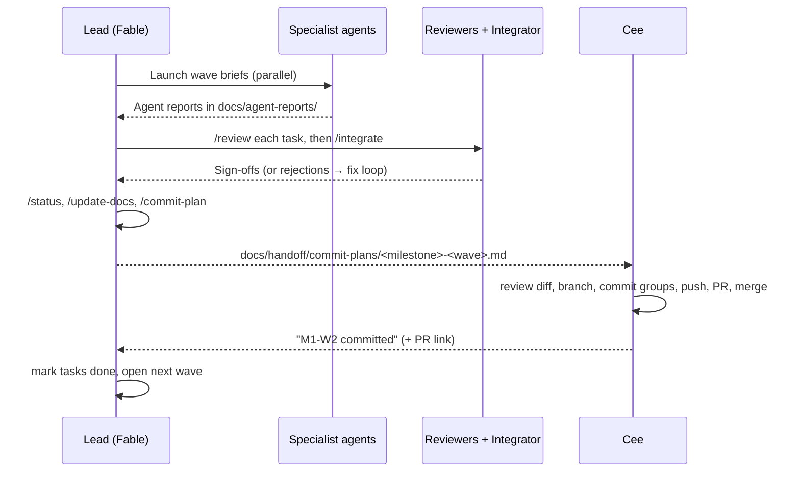

# Workflow — branches, commits and wave hand-offs

Audience: Cee (owner; performs **all** git operations) and the Fable lead/orchestrator.
Related: [AGENT_ORCHESTRATION.md](AGENT_ORCHESTRATION.md) · [FABLE_KICKOFF.md](FABLE_KICKOFF.md) · [../STATUS.md](../STATUS.md)

## 1. The golden rule

**No agent runs git.** Agents only create and edit files in the working tree. At the end of every wave the lead
produces a *commit plan*; Cee reviews the diff, commits, pushes and merges. `.claude/settings.json` denies mutating git
commands for every agent as a safety net (see [AGENT_ORCHESTRATION.md §12](AGENT_ORCHESTRATION.md#12-git-and-commit-hand-off)).

## 2. Branch strategy

| Branch | Purpose | Deploys to | Who updates it |
| --- | --- | --- | --- |
| `main` | Integration branch. Always builds; CI must be green to merge. | **Staging**: Render service `moon-cleanup-server-staging`; Vercel branch URL for `main` | Cee merges wave PRs |
| `release` | Production. Fast-forward only from `main` after `/release-checklist` passes. | **Production**: Render service `moon-cleanup-server`; Vercel production domain | Cee |
| `wave/<milestone>-<wave>-<slug>` | One per wave, e.g. `wave/m0-w1-contracts` | Vercel preview deployment per push | Cee creates, commits, opens PR → `main` |
| `hotfix/<slug>` | Urgent production fix from `release` | Preview, then production | Cee; merge into `release` **and** `main` |

Notes
- Cee may create the wave branch before the lead starts a wave or after it finishes (uncommitted changes carry over with
  `git switch -c`). Agents never need to know which branch is checked out.
- Vercel: set the project's **Production Branch** to `release` (Project Settings → Git). Every other branch gets a preview URL.
- Render: the production service tracks `release`; the staging service tracks `main` (see `render.yaml`).
- Prototype work under `prototypes/` is normally *not* committed; if Cee wants a record, commit it on a `proto/<topic>`
  branch and never merge it.

## 3. Commit conventions — Conventional Commits 1.0.0

Format: `<type>(<scope>): <imperative summary>` — summary ≤ 72 characters, lower-case, no trailing period.

- **Types:** `feat`, `fix`, `perf`, `refactor`, `test`, `docs`, `build`, `ci`, `chore`, `style`, `revert`.
- **Scopes** (match folders/packages): `client`, `server`, `shared`, `protocol`, `sim`, `world`, `game-data`, `db`,
  `config`, `render`, `terrain`, `visuals`, `anim`, `ui`, `audio`, `gameplay`, `net`, `api`, `ops`, `bots`, `perf`,
  `assets`, `tools`, `docs`, `agents`, `ci`, `deps`.
- **Body:** why the change was made; notable trade-offs.
- **Footer:** `Refs: M1-W2-T03, M1-W2-T04` (task IDs). Use `BREAKING CHANGE: ...` when a protocol/contract version bumps.
- Examples:
  - `feat(shared): add v1 protocol message catalog and sector id types`
  - `feat(terrain): stream cube-sphere terrain tiles with morphing LOD`
  - `perf(server): reuse snapshot buffers to cut per-tick allocations`
  - `docs(adr): record dust-mask atlas decision (ADR-0007)`

## 4. Wave hand-off loop

1. The lead finishes a wave only when every task is `approved` and the integrator gate passed (`/verify`, `/bot-test`,
   `/visual-check`, `/perf-check` as required).
2. The lead runs `/commit-plan`, which writes `docs/handoff/commit-plans/<milestone>-<wave>.md`: ordered commit groups
   (contracts → packages → apps → tools → assets → docs), each listing exact file paths and the commit message.
3. Cee reviews (`git status`, `git diff`), stages each group exactly as listed, commits with the given message, pushes and
   opens a PR to `main`. CI must be green; the Vercel preview link goes in the PR.
4. Cee tells the lead: *"M1-W2 committed, PR #12 merged"* (or lists anything changed by hand). The lead then marks the wave's
   tasks `done`, updates `docs/STATUS.md` and the milestone file, and only then plans the next wave.
5. If Cee rejects or edits something, tell the lead which files changed so `docs/STATUS.md` stays true.

## 5. Task status lifecycle

Task rows live in `docs/milestones/<milestone>.md`. Allowed values:

`todo` → `in-progress` → `in-review` → (`changes-requested` → `in-review`)* → `approved` → `done`

| Status | Set by | Meaning |
| --- | --- | --- |
| `in-progress` | owning agent (its own row only) | Work started |
| `in-review` | owning agent | Report written; waiting for reviewers |
| `changes-requested` | lead (from a reviewer report) | Reviewer rejected with specific fixes |
| `approved` | lead | All required reviewers signed off on this task |
| `done` | lead | The wave's integration gate passed **and** Cee confirmed the commit |

Agents edit only their own task row, using an exact-match edit of that row. If the edit fails because the file changed,
re-read and retry; never rewrite the whole file.

## 6. Releases and versions

- Game build version: SemVer `0.x.y` until v1.0 (`v0.1.0` = M0 complete, `v0.2.0` = MVP, `v1.0.0` = mechanics parity).
- The protocol version (`PROTOCOL_VERSION` in `packages/shared`) and save-format version are independent of the game version.
- Cee creates tags; the lead proposes the tag name in the commit plan for milestone-closing waves.
- Promote to production by fast-forwarding `release` to the tested `main` commit after `/release-checklist` passes.

## 7. Dependency updates

- Dependabot opens grouped weekly PRs (`.github/dependabot.yml`). Cee merges patch/minor groups after CI.
- Major version bumps of engine-level packages (three, rendering libs, netcode, ORM, Vite, TypeScript, Node) require an ADR
  and a lead-scheduled wave; Dependabot ignores those majors by default.

## 8. Large files and Git LFS

See ADR-0017 (asset storage) and `.gitattributes`. If LFS is enabled, run `git lfs install` once on your machine before
the first commit that contains binary assets (listed in [../SETUP_CHECKLIST.md](../SETUP_CHECKLIST.md)).

## 9. Things Cee should never need to do

- Resolve conflicts between agents' files — ask the lead to run `/integrate`.
- Edit `docs/STATUS.md` by hand — ask the lead to run `/status`.
- Paste secrets into any file — secrets go only into the Vercel/Render/Aiven dashboards and your local `.env` files
  (which are git-ignored).
