# M0 — Foundation (`v0.1.0`)

Direction: `docs/design/REFERENCE_TARGET.md` overrides retired naming/style/custom-gate rules.

Execution: `docs/handoff/MODEL_POLICY.md`; stages are checkpoints, not usage-window promises.

Owner: lead (structure) · Lead alone maintains task rows from actual progress ([backlog rules](README.md)).
Roadmap: [../ROADMAP.md](../ROADMAP.md) · Process: [continuous build](../handoff/WORKFLOW.md) · Ownership: [module-boundaries.md §3](../architecture/module-boundaries.md#3-file-ownership-map).

## 1. Goal

A green, deployable monorepo that every later wave can build on: tooling and CI green with real sources, contracts v0, a hello-world client on Vercel and a `/healthz` server on Render, a vendored three r187 docs snapshot, a git-blocking hook, and **three spikes that retire the biggest technical unknowns early enough to guide MVP; unrelated ready features keep progressing**: render (three.js WebGPURenderer cost on Tier A/B, Babylon revisit trigger), netcode (16 bots on a real Render Free instance at 20/10 Hz, Colyseus built-in HTTP routing on uWS) and terrain bake (NASA LOLA → height cube map). M0 also lands the first look-dev (light, sky, regolith) **before** the render spike is captured, so the spike measures the real look (real regolith material on the real baked height cube), not a stand-in, and the visual bar is tested from day one.

## 2. Exit criteria (all required for `v0.1.0`)

| # | Criterion | Verified by |
| --- | --- | --- |
| E1 | `pnpm verify` meaningful and green locally with lockfile + sources; record remote CI when Cee later pushes | `/verify`, GitHub Actions |
| E2 | Local client serves the hello-world; repeat on Vercel main when available: WebGPU boot, `?backend=webgl2` fallback, build version + backend/tier overlay, live connection to `HelloRoom` with RTT | Browser check, Playwright smoke |
| E3 | Local `/healthz` = 200, truthful DB readiness and first migration verified on isolated Postgres; repeat on the one hosted Render/Aiven service when available | SETUP_CHECKLIST: Hosted verification |
| E4 | `packages/shared` contracts v0 with version headers; ESLint import-boundary + three.js ban-list rules active | `code-reviewer`, `/verify` |
| E5 | `docs/vendor/three-r187/` snapshot with index and source URLs | `code-reviewer` |
| E6 | Git-blocking PreToolUse hook active and its command matrix test passes | hook test |
| E7 | **Render spike verdict** (performance-reviewer) with Tier A / Tier B / WebGL2 numbers measured **after look-dev v0 and on the real baked height cube** (M0-W3-T07 bench v1); Babylon revisit trigger evaluated on that run, not on the stand-in run; lead ADR written | `tools/perf/results/M0/`, review file, ADR |
| E8 | **Netcode spike verdict**: 16 bots on the one Render Free service during an isolated test-only window at 20/10 Hz (and 30/20 comparison), each hosted run ≤ 5 min (netcode §17; longer soaks run locally) with CPU %, tick p50/p95/max, event-loop p99, bytes/client; HTTP routing on uWS confirmed or fallback chosen; lead ADR | `tools/bots/results/M0/`, review file, ADR |
| E9 | **Terrain bake spike**: LDEM_16 → `height-cube-1024.bin` + `height-cube-256.bin` + manifest; slope acceptance (world-and-dust §3.3) passes; bake time/RAM and LDEM_64 extrapolation recorded | bake report |
| E10 | VT-M0-01…16 (incl. 04b grazing sun, 15 horizon-map spike, 16 fill): every V1 item passes; ≤ 3 V2 open with tickets. VT-M0-06 is calibrated **with AgX on** (noon key: albedo 0.10 / 0.33 / 0.80 → 126 / 181 / 213 ± 8; grime 0.085 vs clean 0.34 → ratio ≥ 1.45, ≥ 50 codes) | `/visual-check` M0 matrix (visual-target §6.5) |
| E11 | M0 technical checks complete; unresolved external evidence explicitly recorded; continue M1 | Compact STATUS/evidence, or integration report if useful |
| E12 | **Asset-pipeline proof**: one rock and one outpost module go from script to a budget-checked, content-hashed glTF (art-direction §13.5, ADR-0027); headless Blender 4.5.10 LTS path used (Q23 resolved) | M0-W0-T06 report |
| E13 | **Hardware (OPEN_QUESTIONS Q21, resolved):** the only device is an Intel UHD 620 laptop (below Tier B class); the render capture runs on it as a provisional below-Tier-B worst case and the Tier A/B verdicts are recorded BLOCKED until a reference device is available; **r187 verification matrix** (rendering-pipeline §21) filled PASS/FAIL on `webgpu` and `webgl2` | Hardware confirmation; M0-W2-T07 report; `tools/perf/results/M0/` |

## 3. Stage plan (dependency checkpoints; continuous execution)

| Stage | Wave | Task dependency order (MODEL_POLICY limits concurrency) | Notes |
| --- | --- | --- | --- |
| **M0-S1** | W0 | T02 → T01 (T01 launches when T02 reports), T04 in parallel | **T02 performs the FIRST install** (the one named exception to the no-install rule); contracts typecheck against it. Reuse the existing recovery note; do not repeat the install |
| **M0-S2** | W0 | T03, then T06 (asset-pipeline proof; needs T03's scripts; Blender installed, Q23 resolved), then T05 (integrator) | Verify the baseline, then continue W1; no commit wait |
| **M0-S3** | W1 | T01, T02, T03 | |
| **M0-S4** | W1 | T04, T05, then T06 (integrator) | Local client/server boot; cloud setup only when available |
| **M0-S5** | W2 | T01, T02, T03 | Spike code |
| **M0-S6** | W2 | T04, T05, T07 (r187 verification, launches after T02 reports), then T06 (integrator) | Run local spikes; arrange isolated hosted measurement when needed |
| **M0-S7** | W3 | T01, T03, T04 | Netcode spike in an isolated hosted-test window + look-dev v0 (light/sky/post + regolith material), the first work after W2 technical inputs are ready — **look-dev lands before the render capture**; the early signal comes from the bench-v0 capture in M0-W2-T06 |
| **M0-S8** | W3 | T07 and T05 in parallel, then T02 (launches when T07 reports), then T06 (integrator, milestone close) | Bench v1 on the real baked height cube + look-dev material → **render spike capture runs last, on Tier A / Tier B / WebGL2** → record findings and continue M1 |
| M0-S9 | W4 | *Contingent only*: T01 and/or T02 if a revisit trigger fired, then T03 (integrator) | lead ADR |

Stage labels express dependencies, not token budgets, usage windows or stopping points.

## 4. External inputs (not development stop gates)

Setup already passed. No commit, tag, milestone approval or cloud-deploy prerequisite for independent local work.
Ask for hardware or credentials when the affected check actually needs them; keep building other ready work.
Before a hosted spike, ask for an isolated/test-only window and NET_SPIKE=1; restore NET_SPIKE=0 afterward.
Until authorized cloud access exists, run locally and mark cloud measurements BLOCKED. Never claim local evidence as hosted proof.
Name Tier B hardware before claiming that measurement; use an explicitly accepted provisional fallback when necessary.
Cee commits/publishes only when satisfied. Final acceptance must disclose any unrun external checks.

## 5. Status table

| ID | Stage | Role | Goal | Depends on | Port | Status |
| --- | --- | --- | --- | --- | --- | --- |
| M0-W0-T01 | M0-S1 | contracts-architect | Contracts v0 in packages/shared | M0-W0-T02 | 0 | in-progress |
| M0-W0-T02 | M0-S1 | devops-engineer | Tooling config package + root configs + FIRST install/lockfile | — | 1 | changes-requested |
| M0-W0-T03 | M0-S2 | devops-engineer | Real package scripts, Vite/esbuild configs, CI lanes, NET_SPIKE + DB_SCHEMA keys, minimal bootstrap stubs (`boot.ts`, server `index.ts`) | M0-W0-T01, M0-W0-T02 | 2 | todo |
| M0-W0-T04 | M0-S1 | devops-engineer | Git-blocking hook + vendored three r187 docs snapshot | — | 3 | changes-requested |
| M0-W0-T05 | M0-S2 | integrator | M0-W0 integration: verify green, contracts consumer list (extends T03's stubs only if needed) | M0-W0-T01, M0-W0-T03, M0-W0-T04, M0-W0-T06 | 9 | todo |
| M0-W0-T06 | M0-S2 | technical-artist | Asset-pipeline proof: one rock + one outpost module, script to budget-checked hashed glTF (art-direction §13.5, ADR-0027; Q23) | M0-W0-T03 (Blender installed, Q23 resolved) | 5 | todo |
| M0-W1-T01 | M0-S3 | rendering-engineer | Renderer bootstrap: backend/tier detection, frame loop, RenderPipeline skeleton | M0-W0-T05 | 1 | todo |
| M0-W1-T02 | M0-S3 | devops-engineer | Server ops: env schema, pino logger, room-stats + bandwidth counters | M0-W0-T05 | 2 | todo |
| M0-W1-T03 | M0-S3 | backend-data-engineer | /healthz + /readyz handlers, db package skeleton + first migration | M0-W0-T05 | 3 | todo |
| M0-W1-T04 | M0-S4 | netcode-engineer | Colyseus on uWS server factory, HTTP routing, HelloRoom, client connect | M0-W0-T05 | 4 | todo |
| M0-W1-T05 | M0-S4 | qa-test-engineer | Screenshot harness v0 + `tools/screenshots/measure` (with synthetic-chart tests) + Playwright smoke e2e | M0-W0-T05 | 5 | todo |
| M0-W1-T06 | M0-S4 | integrator | M0-W1 integration: hello-world client + server composition roots | M0-W1-T01, M0-W1-T02, M0-W1-T03, M0-W1-T04, M0-W1-T05 | 9 | todo |
| M0-W2-T01 | M0-S5 | performance-profiler | F3 perf HUD, GPU timing, tools/perf capture runner | M0-W1-T06 | 1 | todo |
| M0-W2-T02 | M0-S5 | rendering-engineer | Render spike bench scene v0 (stand-in terrain, full worst-case terrain-shader stub incl. horizon-map term and camera-only velocity check) + instancing helpers + reversed-Z/WebGL2 check | M0-W1-T06 | 2 | todo |
| M0-W2-T03 | M0-S5 | netcode-engineer | Netcode spike LoadTestRoom (20/10 Hz synthetic 16-player load + metrics) | M0-W1-T06 | 3 | todo |
| M0-W2-T04 | M0-S6 | qa-test-engineer | Headless bots v0 + netsim v0 + spike-16 scenario | M0-W2-T03 | 4 | todo |
| M0-W2-T05 | M0-S6 | terrain-dust-engineer | Terrain bake spike (LDEM_16 → height cube + manifest) | M0-W1-T06 | 5 | todo |
| M0-W2-T07 | M0-S6 | rendering-engineer | r187 feature verification matrix (rendering-pipeline §21), PASS/FAIL on `webgpu` and `webgl2` | M0-W2-T02 | 6 | todo |
| M0-W2-T06 | M0-S6 | integrator | M0-W2 integration: wire perf HUD, bench route, LoadTestRoom flag; local spike runs incl. the early bench-v0 capture | M0-W2-T01, M0-W2-T02, M0-W2-T03, M0-W2-T04, M0-W2-T05, M0-W2-T07 | 9 | todo |
| M0-W3-T01 | M0-S7 | qa-test-engineer | Run netcode spike on the one Render Free service during an isolated test-only window (20/10 and 30/20) | M0-W2-T06, isolated hosted-test access | 4 | todo |
| M0-W3-T02 | M0-S8 | performance-profiler | Second capture (gates ADR-0003): render spike matrix on Tier A / Tier B / WebGL2 **on bench v1 (after look-dev v0)**, incl. a `webgl2` capture of the real terrain shader | M0-W3-T03, M0-W3-T04, M0-W3-T07 | 1 | todo |
| M0-W3-T03 | M0-S7 | technical-artist | Look-dev v0: sun + CSM rig, sky, stars, Earth placeholder, post look; grazing-sun (VT-M0-04b), horizon-map spike (VT-M0-15), fill (VT-M0-16) | M0-W2-T06 | 3 | todo |
| M0-W3-T04 | M0-S7 | technical-artist | Regolith/dust material v0 with mask input, berm, albedo chart calibrated with AgX on | M0-W2-T06 | 6 | todo |
| M0-W3-T05 | M0-S8 | ui-ux-motion-designer | Design tokens v0, UI root, HUD crispness test page, waking overlay | M0-W2-T06 | 7 | todo |
| M0-W3-T06 | M0-S8 | integrator | M0 closing integration: full gates, VT-M0 matrix, release checklist v0.1.0 | M0-W3-T01, M0-W3-T02, M0-W3-T03, M0-W3-T04, M0-W3-T05, M0-W3-T07 | 9 | todo |
| M0-W3-T07 | M0-S8 | rendering-engineer | Bench v1: real regolith material + real baked height cube in the bench scene (render-spike input) | M0-W3-T03, M0-W3-T04, M0-W2-T05, M0-W2-T06 | 2 | todo |
| M0-W4-T01 | M0-S9 | rendering-engineer | *Contingent*: Babylon 9 bench prototype (render revisit trigger) | M0-W3-T02 | 2 | todo |
| M0-W4-T02 | M0-S9 | netcode-engineer | *Contingent*: custom uWS edge prototype (netcode revisit trigger) | M0-W3-T01 | 3 | todo |
| M0-W4-T03 | M0-S9 | integrator | *Contingent*: run prototype benchmarks, re-run M0 gates after the ADR | M0-W4-T01 or M0-W4-T02 | 9 | todo |

## 6. Task DAG

```mermaid
flowchart LR
  subgraph W0["M0-W0 contracts + tooling (S1-S2)"]
    W0T02[T02 config + FIRST install] --> W0T01[T01 contracts v0]
    W0T01 --> W0T03[T03 scripts/Vite/CI + boot stubs]
    W0T02 --> W0T03
    W0T04[T04 git hook + three docs]
    W0T03 --> W0T06[T06 asset-pipeline proof]
    W0T01 & W0T03 & W0T04 & W0T06 --> W0T05{{T05 integrate}}
  end
  subgraph W1["M0-W1 hello world (S3-S4)"]
    W1T01[T01 renderer bootstrap]
    W1T02[T02 server ops]
    W1T03[T03 health + db]
    W1T04[T04 Colyseus/uWS + HelloRoom]
    W1T05[T05 screenshot harness + smoke]
    W1T01 & W1T02 & W1T03 & W1T04 & W1T05 --> W1T06{{T06 integrate}}
  end
  subgraph W2["M0-W2 spikes: code (S5-S6)"]
    W2T01[T01 perf HUD + tools/perf]
    W2T02[T02 render bench scene]
    W2T03[T03 LoadTestRoom]
    W2T03 --> W2T04[T04 bots + netsim]
    W2T05[T05 terrain bake spike]
    W2T02 --> W2T07[T07 r187 verification]
    W2T01 & W2T02 & W2T04 & W2T05 & W2T07 --> W2T06{{T06 integrate}}
  end
  subgraph W3["M0-W3 spike runs + look-dev (S7-S8)"]
    W3T01[T01 netcode spike on Render]
    W3T03[T03 light/sky/post v0]
    W3T04[T04 regolith material v0]
    W3T03 & W3T04 --> W3T07[T07 bench v1: real material + height cube]
    W3T07 --> W3T02[T02 render spike captures]
    W3T05[T05 UI tokens + crispness page]
    W3T01 & W3T02 & W3T03 & W3T04 & W3T05 & W3T07 --> W3T06{{T06 close M0}}
  end
  W0T05 --> W1T01 & W1T02 & W1T03 & W1T04 & W1T05
  W1T06 --> W2T01 & W2T02 & W2T03 & W2T05
  W2T06 --> Hosted[/Isolated hosted-test access for this measurement only/]
  Hosted --> W3T01
  W2T05 --> W3T07
  W2T06 --> W3T03 & W3T04 & W3T05
  W3T02 -.trigger.-> W4T01[W4-T01 Babylon proto]
  W3T01 -.trigger.-> W4T02[W4-T02 custom uWS proto]
```

## 7. Task cards

### M0-W0 — Contracts first + tooling

#### M0-W0-T01 — Contracts v0 in `packages/shared`
- **Stage** M0-S1 (launch after T02 reports) · **Role** `contracts-architect` · **Port** 0 · **Status** `todo` (authoritative value in §5)
- **Goal:** the minimal, versioned contracts that M0 code compiles against, and the folder/sub-barrel layout that M1 extends.
- **Owned files:** `packages/shared/src/**`, `packages/shared/tsconfig.json`, `packages/shared/vitest.config.ts` (if needed), `packages/shared/README.md`. **Not** `packages/shared/package.json` (T03 wires its scripts; dependencies unchanged; no installs).
- **Read first:** module-boundaries §1–§2, §4–§5; netcode.md §2, §4.1, §10, §12–§13, §15; data-model.md §6; rendering-pipeline §14 (canonical presets); environments.md §9 (names only); `packages/shared/README.md`.
- **Input contracts:** none (this task creates them).
- **Depends on:** M0-W0-T02 (node_modules + the repo-root `tsconfig.base.json` that `packages/shared/tsconfig.json` extends).
- **Acceptance criteria:**
  - [ ] Root `src/index.ts` re-exports one sub-barrel per folder listed in module-boundaries §2 (`ids`, `units`, `protocol`, `sim`, `world`, `events`, `client`, `ui`, `audio`, `render`, `config`, `api`, `save`); T01 **creates the `units/` folder** (the scaffold has none); every contract file starts with a header `@contract <name> v0`.
  - [ ] `ids`/`units`: branded `PlayerId`, `PlotId`, `EntityId`, `ContractId`; unit aliases (metres, seconds, kg, Lumens).
  - [ ] `protocol`: **first deliverable of the task: the single `protocol/messages.ts` message catalog** (every message ID, direction, channel; netcode §4.1/§4.3; WDS dust IDs `0x21–0x24` and `DUST_REQUEST 0x03`), written **before any codec**; then `PROTOCOL_VERSION = 0`, channel enum (schema vs bytes), M0 messages only: `HELLO` handshake, `PING`/`PONG`, close codes 4100 (protocol mismatch) and 4105 (server full) as constants; M0 spike payload type IDs reserved (netcode §4.1/§15). The protocol version travels in the **join options** and `onAuth` rejects a mismatch (netcode §13); `HELLO` is the first message sent after join, not the version check.
  - [ ] `client/module.ts`: `ClientModule { id; init(ctx); update(frame); resize?(); dispose() }`, `FrameInfo { dt, time, alpha, simTick, quality }`, typed `ServiceRegistry` keys for renderer, scene roots, event bus, UI store, input, net session, sim, asset loader, quality (module-boundaries §4). Service types are **opaque interfaces; no `three`/Colyseus types** may appear in `shared`.
  - [ ] `events/catalog.ts`: typed event-bus interface + M0 events (`net.status` with the states from netcode §10, `render.backendSelected`, `quality.changed`).
  - [ ] `render/quality.ts`: Low/Medium/High/Ultra knob type + default values from rendering-pipeline §14 (shadows, post, dynres range, DPR cap).
  - [ ] `api/rest.ts`: `HealthResponse`, `ReadyResponse`, and a transport-neutral `HttpRouteDef { method, path, handle }` so API handlers do not import Colyseus/uWS.
  - [ ] `save/format.ts`: `SAVE_FORMAT_VERSION = 0`, header shape incl. `bakeHash` (data-model §6); `world/`, `sim/`, `ui/`, `audio/`, `config/` exist with v0 placeholder types only.
  - [ ] Package imports nothing from the workspace (module-boundaries §1 rule 2); zod only; `pnpm exec tsc -p packages/shared/tsconfig.json` and `pnpm exec vitest run --root packages/shared` exit 0 (the base config has `noEmit`; schema tests for env-free zod schemas present). The package `typecheck`/`test` scripts are wired by T03, after which `pnpm --filter @moon-cleanup/shared typecheck` is also green.
- **Visual acceptance:** n/a.
- **Applicable review lenses (lead selects for risk/final review):** `code-reviewer`, `netcode-security-reviewer`.
- **Definition of done:** Standard DoD + consumer list for each contract written in the report.

#### M0-W0-T02 — Tooling config package, root configs, first install
- **Stage** M0-S1 · **Role** `devops-engineer` · **Port** 1 · **Status** `todo`
- **Goal:** shared lint/type/test/format presets and a reproducible install so every package can run real gates.
- **Owned files:** `packages/config/**`, root `package.json`, `pnpm-lock.yaml` (created), `pnpm-workspace.yaml`, `tsconfig.base.json`, `turbo.json`, root `eslint.config.*`, root `vitest.config.*`, root Prettier files, `.nvmrc`, `.prettierignore`, `.editorconfig`, `.gitignore`, `.gitattributes`.
- **Installer: yes.** This is the **one named exception** to the no-install rule: `devops-engineer` in M0-W0-T02 performs the FIRST `pnpm install`; later installs are sequential through the designated devops writer when needed.
- **Read first:** tech-stack.md §4; module-boundaries §1 (rules 1–6); rendering-pipeline §18 (ban-list row); ADR-0001; SETUP_CHECKLIST §2.6 (the agent creates the lockfile; Cee reviews it).
- **Input contracts:** none.
- **Depends on:** setup (already complete).
- **Acceptance criteria:**
  - [ ] `packages/config` exports the ESLint flat config, Vitest presets (node, browser-mode placeholder; root `vitest.config.*`, no deprecated `vitest.workspace`) and the Prettier config. **TypeScript compiler options stay in the single repo-root `tsconfig.base.json`** (strict, `noUncheckedIndexedAccess`, ESM, `noEmit`); **no project references in M0** — Turbo `^typecheck` ordering over source-exported barrels gives the needed order. `packages/config` gets `@types/node` 26.6.6 in devDependencies (ADR-0001) so its own typecheck passes.
  - [ ] ESLint `no-restricted-imports` enforces module-boundaries §1: packages never import apps/tools; `shared` imports nothing; `sim|world|protocol|shared` cannot import DOM libs, Node built-ins, `three`, `colyseus*`; client cannot import `@moon-cleanup/db`; server cannot import `three`; deep imports `@moon-cleanup/*/src/**` banned.
  - [ ] three.js ban-list: `WebGLRenderer`, `EffectComposer`, `three/examples/jsm/postprocessing/*`, `ShaderMaterial`, `RawShaderMaterial`, `onBeforeCompile`, `PCFSoftShadowMap`, `renderAsync`, `RGBELoader`, `Clock`, `PostProcessing`, R3F and `postprocessing` imports — each with a fixture test proving the rule fires.
  - [ ] `pnpm install` (pnpm 11.28.9, Node 26.13.1) produces `pnpm-lock.yaml` with exact versions from existing manifests; ignored build scripts listed in the report for Cee (`pnpm approve-builds`); Chromium for Playwright is downloaded once (`pnpm exec playwright install chromium`) so M0-W1-T05 can run specs without installing anything (report it as blocked if the download fails).
  - [ ] `pnpm lint`, `pnpm typecheck`, `pnpm test` exit 0 on the scaffold **and** `pnpm exec eslint packages/config` plus the ban-list/boundary fixture suite exit 0 (the package scripts are still `echo` in S1, so the fixture suite is what proves the config).
- **Visual acceptance:** n/a.
- **Applicable review lenses (lead selects for risk/final review):** `code-reviewer`, `netcode-security-reviewer` (supply chain: lockfile, build scripts).
- **Definition of done:** Standard DoD + note in report of every dependency whose postinstall was blocked.

#### M0-W0-T03 — Package scripts, Vite/esbuild configs, CI lanes, `NET_SPIKE` key
- **Stage** M0-S2 · **Role** `devops-engineer` · **Port** 2 · **Status** `todo`
- **Goal:** every workspace package runs real `lint/typecheck/test/build/dev` scripts; client builds with Vite, server bundles to `apps/server/dist/index.js`; CI runs gates and a software-WebGL2 smoke lane.
- **Owned files:** `scripts` fields of every `apps/*/package.json`, `packages/*/package.json` (except `packages/config`), `tools/*/package.json`, `tests/e2e/package.json` (lead-delegated, scripts only); `apps/client/vite.config.ts`, `apps/client/index.html`, `apps/client/src/main.ts` (one-line import of `./app/boot`), `apps/server/build.config.*` (lead-delegated); **minimal bootstrap stubs `apps/client/src/app/boot.ts` and `apps/server/src/app/index.ts` (lead-delegated; the integrator replaces/extends them in M0-W1-T06)**; `.github/**`; `render.yaml`; `vercel.json`; `**/.env.example`.
- **Read first:** environments.md §2, §4, §6, §7, §9; performance-budgets §5, §8 (CI size check); ADR-0019; `.github/workflows/ci.yml`; `render.yaml`; `vercel.json`.
- **Owner run contract:** [README localhost/test steps](../../README.md#run-on-localhost); keep these commands and env-file locations accurate. The [hosting guide](../HOSTING_GUIDE.md) is an on-demand connection walkthrough, not required startup reading.
- **Input contracts:** `packages/shared` v0 (M0-W0-T01).
- **Depends on:** M0-W0-T01, M0-W0-T02.
- **Acceptance criteria:**
  - [ ] Placeholder `echo` scripts replaced; `pnpm verify` green with the contracts sources present; `pnpm --filter @moon-cleanup/client build` → `apps/client/dist`; server build (entry `apps/server/src/app/index.ts`) → `apps/server/dist/index.js` (esbuild, Node 26 target, uWS native binding external). The two stubs are no-op: `boot.ts` exports `boot(): void {}` and the server `index.ts` is an empty-safe entry that logs a one-line placeholder and exits 0; no logic, no imports beyond `@moon-cleanup/shared` types if needed.
  - [ ] Vite config: `VITE_*` env only, source maps on, dev port `5173+N` via `--port`, no COOP/COEP. `apps/client/index.html` has `<title>Clean The Moon!</title>` (exact owner title, non-negotiable).
  - [ ] Local client dev reads `apps/client/.env.local`; server dev explicitly loads `apps/server/.env` before env validation. Migration/seed scripts use a documented env-loading path locally and injected env on Render. Do not assume Node/Turbo automatically loads env files or log secret values. Keep root `pnpm dev` and separate filtered commands usable as real app boot lands in W1.
  - [ ] CI: gated jobs run lint/typecheck/test/build; new job `smoke-webgl2` (Playwright, software WebGL2) runs `tests/e2e` smoke with `--pass-with-no-tests` (the smoke spec arrives in M0-W1-T05; the job must not fail on an empty suite in W0); first-load size check fails if the first-load group > 20 MB; the ci.yml lockfile comment is already updated (pre-kickoff cleanup); keep it accurate.
  - [ ] Inspect/reuse the existing single-service `render.yaml`: branch main, `NET_SPIKE="0"`, `DB_SCHEMA=prod`, `NODE_OPTIONS=--max-old-space-size=384`, `MAX_ROOMS=3`, `TICK_BUDGET_MS=3.5` and `CLIENT_IP_HEADER=true-client-ip` (proxy handling verified in M0-W3-T01). The server env template already includes `NET_SPIKE` and local memory defaults. No second staging service. Required values/defaults match HOSTING_GUIDE and the canonical env list.
  - [ ] No installs performed (T02 did the first one; any extra dependency need is listed in the report for the designated installer when needed).
- **Visual acceptance:** n/a.
- **Applicable review lenses (lead selects for risk/final review):** `code-reviewer`, `netcode-security-reviewer` (render.yaml/env), `performance-reviewer` (bundle/size check).
- **Definition of done:** Standard DoD.

#### M0-W0-T04 — Git-blocking hook + vendored three r187 docs
- **Stage** M0-S1 · **Role** `devops-engineer` · **Port** 3 · **Status** `todo`
- **Goal:** a PreToolUse hook that blocks state-changing git in every agent session (belt-and-braces with `.claude/settings.json` deny rules), and an offline three r187 docs snapshot agents read instead of guessing APIs.
- **Owned files:** `.claude/hooks/**` and the `hooks` block of `.claude/settings.json` (lead-delegated; do not touch `permissions`); `docs/vendor/three-r187/**` (lead-delegated).
- **Read first:** CLAUDE.md "NEVER"; WORKFLOW; `.claude/settings.json`; rendering-pipeline §18, §20 (items 4, 5); tech-stack §4; `docs/research/tech/rendering-case-threejs.md` "Sources" [5], [9], [16], [17].
- **Input contracts:** none.
- **Depends on:** setup (already complete).
- **Acceptance criteria:**
  - [ ] Hook script `.claude/hooks/block-git.mjs` (Node, no dependencies) is registered as `"command": "node \"$CLAUDE_PROJECT_DIR/.claude/hooks/block-git.mjs\""` for the `Bash` and `PowerShell` matchers (quoting works on Windows and after the folder rename); it reads the PreToolUse JSON from stdin and exits 2 with a reason when a command contains a mutating git subcommand: `add, commit, push, pull, fetch, checkout, switch, restore, branch, worktree, reset, rebase, merge, cherry-pick, revert, stash, tag, init, remote, clean, rm, mv, am`, also inside chains (`&&`, `||`, `;`, `|`, newlines, `$(…)`), with `git -C`/`-c`/env prefixes, and `git.exe`.
  - [ ] Read-only `git status|diff|log|show|rev-parse|ls-files` are allowed, and so is read-only text that merely contains the words (≥ 5 quoted-string/grep allow cases such as `grep -rn "git commit" docs` and `echo "never git push"`).
  - [ ] Matrix test (`node --test ".claude/hooks/*.test.mjs"`) with ≥ 40 allow/deny cases passes, including both live examples (`git status` allowed; `cd x && git commit -m y` denied) piped as PreToolUse JSON into the script. **No agent runs a real `git commit` to test the hook.** Hooks added mid-session activate on the next session. Test command strings as piped JSON; never invoke a real git mutation or create a stage-stop for this check.
  - [ ] `docs/vendor/three-r187/` contains, **fetched from the `r187` tag** (`https://raw.githubusercontent.com/mrdoob/three.js/r187/...` for examples, manual and docs sources/`llms.txt`; the three.js wiki Migration Guide for the r180–r187 sections only; the `master` URLs in the research doc are *not* used): `llms.txt` (+ full variant if published), Migration Guide entries r180–r187, docs pages for `WebGPURenderer`, `RenderPipeline`, `CSMShadowNode`, `BatchedMesh`, `InstancedMesh`, `StorageTexture`, the TSL reference (the TSL wiki page plus the manual page), and example sources `webgpu_postprocessing_ao`, `webgpu_lights_clustered`, `webgpu_shadowmap_csm`, `webgpu_postprocessing_bloom`, `webgpu_compute_texture`, `webgpu_postprocessing_traa`, `webgpu_postprocessing_smaa`; HTML pages are stored as converted Markdown or raw source; `README.md` index with source URL, retrieval date, three's MIT notice; total ≤ 5 MB.
- **Visual acceptance:** n/a.
- **Applicable review lenses (lead selects for risk/final review):** `code-reviewer`, `netcode-security-reviewer` (hook is a safety control).
- **Definition of done:** Standard DoD (`.claude/hooks/**` and `docs/vendor/**` are already in module-boundaries §3). Expect **one approval prompt** for the `.claude/settings.json` hooks edit.

#### M0-W0-T06 — Asset-pipeline proof: one rock, one outpost module
- **Stage** M0-S2 (after T03 reports) · **Role** `technical-artist` · **Port** 5 · **Status** `todo`
- **Goal:** retire the biggest art-production unknown in M0: prove that original 3D assets go from a script (headless Blender 4.5.10 LTS, installed) to a budget-checked, content-hashed glTF the client can load (art-direction §13, decision D5 / OPEN_QUESTIONS Q23, ADR-0027 3D art path).
- **Owned files:** `tools/asset-pipeline/src/**`, `assets/models/**` (source scripts + the two proof assets; blockout dirs), `docs/ASSET_LICENSES.md` rows (append only). `scripts` fields stay with M0-W0-T03; if `assets:build` / `assets:check` must change, the task reports it for the integrator.
- **Read first:** art-direction §11–§13 (esp. §13.1 sources, §13.3 quality bar, §13.5 order of work); ADR-0027 (3D art path), ADR-0028 (dependency policy), ADR-0013, ADR-0017; tools/asset-pipeline/README; asset-and-data-licensing §1; performance-budgets §4 (asset budgets).
- **Input contracts:** none. **Cee input:** Q23 resolved — Blender 4.5.10 LTS installed; path in OPEN_QUESTIONS Q23 and M0-W0 §8.2.
- **Depends on:** M0-W0-T03 (package scripts), Blender installed (Q23 resolved).
- **Acceptance criteria:**
  - [ ] One rock (rock-kit class) and one outpost module (hard-surface class) produced from source scripts (headless Blender; Node procedural modelling only as a documented fallback if Blender fails), exported as glTF 2.0, processed with glTF-Transform (meshopt; KTX2 only if the `ktx` CLI is installed, otherwise the report states the missing tool and which step was skipped).
  - [ ] Output file names are content-hashed with a `manifest.json` (asset-validation.yml contract); `assets:check` budget checker passes on both assets and fails on a deliberately oversize fixture.
  - [ ] Both assets meet the art-direction §13.3 measurable bar or the report lists exactly which numbers miss and why; one 1080p turntable each (noon + night-near) via the harness.
  - [ ] Throughput report: wall time per asset, source-to-hashed-output steps, what a human must do by hand; verdict feeds the ADR-0027 follow-up and M1 task estimates (M1-W3-T07, M1-W4-T07).
  - [ ] Licence rows added to `docs/ASSET_LICENSES.md`; no external asset used.
- **Visual acceptance:** VT-M1-35 method previewed on both assets (turntables); not an M0 V1 item.
- **Applicable review lenses (lead selects for risk/final review):** `code-reviewer`, `visual-qa-reviewer`.
- **Definition of done:** Standard DoD + a short report section "Pipeline proof verdict".

#### M0-W0-T05 — M0-W0 integration
- **Stage** M0-S2 · **Role** `integrator` · **Port** 9 · **Status** `todo`
- **Goal:** prove the contracts + tooling baseline is green and record the consumer list for M0-W1.
- **Owned files:** `apps/client/src/app/**`, `apps/server/src/app/**` (extends the T03 stubs `boot.ts` / `index.ts` only if typecheck needs it), `docs/agent-reports/M0-W0-integration.md`.
- **Read first:** WORKFLOW; all M0-W0 reports.
- **Input contracts:** `packages/shared` v0.
- **Depends on:** M0-W0-T01, M0-W0-T03, M0-W0-T04, M0-W0-T06.
- **Acceptance criteria:**
  - [ ] Required W0 technical inputs implemented; `/verify` PASS; ban-list and boundary fixtures fire.
  - [ ] Integration report lists gates (verify only; bot/visual/perf = n/a in W0) and the frozen contract versions for W1.
- **Visual acceptance:** n/a.
- **Applicable review lenses (lead selects for risk/final review):** `code-reviewer` (if any app stub was written).
- **Definition of done:** implemented and meaningfully verified; continue ready work without waiting for commits.

### M0-W1 — Hello world end to end

#### M0-W1-T01 — Renderer bootstrap
- **Stage** M0-S3 · **Role** `rendering-engineer` · **Port** 1 · **Status** `todo`
- **Goal:** a `render` ClientModule that boots three r187 `WebGPURenderer` (auto WebGL2), picks a tier and preset, runs the frame loop and an HDR `RenderPipeline` skeleton with AgX output.
- **Owned files:** `apps/client/src/render/**`.
- **Read first:** rendering-pipeline §2, §3.1, §4, §8.1, §9 (interface only), §14 (canonical presets), §18; performance-budgets §1; `docs/vendor/three-r187/` (WebGPURenderer, RenderPipeline, Migration Guide); module-boundaries §4.
- **Input contracts:** `shared/client/module.ts`, `shared/render/quality.ts`, `shared/events/catalog.ts` (v0).
- **Depends on:** M0-W0-T05.
- **Acceptance criteria:**
  - [ ] `render/backend.ts` implements the §2.1 detection procedure; `?backend=webgpu|webgl2` override; result emitted as `render.backendSelected` with tier (A/B/C) and default preset (§2.3).
  - [ ] `await renderer.init()` then `render()` (no `renderAsync`); HDR half-float target; AgX tone map; output color transform per vendored docs; DPR cap per tier; resize handling.
  - [ ] Frame orchestration calls modules in module-boundaries §4 order via the registry; per-module `performance.mark` spans named `mc:<module>:update`.
  - [ ] Device-lost / context-lost handler recreates the renderer (unit-tested with a mock).
  - [ ] Unit tests for detection/tier logic with mocked adapters; zero ban-list violations.
- **Visual acceptance:** VT-M0-01 (black clear, no gradient) and VT-M0-09 smoke (test mesh renders identically on WebGPU and `?backend=webgl2`, no errors).
- **Applicable review lenses (lead selects for risk/final review):** `code-reviewer`, `visual-qa-reviewer`, `performance-reviewer`.
- **Definition of done:** Standard DoD.

#### M0-W1-T02 — Server ops: env, logger, room-stats, bandwidth counters
- **Stage** M0-S3 · **Role** `devops-engineer` · **Port** 2 · **Status** `todo`
- **Goal:** the server's operational spine: validated env, structured logs, and the counters that make the 5 GB/month egress visible.
- **Owned files:** `apps/server/src/ops/**`.
- **Read first:** environments.md §7.2, §9; performance-budgets §6, §6.2; netcode.md §14, §16; ADR-0020; security.md §7.
- **Input contracts:** `shared` v0 (ids).
- **Depends on:** M0-W0-T05.
- **Acceptance criteria:**
  - [ ] zod env schema for the canonical server env list incl. `NET_SPIKE`, `DB_SCHEMA` (default `prod`), `SIM_TICK_HZ`, `SNAPSHOT_HZ`, `MAX_ROOMS` (default **3** = hard ceiling, per netcode §15 / performance-budgets §6 / render.yaml), `TICK_BUDGET_MS` (default 3.5), `CLIENT_IP_HEADER` (default `true-client-ip`), `ALLOWED_ORIGINS` (comma list), secrets marked and never logged; boot fails fast with a readable error.
  - [ ] pino 10 logger factory (JSON in prod, pretty in dev), `BUILD_VERSION`/`RENDER_GIT_COMMIT` fields, redaction of tokens/URIs.
  - [ ] `RoomStats` API: per-room tick timings (p50/p95/max), clients, bytes out per message type, CPU % (`process.cpuUsage` vs 0.1-CPU quota), event-loop delay p99 (`monitorEventLoopDelay`); emits one line/room/min (every 10 s when `NET_SPIKE=1`).
  - [ ] Process-wide bytes-out counter with a month-to-date running total logged hourly (owner accepted no cap logic, OPEN_QUESTIONS Q4).
  - [ ] Unit tests for env parsing, redaction and stats math.
- **Visual acceptance:** n/a.
- **Applicable review lenses (lead selects for risk/final review):** `code-reviewer`, `netcode-security-reviewer`, `performance-reviewer` (counters on the tick path).
- **Definition of done:** Standard DoD.

#### M0-W1-T03 — `/healthz` + `/readyz`, db package skeleton, first migration
- **Stage** M0-S3 · **Role** `backend-data-engineer` · **Port** 3 · **Status** `todo`
- **Goal:** health endpoints Render can probe, and a Drizzle/Postgres package whose migrate step works in the Render build against Aiven.
- **Owned files:** `apps/server/src/api/**`, `packages/db/**`.
- **Read first:** data-model.md §1, §3.12, §8, §9; environments.md §6; security.md §4.1, §7; ADR-0016; netcode.md §16 (DB row).
- **Input contracts:** `shared/api/rest.ts` v0 (`HttpRouteDef`, `HealthResponse`, `ReadyResponse`).
- **Depends on:** M0-W0-T05.
- **Acceptance criteria:**
  - [ ] Handlers exported as `HttpRouteDef[]` (no Colyseus/uWS import): `GET /healthz` (always 200 if the process is up, < 5 ms, no DB call), `GET /readyz` (DB reachable / powered-off / not-configured, cached ≤ 10 s).
  - [ ] `packages/db`: Drizzle config, lazy connection factory with TLS using `DATABASE_CA_CERT`, retry/backoff 1 → 30 s on power-off, `migrate` script that succeeds with zero pending migrations. **`DB_SCHEMA` (`prod` | `staging`)** selects a Postgres schema via Drizzle `pgSchema` / `search_path`; production uses `prod` (ADR-0029) and `staging` stays a valid but unused value; the migration creates the schema if missing and runs inside it.
  - [ ] First migration: `ops_usage_daily` per data-model §3.12 (generated SQL committed), created in the schema named by `DB_SCHEMA`; `/readyz` reports the active schema name.
  - [ ] Tests: handler tests; migration applies to a local Postgres schema `_a3` when `DATABASE_URL` is set, skipped (not failed) otherwise.
- **Visual acceptance:** n/a.
- **Applicable review lenses (lead selects for risk/final review):** `code-reviewer`, `netcode-security-reviewer`.
- **Definition of done:** Standard DoD.

#### M0-W1-T04 — Colyseus on uWS, HTTP routing, HelloRoom, client connect
- **Stage** M0-S4 · **Role** `netcode-engineer` · **Port** 4 · **Status** `todo`
- **Goal:** a server factory that serves rooms **and** HTTP routes from one Node process on the uWebSockets transport, plus a client session that probes, wakes and joins.
- **Owned files:** `apps/server/src/net/**`, `apps/client/src/net/**`.
- **Read first:** netcode.md §1–§3, §9.3, §10, §12–§13; security.md §4.1–§4.2; tech-stack §3 and REST row; ADR-0014, ADR-0015.
- **Input contracts:** `shared/protocol` v0, `shared/api/rest.ts` v0 (`HttpRouteDef`), `shared/client/module.ts`.
- **Depends on:** M0-W0-T05.
- **Acceptance criteria:**
  - [ ] `createGameServer({ port, routes, allowedOrigins, logger })` builds Colyseus 0.18 on `@colyseus/uwebsockets-transport` and mounts `HttpRouteDef[]` through **Colyseus' built-in HTTP routing on uWS**; if that path is not workable, plain uWS handlers are used and the report says why (feeds the M0 netcode ADR).
  - [ ] CORS for REST/matchmake and WebSocket origin check per security §4.1–§4.2 (tests for allowed/denied origins).
  - [ ] `HelloRoom`: guest join, `HELLO` with `PROTOCOL_VERSION` (mismatch → close 4100), `PING`/`PONG` RTT; `@colyseus/testing` tests.
  - [ ] Client `net` module: `/healthz` probe every 3 s → states `asleep → waking → connecting → connected → lost`, emits `net.status`; joins `HelloRoom` and reports RTT.
  - [ ] Graceful shutdown hook (`gracefullyShutdown`) exposed for the composition root.
  - [ ] Colyseus 0.18 verifications recorded in the report (netcode §18): `exposedMethods` / `reserveSeatFor` behave as the REST-only join flow needs (ADR-0025); automatic patching off with manual `broadcastPatch()` and write coalescing confirmed.
- **Visual acceptance:** n/a.
- **Applicable review lenses (lead selects for risk/final review):** `code-reviewer`, `netcode-security-reviewer`.
- **Definition of done:** Standard DoD.

#### M0-W1-T05 — Screenshot harness v0 + Playwright smoke
- **Stage** M0-S4 · **Role** `qa-test-engineer` · **Port** 5 · **Status** `todo`
- **Goal:** the capture tool every visual review depends on, and a smoke test CI can run without a GPU.
- **Owned files:** `tools/screenshots/**` (harness; scene list file left for `visual-qa-reviewer`), `tests/e2e/**`.
- **Read first:** visual-target §6.1–§6.7 (naming, measure tool, `index.md`); rendering-pipeline §16, §19 (backend detection row); ADR-0019.
- **Input contracts:** URL params `?scene=`, `?backend=`, `?preset=`, `?dpr=` (documented in the report for the integrator).
- **Depends on:** M0-W0-T05.
- **Acceptance criteria:**
  - [ ] Two lanes: CI (Chromium, software WebGL2) and local real-GPU (headed Chrome, WebGPU), selected by flag.
  - [ ] Captures follow §6.6 naming; PNG pixel size = output × DPR; one sidecar JSON per PNG (scene, tier, preset, backend, DPR, commit, frame-time sample, `texPoolMB` placeholder).
  - [ ] Waits for a "frame ready" signal (`window.__mcReady`) instead of fixed sleeps.
  - [ ] `tools/screenshots/measure`: luma patches, 10–90 % edge width, Sobel sharpness, b*, PNG disk size, star count, temporal variance between frames; each measure has a **synthetic-chart test** (known chart in, known number out); results are written to the sidecar JSON and to a generated `index.md` per run (replaces `REVIEW.md`).
  - [ ] **Frame-stepped deterministic capture mode** (fixed dt, fixed seed, N frames advanced before capture) and **turntable capture** (8 views, noon + night-near) for VT-M1-35.
  - [ ] `tests/e2e/smoke.spec.ts`: page loads, canvas non-black, backend logged, `/healthz` reachable when a server URL is configured.
- **Visual acceptance:** VT-M0-12 (harness output format, measure tool passes its own tests on synthetic charts).
- **Applicable review lenses (lead selects for risk/final review):** `code-reviewer`, `visual-qa-reviewer`.
- **Definition of done:** Standard DoD.

#### M0-W1-T06 — M0-W1 integration: hello-world client + server
- **Stage** M0-S4 · **Role** `integrator` · **Port** 9 · **Status** `todo`
- **Goal:** deployable hello world: client boots render + net and shows version/backend/server status; server boots env → logger → routes → game server → listen.
- **Owned files:** `apps/client/src/app/**`, `apps/server/src/app/**` (incl. the entry built to `dist/index.js`), `docs/agent-reports/M0-W1-integration.md`.
- **Read first:** module-boundaries §4–§5; netcode.md §9.3; WORKFLOW.
- **Input contracts:** all M0-W1 module exports.
- **Depends on:** M0-W1-T01 … T05.
- **Acceptance criteria:**
  - [ ] Client composition root: `ServiceRegistry`, module order per §4, DOM overlay (build version, backend, tier, preset, server state + RTT), error boundary, `window.__mcReady`.
  - [ ] Server composition root: boot ≤ 5 s of our code, lazy DB, SIGTERM drain ≤ 25 s, `/healthz` live before rooms.
  - [ ] Gates: `/verify` PASS; Playwright smoke PASS; local client ↔ server join with RTT shown; harness captures the hello scene on both backends.
- **Visual acceptance:** VT-M0-01, VT-M0-09 smoke re-checked after wiring.
- **Applicable review lenses (lead selects for risk/final review):** `code-reviewer`, `netcode-security-reviewer` (server boot/shutdown).
- **Definition of done:** implemented and meaningfully verified; continue ready work without waiting for commits.

### M0-W2 — Spikes (code)

#### M0-W2-T01 — F3 perf HUD, GPU timing, `tools/perf` capture runner
- **Stage** M0-S5 · **Role** `performance-profiler` · **Port** 1 · **Status** `todo`
- **Goal:** the measurement instruments for the render spike and every later `/perf-check`.
- **Owned files:** `apps/client/src/debug/**`, `tools/perf/**` (incl. `tools/perf/results/**`).
- **Read first:** performance-budgets §2–§4, §8, §9; rendering-pipeline §3, §13, §17, §19; vendored three docs (timestamp queries).
- **Input contracts:** `shared/client/module.ts`; render module services (renderer info, pass list) from M0-W1-T01.
- **Depends on:** M0-W1-T06.
- **Acceptance criteria:**
  - [ ] F3 HUD (DOM, crisp at any DPR): FPS, frame p50/p95, CPU ms per module (from `mc:*` spans), GPU ms per pass (WebGPU `timestamp-query`; WebGL2 `EXT_disjoint_timer_query_webgl2` when present; else "CPU only"), draw calls, triangles, GPU memory ledger total, backend/tier/preset/render scale, pipelines created after warm-up.
  - [ ] Stats export (`window.__mcStats()` → JSON) used by the runner.
  - [ ] `tools/perf` runner: headed Chrome with a chosen adapter (high-performance / low-power; flag documented), scripted camera path API, 10 s warm-up + 60 s capture, p50/p95/p99, JSON + Markdown summary into `tools/perf/results/<milestone>/`.
  - [ ] HUD costs ≤ 0.2 ms CPU when visible, ~0 when hidden.
- **Visual acceptance:** VT-M0-11 (overlay readable in captures).
- **Applicable review lenses (lead selects for risk/final review):** `code-reviewer`, `performance-reviewer`, `visual-qa-reviewer`.
- **Definition of done:** Standard DoD.

#### M0-W2-T02 — Render spike bench scene
- **Stage** M0-S5 · **Role** `rendering-engineer` · **Port** 2 · **Status** `todo`
- **Goal:** an MVP-representative scene that gives the **early signal** on whether three r187 WebGPURenderer fits the CPU/GPU budget on Tier A and Tier B. This is bench **v0**: its terrain is a stand-in. The verdict (E7) is taken on bench v1 (M0-W3-T07), after look-dev v0, on the real baked height cube.
- **Owned files:** `apps/client/src/render/bench/**`, `apps/client/src/render/instancing/**`.
- **Read first:** rendering-pipeline §3.2, §4, §5.2, §7, §8, §10, §12, §14 (canonical presets), §18; performance-budgets §2–§4; tech-stack §2 (revisit trigger); world-and-dust §12 item 7.
- **Input contracts:** render module (M0-W1-T01); `shared/render/quality.ts`.
- **Depends on:** M0-W1-T06.
- **Acceptance criteria:**
  - [ ] `?scene=bench&draws=<200|350|600|900>&preset=<low|medium|high>`: chunked sphere-terrain stand-in (64 chunk draws) carrying a **worst-case terrain-shader stub** with the full fetch/ALU count of world-and-dust §7.7 / rendering-pipeline §7 (3 detail layers, plot-ID cube lookup + 7 dot products, ring + atlas + both direction-texture taps, horizon-map term, 4-tap berm normals, noise octaves, sparkle), instanced rocks (≥ 2,000 in ≤ 6 draws), 16 avatar proxies via `BatchedMesh`, ~40 outpost props, sun + `CSMShadowNode` (2/3/4 cascades by preset), full post chain at canonical parameters (AgX, bloom, GTAO on High, TRAA High / SMAA Medium).
  - [ ] **Terrain camera-only velocity check:** the terrain pass writes velocity by camera-only reprojection (rendering-pipeline §8.1); a static-scene capture shows no TRAA/SMAA smear or shimmer attributable to terrain velocity.
  - [ ] Camera paths P1 (walk loop) and P3 (orbit + sky pan) drivers callable by `tools/perf`.
  - [ ] Instancing/BatchedMesh helpers reusable by later waves; no per-frame allocations (heap flat over 60 s).
  - [ ] Reversed-Z verified on WebGPU and WebGL2 backends (or fallback documented per world-and-dust §3.6).
  - [ ] Shader/pipeline warm-up before capture; pipelines-after-warm-up = 0.
- **Visual acceptance:** VT-M0-09 (bench renders on WebGL2 with no black/missing materials).
- **Applicable review lenses (lead selects for risk/final review):** `code-reviewer`, `performance-reviewer`, `visual-qa-reviewer`.
- **Definition of done:** Standard DoD. The report states that v0 numbers are not a verdict and lists the swap points M0-W3-T07 replaces (terrain mesh source, terrain material).

#### M0-W2-T03 — Netcode spike: `LoadTestRoom`
- **Stage** M0-S5 · **Role** `netcode-engineer` · **Port** 3 · **Status** `todo`
- **Goal:** a room that reproduces the MVP's per-tick server work and bytes at 16 players so a real Render Free instance can be measured.
- **Owned files:** `apps/server/src/net/spike/**`.
- **Read first:** netcode.md §2–§4.4, §14, §15, §17; performance-budgets §6; tech-stack §3 (revisit trigger).
- **Input contracts:** `shared/protocol` v0 (reserved spike IDs); ops `RoomStats` (M0-W1-T02); server factory (M0-W1-T04).
- **Depends on:** M0-W1-T06.
- **Acceptance criteria:**
  - [ ] Fixed-step loop at `tickHz` ∈ {20, 30} and snapshots at `snapshotHz` ∈ {10, 20} (room create options, bounded; only when `NET_SPIKE=1`).
  - [ ] Synthetic work per tick matches netcode §15 line items (input decode/validate, 32 kinematic bodies with height sampling stub, interest recompute staggered, per-client frame encode every snapshot, Schema `SpikeState` with 16 avatar records encode-once without StateView, dust-delta bytes every 4th tick) with sizes from §4.4/§14.
  - [ ] Synthetic inputs accepted at 20 Hz per client with validation and rate limits.
  - [ ] Metrics through `RoomStats` (tick p50/p95/max, CPU %, event-loop p99, bytes/client/message type) every 10 s.
  - [ ] `/healthz` latency sampled during load (confirms HTTP routing on uWS under load).
  - [ ] Room tests: 16 simulated clients join/leave; no allocations per tick in the hot loop (benchmark note).
- **Visual acceptance:** n/a.
- **Applicable review lenses (lead selects for risk/final review):** `code-reviewer`, `netcode-security-reviewer`, `performance-reviewer`.
- **Definition of done:** Standard DoD.

#### M0-W2-T04 — Headless bots v0, netsim v0, `spike-16` scenario
- **Stage** M0-S6 · **Role** `qa-test-engineer` · **Port** 4 · **Status** `todo`
- **Goal:** 16 headless clients under realistic network conditions that produce a numeric report.
- **Owned files:** `tools/bots/**` (incl. `tools/bots/results/**`), `tools/netsim/**`.
- **Read first:** netcode.md §17; performance-budgets §8 (server rows); `.claude/commands/bot-test.md`.
- **Input contracts:** `LoadTestRoom` join options and message IDs (M0-W2-T03 report).
- **Depends on:** M0-W2-T03.
- **Acceptance criteria:**
  - [ ] Bot runner (Node, `@colyseus/sdk`): N bots join one room, send synthetic inputs at 20 Hz, record bytes received per message type, RTT, disconnects.
  - [ ] In-process conditioner: latency 120 ms ± 30, 1 % loss modelled as TCP stall delay; profiles good/typical/bad/outage per netcode §17.
  - [ ] `spike-16` scenario: 10 min, target URL param (local by default; hosted only for an approved test window), reads server room-stats lines (local stdout or a pasted Render log export) and writes JSON + Markdown to `tools/bots/results/<milestone>/`.
  - [ ] `pnpm bots -- spike-16 --url http://localhost:2571` works against a local server.
- **Visual acceptance:** n/a.
- **Applicable review lenses (lead selects for risk/final review):** `code-reviewer`, `performance-reviewer`.
- **Definition of done:** Standard DoD.

#### M0-W2-T05 — Terrain bake spike
- **Stage** M0-S6 · **Role** `terrain-dust-engineer` · **Port** 5 · **Status** `todo`
- **Goal:** prove the LOLA → height cube pipeline, its cost and its slope acceptance before CDLOD work starts.
- **Owned files:** `tools/terrain-bake/**`, `assets/terrain/**` (raw downloads in git-ignored `assets/terrain/raw/`); append one row to `docs/ASSET_LICENSES.md`.
- **Read first:** world-and-dust §1, §3.1–§3.5, §12 items 7 and 12; asset-and-data-licensing §1.2; ADR-0008, ADR-0017.
- **Input contracts:** none (grid-dependent step 8 deferred to M1).
- **Depends on:** M0-W1-T06.
- **Acceptance criteria:**
  - [ ] Steps 1–7 and 9 of world-and-dust §3.2 on **LDEM_16**: label-driven decode, reprojection to 6 cube faces with 4×4 supersampling, two-band exaggeration (E_low 6, E_high 3), outpost pad flattening at 4 placeholder sites, slope relaxation, uint16 quantisation.
  - [ ] Outputs `height-cube-1024.bin`, `height-cube-256.bin` (logical names: the shipped files are **content-hashed**, `height-cube-1024.<hash>.bin`, resolved through the short-TTL `manifest.json`; asset-validation.yml enforces it) and `manifest.json` (source URLs + SHA-256, parameters, output hashes, credit line); deterministic (same hashes on rerun). The far-occluder horizon map (6 × 512², ≈ 12 MiB, rendering-pipeline §5.2) is baked here too, for the VT-M0-15 spike.
  - [ ] Slope acceptance report: ≤ 5 % > 30°, ≤ 1 % > 45° outside rims, pads ≤ 3° — or E_high stepped down per §3.3 and recorded.
  - [ ] Bake wall time, peak RAM; LDEM_64 extrapolation (download 531 MB, time, RAM) with a go/no-go for M1.
  - [ ] Golden height samples (≥ 20 directions) for the later TSL/JS twin test, and a small committed cube-sample fixture `assets/terrain/fixtures/` for `packages/world` unit tests (M1-W1-T01 passes the cube in as an `ArrayBuffer`); hillshade preview PNG per face in the report.
- **Visual acceptance:** n/a (preview only).
- **Applicable review lenses (lead selects for risk/final review):** `code-reviewer`, `performance-reviewer` (asset size, bake cost).
- **Definition of done:** Standard DoD + committed derivatives within ADR-0017 size budget.

#### M0-W2-T07 — r187 feature verification
- **Stage** M0-S6 (launches after M0-W2-T02 reports) · **Role** `rendering-engineer` · **Port** 6 · **Status** `todo`
- **Goal:** turn every r187 API the rendering plan assumes into a recorded PASS/FAIL before any visual task depends on it (rendering-pipeline §21), with the fallback adopted for each FAIL.
- **Owned files:** `apps/client/src/render/verify/**` (one tiny test scene per matrix row, reachable as `?scene=verify&row=<n>`), `docs/agent-reports/M0-W2-r187-verification.md`.
- **Read first:** rendering-pipeline §21 (15-row matrix), §2.1, §5, §8, §14; `docs/vendor/three-r187/` (the example sources named in each row); M0-W2-T02 report.
- **Input contracts:** render module (M0-W1-T01), bench scene helpers (M0-W2-T02).
- **Depends on:** M0-W2-T02.
- **Acceptance criteria:**
  - [ ] All 15 rows of rendering-pipeline §21 run on `webgpu` and `?backend=webgl2` and are recorded PASS/FAIL in the report (example used, measured effect, fallback adopted if FAIL); rows 1–3 (CSM splits/fade, Earth re-pointing, PCF kernel control), 5 (specular-only probe), 7 (TRAA velocity incl. instanced/batched/skinned) and 12 (reversed depth on `webgl2`) have a screenshot each.
  - [ ] Each FAIL row names the owner task that adopts the fallback and the rendering-pipeline section to amend (the lead edits the doc, not this task).
  - [ ] Captured on the real Tier A device and, when available for measurement, the Tier B device (not only the CI software lane).
  - [ ] Zero ban-list violations; no per-frame allocations.
- **Visual acceptance:** VT-M0-09 (rows render identically in intent on both backends; no black or missing materials).
- **Applicable review lenses (lead selects for risk/final review):** `code-reviewer`, `visual-qa-reviewer`, `performance-reviewer`.
- **Definition of done:** implemented and meaningfully verified; continue ready work without waiting for commits.

#### M0-W2-T06 — M0-W2 integration + local spike runs
- **Stage** M0-S6 · **Role** `integrator` · **Port** 9 · **Status** `todo`
- **Goal:** spike code wired and smoke-measured locally so the real-host runs in W3 are mechanical.
- **Owned files:** `apps/client/src/app/**`, `apps/server/src/app/**`, `docs/agent-reports/M0-W2-integration.md`.
- **Read first:** WORKFLOW; W2 reports.
- **Input contracts:** debug module, bench scene, `LoadTestRoom`, bots CLI.
- **Depends on:** M0-W2-T01 … T05, M0-W2-T07.
- **Acceptance criteria:**
  - [ ] Debug module registered last; `?scene=bench` route; `LoadTestRoom` registered only when `NET_SPIKE=1`.
  - [ ] `/verify` PASS; **first capture:** local `/perf-check` on the dev machine (bench v0 incl. the worst-case terrain-shader stub, Tier A High, plus the Tier B device on Medium if named at G1; stand-in terrain, labelled as such) produces a results file as the early signal (the second capture, M0-W3-T02 on bench v1, gates ADR-0003); local `spike-16` run (no CPU cap) produces a results file; if Docker is already available, one run with `--cpus=0.1` (optional, no installs).
- **Visual acceptance:** VT-M0-11 smoke.
- **Applicable review lenses (lead selects for risk/final review):** `code-reviewer`, `performance-reviewer`.
- **Definition of done:** implemented and meaningfully verified; continue ready work without waiting for commits.

### M0-W3 — Spike runs + look-dev v0 (milestone close)

#### M0-W3-T01 — Netcode spike in an isolated hosted-test window Render Free
- **Stage** M0-S7 · **Role** `qa-test-engineer` · **Port** 4 · **Status** `todo`
- **Goal:** the real numbers for "16 players on 0.1 CPU".
- **Owned files:** `tools/bots/results/M0/**`, `tools/bots/src/scenarios/**` (fixes only).
- **Read first:** netcode.md §14–§15, §17; performance-budgets §6–§6.3; environments.md §5.
- **Input contracts:** isolated hosted-test URL with `NET_SPIKE=1` (when isolated hosted-test access is available).
- **Depends on:** M0-W2-T06, isolated hosted-test access.
- **Acceptance criteria:**
  - [ ] Cold-start timing: sleeping service → `/healthz` 200 (3 samples).
  - [ ] `spike-16` ≤ 5 min at 20/10 Hz and ≤ 5 min at 30/20 Hz on the one Render Free service during an isolated, Cee-authorized test window (netcode §17 / environments §5 cap; a 10 min run of each is repeated locally for comparison); per run: CPU % of 0.1 quota (EWMA 60 s), tick p50/p95/max, event-loop p99, bytes/client/s by type, `/healthz` p95 latency under load, disconnects.
  - [ ] Verdict inputs: one 16-bot room > 50 % CPU at 20 Hz → revisit trigger fires (M0-W4-T02); egress per room-hour vs performance-budgets §6.2.
  - [ ] Total egress used by the test recorded (expected ≈ 0.3 GB of the 5 GB month).
  - [ ] M0 server verifications recorded: Render **health-check traffic** (instance-seconds consumed by `healthCheckPath`; drop it from `render.yaml` if it keeps the instance awake, environments §4.1); the **client-IP header** Render actually sends (confirm `CLIENT_IP_HEADER` default `true-client-ip`) with a **forged `X-Forwarded-For` test** (security §5, §11); **GC/heap flags** evaluated under the 16-bot load (max GC stall traced ≤ 50 ms; `NODE_OPTIONS` changed only on evidence); precomputed grid binaries build step noted for M1 (netcode §15).
- **Visual acceptance:** n/a.
- **Applicable review lenses (lead selects for risk/final review):** `performance-reviewer` (writes the spike verdict), `code-reviewer` (only if code changed).
- **Definition of done:** Standard DoD + lead writes the netcode-spike ADR (confirms or supersedes ADR-0014 REST routing / edge).

#### M0-W3-T02 — Render spike capture matrix
- **Stage** M0-S8 (launches after M0-W3-T07 reports) · **Role** `performance-profiler` · **Port** 1 · **Status** `todo`
- **Goal:** the real numbers for "three r187 WebGPU on Tier A/B", measured on bench v1 (look-dev v0 + real baked height cube), not on the stand-in.
- **Owned files:** `tools/perf/results/M0/**`, `tools/perf/src/**` (fixes only).
- **Read first:** performance-budgets §1–§4, §10 item 3; rendering-pipeline §19; tech-stack §2 revisit trigger.
- **Input contracts:** bench scene URL params (M0-W2-T02) plus `?terrain=real` (M0-W3-T07).
- **Depends on:** M0-W3-T03, M0-W3-T04, M0-W3-T07 (look-dev v0, regolith material, real height cube all landed).
- **Acceptance criteria:**
  - [ ] Matrix: Tier A High WebGPU; Tier B Medium and Low WebGPU (**OPEN_QUESTIONS Q21:** no Tier A or Tier B reference device exists; run the matrix on Cee's Intel UHD 620 laptop, label it a provisional below-Tier-B worst case, and record Tier A/B verdicts BLOCKED); `webgl2` Low (Tier C) **including a capture of the real terrain shader** (frame time per pass + one screenshot, to size the `webgl2` TSL cost, performance-budgets §10); draws 200/350/600/900; paths P1 and P3; run with `?terrain=real` (the stand-in run from W2-T06 is kept only as a comparison column).
  - [ ] Per cell: frame p50/p95/p99, CPU render submit ms, total render-related CPU ms, GPU ms per pass, pipelines after warm-up, GPU memory ledger.
  - [ ] Explicit trigger check: WebGPU-path render CPU > 6 ms on Tier B at the Tier B budget (350 draws) → M0-W4-T01 fires. The terrain pass GPU line (budget 7.0 ms of 28 ms on B) is reported separately.
  - [ ] Pre-declared Tier B fallback ladder, applied in this order if the terrain line fails and re-measured after each step: 2 detail layers → screen-derivative normals → render-scale floor 0.5; the verdict records which rung was needed.
- **Visual acceptance:** VT-M0-11 (captures include the overlay).
- **Applicable review lenses (lead selects for risk/final review):** `performance-reviewer` (writes the render-spike verdict).
- **Definition of done:** Standard DoD + lead ADR (confirms ADR-0003 or opens the Babylon contest), **decided on this run, not the stand-in run**.

#### M0-W3-T03 — Look-dev v0: light, shadows, sky, post
- **Stage** M0-S7 · **Role** `technical-artist` · **Port** 3 · **Status** `todo`
- **Goal:** (runs before the render capture so the spike measures it) the first frames that look like the game: one hard sun with filtered cascades, black sky with stable stars and Earth, AgX/bloom that respects the art direction.
- **Owned files:** `apps/client/src/visuals/lighting/**`, `apps/client/src/visuals/sky/**`, `apps/client/src/visuals/post/**`, `apps/client/src/visuals/lookdev/s01-*`, `s05-*`, `s06-*`, `apps/client/src/visuals/index.ts` (root barrel); star/Earth source files under `assets/textures/sky/**` + ASSET_LICENSES rows.
- **Read first:** art-direction §2–§3; rendering-pipeline §5.1–§5.2, §6, §8, §14 (canonical presets); visual-target §2.2, §4.1, §6.2 (S01, S05, S06); rendering-pipeline §20 items 10–11.
- **Input contracts:** render module + `shared/render/quality.ts`.
- **Depends on:** M0-W2-T06.
- **Acceptance criteria:**
  - [ ] Sun rig with `CSMShadowNode`, cascade count/resolution per preset, filtered PCF, texel snapping; earthshine/ground-bounce fill.
  - [ ] Sky: black, sun disk, starfield (HYG-derived or procedural; no Gaia), Earth placeholder disk with phase from sun direction.
  - [ ] Post look: AgX, bloom thresholds so only sun/lamps/emissives/Earth bloom, GTAO on High.
  - [ ] **Grazing-sun shadows (VT-M0-04b):** sun at 60° / 15° / 4° / 1° on post, 0.5 m rock and standing boots, flat and 20° slope: no acne, contact gap ≤ 1 cm, no peter-panning; grazing-sun bias rule applied (rendering-pipeline §5.2).
  - [ ] **Horizon-map spike (VT-M0-15):** dawn (sun 4°) flyover P4 on Medium and High: terrain shadows continue past the CSM far plane, edge-width ratio ≤ 2× across the seam, no luma step > 8 on flat ground.
  - [ ] **Fill (VT-M0-16):** normal-dependent regolith bounce (up-facing 15 %, vertical 25 %, down 35 % of the key): noon up-facing shadow 81–97 luma, wall shadow brighter than flat shadow, never blue.
  - [ ] Look-dev scenes S01, S05, S06 selectable via `?scene=`.
- **Visual acceptance:** VT-M0-01, 02, 03, 04, 04b, 05, 09, 13, 14, 15, 16 (Earth apparent size 2.4°, resolved: rendering-pipeline §20 item 11 and visual-target agree).
- **Applicable review lenses (lead selects for risk/final review):** `code-reviewer`, `visual-qa-reviewer`, `performance-reviewer`.
- **Definition of done:** Standard DoD.

#### M0-W3-T04 — Regolith/dust material v0 with mask input
- **Stage** M0-S7 · **Role** `technical-artist` · **Port** 6 · **Status** `todo`
- **Goal:** the grime-vs-clean material response the dust contest and M1 will drive, proven on a static test mask.
- **Owned files:** `apps/client/src/visuals/materials/**`, `apps/client/src/visuals/lookdev/s02-*`, `s03-*`, `assets/textures/regolith/**` (small source textures) + ASSET_LICENSES rows.
- **Read first:** art-direction §2.3 (luma targets), regolith sections; rendering-pipeline §7, §14 (canonical presets); world-and-dust §7.7; visual-target §2.2, §4.1.
- **Input contracts:** render module; a mask texture interface (R = grime amount, G = berm height) documented in the report as a contract proposal for M1-W0.
- **Depends on:** M0-W2-T06.
- **Acceptance criteria:**
  - [ ] TSL node material: grime/clean albedo per art-direction, berm normal/height from mask gradient, detail normal at two scales, works on both backends.
  - [ ] Albedo calibration chart prop (0.10 / 0.33 / 0.80) in S02, **calibrated with AgX on** (VT-M0-06): noon key (EV100 14.3, capture mode) lands on 126 / 181 / 213 ± 8; grime 0.085 vs clean 0.34 gives ratio ≥ 1.45 and ≥ 50 codes (expected 119 / 182, VT-M0-08; art-direction §2.3).
  - [ ] Procedural test stroke mask (1 m Desk Duster stroke) in S02 and a distance-ladder S03 (1/3/10/25 m).
- **Visual acceptance:** VT-M0-06, 07, 08, 09.
- **Applicable review lenses (lead selects for risk/final review):** `code-reviewer`, `visual-qa-reviewer`, `performance-reviewer`.
- **Definition of done:** Standard DoD.

#### M0-W3-T05 — Design tokens v0, UI root, HUD crispness page, waking overlay
- **Stage** M0-S8 · **Role** `ui-ux-motion-designer` · **Port** 7 · **Status** `todo`
- **Goal:** the DOM UI layer exists and proves crisp text over a low-res canvas.
- **Owned files:** `apps/client/src/ui/**`, `assets/ui/**` (OFL fonts, SVG icons) + ASSET_LICENSES rows.
- **Read first:** ADR-0012; art-direction §8; visual-target §2.3; rendering-pipeline §15; GDD §10.
- **Input contracts:** `shared/ui/store.ts` v0, `shared/events/catalog.ts` (`net.status`).
- **Depends on:** M0-W2-T06.
- **Acceptance criteria:**
  - [ ] React 19 root as a `ClientModule` (`ui`), external store via `useSyncExternalStore`, UI flush ≤ 15 Hz.
  - [ ] Tokens (CSS custom properties): colour, type scale (≥ 14 CSS px body), spacing, glass panel, motion presets (+ reduced-motion).
  - [ ] `?scene=hud-test`: canvas at render scale 0.5, sample HUD panel, icons, numerals, toast; crisp at DPR 1/1.5/2.
  - [ ] "Waking the moon…" overlay bound to `net.status`.
- **Visual acceptance:** VT-M0-10.
- **Applicable review lenses (lead selects for risk/final review):** `code-reviewer`, `visual-qa-reviewer`.
- **Definition of done:** Standard DoD.

#### M0-W3-T07 — Bench v1: real regolith material + real baked height cube
- **Stage** M0-S8 (parallel with T05; launches after required S7 technical inputs are ready) · **Role** `rendering-engineer` · **Port** 2 · **Status** `todo`
- **Goal:** make the render-spike input real: replace bench v0's stand-in terrain mesh and shader stub with the M0-W3-T04 regolith material on terrain chunks built from the baked `height-cube-256.bin` (M0-W2-T05), under the M0-W3-T03 sun/sky/post rig.
- **Owned files:** `apps/client/src/render/bench/**` (same folder as W2-T02; different wave, so no overlap), `apps/client/src/render/instancing/**`.
- **Read first:** M0-W2-T02 report (swap points); M0-W2-T05 bake report; M0-W3-T03/T04 reports; rendering-pipeline §4, §7, §12; world-and-dust §3.4–§3.6, §7.7; performance-budgets §2–§4.
- **Input contracts:** `assets/terrain/height-cube-256.bin` + `manifest.json`; regolith material + mask interface (M0-W3-T04); lighting/sky/post modules (M0-W3-T03).
- **Depends on:** M0-W3-T03, M0-W3-T04, M0-W2-T05, M0-W2-T06.
- **Acceptance criteria:**
  - [ ] `?scene=bench&terrain=real` renders terrain chunks displaced from the real height cube (JS decode on the CPU is fine; this is not the CDLOD of M1) with the real regolith material (grime/clean, berm from a static mask, detail normals) and the look-dev lights, sky and post; `?terrain=standin` keeps the v0 path for comparison.
  - [ ] Same camera paths P1/P3 and draw-count knobs as v0; pipelines-after-warm-up = 0; no per-frame allocations.
  - [ ] Works on WebGPU and `?backend=webgl2` (the real terrain shader runs on `webgl2`, feeding the W3-T02 capture); the report lists the per-pass GPU ms the real material adds over the stand-in (input to the capture).
- **Visual acceptance:** VT-M0-06, 09 on the bench terrain.
- **Applicable review lenses (lead selects for risk/final review):** `code-reviewer`, `performance-reviewer`, `visual-qa-reviewer`.
- **Definition of done:** Standard DoD.

#### M0-W3-T06 — M0 closing integration
- **Stage** M0-S8 · **Role** `integrator` · **Port** 9 · **Status** `todo`
- **Goal:** all M0 exit criteria demonstrated in one integration report.
- **Owned files:** `apps/client/src/app/**`, `apps/server/src/app/**`, Compact STATUS/evidence, or integration report if useful.
- **Read first:** §2 exit criteria; WORKFLOW; `.claude/commands/release-checklist.md`.
- **Input contracts:** visuals + ui modules, bench v1, spike reports, both verdicts.
- **Depends on:** M0-W3-T01 … T05, M0-W3-T07.
- **Acceptance criteria:**
  - [ ] visuals and ui modules registered; look-dev scenes routed.
  - [ ] `/verify`, `/visual-check M0` (S01, S02, S03, S05, S06, S12 × Tier A High, Tier B Medium, Tier C Low on `webgl2`), `/perf-check`, local `/bot-test` (spike-16) all PASS or have an approved waiver.
  - [ ] E1–E11 table filled with evidence links; `/release-checklist` go for `v0.1.0`.
- **Visual acceptance:** VT-M0-01…16 (matrix).
- **Applicable review lenses (lead selects for risk/final review):** `code-reviewer`, `visual-qa-reviewer`, `performance-reviewer`.
- **Definition of done:** implemented and meaningfully verified; continue ready work without waiting for commits.

### M0-W4 — Contingent (only if a revisit trigger fired)

#### M0-W4-T01 — *Contingent*: Babylon 9 bench prototype
- **Stage** M0-S9 · **Role** `rendering-engineer` · **Port** 2 · **Status** `todo`
- **Goal:** same bench scene in Babylon.js 9 under the competing-approach rule, so the lead can decide on evidence.
- **Owned files:** `prototypes/render-engine/babylon9/**` (a twin `prototypes/render-engine/three-r187/` copy of the bench is made by the same task for identical conditions).
- **Read first:** WORKFLOW; tech-stack §2; M0-W3-T02 results.
- **Input contracts:** bench spec from M0-W2-T02.
- **Depends on:** M0-W3-T02 (trigger fired) + a devops-engineer install of Babylon (and of three for the twin bench) into the isolated prototype folders when needed, isolated per folder with `pnpm install --ignore-workspace` (prototypes are not workspace packages, see prototypes/README.md; ADR draft required).
- **Acceptance criteria:** identical scene, seed, camera paths, tiers; results through `tools/perf`; `prototypes/render-engine/BENCHMARK.md` written by `performance-reviewer` + `visual-qa-reviewer`.
- **Visual acceptance:** VT-M0-02…05 on the Babylon build.
- **Applicable review lenses (lead selects for risk/final review):** `performance-reviewer`, `visual-qa-reviewer`, `code-reviewer`.
- **Definition of done:** Standard DoD + lead ADR (keep three or switch).

#### M0-W4-T02 — *Contingent*: custom uWS edge prototype
- **Stage** M0-S9 · **Role** `netcode-engineer` · **Port** 3 · **Status** `todo`
- **Goal:** the ADR-0014 alternative (custom uWebSockets.js edge without Colyseus) with the same synthetic load, to compare CPU on Render Free.
- **Owned files:** `prototypes/netcode-edge/custom-uws/**`.
- **Read first:** tech-stack §3; netcode.md §15; M0-W3-T01 results; ADR-0014.
- **Input contracts:** `LoadTestRoom` workload definition (M0-W2-T03).
- **Depends on:** M0-W3-T01 (trigger fired).
- **Acceptance criteria:** same workload and metrics; `spike-16` run locally in the CPU-limited container; a hosted run only if Cee chooses to deploy the prototype to the one service during an isolated test window (ADR-0029, no staging service); `prototypes/netcode-edge/BENCHMARK.md` by `performance-reviewer`.
- **Visual acceptance:** n/a.
- **Applicable review lenses (lead selects for risk/final review):** `performance-reviewer`, `netcode-security-reviewer`, `code-reviewer`.
- **Definition of done:** Standard DoD + lead ADR (keep Colyseus edge or replace in M1-W4).

#### M0-W4-T03 — *Contingent*: benchmark runs + gate re-run
- **Stage** M0-S9 · **Role** `integrator` · **Port** 9 · **Status** `todo`
- **Goal:** identical benchmark runs for whichever contingent prototype fired, then the M0 gates re-run against the stack the ADR keeps.
- **Owned files:** `docs/agent-reports/M0-W4-integration.md`, `prototypes/render-engine/results/**` or `prototypes/netcode-edge/results/**` (run outputs only).
- **Read first:** WORKFLOW; the triggering verdict.
- **Input contracts:** prototype READMEs.
- **Depends on:** M0-W4-T01 or M0-W4-T02 (whichever ran).
- **Acceptance criteria:** [ ] benchmark results handed to reviewers for `BENCHMARK.md`; [ ] after the lead's ADR, `/verify` and the affected gate (`/perf-check` or `/bot-test`) re-run PASS; [ ] if not triggered, the lead sets this row `done` with "not triggered".
- **Visual acceptance:** as in the prototype task.
- **Applicable review lenses (lead selects for risk/final review):** `performance-reviewer`.
- **Definition of done:** implemented and meaningfully verified; continue ready work without waiting for commits.

## 8. Notes and open issues for the lead

1. *(resolved)* `docs/STATUS.md` and `docs/handoff/FABLE_KICKOFF.md` exist.
2. *(cross-file, module-boundaries §3 — owned by another agent)* The app build files (`apps/*/package.json` scripts, `apps/client/vite.config.ts`, `apps/client/index.html`, `apps/client/src/main.ts`, `apps/server/build.config.*`), the two T03 bootstrap stubs (`apps/client/src/app/boot.ts`, `apps/server/src/app/index.ts`, devops-engineer until M0-W1-T06, then integrator), `pnpm-lock.yaml`, `eslint.config.*`, Prettier files, `.prettierignore`, `.editorconfig`, `.gitignore`, `.gitattributes`, root `tsconfig.json`/`vitest.config.*` all need explicit rows with owner devops-engineer. `.claude/hooks/**` and `docs/vendor/**` are already there. Also delete "tsconfig bases" from `packages/config` in §3 (the root `tsconfig.base.json` is the single base).
3. Hardware: OPEN_QUESTIONS Q21 is resolved — the only machine is an Intel UHD 620 laptop (no dGPU). The spike runs there as a provisional below-Tier-B worst case; Tier A and true Tier B (Iris Xe / Arc 140V / 780M) verdicts stay BLOCKED until a reference device is available (performance-budgets §10 item 3). Targets are not lowered.
4. *(resolved)* Earth apparent size is 2.4° (visual-target VT-M0-14 and rendering-pipeline §20 item 11 agree).
5. *(resolved)* `MAX_ROOMS` is 3 (hard ceiling) in render.yaml, performance-budgets §6 and environments (after the cross-file fix).
