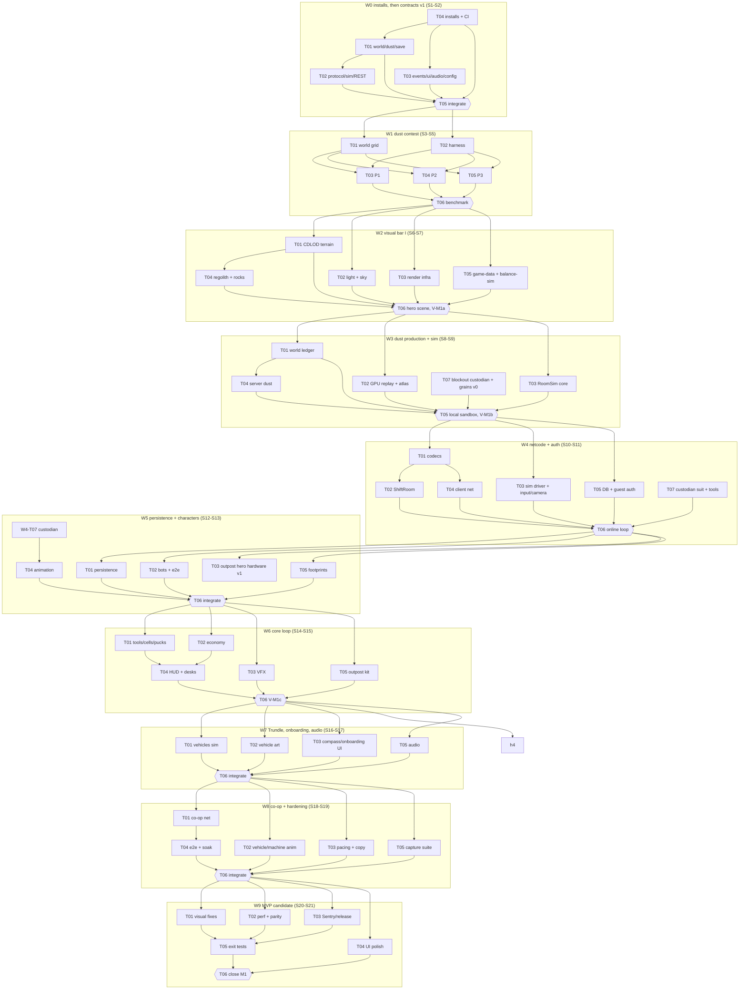

# M1 — MVP "Boreal Pilot Area" (`v0.2.0`)

Direction: `docs/design/REFERENCE_TARGET.md` overrides retired naming/style/custom-gate rules.

Execution: `docs/handoff/MODEL_POLICY.md`; stages are checkpoints, not usage-window promises.

Owner: lead (structure) · Lead alone maintains task rows from actual progress ([backlog rules](README.md)).
Scope: [scope-tiers.md §1](../design/scope-tiers.md#1-mvp-v020--boreal-pilot-area) (canonical) · Visual bar: [visual-target.md §3, §4.2](../design/visual-target.md#42-m1-mvp-v020) · Dust: [world-and-dust-simulation.md](../architecture/world-and-dust-simulation.md) · Netcode: [netcode.md](../architecture/netcode.md).

## 1. Goal

A fun, multiplayer vertical slice in the Boreal Pilot Area (≈ 8,160 plots inside the Pilot Fence on a full-size, orbit-renderable Moon) that **already meets the visual bar in that small area**. It proves the four risky things: dust feel, a shared 16-player world over the network, persistence across Render cold starts, and the first 2–3 hours of pacing.

**Visuals are scheduled early, not as polish:** W1 decides the dust approach by contest, W2 builds terrain + light + regolith to the bar, W3 lands production dust trails **and the first playable already includes look-dev (W2 light/sky/regolith), a blockout custodian with the Desk Duster, and grime-tinted grains**, W4 lands the production custodian suit and all four hand tools, W5–W7 the Outpost Boreal kit and vehicles, and every wave passes a visual gate on what it adds. **Original 3D art is produced by a decided path (D5, ADR-0027; the pipeline is proven in M0-W0-T06), scheduled as explicit tasks, not left to chance.** Every hero asset passes a turntable bar (art-direction §13.3, VT-M1-35).

## 2. Exit criteria (scope-tiers §1 exit column, all required for `v0.2.0`)

| # | Criterion | Verified by |
| --- | --- | --- |
| E1 | Walk to the Pilot Fence in all directions with no cracks or pops at Tier B quality | VT-M1-26, P2/P4 captures |
| E2 | Passes visual-target §4.2: all V1 items, ≤ 3 V2 open with tickets; VM-01…VM-07 and VM-09 approved (VM-08 Survey Globe is v1.0, M2-W1); comparator CMP-02/05/07/15 | `/visual-check M1` |
| E3 | 8 bots × 30 min: zero stuck plots; client and server Shine agree | `/bot-test` soak |
| E4 | Sweeping feels good (internal playtest ≥ 4/5); Lane Lock works | Gate P1 |
| E5 | Pucks and vehicles sync for 16 players; no rubber-banding at 120 ms ± 30 jitter | `/bot-test` + manual |
| E6 | Payment server-authoritative; wallet never desyncs; shared purchase races resolved server-side | tests + `/bot-test` |
| E7 | First Roost bought solo in 1.5–2 h (hand + Trundle; money only, no quest gate); 4 players < 1 h (scope-tiers MVP pacing, sim to confirm) | `/balance-check` + playtest |
| E8 | New tester buys the Crescent Squeegee in 5–10 min unaided | Gate P2 |
| E9 | `/bot-test`: 16 bots, 10 min, within tick (p95 ≤ 3.5 ms) and bandwidth (≤ 6.5 KB/s/client busy) budgets locally (CPU-limited container), plus a ≤ 5-min hosted run when Cee authorizes a test window | `/bot-test` |
| E10 | Kill the server mid-session: ≤ 30 s progress lost; contract resumes after cold start with the waking screen | restart scenario + e2e |
| E11 | KBM and gamepad complete; frame time VT-M1-27 on Tier A High and Tier B Medium | `/perf-check` |
| E12 | M1 closing integration PASS; `/release-checklist` go | `M1-W9-integration.md` |

## 3. Pre-wave decisions (lead, logged in OPEN_QUESTIONS/ADR before the named stage)

| # | Decision | Needed by | Recommended default |
| --- | --- | --- | --- |
| D1 | MVP hero location and sun path: scope-tiers puts the MVP at **Outpost Boreal**, visual-target scenes name **Outpost Dawnside**, and VT-M2-11 gives polar outposts a permanent ≈ 2° sun, while MVP needs a 60-min (30/30) day/night | M1-S6 | Capture all M1 scenes at Boreal; game-designer defines a gameplay sun path with a full 30/30 cycle at Boreal (max elevation in data); VT thresholds that assume a 60° noon are judged at the highest MVP elevation |
| D2 | Dust contest winner (P1/P2/P3) | after M1-S5 | P2 unless the world-and-dust §10 decision rule says otherwise → ADR; W3 cards re-planned only if P1/P3 wins |
| D3 | *(resolved)* Earth apparent size is 2.4° (visual-target and rendering-pipeline §20 item 11 agree) | — | — |
| D4 | Vehicles are in MVP scope (scope-tiers says yes) → VM-09 and CMP-03/04/09 judged at M1 for the Trundle (the Skiff is v1.0, scope-tiers §1) | M1-S16 | Yes (VM-09 at M1) |
| D5 | **3D art production path** (OPEN_QUESTIONS Q23): how original custodian, hand tools, outpost kit, Trundle is modelled, rigged, LODed and textured (technical-artist has no DCC tool); ADR + a "placeholder quality bar" (blockout assets still meet art-direction §13.4: final proportions, final shader and player-colour slots, not merely a 32 px silhouette (VT-M1-18); see ADR-0027 for the path and ADR-0028 for the dependency policy) | M1-S9 | Scripted, licence-clean procedural modelling in `tools/asset-pipeline` (bevelled primitives, baked AO, glTF-Transform, KTX2) for hard-surface assets; a modular, bevelled custodian suit with 16 colour slots; CC0/commercial base meshes only if Cee approves the licence and budget; headless Blender 4.5.10 LTS is installed and is the preferred source (Q23 resolved; path in OPEN_QUESTIONS) |
| D6 | Project-local dependencies: designated devops writer installs sequentially when needed; review scripts/licenses/pins | Before affected work | No per-package ADR or between-wave wait; major architecture/toolchain changes still need a concise decision |

## 4. Stage plan

| Stage | Wave | Tasks | Technical check / Next |
| --- | --- | --- | --- |
| **M1-S1** | W0 | T04 (installs) **first**; T01 and T03 launch when T04 reports | One installer; consumers wait only for the dependency/config changes they need |
| **M1-S2** | W0 | T02, then T05 (integrator) | Verify affected checks; continue |
| **M1-S3** | W1 | T01, T02 | |
| **M1-S4** | W1 | T03, T04, T05 (P1/P2/P3 in parallel) | |
| **M1-S5** | W1 | T06 (integrator: benchmark runs) + BENCHMARK.md reviewers | D2 technical verdict; continue |
| **M1-S6** | W2 | T01, T02, T03 | |
| **M1-S7** | W2 | T04, T05, then T06 (integrator) | **Visual gate V-M1a** |
| **M1-S8** | W3 | T01, T02, T03 | |
| **M1-S9** | W3 | T04 and T07 in parallel, then T05 (integrator: local sandbox) | **Visual gate V-M1b** (first playable, looks good) |
| **M1-S10** | W4 | T01, T03, T05 | |
| **M1-S11** | W4 | T02, T04, T07 (3D art), then T06 (integrator) | Verify affected checks; continue |
| **M1-S12** | W5 | T01, T02, T03 | |
| **M1-S13** | W5 | T04, T05, then T06 (integrator) | **G-M1-1** bot-test (local; hosted window when authorized) |
| **M1-S14** | W6 | T01, T02, T03 | |
| **M1-S15** | W6 | T04, T05, then T06 (integrator) | **Visual gate V-M1c**, **P1** playtest |
| **M1-S16** | W7 | T01, T02, T03 | |
| **M1-S17** | W7 | T05, then T06 (integrator) | Verify affected checks; continue |
| **M1-S18** | W8 | T01, T02, T03 | |
| **M1-S19** | W8 | T04, T05, then T06 (integrator) | **P2** playtest, **G-M1-2** local soak |
| **M1-S20** | W9 | T01, T02, T03 | |
| **M1-S21** | W9 | T04, T05, then T06 (integrator, milestone close) | **Final visual gate**, technical candidate check; Cee commits later |

Stage labels express dependencies, not token budgets, usage windows or stopping points.

## 5. External playtest inputs

No per-wave commit or stage approval. Continue building through M1–M3 when technical inputs are ready.
P1: request Cee/friends' sweeping feedback (score 1–5, concise notes) when a playable loop exists.
P2: observe a new tester's unaided first upgrade; use findings to fix onboarding/pacing.
Run long soaks/restart checks locally. Arrange isolated hosted checks only with actual access and an agreed test window.
Unavailable testers/cloud checks remain pending; continue independent work and report the limitation honestly.

## 6. Status table

| ID | Stage | Role | Goal | Depends on | Port | Status |
| --- | --- | --- | --- | --- | --- | --- |
| M1-W0-T01 | M1-S1 | contracts-architect | World/dust/stroke/save contracts v1 | M1-W0-T04 | 0 | todo |
| M1-W0-T02 | M1-S2 | contracts-architect | Protocol/input/sim/REST contracts v1 | M1-W0-T01 | 0 | todo |
| M1-W0-T03 | M1-S1 | contracts-architect | Events/UI/audio/render/config contracts v1 + root barrel | M1-W0-T04 | 0 | todo |
| M1-W0-T04 | M1-S1 | devops-engineer | Installs from actual dependency needs (sequential install), CI determinism + size lanes | required M0 tooling and actual dependency needs | 1 | todo |
| M1-W0-T05 | M1-S2 | integrator | M1-W0 integration: compile fixes in app roots, consumer list | M1-W0-T01, M1-W0-T02, M1-W0-T03, M1-W0-T04 | 9 | todo |
| M1-W1-T01 | M1-S3 | terrain-dust-engineer | packages/world plot grid GP(128,0) + height function | M1-W0-T05 | 1 | todo |
| M1-W1-T02 | M1-S3 | qa-test-engineer | Dust contest harness (scenes, seeds, paths, bot scenarios) | M1-W0-T05 | 2 | todo |
| M1-W1-T03 | M1-S4 | terrain-dust-engineer | Dust prototype P1 scalar + procedural | M1-W1-T01, M1-W1-T02 | 3 | todo |
| M1-W1-T04 | M1-S4 | terrain-dust-engineer | Dust prototype P2 strokes + atlas + ledger | M1-W1-T01, M1-W1-T02 | 4 | todo |
| M1-W1-T05 | M1-S4 | terrain-dust-engineer | Dust prototype P3 client-painted min-merge | M1-W1-T01, M1-W1-T02 | 5 | todo |
| M1-W1-T06 | M1-S5 | integrator | M1-W1 integration: run contest benchmark S1-S8, verify world | M1-W1-T03, M1-W1-T04, M1-W1-T05 | 9 | todo |
| M1-W2-T01 | M1-S6 | terrain-dust-engineer | CDLOD sphere terrain on baked height cube + Pilot Fence | M1-W1-T06 | 1 | todo |
| M1-W2-T02 | M1-S6 | technical-artist | Production light + sky: day/night, horizon shadows, exposure, Earth phase | M1-W1-T06 | 2 | todo |
| M1-W2-T03 | M1-S6 | rendering-engineer | Render infra: dynamic res, presets, culling/LOD, warm-up, memory ledger | M1-W1-T06 | 3 | todo |
| M1-W2-T04 | M1-S7 | technical-artist | Production regolith, rocks/craters scatter, asset pipeline | M1-W2-T01 | 4 | todo |
| M1-W2-T05 | M1-S7 | game-designer | MVP game-data tables + balance-sim v0 | M1-W1-T06 | 5 | todo |
| M1-W2-T06 | M1-S7 | integrator | M1-W2 integration: hero scene at Boreal, visual gate V-M1a | M1-W2-T01, M1-W2-T02, M1-W2-T03, M1-W2-T04, M1-W2-T05 | 9 | todo |
| M1-W3-T01 | M1-S8 | terrain-dust-engineer | World dust ledger, rasterisation, thresholds, stamp rule | M1-W2-T06 | 1 | todo |
| M1-W3-T02 | M1-S8 | terrain-dust-engineer | Client GPU stroke replay, tile atlas, detail ring | M1-W2-T06 | 2 | todo |
| M1-W3-T03 | M1-S8 | gameplay-systems-engineer | packages/sim RoomSim core: low-g movement, tool strokes, Dust Cells | M1-W2-T06 | 3 | todo |
| M1-W3-T04 | M1-S9 | terrain-dust-engineer | Server authoritative dust state, interest sets, checkpoint serialisation | M1-W3-T01 | 4 | todo |
| M1-W3-T05 | M1-S9 | integrator | M1-W3 integration: local sandbox (client-side RoomSim), visual gate V-M1b | M1-W3-T01, M1-W3-T02, M1-W3-T03, M1-W3-T04, M1-W3-T07 | 9 | todo |
| M1-W3-T07 | M1-S9 | technical-artist | First-playable art: blockout custodian (art-direction §13.4 bar) + Desk Duster v0 + grime-tinted grains v0 (D5 pipeline) | M1-W2-T06, D5 ADR | 6 | todo |
| M1-W4-T01 | M1-S10 | netcode-engineer | packages/protocol codecs, vectors, session + interpolation buffer | M1-W3-T05 | 1 | todo |
| M1-W4-T02 | M1-S11 | netcode-engineer | Server ShiftRoom over RoomSim, Schema encode-once, bytes channel | M1-W4-T01 | 2 | todo |
| M1-W4-T03 | M1-S10 | gameplay-systems-engineer | Server sim driver + validation; client input, camera rig, tool aiming | M1-W3-T05 | 3 | todo |
| M1-W4-T04 | M1-S11 | netcode-engineer | Client net: prediction/reconciliation, interpolation, dust ingest, wake-up | M1-W4-T01 | 4 | todo |
| M1-W4-T05 | M1-S10 | backend-data-engineer | DB schema v1 + guest auth + contracts/profile REST | M1-W3-T05 | 5 | todo |
| M1-W4-T06 | M1-S11 | integrator | M1-W4 integration: 2-client online loop with auth | M1-W4-T01, M1-W4-T02, M1-W4-T03, M1-W4-T04, M1-W4-T05, M1-W4-T07 | 9 | todo |
| M1-W4-T07 | M1-S11 | technical-artist | Custodian suit production model + hand tools T1–T4 (Desk Duster, Crescent Squeegee, Bristle Broom, Lane Broom) | M1-W3-T05 | 6 | todo |
| M1-W5-T01 | M1-S12 | backend-data-engineer | Persistence: checkpoints, lease, restore, SIGTERM drain, DB power-off | M1-W4-T06 | 1 | todo |
| M1-W5-T02 | M1-S12 | qa-test-engineer | Real-protocol bots, /bot-test scenarios, restart + e2e cold start | M1-W4-T06 | 2 | todo |
| M1-W5-T03 | M1-S12 | technical-artist | Outpost Boreal hero hardware v1 (Assay Counter, Receiving Gate, Dump Plate, floods) + custodian polish from animation/visual feedback | M1-W4-T06 | 3 | todo |
| M1-W5-T04 | M1-S13 | animation-engineer | Skeleton pipeline, locomotion blend, low-g bounce, foot IK, tool layer | M1-W4-T07 | 4 | todo |
| M1-W5-T05 | M1-S13 | terrain-dust-engineer | Footprints and tracks ring | M1-W4-T06 | 5 | todo |
| M1-W5-T06 | M1-S13 | integrator | M1-W5 integration: persistence + characters, first 16-bot run | M1-W5-T01, M1-W5-T02, M1-W5-T03, M1-W5-T04, M1-W5-T05 | 9 | todo |
| M1-W6-T01 | M1-S14 | gameplay-systems-engineer | Tools T1-T4 + traits, Dust Cells I-III, Dust Pucks, Plot Card | M1-W5-T06 | 1 | todo |
| M1-W6-T02 | M1-S14 | gameplay-systems-engineer | Economy: selling, wallet, Promotions subset, suit gear, Stamp, Roost purchase, cargo, achievements | M1-W5-T06 | 2 | todo |
| M1-W6-T03 | M1-S14 | technical-artist | VFX: ballistic dust, Inspector's Stamp, Assay pour, Railshot, lamp pools | M1-W5-T06 | 3 | todo |
| M1-W6-T04 | M1-S15 | ui-ux-motion-designer | HUD, toasts, Requisitions Desk, Ops Console, settings | M1-W6-T01, M1-W6-T02 | 4 | todo |
| M1-W6-T05 | M1-S15 | technical-artist | Outpost Boreal hardware kit part 2 (Motor Pool, Requisitions Desk, Ops Console) | M1-W5-T06 | 5 | todo |
| M1-W6-T06 | M1-S15 | integrator | M1-W6 integration: core loop playable, visual gate V-M1c | M1-W6-T01, M1-W6-T02, M1-W6-T03, M1-W6-T04, M1-W6-T05 | 9 | todo |
| M1-W7-T01 | M1-S16 | gameplay-systems-engineer | Trundle kinematics, Motor Pool, upgrade lines, vehicle cleaning | M1-W6-T06 | 1 | todo |
| M1-W7-T02 | M1-S16 | technical-artist | Trundle model, brush-drum VFX | M1-W6-T06 | 2 | todo |
| M1-W7-T03 | M1-S16 | ui-ux-motion-designer | Compass, onboarding, invite UI | M1-W6-T06 | 3 | todo |
| M1-W7-T05 | M1-S17 | audio-engineer | Audio graph, helmet muffle, MVP SFX, ambient beds, DOT chime | M1-W6-T06 | 5 | todo |
| M1-W7-T06 | M1-S17 | integrator | M1-W7 integration: vehicle, onboarding, audio | M1-W7-T01, M1-W7-T02, M1-W7-T03, M1-W7-T05 | 9 | todo |
| M1-W8-T01 | M1-S18 | netcode-engineer | Co-op: Solo/Private Shift, invite join, join-in-progress, reconnect grace, kick/ban, vehicle sync | M1-W7-T06 | 1 | todo |
| M1-W8-T02 | M1-S18 | animation-engineer | Vehicle suspension/enter-exit, machine motion (Assay, Railshot, Gate) | M1-W7-T06 | 2 | todo |
| M1-W8-T03 | M1-S18 | game-designer | MVP pacing pass, DOT copy, Induction/Handbook text, achievements wording | M1-W7-T06 | 3 | todo |
| M1-W8-T04 | M1-S19 | qa-test-engineer | MVP e2e flows, 16-bot drive scenario, 8x30 min soak | M1-W8-T01 | 4 | todo |
| M1-W8-T05 | M1-S19 | performance-profiler | MVP capture suite (S10 16 bots, P1/P2/P4), budget tracker | M1-W7-T06 | 5 | todo |
| M1-W8-T06 | M1-S19 | integrator | M1-W8 integration: full MVP feature set integrated and playable | M1-W8-T01, M1-W8-T02, M1-W8-T03, M1-W8-T04, M1-W8-T05 | 9 | todo |
| M1-W9-T01 | M1-S20 | technical-artist | Visual V1 fixes + comparator CMP-02/05/07/15 | M1-W8-T06 | 1 | todo |
| M1-W9-T02 | M1-S20 | rendering-engineer | Perf fixes, Low preset dignity, WebGL2 MVP parity | M1-W8-T06 | 2 | todo |
| M1-W9-T03 | M1-S20 | devops-engineer | Sentry + source maps, release config, usage logging, size gate | M1-W8-T06 | 3 | todo |
| M1-W9-T04 | M1-S21 | ui-ux-motion-designer | UI polish from reviews; KBM + gamepad completeness | M1-W8-T06 | 4 | todo |
| M1-W9-T05 | M1-S21 | qa-test-engineer | MVP exit-criteria test pass (E1-E11 evidence) | M1-W9-T01, M1-W9-T02, M1-W9-T03 | 5 | todo |
| M1-W9-T06 | M1-S21 | integrator | M1 closing integration, all gates, release checklist v0.2.0 | M1-W9-T01, M1-W9-T02, M1-W9-T03, M1-W9-T04, M1-W9-T05 | 9 | todo |

## 7. Task DAG

## 8. Task cards

### M1-W0 — Contracts v1 + installs

#### M1-W0-T01 — World, dust, stroke and save contracts v1
- **Stage** M1-S1 · **Role** `contracts-architect` · **Port** 0 · **Status** `todo` (authoritative value in §6)
- **Goal:** the frozen contracts the dust contest and all dust/world code build on.
- **Owned files:** `packages/shared/src/world/**`, `packages/shared/src/save/**`.
- **Read first:** world-and-dust §2.3–§2.7, §4.2–§4.5, §5.1, §6, §8 (contract proposals), §12 item 14; data-model §6; netcode §8.
- **Input contracts:** M0 shared v0; M0-W3-T04 mask-interface proposal.
- **Depends on:** M1-W0-T04 (installs finished; M0 done).
- **Acceptance criteria:**
  - [ ] `world/plot-grid.ts`: `PlotGrid` (`plotAt(dir)`, `neighbors(id)`, `center(id)`, `count`, chunk/display IDs), GP(m,0) parameters, golden-hash constant slot.
  - [ ] `world/dust.ts`: plot state enum (Grimy, Opened, Polished, Empty), integer thresholds, ledger dimensions and units per world-and-dust §4.4 (ADR-0026), dust message payload types of §5.1.
  - [ ] `world/stroke.ts`: stroke format incl. `actorSlot` + `inputSeq`, plot-local quantisation ranges.
  - [ ] `save/format.ts`: save layout v1 (§6), `SAVE_FORMAT_VERSION = 1`, `bakeHash`, migration note from v0.
  - [ ] zod schemas + round-trip tests; version headers bumped; consumers listed.
- **Visual acceptance:** n/a.
- **Applicable review lenses (lead selects for risk/final review):** `code-reviewer`, `netcode-security-reviewer`.
- **Definition of done:** Standard DoD + module-boundaries §2 table updated via the lead.

#### M1-W0-T02 — Protocol, input, sim and REST contracts v1
- **Stage** M1-S2 · **Role** `contracts-architect` · **Port** 0 · **Status** `todo`
- **Goal:** the MVP network/sim surface, frozen for W1–W9.
- **Owned files:** `packages/shared/src/protocol/**`, `sim/**`, `api/**`, `ids/**`, `units/**`.
- **Read first:** netcode §2, §4 (MVP subset), §5, §9, §11–§13; module-boundaries §2; security §3, §6; data-model §3.1–§3.7; GDD §7, §9.
- **Input contracts:** M1-W0-T01 outputs; M0 spike verdict ADR.
- **Depends on:** M1-W0-T01.
- **Acceptance criteria:**
  - [ ] MVP message catalog (client→server inputs, intents; server→client FRAME, dust bytes, join snapshot, Schema `ShiftState` shape) with channel, direction, rate; `PROTOCOL_VERSION = 1`.
  - [ ] `sim/input.ts` (per-tick input, sequence numbers, tool actions incl. Lane Lock, puck actions, vehicle controls); `sim/components.ts` (Transform, Avatar, Vehicle, Tool, Cargo/Puck, Building stub); `sim/room-sim.ts` (`step`, `applyInput`, `snapshot`, `onEvent`).
  - [ ] REST DTOs: guest create/refresh, profile, contracts list/create/join-code, Contract member roles (Holder/Staff for MVP).
  - [ ] Close codes from netcode §12 verified against Colyseus 0.18 (netcode §18 item 2).
  - [ ] zod validation schemas for every client→server payload; tests.
- **Visual acceptance:** n/a.
- **Applicable review lenses (lead selects for risk/final review):** `code-reviewer`, `netcode-security-reviewer`.
- **Definition of done:** Standard DoD.

#### M1-W0-T03 — Events, UI store, audio cues, quality, config schemas v1 + root barrel
- **Stage** M1-S1 · **Role** `contracts-architect` · **Port** 0 · **Status** `todo`
- **Goal:** client-facing contracts and the zod schemas for every MVP game-data table.
- **Owned files:** `packages/shared/src/events/**`, `ui/**`, `audio/**`, `render/**`, `config/**`, `client/**`, `packages/shared/src/index.ts` (root barrel).
- **Read first:** progression-and-economy §1, §21 (table layout); scope-tiers §1; GDD §10–§11; audio-direction cue list; rendering-pipeline §14; world-and-dust §7.2, §7.5 (quality knobs).
- **Input contracts:** M0 v0.
- **Depends on:** M1-W0-T04 (installs finished; M0 done).
- **Acceptance criteria:**
  - [ ] Event catalog MVP (`dust.collected`, `plot.opened`, `plot.polished`, `cargo.sold`, `purchase.completed`, `unlock.granted`, `vehicle.entered`, `achievement.unlocked`, `review.reached`, …) with payload types.
  - [ ] UI store slices (HUD, wallet, Shine, cells, compass, suit, docket, menus, notifications) and actions.
  - [ ] Audio cue IDs + parameters for the MVP SFX set; quality knobs incl. atlas size/ring radius.
  - [ ] `config/*.schema.ts` for MVP tables: tools + traits, Dust Cells, terrain classes, dust levels, prices, Promotions nodes, suit gear, vehicles + lines, reviews, achievements, cargo placements, onboarding steps, day/night.
  - [ ] Tests; consumers listed.
- **Visual acceptance:** n/a.
- **Applicable review lenses (lead selects for risk/final review):** `code-reviewer`, `netcode-security-reviewer` (contracts), `balance-reviewer` (**schema coverage only**: every MVP table has a schema; no simulator run — `tools/balance-sim` is not built until M1-W2-T05).
- **Definition of done:** Standard DoD.

#### M1-W0-T04 — Installs + CI determinism and size lanes
- **Stage** M1-S1 · **Role** `devops-engineer` · **Port** 1 · **Status** `todo`
- **Goal:** every M1 dependency installed once (this is M1's install task: it runs **alone first** in M1-S1, so no contracts agent typechecks while `node_modules` and the lockfile change), and CI guards that M1 relies on.
- **Owned files:** root `package.json`, `pnpm-lock.yaml`, `pnpm-workspace.yaml`, `turbo.json`, root `eslint.config.*`, root `vitest.config.*`, `.github/**`, `packages/config/**`, the `dependencies`/`devDependencies` fields of every workspace `package.json` (lead-delegated, sequentially), and `prototypes/dust-sim/*/package.json` + their local lockfiles (see "Prototype installs" in W1).
- **Installer: yes** (sequential install only if actual dependency changes are needed).
- **Read first:** M0 reports "Dependencies requested"; the D6 dependency ADRs (written by the lead before this stage); netcode §17 (determinism); performance-budgets §5, §8.
- **Input contracts:** none.
- **Depends on:** M0 done; D6 ADRs written.
- **Acceptance criteria:**
  - [ ] Only ADR-backed deps installed (e.g. compression for dust chunks, Vitest browser mode, drizzle-kit if missing, `tsx`); report lists each with its ADR. Prototype folders `prototypes/dust-sim/{harness,p1-scalar-procedural,p2-stroke-atlas-ledger,p3-client-paint-minmerge}` get a private `package.json` and an isolated install (`pnpm install --ignore-workspace` inside the folder; they are **not** workspace packages).
  - [ ] CI job `determinism`: sim/world golden-hash tests on Node and in a browser (Vitest browser mode, software lane).
  - [ ] First-load size check enforced; Playwright software lane runs `tests/e2e` on PRs.
  - [ ] `/verify` green.
- **Visual acceptance:** n/a.
- **Applicable review lenses (lead selects for risk/final review):** `code-reviewer`, `netcode-security-reviewer` (supply chain).
- **Definition of done:** Standard DoD.

#### M1-W0-T05 — M1-W0 integration
- **Stage** M1-S2 · **Role** `integrator` · **Port** 9 · **Status** `todo`
- **Goal:** apps compile against contracts v1; consumer update list for W1+.
- **Owned files:** `apps/client/src/app/**`, `apps/server/src/app/**`, `docs/agent-reports/M1-W0-integration.md`.
- **Read first:** W0 reports.
- **Input contracts:** shared v1.
- **Depends on:** M1-W0-T01 … T04.
- **Acceptance criteria:** [ ] `/verify` PASS; [ ] report lists every module that must adopt v1 and in which wave.
- **Visual acceptance:** n/a.
- **Applicable review lenses (lead selects for risk/final review):** `code-reviewer`.
- **Definition of done:** implemented and meaningfully verified; continue ready work without waiting for commits.

### M1-W1 — Dust prototype contest (competing-approach rule)

Common to T03–T05: harness, scene, seed and camera paths from M1-W1-T02; grid + height from M1-W1-T01; robots scenario S5 is run as **synthetic ledger-op load** (robots are not in MVP; full S5 repeats in M2-W5); competitors never read each other's folders; prototype code is never imported by `apps/` or `packages/`; throwaway quality is fine.

**Prototype installs and imports (decided):** `prototypes/*/*` folders are **not** workspace packages (`pnpm-workspace.yaml` is unchanged). Each has its own throwaway `package.json` and lockfile created and installed **only inside that folder** by `devops-engineer` in M1-W0-T04 (`pnpm install --ignore-workspace`); prototype agents never run installs. Prototypes consume production code by **relative import of the source barrels** (for example `../../../packages/world/src/index.ts`) and run with their own `tsx`/`vitest`/`vite`; the same applies to `prototypes/render-engine/*` in M0-W4 (Babylon is installed into its prototype folder the same way).

#### M1-W1-T01 — `packages/world` plot grid + height function
- **Stage** M1-S3 · **Role** `terrain-dust-engineer` · **Port** 1 · **Status** `todo`
- **Goal:** the production, deterministic plot grid that every prototype and every later system shares.
- **Owned files:** `packages/world/**`.
- **Read first:** world-and-dust §1, §2 (all), §3.5; ADR-0007; M0-W2-T05 golden height samples.
- **Input contracts:** `shared/world/plot-grid.ts` v1.
- **Depends on:** M1-W0-T05.
- **Acceptance criteria:**
  - [ ] GP(128,0) construction (163,842 plots), diamond (i,j) indexing + 2 poles, chunks/display IDs, neighbour table, O(1) point→plot, tangent frames/plot-local coords, height function reading the baked cube **passed in as an `ArrayBuffer`** (no file or network I/O inside `packages/world`; the test fixture is a small cube sample under `assets/terrain/fixtures/`, a path M0-W2-T05 adds to its owned files).
  - [ ] Golden grid hash identical on Node and browser (CI `determinism`); counts match §2.1.
  - [ ] Benchmarks: point→plot and height sample costs recorded; no allocations in hot calls.
  - [ ] Environment-agnostic (no DOM/Node/three imports).
- **Visual acceptance:** n/a.
- **Applicable review lenses (lead selects for risk/final review):** `code-reviewer`, `performance-reviewer`.
- **Definition of done:** Standard DoD.

#### M1-W1-T02 — Dust contest harness
- **Stage** M1-S3 · **Role** `qa-test-engineer` · **Port** 2 · **Status** `todo`
- **Goal:** one harness so P1/P2/P3 are measured identically.
- **Owned files:** `prototypes/dust-sim/harness/**`, `tools/bots/src/scenarios/dust-contest/**`.
- **Read first:** world-and-dust §10 (scenarios S1–S8, pass bars, decision rule); visual-target §6.3; rendering-pipeline §19 (readability ratio).
- **Input contracts:** prototype adapter interface defined here (start/stop, stroke input, metrics export) — published in the report before S4 launches.
- **Depends on:** M1-W0-T05 (the harness's own `package.json`/install come from M1-W0-T04).
- **Acceptance criteria:**
  - [ ] Fixed seed, scene bookmarks, camera path drivers for S1/S2/S3/S7/S8, bot scenarios for S4/S6 (+ synthetic S5), metric schema → `prototypes/dust-sim/results/<approach>/`.
  - [ ] Blind A/B screenshot pair generator for the visual judgement.
  - [ ] Dry run against a stub adapter.
- **Visual acceptance:** n/a.
- **Applicable review lenses (lead selects for risk/final review):** `code-reviewer`, `performance-reviewer`.
- **Definition of done:** Standard DoD.

#### M1-W1-T03 — P1 scalar + procedural
- **Stage** M1-S4 · **Role** `terrain-dust-engineer` · **Port** 3 · **Status** `todo`
- **Goal:** cheapest approach: server L0 scalar only; client procedural dissolve + ring.
- **Owned files:** `prototypes/dust-sim/p1-scalar-procedural/**`.
- **Read first:** world-and-dust §10 (P1 column), §7.8 (P1 style); harness README.
- **Input contracts:** harness adapter (M1-W1-T02); `packages/world`; M0 regolith material (copy, do not import production visuals).
- **Depends on:** M1-W1-T01, M1-W1-T02.
- **Acceptance criteria:** [ ] runs S1, S4, S6, S7, S8 (S2/S3 best effort, synthetic S5) through the harness adapter; [ ] dev-run results kept in its own folder (official runs are M1-W1-T06); [ ] README with hypothesis, how to run, numbers.
- **Visual acceptance:** VT-M1-03, 04, 05 judged in BENCHMARK (not gating the task).
- **Applicable review lenses (lead selects for risk/final review):** `performance-reviewer`, `visual-qa-reviewer` (via BENCHMARK.md).
- **Definition of done:** Standard DoD (prototype quality allowed; no production paths touched).

#### M1-W1-T04 — P2 strokes + atlas + ledger (preferred)
- **Stage** M1-S4 · **Role** `terrain-dust-engineer` · **Port** 4 · **Status** `todo`
- **Goal:** the canonical design: server ledger exact at 0.8 m, client GPU stroke replay into a per-plot tile atlas + ring.
- **Owned files:** `prototypes/dust-sim/p2-stroke-atlas-ledger/**`.
- **Read first:** world-and-dust §4–§7 (all), §10; rendering-pipeline §18 (#33795, #32735).
- **Input contracts:** as T03.
- **Depends on:** M1-W1-T01, M1-W1-T02.
- **Acceptance criteria:** [ ] S1, S4, S6, S7, S8 run (S2/S3 best effort, synthetic S5); [ ] client/server ledger hash match 100 % in S4; [ ] compute and fragment replay both measured on WebGPU (§12 item 5); [ ] README + numbers.
- **Visual acceptance:** VT-M1-03, 04, 05 judged in BENCHMARK.
- **Applicable review lenses (lead selects for risk/final review):** `performance-reviewer`, `visual-qa-reviewer`.
- **Definition of done:** Standard DoD (prototype quality).

#### M1-W1-T05 — P3 client-painted, min-merge
- **Stage** M1-S4 · **Role** `terrain-dust-engineer` · **Port** 5 · **Status** `todo`
- **Goal:** brush-freedom approach: clients paint tiles; server stores opaque 4-bit tiles with per-texel min merge.
- **Owned files:** `prototypes/dust-sim/p3-client-paint-minmerge/**`.
- **Read first:** world-and-dust §10 (P3 column); security §2 (client-reported scoring risk).
- **Input contracts:** as T03.
- **Depends on:** M1-W1-T01, M1-W1-T02.
- **Acceptance criteria:** [ ] S1, S4, S6, S7, S8 run; [ ] tile-delta bandwidth and persistence size measured; [ ] cheating surface documented; [ ] README + numbers.
- **Visual acceptance:** VT-M1-03, 04, 05 judged in BENCHMARK.
- **Applicable review lenses (lead selects for risk/final review):** `performance-reviewer`, `visual-qa-reviewer`.
- **Definition of done:** Standard DoD (prototype quality).

#### M1-W1-T06 — Contest benchmark run + world verification
- **Stage** M1-S5 · **Role** `integrator` · **Port** 9 · **Status** `todo`
- **Goal:** identical benchmark runs for P1/P2/P3 handed to the reviewers; production `packages/world` verified.
- **Owned files:** `docs/agent-reports/M1-W1-integration.md`, `prototypes/dust-sim/results/**` (run outputs only).
- **Read first:** world-and-dust §10; harness README.
- **Input contracts:** three prototypes + harness.
- **Depends on:** M1-W1-T03, T04, T05.
- **Acceptance criteria:** [ ] all scenarios run on Tier A and Tier B (WebGPU + WebGL2 for S8); [ ] `/verify` PASS for `packages/world`; [ ] results handed to `performance-reviewer` + `visual-qa-reviewer`, who write `prototypes/dust-sim/BENCHMARK.md`; [ ] lead records the D2 ADR.
- **Visual acceptance:** blind A/B pairs produced.
- **Applicable review lenses (lead selects for risk/final review):** `performance-reviewer`, `visual-qa-reviewer`.
- **Definition of done:** Standard DoD + ADR + loser folders archived/deleted per prototypes/README.

### M1-W2 — Visual bar I: terrain, light, regolith at Boreal

#### M1-W2-T01 — CDLOD sphere terrain + Pilot Fence
- **Stage** M1-S6 · **Role** `terrain-dust-engineer` · **Port** 1 · **Status** `todo`
- **Goal:** the full Moon as a crack-free, pop-free CDLOD sphere from boot height to orbit.
- **Owned files:** `apps/client/src/terrain/**` except `terrain/dust/**`, `terrain/marks/**`, `terrain/orbit/**`; `assets/terrain/**` (release bake re-run if M0 said go).
- **Read first:** world-and-dust §3.4–§3.6; rendering-pipeline §4, §10; visual-target §2.4; M0 bake report; ADR-0008.
- **Input contracts:** `packages/world` height function; render module services; `shared/render/quality.ts` v1.
- **Depends on:** M1-W1-T06.
- **Acceptance criteria:**
  - [ ] Spherified-cube CDLOD with morphing, one draw per LOD level/chunk set, height cube resident (16 MiB), reversed-Z per M0 verdict.
  - [ ] TSL height twin within ±2 cm of the JS function (readback test).
  - [ ] Pilot Fence at 900 m from Boreal: visible marker ring + hook for the DOT message.
  - [ ] Terrain GPU ≤ 3.0 ms A / ≤ 7.0 ms B (main pass, pre-dust); CPU select ≤ 0.8/1.5 ms.
- **Visual acceptance:** VT-M1-26 (P2, P4), VT-M1-14 (craters from terrain relief).
- **Applicable review lenses (lead selects for risk/final review):** `code-reviewer`, `visual-qa-reviewer`, `performance-reviewer`.
- **Definition of done:** Standard DoD.

#### M1-W2-T02 — Production light + sky
- **Stage** M1-S6 · **Role** `technical-artist` · **Port** 2 · **Status** `todo`
- **Goal:** the lunar light that sells the game: low-sun drama, ground-bounce fill, earthlit night, correct Earth phase, exposure-gated stars.
- **Owned files:** `apps/client/src/visuals/lighting/**`, `visuals/sky/**`, `visuals/post/**`, `visuals/lookdev/**`, `visuals/index.ts`.
- **Read first:** art-direction §2–§3; rendering-pipeline §5, §6, §8.4; visual-target §3 (VM-01, VM-06), §4.2; D1 decision.
- **Input contracts:** sun direction/time from `shared/sim` (stub clock until W3); quality presets v1.
- **Depends on:** M1-W1-T06.
- **Acceptance criteria:**
  - [ ] Day→night cycle driven by a time source (30/30 min), sun path per D1; horizon-shadow map continuing CSM to the horizon with no visible handoff.
  - [ ] Exposure adaptation (P5), stars gated by exposure, Earth phase from geometry, earthshine fill; Crown Lamp light hooks (L1 Clip Light, L2 Spot Ring) for W6.
  - [ ] Bloom discipline holds.
- **Visual acceptance:** VT-M1-08, 09, 10, 11, 12, 29; VM-01, VM-06 (lighting part).
- **Applicable review lenses (lead selects for risk/final review):** `code-reviewer`, `visual-qa-reviewer`, `performance-reviewer`.
- **Definition of done:** Standard DoD.

#### M1-W2-T03 — Render infra: dynamic res, presets, culling/LOD, warm-up, memory
- **Stage** M1-S6 · **Role** `rendering-engineer` · **Port** 3 · **Status** `todo`
- **Goal:** the renderer holds the frame target on Tier A/B under real content.
- **Owned files:** `apps/client/src/render/**` (incl. `bench/`, `instancing/`).
- **Read first:** rendering-pipeline §9, §10, §12, §13, §14, §17; performance-budgets §2–§4; M0 render verdict.
- **Input contracts:** quality presets v1.
- **Depends on:** M1-W1-T06.
- **Acceptance criteria:**
  - [ ] Dynamic resolution controller (converges ≤ 3 s, ≤ 1 change / 2 s, within range); all presets apply live.
  - [ ] Frustum/distance culling + LOD infra; draw budget counters ≤ 600 A / ≤ 350 B.
  - [ ] Pipeline warm-up behind Clock In (≤ 4 s A / ≤ 8 s B), zero runtime pipeline creation.
  - [ ] GPU memory ledger per allocation; device-loss rebuild drops a preset after 2 losses.
- **Visual acceptance:** VT-M1-28, VT-M1-31 (infra side).
- **Applicable review lenses (lead selects for risk/final review):** `code-reviewer`, `performance-reviewer`, `visual-qa-reviewer`.
- **Definition of done:** Standard DoD.

#### M1-W2-T04 — Production regolith, rocks and craters, asset pipeline
- **Stage** M1-S7 · **Role** `technical-artist` · **Port** 4 · **Status** `todo`
- **Goal:** ground that reads as real regolith at 1:1 with no repeat, plus rocks and small craters everywhere.
- **Owned files:** `apps/client/src/visuals/materials/**`, `tools/asset-pipeline/**`, `assets/models/rocks/**`, `assets/textures/regolith/**`, `apps/client/public/assets/**` (generated) + ASSET_LICENSES rows.
- **Read first:** art-direction (regolith, rocks); rendering-pipeline §7; world-and-dust §7.7; ADR-0013, ADR-0017; performance-budgets §4–§5.
- **Input contracts:** terrain material hooks (M1-W2-T01 report); dust-mask interface (shared v1).
- **Depends on:** M1-W2-T01.
- **Acceptance criteria:**
  - [ ] Regolith material with grime/clean response driven by the dust mask, 3 relief scales, anti-repeat.
  - [ ] Instanced rock + crater-rim scatter (seeded by plot) within draw budget.
  - [ ] glTF-Transform/KTX2 pipeline with per-group size budgets and a CI check script.
- **Visual acceptance:** VT-M1-13, 14, 03 (material side).
- **Applicable review lenses (lead selects for risk/final review):** `code-reviewer`, `visual-qa-reviewer`, `performance-reviewer`.
- **Definition of done:** Standard DoD.

#### M1-W2-T05 — MVP game-data tables + balance-sim v0
- **Stage** M1-S7 · **Role** `game-designer` · **Port** 5 · **Status** `todo`
- **Goal:** every MVP number in validated data, and a simulator that predicts MVP pacing.
- **Owned files:** `packages/game-data/**`, `tools/balance-sim/**`.
- **Read first:** progression-and-economy (MVP rows, §21); scope-tiers §1; naming-bible; D1.
- **Input contracts:** `shared/config/*.schema.ts` v1.
- **Depends on:** M1-W1-T06.
- **Acceptance criteria:**
  - [ ] Tables for every MVP schema validate; names from the naming bible only.
  - [ ] Gameplay sun path for Boreal (D1).
  - [ ] balance-sim v0 outputs time-to-unlock curves: Crescent Squeegee 5–10 min; first Roost bought solo 1.5–2 h; 4 players < 1 h.
- **Visual acceptance:** n/a.
- **Applicable review lenses (lead selects for risk/final review):** `code-reviewer`, `balance-reviewer`.
- **Definition of done:** Standard DoD.

#### M1-W2-T06 — M1-W2 integration: hero scene at Boreal, visual gate V-M1a
- **Stage** M1-S7 · **Role** `integrator` · **Port** 9 · **Status** `todo`
- **Goal:** the hero area renders to the bar before gameplay exists.
- **Owned files:** `apps/client/src/app/**`, `docs/agent-reports/M1-W2-integration.md`.
- **Read first:** visual-target §6.2 (S01, S04, S05, S06), §6.3 (P2, P4, P5).
- **Input contracts:** terrain, visuals, render, game-data.
- **Depends on:** M1-W2-T01 … T05.
- **Acceptance criteria:** [ ] free-camera hero scene at Boreal with blockout outpost; [ ] `/verify`, `/visual-check` (S01, S05, S06 + P2/P4/P5), `/perf-check` PASS; [ ] **V-M1a**: VT-M1-08…14, 26, 29 V1 items pass.
- **Visual acceptance:** listed above.
- **Applicable review lenses (lead selects for risk/final review):** `code-reviewer`, `visual-qa-reviewer`, `performance-reviewer`.
- **Definition of done:** implemented and meaningfully verified; continue ready work without waiting for commits.

### M1-W3 — Production dust + sim core

(Cards assume D2 = P2. If P1 or P3 wins, the lead adjusts ready tasks, keeping IDs and coordinated ownership.)

#### M1-W3-T01 — World dust ledger, rasterisation, thresholds, stamp
- **Stage** M1-S8 · **Role** `terrain-dust-engineer` · **Port** 1 · **Status** `todo`
- **Goal:** the exact, deterministic dust math shared by client prediction and the server.
- **Owned files:** `packages/world/**`.
- **Read first:** world-and-dust §4 (all, esp. §4.4–§4.5b), §5.5, §10; ADR-0026 (order-independent absolute removal); D2 ADR; P2 prototype README.
- **Input contracts:** `shared/world/dust.ts`, `stroke.ts` v1.
- **Depends on:** M1-W2-T06.
- **Acceptance criteria:** [ ] coarse ledger in 1/16-level units per world-and-dust §4.4–§4.5b (ADR-0026), exact integer rasterisation, stroke quantisation, coverage math, integer thresholds + recount, Inspector's Stamp rule (≤ 1 %); [ ] **ledger test vectors V1–V5** (golden 4-engine, permutations, per-tool reachability ±20 %, over-collection, client two-view convergence; WDS §10); [ ] golden vectors identical Node/browser; [ ] p99 stroke ≤ 0.2 ms server-side benchmark.
- **Visual acceptance:** n/a.
- **Applicable review lenses (lead selects for risk/final review):** `code-reviewer`, `performance-reviewer`, `balance-reviewer` (thresholds/stamp economy).
- **Definition of done:** Standard DoD.

#### M1-W3-T02 — Client GPU stroke replay, tile atlas, detail ring
- **Stage** M1-S8 · **Role** `terrain-dust-engineer` · **Port** 2 · **Status** `todo`
- **Goal:** crisp, continuous trails with raised berms that look the same on every client.
- **Owned files:** `apps/client/src/terrain/dust/**`.
- **Read first:** world-and-dust §7.1–§7.5, §7.7, §9, §11; rendering-pipeline §14 (canonical presets), §18; art-direction §3.3–§3.5.
- **Input contracts:** stroke format v1; regolith mask interface; quality knobs v1.
- **Depends on:** M1-W2-T06.
- **Acceptance criteria:** [ ] compute replay (WebGPU) + fragment twin (WebGL2); [ ] atlas alloc/eviction/rebuild; [ ] detail ring; [ ] dust GPU ≤ 0.5 ms A / ≤ 1.0 ms B; [ ] device-loss rebuild from CPU state; [ ] stroke-direction R8 textures beside the atlas (Medium+) and the ring; [ ] sub-texel strokes as an area-correct lighter line; partial removal thins smoothly.
- **Visual acceptance:** VT-M1-03, 04, 05, **05b** (ring ↔ atlas handoff and sub-texel strokes), 06, 28, **34** (dust thins smoothly: monotonic, step ≥ 8 luma, ledger ±10 points, no island > 0.5 m²); VM-02 (dust part), VM-05.
- **Applicable review lenses (lead selects for risk/final review):** `code-reviewer`, `visual-qa-reviewer`, `performance-reviewer`.
- **Definition of done:** Standard DoD.

#### M1-W3-T03 — `packages/sim` RoomSim core
- **Stage** M1-S8 · **Role** `gameplay-systems-engineer` · **Port** 3 · **Status** `todo`
- **Goal:** a deterministic room simulation a player can walk and clean in, usable by client prediction and server alike.
- **Owned files:** `packages/sim/**` (root barrel + sub-barrels `movement/`, `tools/`, `cargo/`, `economy/`, `vehicles/` created now as placeholders).
- **Read first:** ADR-0010, ADR-0022; netcode §3, §5; world-and-dust §4.6, §8; GDD §9; game-data tables.
- **Input contracts:** `shared/sim/*` v1, `packages/world`, `packages/game-data`.
- **Depends on:** M1-W2-T06.
- **Acceptance criteria:** [ ] 20 Hz fixed step; low-g kinematics on the analytic height (capsule); input apply with seq; Desk Duster + Crescent Squeegee head motion → strokes; Dust Cell fill + full-cell stop; sun/time clock; [ ] 10,000-tick determinism Node vs browser; [ ] avatar step ≤ 10 µs.
- **Visual acceptance:** n/a.
- **Applicable review lenses (lead selects for risk/final review):** `code-reviewer`, `performance-reviewer`, `balance-reviewer`.
- **Definition of done:** Standard DoD.

#### M1-W3-T04 — Server authoritative dust state
- **Stage** M1-S9 · **Role** `terrain-dust-engineer` · **Port** 4 · **Status** `todo`
- **Goal:** the server's dust truth: ledgers, plot completion, interest sets and checkpoint data.
- **Owned files:** `apps/server/src/world/**`.
- **Read first:** world-and-dust §4.3, §5, §6, §9, §11; netcode §7–§8.
- **Input contracts:** `packages/world` ledger (T01); save layout v1.
- **Depends on:** M1-W3-T01.
- **Acceptance criteria:** [ ] L0 + hot/cold ledgers + capped logs; plot completion + stamp events; interest radii §5.2; snapshot cache; serialise/restore to save layout v1; [ ] server dust CPU ≤ 8 ms/s at 16 cleaning players (synthetic); RAM ≈ 25 MB typical.
- **Visual acceptance:** n/a.
- **Applicable review lenses (lead selects for risk/final review):** `code-reviewer`, `netcode-security-reviewer`, `performance-reviewer`.
- **Definition of done:** Standard DoD.

#### M1-W3-T07 — First-playable art: blockout custodian, Desk Duster v0, grains v0
- **Stage** M1-S9 (parallel with T04) · **Role** `technical-artist` · **Port** 6 · **Status** `todo`
- **Goal:** the first playable (V-M1b) already has a person, a tool and satisfying grains, so the look is judged on the real hero shot (character + dust), not on bare ground.
- **Owned files:** `assets/models/characters/blockout/**`, `assets/models/tools/blockout/**`, `apps/client/public/assets/blockout/**` (generated), `apps/client/src/visuals/characters/blockout/**`, `apps/client/src/visuals/vfx/grains/**` (v0; W6-T03 extends it) + ASSET_LICENSES rows.
- **Read first:** D5 ADR / ADR-0027 (3D art production path); art-direction §1.3, §3.6, §4–§5, §13.3–§13.5, VFX notes; visual-target VT-M1-16…21; rendering-pipeline §11; the M1-W2-T04 asset pipeline report.
- **Input contracts:** asset pipeline (`tools/asset-pipeline`, M1-W2-T04); instancing helpers; sim avatar transform (stub pose until W4).
- **Depends on:** M1-W2-T06, D5 ADR.
- **Acceptance criteria:**
  - [ ] Blockout custodian: human proportions, one mesh with 16 player-colour slots (colour mask), a name-tag anchor, a procedural bob/turn driven by sim velocity (no skeleton yet), ≤ 6k triangles; it meets **art-direction §13.4** (final proportions, final shader, player-colour slots), which is stricter than a 32 px silhouette, and still reads at 32 px (VT-M1-18) under the real light.
  - [ ] Desk Duster v0 model (comically tiny), attached at the hand anchor.
  - [ ] Grains v0: grime-tinted grains 1–3 cm world (≈ 3–8 px at 3–4 m), rounded quads, 15 % glints, **never faceted mesh pebbles** (art-direction §1.3, §3.6), on 1.62 m/s² parabolas, vanish on landing, composited after AA; reads in a cropped screenshot and GIF (Pillar P3); VT-M1-16b bar (≥ 20 grains ≥ 2 px visible within 0.5 s, ≥ 50 % at ≥ 15 luma contrast).
  - [ ] All assets pass the pipeline size budgets; licence rows added (own work: "generated").
- **Visual acceptance:** VT-M1-18 (silhouette), VT-M1-16/16b/17 (grain read, preview), VT-M1-35 turntable of the blockout custodian; judged in V-M1b against the art-direction §13.4 placeholder bar (D5).
- **Applicable review lenses (lead selects for risk/final review):** `code-reviewer`, `visual-qa-reviewer`, `performance-reviewer`.
- **Definition of done:** Standard DoD; report lists what W4-T07 must replace.

#### M1-W3-T05 — M1-W3 integration: local sandbox, visual gate V-M1b
- **Stage** M1-S9 · **Role** `integrator` · **Port** 9 · **Status** `todo`
- **Goal:** first playable that **already looks good**: walk and clean at Boreal with client-side `RoomSim` (`?local=1`), before netcode, under the W2 light/sky/regolith, with a blockout custodian and chunky grains.
- **Owned files:** `apps/client/src/app/**`, `docs/agent-reports/M1-W3-integration.md`.
- **Read first:** module-boundaries §4.
- **Input contracts:** sim, world, terrain/dust, W3-T07 custodian + grains.
- **Depends on:** M1-W3-T01 … T04, M1-W3-T07.
- **Acceptance criteria:** [ ] `?local=1` sandbox with placeholder input (W4 replaces) and the blockout custodian visible; [ ] `/verify`, `/visual-check` (S02, S03, S04, plus a custodian-in-frame crop), `/perf-check` PASS on Tier A High **and Tier B Medium**; [ ] **V-M1b**: VT-M1-03, 04, 05, 06, 28 pass; [ ] **interim comparator** CMP-02 and CMP-05 scored on Tier A High, Tier B Medium and Tier C Low (recorded, not yet gating; the final comparator stays in W9); [ ] **VT-M1-30** (`webgl2` parity: VM-01, 02, 06 on Tier C meet the Low thresholds) run now, not only at the final gate.
- **Visual acceptance:** listed above; VM-02 preview.
- **Applicable review lenses (lead selects for risk/final review):** `code-reviewer`, `visual-qa-reviewer`, `performance-reviewer`.
- **Definition of done:** implemented and meaningfully verified; continue ready work without waiting for commits.

### M1-W4 — Netcode, controls and accounts

#### M1-W4-T01 — `packages/protocol` codecs, vectors, session, interpolation
- **Stage** M1-S10 · **Role** `netcode-engineer` · **Port** 1 · **Status** `todo`
- **Goal:** bit-exact, fuzz-safe encoding of everything the MVP sends.
- **Owned files:** `packages/protocol/**`.
- **Read first:** netcode §2, §4, §6, §8, §9.1, §13, §17; ADR-0023; world-and-dust §5.
- **Input contracts:** protocol/stroke/dust contracts v1.
- **Depends on:** M1-W3-T05.
- **Acceptance criteria:** [ ] FRAME, input bundle, dust chains/deltas/`DUST_SNAPSHOT`/`DUST_LEDGER`/`DUST_REQUEST`, stroke echo, join snapshot codecs; [ ] property round-trip + fuzz (truncated/oversized never throws past the boundary); [ ] checked-in vectors; [ ] client session state machine + adaptive interpolation buffer (150–250 ms); [ ] FRAME decode ≤ 0.2 ms A.
- **Visual acceptance:** n/a.
- **Applicable review lenses (lead selects for risk/final review):** `code-reviewer`, `netcode-security-reviewer`, `performance-reviewer`.
- **Definition of done:** Standard DoD.

#### M1-W4-T02 — Server `ShiftRoom`
- **Stage** M1-S11 · **Role** `netcode-engineer` · **Port** 2 · **Status** `todo`
- **Goal:** a thin Colyseus room over `RoomSim` that is authoritative, cheap and bandwidth-disciplined.
- **Owned files:** `apps/server/src/net/**` (spike folder untouched).
- **Read first:** netcode §3, §4.3, §7, §9.2–§9.3, §11, §12, §15; module-boundaries §5; security §1, §5–§6.
- **Input contracts:** codecs (T01); `RoomSim`; server world API; `verifyToken` injected by the composition root (from T05).
- **Depends on:** M1-W4-T01.
- **Acceptance criteria:** [ ] join via `onAuth` (token injected), `ShiftState` Schema encode-once without StateView, bytes channel with interest filtering, seat hold, admission control, per-connection rate limits, close codes; [ ] room tick p95 ≤ 3.5 ms with 16 synthetic clients locally.
- **Visual acceptance:** n/a.
- **Applicable review lenses (lead selects for risk/final review):** `code-reviewer`, `netcode-security-reviewer`, `performance-reviewer`.
- **Definition of done:** Standard DoD.

#### M1-W4-T03 — Server sim driver + client input, camera, aiming
- **Stage** M1-S10 · **Role** `gameplay-systems-engineer` · **Port** 3 · **Status** `todo`
- **Goal:** fixed-step authority on the server; responsive KBM/gamepad controls and camera feel on the client.
- **Owned files:** `apps/server/src/sim/**`, `apps/client/src/gameplay/**`.
- **Read first:** netcode §3, §5; GDD §9; art-direction camera notes; ADR-0010.
- **Input contracts:** `RoomSim`, input contract v1.
- **Depends on:** M1-W3-T05.
- **Acceptance criteria:** [ ] drift-free 20 Hz driver, input validation vs sim rules, neutral input after 3 ticks; [ ] KBM + gamepad mapping with remap API, third/first-person camera rig (easing, FOV kick), tool aiming on terrain; [ ] tests.
- **Visual acceptance:** VT-M1-07 (no peter-panning in camera framing) — checked at W5.
- **Applicable review lenses (lead selects for risk/final review):** `code-reviewer`, `netcode-security-reviewer` (server validation), `performance-reviewer`.
- **Definition of done:** Standard DoD.

#### M1-W4-T04 — Client net: prediction, reconciliation, interpolation, dust ingest
- **Stage** M1-S11 · **Role** `netcode-engineer` · **Port** 4 · **Status** `todo`
- **Goal:** own avatar feels local at 120 ms RTT; others move smoothly; dust stays in sync.
- **Owned files:** `apps/client/src/net/**`.
- **Read first:** netcode §5, §6, §8, §9, §10; performance-budgets §7.
- **Input contracts:** codecs + session (T01); sim; terrain/dust replay API.
- **Depends on:** M1-W4-T01.
- **Acceptance criteria:** [ ] prediction + replay ≤ 16 inputs (≤ 0.5 ms A); [ ] own-avatar correction p95 ≤ 5 cm under netsim typical; [ ] `DUST_SNAPSHOT` / `DUST_LEDGER` inflate in a worker; [ ] wake-up flow + reconnect overlay states.
- **Visual acceptance:** n/a (feel checked in W5 bot/manual runs).
- **Applicable review lenses (lead selects for risk/final review):** `code-reviewer`, `netcode-security-reviewer`, `performance-reviewer`.
- **Definition of done:** Standard DoD.

#### M1-W4-T05 — DB schema v1, guest auth, contracts/profile REST
- **Stage** M1-S10 · **Role** `backend-data-engineer` · **Port** 5 · **Status** `todo`
- **Goal:** players get a guest identity and a Contract without accounts.
- **Owned files:** `packages/db/**`, `apps/server/src/api/**`.
- **Read first:** data-model §3.1–§3.7, §4, §8–§9; security §3, §5, §7; ADR-0018; environments §7.2.
- **Input contracts:** REST DTOs v1.
- **Depends on:** M1-W3-T05.
- **Acceptance criteria:** [ ] tables players, identities, refresh_tokens, profiles, contracts, contract_members, contract_saves (+ existing ops_usage_daily) with generated migrations; [ ] guest create/refresh (opaque refresh hashed with pepper, 15-min `jose` JWT), `verifyToken` export for the room; [ ] contracts create/list/join-code, profile; REST rate limits; [ ] tests against schema `_a5`.
- **Visual acceptance:** n/a.
- **Applicable review lenses (lead selects for risk/final review):** `code-reviewer`, `netcode-security-reviewer`.
- **Definition of done:** Standard DoD.

#### M1-W4-T07 — Custodian suit production model + hand tools T1–T4
- **Stage** M1-S11 · **Role** `technical-artist` · **Port** 6 · **Status** `todo`
- **Goal:** the hero character and the four hand tools at production quality early enough for animation (W5) and every later visual gate to judge real art.
- **Owned files:** `assets/models/characters/**`, `assets/models/tools/**`, `apps/client/public/assets/characters/**`, `apps/client/public/assets/tools/**` (generated), `tools/asset-pipeline/**` (character/tool recipes only), `apps/client/src/visuals/characters/**` (material/colour-slot setup) + ASSET_LICENSES rows.
- **Read first:** D5 ADR / ADR-0027; art-direction §4–§5, §13.2–§13.3; visual-target VT-M1-18…21, VT-M1-35; ADR-0011, ADR-0013, ADR-0017; naming-bible (tools); the M1-W3-T07 report.
- **Input contracts:** blockout assets (W3-T07); asset pipeline.
- **Depends on:** M1-W3-T05.
- **Acceptance criteria:**
  - [ ] Skinned glTF custodian suit (LODs, KTX2, ≤ 18k triangles LOD0), 16 player-colour slots + numeral glyph slot, name-tag anchor; **rig/skeleton spec published in the report for `animation-engineer` (W5-T04)**.
  - [ ] Desk Duster, Crescent Squeegee, Bristle Broom, Lane Broom models (Desk Duster comically tiny), within asset budgets, readable at 32 px silhouette.
  - [ ] Turntable captures at 1080p (custodian + each tool) for the asset-quality review; replaces the W3-T07 blockout in the online loop; each asset meets the art-direction §13.3 turntable bar (**VT-M1-35**: 8 views, noon + night-near).
- **Visual acceptance:** VT-M1-18, 19, 20, 21 (turntable form), **35**.
- **Applicable review lenses (lead selects for risk/final review):** `code-reviewer`, `visual-qa-reviewer`, `performance-reviewer`.
- **Definition of done:** Standard DoD.

#### M1-W4-T06 — M1-W4 integration: online loop
- **Stage** M1-S11 · **Role** `integrator` · **Port** 9 · **Status** `todo`
- **Goal:** two browsers clean the same plot online with guest auth.
- **Owned files:** `apps/client/src/app/**`, `apps/server/src/app/**`, `docs/agent-reports/M1-W4-integration.md`.
- **Read first:** module-boundaries §5.
- **Input contracts:** all W4 exports (incl. the W4-T07 custodian and tools).
- **Depends on:** M1-W4-T01 … T05, M1-W4-T07.
- **Acceptance criteria:** [ ] server wires auth → room (`verifyToken` injection), sim driver, world, ops stats; client replaces sandbox input with gameplay + net; [ ] `/verify`, Playwright 2-client e2e, local `/bot-test` (spike bots on ShiftRoom where possible) PASS.
- **Visual acceptance:** n/a.
- **Applicable review lenses (lead selects for risk/final review):** `code-reviewer`, `netcode-security-reviewer`.
- **Definition of done:** implemented and meaningfully verified; continue ready work without waiting for commits.

### M1-W5 — Persistence, bots, characters

#### M1-W5-T01 — Persistence: checkpoints, lease, restore, SIGTERM, DB power-off
- **Stage** M1-S12 · **Role** `backend-data-engineer` · **Port** 1 · **Status** `todo`
- **Goal:** ≤ 30 s of progress lost on any crash, restart or cold start.
- **Owned files:** `apps/server/src/persistence/**`, `packages/db/**` (repositories only).
- **Read first:** data-model §6–§7; netcode §9.3–§9.4, §16; world-and-dust §6; environments §6.
- **Input contracts:** save layout v1; world/sim serialisers.
- **Depends on:** M1-W4-T06.
- **Acceptance criteria:** [ ] save blob build + compress, coalesced writes ≤ 30 s when dirty, on room empty, on SIGTERM (≤ 25 s drain, ≤ 1.5 ms CPU slice/tick); [ ] lease renewal 10 s, restore on room create, `bakeHash` check; [ ] DB powered off → rooms keep running, retries 1 → 30 s, new rooms refused (4108); [ ] month-to-date egress persisted to `ops_usage_daily`.
- **Visual acceptance:** n/a.
- **Applicable review lenses (lead selects for risk/final review):** `code-reviewer`, `netcode-security-reviewer`, `performance-reviewer`.
- **Definition of done:** Standard DoD.

#### M1-W5-T02 — Real-protocol bots, `/bot-test` scenarios, restart + cold-start e2e
- **Stage** M1-S12 · **Role** `qa-test-engineer` · **Port** 2 · **Status** `todo`
- **Goal:** the MVP's automated multiplayer proof.
- **Owned files:** `tools/bots/**`, `tools/netsim/**`, `tests/e2e/**`.
- **Read first:** netcode §17; world-and-dust §10 (S4, S6, S7); `.claude/commands/bot-test.md`.
- **Input contracts:** `packages/protocol` session; REST DTOs.
- **Depends on:** M1-W4-T06.
- **Acceptance criteria:** [ ] bots on the real session: guest auth, join, walk, clean (tool strokes), desync checks (ledger hash); [ ] `/bot-test` 16 × 10 min netsim 120 ± 30, 1 %; restart scenario (SIGTERM → 100 % rejoin, positions match checkpoint); late-join S7; [ ] e2e: cold start → waking → join; protocol mismatch flow.
- **Visual acceptance:** n/a.
- **Applicable review lenses (lead selects for risk/final review):** `code-reviewer`, `performance-reviewer`.
- **Definition of done:** Standard DoD.

#### M1-W5-T03 — Outpost Boreal hero hardware v1 + custodian polish
- **Stage** M1-S12 · **Role** `technical-artist` · **Port** 3 · **Status** `todo`
- **Goal:** the hero hardware that every Brightside screenshot frames (Assay Counter, Receiving Gate, Dump Plate, floods) at production quality early, plus custodian fixes from the first animation and visual reviews. (The custodian suit and the four hand tools were produced in M1-W4-T07.)
- **Owned files:** `assets/models/outpost/**`, `apps/client/public/assets/outpost/**` (generated), `apps/client/src/visuals/outpost/**` (hero pieces), `assets/models/characters/**` (fixes only) + ASSET_LICENSES rows.
- **Read first:** D5 ADR / ADR-0027; art-direction §5–§6, §13.3; visual-target VT-M1-21, VT-M1-35; ADR-0013, ADR-0017; naming-bible; M1-W4-T07 report.
- **Input contracts:** asset pipeline; instancing helpers; W4-T07 rig spec.
- **Depends on:** M1-W4-T06.
- **Acceptance criteria:** [ ] Assay Counter, Receiving Gate, Dump Plate and floods as glTF/KTX2 within budgets, palette rule (safety-yellow ≤ 10 %); [ ] placed at the Boreal pad per D1 layout data; [ ] custodian fixes listed in the W4-T07 follow-up list closed.
- **Visual acceptance:** VT-M1-21; **VT-M1-35** turntables (Assay Counter, Receiving Gate, Dump Plate, floods, custodian polish); VM-04 (Assay Counter, preview).
- **Applicable review lenses (lead selects for risk/final review):** `code-reviewer`, `visual-qa-reviewer`, `performance-reviewer`.
- **Definition of done:** Standard DoD.

#### M1-W5-T04 — Animation: skeleton pipeline, locomotion, low-g bounce, foot IK, tool layer
- **Stage** M1-S13 · **Role** `animation-engineer` · **Port** 4 · **Status** `todo`
- **Goal:** custodians move with a convincing low-gravity gait and sweep with readable tool motions, locally and remotely.
- **Owned files:** `apps/client/src/animation/**`, `assets/animations/**` (original/CC0 only).
- **Read first:** ADR-0011; art-direction motion notes; module-boundaries §4 (frame order).
- **Input contracts:** rig/skeleton spec (M1-W4-T07 report); sim avatar state; event catalog.
- **Depends on:** M1-W4-T07.
- **Acceptance criteria:** [ ] clip loading + `AnimationMixer` layers: 1D/2D locomotion blend, additive tool layer per T1–T4, low-g bounce, procedural foot IK on terrain; [ ] remote avatars from interpolated state; [ ] ≤ 0.3 ms CPU for 16 avatars on A.
- **Visual acceptance:** VT-M1-07 (no peter-panning), VT-M1-18 (silhouette in motion).
- **Applicable review lenses (lead selects for risk/final review):** `code-reviewer`, `visual-qa-reviewer`, `performance-reviewer`.
- **Definition of done:** Standard DoD.

#### M1-W5-T05 — Footprints and tracks ring
- **Stage** M1-S13 · **Role** `terrain-dust-engineer` · **Port** 5 · **Status** `todo`
- **Goal:** boot prints with tread in grime, faint prints on clean ground that fade, never mistaken for cleaning.
- **Owned files:** `apps/client/src/terrain/marks/**`.
- **Read first:** world-and-dust §7.6; visual-target VT-M1-15.
- **Input contracts:** avatar foot events (animation/sim); dust ring.
- **Depends on:** M1-W4-T06.
- **Acceptance criteria:** [ ] ring-based (not decals) prints + wheel-track hook for W7; [ ] fade ≤ 30 s on clean ground; [ ] within the dust GPU budget.
- **Visual acceptance:** VT-M1-15; VM-02 (boot prints).
- **Applicable review lenses (lead selects for risk/final review):** `code-reviewer`, `visual-qa-reviewer`, `performance-reviewer`.
- **Definition of done:** Standard DoD.

#### M1-W5-T06 — M1-W5 integration: persistence + characters, first 16-bot run
- **Stage** M1-S13 · **Role** `integrator` · **Port** 9 · **Status** `todo`
- **Goal:** characters in the world, progress survives restarts, 16 bots measured.
- **Owned files:** `apps/client/src/app/**`, `apps/server/src/app/**`, `docs/agent-reports/M1-W5-integration.md`.
- **Depends on:** M1-W5-T01 … T05.
- **Input contracts:** W5 exports.
- **Read first:** WORKFLOW.
- **Acceptance criteria:** [ ] persistence wired to room lifecycle + SIGTERM; animation + marks registered; [ ] `/verify`, `/bot-test` (local; hosted window optional after G-M1-1), restart scenario, `/visual-check` (S02, S05, S10 partial), `/perf-check` PASS.
- **Visual acceptance:** VT-M1-07, 15, 18.
- **Applicable review lenses (lead selects for risk/final review):** `code-reviewer`, `netcode-security-reviewer`, `visual-qa-reviewer`, `performance-reviewer`.
- **Definition of done:** implemented and meaningfully verified; continue ready work without waiting for commits.

### M1-W6 — Core loop: tools, cargo, economy, VFX, HUD, outpost

#### M1-W6-T01 — Tools T1–T4 + traits, Dust Cells, Dust Pucks, Plot Card
- **Stage** M1-S14 · **Role** `gameplay-systems-engineer` · **Port** 1 · **Status** `todo`
- **Goal:** the hand-tool ladder and cargo handling that make sweeping a game.
- **Owned files:** `packages/sim/src/tools/**`, `packages/sim/src/cargo/**`, `packages/sim/src/index.ts` (root barrel this wave).
- **Read first:** progression-and-economy (tools, cells, pucks); GDD §4, §9; scope-tiers §1 rows Hand tools, Dust Cells, Dust Pucks, Plots.
- **Input contracts:** game-data tables; input contract (Lane Lock, puck actions).
- **Depends on:** M1-W5-T06.
- **Acceptance criteria:** [ ] Desk Duster, Crescent Squeegee, Bristle Broom, Lane Broom with Detailing, Flick, Sure Footing, Lane Lock; [ ] Dust Cells I–III, full-cell stop; [ ] Pucks: form (F), carry, drop, throw (Q), pour back; [ ] Plot Card (C) data; [ ] deterministic tests.
- **Visual acceptance:** n/a (VFX in T03).
- **Applicable review lenses (lead selects for risk/final review):** `code-reviewer`, `performance-reviewer`, `balance-reviewer`.
- **Definition of done:** Standard DoD.

#### M1-W6-T02 — Economy: selling, wallet, Promotions subset, suit gear, Stamp, Roost purchase, cargo, achievements
- **Stage** M1-S14 · **Role** `gameplay-systems-engineer` · **Port** 2 · **Status** `todo`
- **Goal:** Lumens in, upgrades out, all server-authoritative.
- **Owned files:** `packages/sim/src/economy/**` (own sub-barrel only).
- **Read first:** progression-and-economy (MVP rows); scope-tiers §1 rows Selling, Promotions Board, Suit gear, Milestone demo, Exploration, Achievements; security §1–§2.
- **Input contracts:** game-data; event catalog v1.
- **Depends on:** M1-W5-T06.
- **Acceptance criteria:** [ ] Assay Counter hold-to-pour, Receiving Gate + Dump Plate intake, Railshot shipment every 2 t (event only), shared wallet; [ ] 10 Promotions nodes with server-side race resolution; Holster Rig L1–3, Crown Lamp L1–2; [ ] Stamp 50 LM; first Roost purchasable with money from the start (4,500 × 1.15^(n−1), cap 3, DOT suggestion only, no quest gate); 12 Stray Cargo Parcels; 10 achievement triggers → events; [ ] no client outcome trusted.
- **Visual acceptance:** n/a.
- **Applicable review lenses (lead selects for risk/final review):** `code-reviewer`, `netcode-security-reviewer`, `balance-reviewer`.
- **Definition of done:** Standard DoD.

#### M1-W6-T03 — VFX: ballistic dust, Inspector's Stamp, Assay pour, Railshot, lamp pools
- **Stage** M1-S14 · **Role** `technical-artist` · **Port** 3 · **Status** `todo`
- **Goal:** the juicy moments: grains on true parabolas, the Stamp, the pour and the ka-ching.
- **Owned files:** `apps/client/src/visuals/vfx/**`, `apps/client/src/visuals/lighting/lamps/**`.
- **Read first:** rendering-pipeline §11; visual-target VM-02, VM-03, VM-04, VT-M1-16, 17, 22; art-direction VFX notes.
- **Input contracts:** event catalog v1; quality knobs (particle caps).
- **Depends on:** M1-W5-T06.
- **Acceptance criteria:** [ ] compute particle pool + CPU fallback (WebGL2), 1.62 m/s² parabolas, no drag, vanish ≤ 0.15 s on landing, composited after AA; [ ] Stamp outline 0.6–1.0 s + emblem overshoot; [ ] Assay pour arcs + lumen-gold flash; [ ] simple Railshot launch visual; [ ] Crown Lamp L1/L2 pools.
- **Visual acceptance:** VT-M1-16, 16b, 17, 22; VM-03, VM-04.
- **Applicable review lenses (lead selects for risk/final review):** `code-reviewer`, `visual-qa-reviewer`, `performance-reviewer`.
- **Definition of done:** Standard DoD.

#### M1-W6-T04 — HUD, toasts, Requisitions Desk, Ops Console, settings
- **Stage** M1-S15 · **Role** `ui-ux-motion-designer` · **Port** 4 · **Status** `todo`
- **Goal:** every MVP number and purchase is readable, crisp and satisfying.
- **Owned files:** `apps/client/src/ui/**`, `assets/ui/**`.
- **Read first:** GDD §10, §13; art-direction §8; visual-target §2.3, VT-M1-24, 25; naming-bible.
- **Input contracts:** UI store v1, event catalog v1.
- **Depends on:** M1-W6-T01, M1-W6-T02 (data shapes).
- **Acceptance criteria:** [ ] HUD: wallet, Shine, Cell gauges, compass, suit icons, Next Requisition tracker, Plot Card overlay; tick-ups and toasts; [ ] Requisitions Desk, Ops Console (board subset), settings (remap, accessibility basics, quality preset, volume placeholder); [ ] reduced-motion; KBM + gamepad focus navigation.
- **Visual acceptance:** VT-M1-24, 25.
- **Applicable review lenses (lead selects for risk/final review):** `code-reviewer`, `visual-qa-reviewer`.
- **Definition of done:** Standard DoD.

#### M1-W6-T05 — Outpost Boreal hardware kit part 2
- **Stage** M1-S15 · **Role** `technical-artist` · **Port** 5 · **Status** `todo`
- **Goal:** the rest of the Brightside hardware, matching the W5-T03 hero pieces: Motor Pool, Requisitions Desk, Ops Console, (Assay Counter, Receiving Gate, Dump Plate and floods are already done in W5-T03).
- **Owned files:** `assets/models/outpost/**`, `apps/client/public/assets/outpost/**`, `apps/client/src/visuals/outpost/**` + ASSET_LICENSES rows.
- **Read first:** art-direction §5–§6; visual-target VT-M1-21; naming-bible.
- **Input contracts:** asset pipeline; instancing helpers.
- **Depends on:** M1-W5-T06.
- **Acceptance criteria:** [ ] all listed pieces as glTF/KTX2 within budgets; palette rule (safety-yellow ≤ 10 %); [ ] placed at Boreal pad per D1 layout data; [ ] kit part 1 + part 2 judged together in V-M1c (VT-M1-21).
- **Visual acceptance:** VT-M1-21; **VT-M1-35** turntables for every new piece (Requisitions Desk, Ops Console, Motor Pool); VM-04 (Assay Counter); VM-07 backdrop.
- **Applicable review lenses (lead selects for risk/final review):** `code-reviewer`, `visual-qa-reviewer`, `performance-reviewer`.
- **Definition of done:** Standard DoD.

#### M1-W6-T06 — M1-W6 integration: core loop, visual gate V-M1c
- **Stage** M1-S15 · **Role** `integrator` · **Port** 9 · **Status** `todo`
- **Goal:** clean → fill Cells → pour/sell → buy upgrade, online, looking right.
- **Owned files:** `apps/client/src/app/**`, `apps/server/src/app/**`, `docs/agent-reports/M1-W6-integration.md`.
- **Depends on:** M1-W6-T01 … T05.
- **Input contracts:** W6 exports.
- **Read first:** scope-tiers §1.
- **Acceptance criteria:** [ ] `/verify`, `/bot-test`, `/visual-check` (S02, S08, S12, S13, S14), `/perf-check`, `/balance-check` PASS; [ ] **V-M1c**: VT-M1-16, **16b**, 17, 18, 20, 21, 22, 24, 25, **35** (turntables for everything landed since V-M1b); [ ] **interim comparator** CMP-07 plus a custodian crop scored on Tier A High, Tier B Medium and Tier C Low (recorded, not yet gating); [ ] build ready for playtest P1.
- **Visual acceptance:** listed.
- **Applicable review lenses (lead selects for risk/final review):** `code-reviewer`, `visual-qa-reviewer`, `performance-reviewer`, `balance-reviewer`.
- **Definition of done:** implemented and meaningfully verified; continue ready work without waiting for commits.

### M1-W7 — Trundle, onboarding, audio

> Scope-tiers §1 cuts the Skiff, the Survey Globe and Flare Beacons from the MVP. They moved to M2 (Skiff: M2-W3-T01/T02; Survey Globe render: M2-W1-T05; Globe UI: M2-W5-T03; Flare Beacons + Spot Check: M2-W9-T03). Task ID M1-W7-T04 is retired.

#### M1-W7-T01 — Trundle, Motor Pool, upgrade lines, vehicle cleaning
- **Stage** M1-S16 · **Role** `gameplay-systems-engineer` · **Port** 1 · **Status** `todo`
- **Goal:** per-player vehicles that clean, haul and feel good in low g.
- **Owned files:** `packages/sim/src/vehicles/**`, `apps/client/src/gameplay/vehicles/**`.
- **Read first:** ADR-0010; progression-and-economy (vehicles); scope-tiers §1 Vehicles row; netcode §4.4.
- **Input contracts:** components v1 (Vehicle); input v1.
- **Depends on:** M1-W6-T06.
- **Acceptance criteria:** [ ] raycast-suspension kinematics for the Trundle; Motor Pool spawn/return, Repeat Requisition; Gear Ratio + Cargo Expander lines; vehicle strokes + hopper → Dump Plate; [ ] vehicle step ≤ 10 µs; deterministic tests; vehicle camera.
- **Visual acceptance:** n/a (T02, W8-T02).
- **Applicable review lenses (lead selects for risk/final review):** `code-reviewer`, `performance-reviewer`, `balance-reviewer`, `netcode-security-reviewer` (input validation).
- **Definition of done:** Standard DoD.

#### M1-W7-T02 — Trundle model, brush-drum VFX
- **Stage** M1-S16 · **Role** `technical-artist` · **Port** 2 · **Status** `todo`
- **Goal:** a readable Trundle that throws ballistic dust, built through the D5 pipeline; the animation-engineer's suspension/bone naming spec is published here.
- **Owned files:** `assets/models/vehicles/**`, `apps/client/public/assets/vehicles/**`, `apps/client/src/visuals/vfx/vehicles/**` + ASSET_LICENSES rows.
- **Read first:** art-direction vehicles, §13.2–§13.3; visual-target VM-09, S09, VT-M1-35.
- **Input contracts:** suspension/bone naming spec published for animation-engineer.
- **Depends on:** M1-W6-T06.
- **Acceptance criteria:** [ ] glTF/KTX2 within budgets; [ ] brush-drum parabolas on the particle pool; [ ] wheel-track hook to `terrain/marks`.
- **Visual acceptance:** VM-09 (VT-M2-03/04 previewed); **VT-M1-35** turntable for the Trundle.
- **Applicable review lenses (lead selects for risk/final review):** `code-reviewer`, `visual-qa-reviewer`, `performance-reviewer`.
- **Definition of done:** Standard DoD.

#### M1-W7-T03 — Compass, onboarding, invite UI
- **Stage** M1-S16 · **Role** `ui-ux-motion-designer` · **Port** 3 · **Status** `todo`
- **Goal:** players always know where to go, and new players learn without a manual.
- **Owned files:** `apps/client/src/ui/**`, `assets/ui/**`.
- **Read first:** GDD §10, §14; scope-tiers §1 rows Navigation, Onboarding, Co-op; naming-bible (map colours).
- **Input contracts:** UI store v1; REST join-code DTO.
- **Depends on:** M1-W6-T06.
- **Acceptance criteria:** [ ] compass (Outpost and Plot Card markers; no Flare Beacons in MVP); [ ] Induction Checklist (8 steps), DOT text tips, DOT Handbook (H); [ ] invite code/link screens, waking screen final; achievement toasts.
- **Visual acceptance:** VT-M1-24 (new screens).
- **Applicable review lenses (lead selects for risk/final review):** `code-reviewer`, `visual-qa-reviewer`.
- **Definition of done:** Standard DoD.

#### M1-W7-T05 — Audio graph, helmet muffle, MVP SFX, ambient beds, DOT chime
- **Stage** M1-S17 · **Role** `audio-engineer` · **Port** 5 · **Status** `todo`
- **Goal:** the helmet-muffled soundscape of a lunar janitor.
- **Owned files:** `apps/client/src/audio/**`, `assets/audio/**` + ASSET_LICENSES rows.
- **Read first:** audio-direction (all MVP sections); scope-tiers §1 Audio row.
- **Input contracts:** audio cue IDs v1; event catalog v1.
- **Depends on:** M1-W6-T06.
- **Acceptance criteria:** [ ] Web Audio graph with buses + helmet-muffle filter; [ ] SFX: sweep per tool, pour, stamp, Trundle, UI; day/night ambient beds; DOT chime; [ ] Opus/WebM + AAC fallback; volume settings hook; ≤ 0.3 ms CPU.
- **Visual acceptance:** n/a.
- **Applicable review lenses (lead selects for risk/final review):** `code-reviewer`, `performance-reviewer` (download size).
- **Definition of done:** Standard DoD.

#### M1-W7-T06 — M1-W7 integration
- **Stage** M1-S17 · **Role** `integrator` · **Port** 9 · **Status** `todo`
- **Goal:** the Trundle, onboarding and audio in one build.
- **Owned files:** `apps/client/src/app/**`, `apps/server/src/app/**`, `docs/agent-reports/M1-W7-integration.md`.
- **Depends on:** M1-W7-T01 … T03, T05.
- **Input contracts:** W7 exports.
- **Read first:** WORKFLOW.
- **Acceptance criteria:** [ ] `/verify`, `/bot-test` (incl. driving bots if available), `/visual-check` (S09, S12), `/perf-check`, `/balance-check` PASS.
- **Visual acceptance:** VM-09.
- **Applicable review lenses (lead selects for risk/final review):** `code-reviewer`, `visual-qa-reviewer`, `performance-reviewer`.
- **Definition of done:** implemented and meaningfully verified; continue ready work without waiting for commits.

### M1-W8 — Co-op complete + hardening

#### M1-W8-T01 — Co-op: Solo/Private Shift, invites, join-in-progress, reconnect, kick/ban, vehicle sync
- **Stage** M1-S18 · **Role** `netcode-engineer` · **Port** 1 · **Status** `todo`
- **Goal:** friends can join by link mid-shift and 16 drivers stay smooth.
- **Owned files:** `apps/server/src/net/**`, `apps/client/src/net/**`, `packages/protocol/**`.
- **Read first:** GDD §7.4–§7.5; netcode §7, §9; security §8 (MVP subset); scope-tiers §1 Co-op row.
- **Input contracts:** REST join codes; Standard Issue rules (sim).
- **Depends on:** M1-W7-T06.
- **Acceptance criteria:** [ ] Solo and Private rooms; join by code/link (≤ 16); join-in-progress with Standard Issue; reconnect grace; Holder kick/ban (session-scoped); [ ] 16-vehicle sync without rubber-banding at 120 ± 30 ms (netsim).
- **Visual acceptance:** n/a.
- **Applicable review lenses (lead selects for risk/final review):** `code-reviewer`, `netcode-security-reviewer`, `performance-reviewer`.
- **Definition of done:** Standard DoD.

#### M1-W8-T02 — Vehicle suspension + machine motion
- **Stage** M1-S18 · **Role** `animation-engineer` · **Port** 2 · **Status** `todo`
- **Goal:** vehicles bounce and settle like low-g machines; outpost machines move.
- **Owned files:** `apps/client/src/animation/**`.
- **Read first:** ADR-0011; visual-target VM-09, VT-M2-04 (preview).
- **Input contracts:** vehicle state; T02 rig spec (M1-W7-T02).
- **Depends on:** M1-W7-T06.
- **Acceptance criteria:** [ ] suspension compression/rebound, drum spin, enter/exit; Assay Counter, Receiving Gate, Railshot motions; [ ] CPU within animation budget.
- **Visual acceptance:** VM-09.
- **Applicable review lenses (lead selects for risk/final review):** `code-reviewer`, `visual-qa-reviewer`, `performance-reviewer`.
- **Definition of done:** Standard DoD.

#### M1-W8-T03 — MVP pacing pass, DOT copy, onboarding text, achievements wording
- **Stage** M1-S18 · **Role** `game-designer` · **Port** 3 · **Status** `todo`
- **Goal:** first 2–3 hours paced to target; every string on-brand.
- **Owned files:** `packages/game-data/**`, `tools/balance-sim/**`, `docs/design/**` (game-designer docs only).
- **Read first:** progression-and-economy; naming-bible; P1 playtest notes.
- **Input contracts:** config schemas v1.
- **Depends on:** M1-W7-T06.
- **Acceptance criteria:** [ ] balance-sim: Crescent Squeegee 5–10 min, first Roost bought solo 1.5–2 h, 4 players < 1 h; [ ] DOT tips, Handbook, Induction, achievements text in data.
- **Visual acceptance:** n/a.
- **Applicable review lenses (lead selects for risk/final review):** `code-reviewer`, `balance-reviewer`.
- **Definition of done:** Standard DoD.

#### M1-W8-T04 — MVP e2e flows, 16-bot drive scenario, 8 × 30 min soak
- **Stage** M1-S19 · **Role** `qa-test-engineer` · **Port** 4 · **Status** `todo`
- **Goal:** automated evidence for E3, E5, E6, E9, E10.
- **Owned files:** `tools/bots/**`, `tests/e2e/**`.
- **Read first:** §2 exit criteria; netcode §17.
- **Input contracts:** W8-T01 co-op flows.
- **Depends on:** M1-W8-T01.
- **Acceptance criteria:** [ ] e2e: new guest → Induction → first sale → Crescent Squeegee (scripted); invite join; cold-start resume; [ ] bots: drive + puck scenarios; purchase races; 8 × 30 min soak with zero stuck plots and Shine agreement.
- **Visual acceptance:** n/a.
- **Applicable review lenses (lead selects for risk/final review):** `code-reviewer`, `performance-reviewer`.
- **Definition of done:** Standard DoD.

#### M1-W8-T05 — MVP capture suite + budget tracker
- **Stage** M1-S19 · **Role** `performance-profiler` · **Port** 5 · **Status** `todo`
- **Goal:** frame-time truth for the MVP scenes.
- **Owned files:** `tools/perf/**`, `apps/client/src/debug/**`.
- **Read first:** performance-budgets §2–§4, §8–§9; visual-target VT-M1-27.
- **Input contracts:** scene/route params.
- **Depends on:** M1-W7-T06.
- **Acceptance criteria:** [ ] S10 with 16 bot players P1 60 s, P2, P4 on Tier A High, Tier B Medium, Tier B Low, Tier C Low (`webgl2`); [ ] per-subsystem CPU and per-pass GPU vs budget table; pipelines-after-warm-up = 0; [ ] results in `tools/perf/results/M1/`.
- **Visual acceptance:** VT-M1-27.
- **Applicable review lenses (lead selects for risk/final review):** `code-reviewer`, `performance-reviewer`.
- **Definition of done:** Standard DoD.

#### M1-W8-T06 — M1-W8 integration: full MVP integrated
- **Stage** M1-S19 · **Role** `integrator` · **Port** 9 · **Status** `todo`
- **Goal:** feature-complete MVP running locally (client + server + Postgres); on the hosted service too when Cee has deployed `main`.
- **Owned files:** `apps/client/src/app/**`, `apps/server/src/app/**`, `docs/agent-reports/M1-W8-integration.md`.
- **Depends on:** M1-W8-T01 … T05.
- **Input contracts:** W8 exports.
- **Read first:** §2.
- **Acceptance criteria:** [ ] all gates PASS; `/bot-test` soak (G-M1-2, local) numbers recorded; build handed to P2 playtest.
- **Visual acceptance:** VT-M1-01 progress list.
- **Applicable review lenses (lead selects for risk/final review):** `code-reviewer`, `netcode-security-reviewer`, `visual-qa-reviewer`, `performance-reviewer`.
- **Definition of done:** implemented and meaningfully verified; continue ready work without waiting for commits.

### M1-W9 — MVP release candidate

#### M1-W9-T01 — Visual V1 fixes + comparator CMP-02/05/07/15
- **Stage** M1-S20 · **Role** `technical-artist` · **Port** 1 · **Status** `todo`
- **Goal:** close every open V1 visual finding and pass the comparator rubric.
- **Owned files:** `apps/client/src/visuals/**`, `assets/models/**`, `assets/textures/**`, `apps/client/public/assets/**`.
- **Read first:** visual-target §2.6, §4.2; open visual review files.
- **Input contracts:** —
- **Depends on:** M1-W8-T06.
- **Acceptance criteria:** [ ] zero open V1; ≤ 3 V2 with tickets; [ ] CMP-02/05/07/15 rubric pass.
- **Visual acceptance:** VT-M1-01, 02.
- **Applicable review lenses (lead selects for risk/final review):** `code-reviewer`, `visual-qa-reviewer`, `performance-reviewer`.
- **Definition of done:** Standard DoD.

#### M1-W9-T02 — Perf fixes, Low preset dignity, WebGL2 MVP parity
- **Stage** M1-S20 · **Role** `rendering-engineer` · **Port** 2 · **Status** `todo`
- **Goal:** budgets hold everywhere; Low never looks broken; WebGL2 works.
- **Owned files:** `apps/client/src/render/**`.
- **Read first:** M1-W8-T05 results; rendering-pipeline §14, §19.
- **Input contracts:** —
- **Depends on:** M1-W8-T06.
- **Acceptance criteria:** [ ] VT-M1-27 on A-High and B-Medium; [ ] draw/memory budgets; [ ] fixes for other owners' hot spots reported to them, not edited.
- **Visual acceptance:** VT-M1-27, 30, 31.
- **Applicable review lenses (lead selects for risk/final review):** `code-reviewer`, `performance-reviewer`, `visual-qa-reviewer`.
- **Definition of done:** Standard DoD.

#### M1-W9-T03 — Sentry, source maps, release config, usage logging, size gate
- **Stage** M1-S20 · **Role** `devops-engineer` · **Port** 3 · **Status** `todo`
- **Goal:** production-ready observability on the free tier.
- **Owned files:** `apps/server/src/ops/**`, `apps/client/vite.config.ts`, `apps/client/src/main.ts`, `**/.env.example`, `apps/client/public/hub/**`.
- **Read first:** ADR-0020; environments §7; security §7, §9.
- **Input contracts:** —
- **Depends on:** M1-W8-T06.
- **Acceptance criteria:** [ ] Sentry browser + node with environment/release tags and uploaded source maps (no secrets in repo); [ ] room-stats + monthly egress visible in logs; [ ] CI first-load size gate green; root-file changes sequenced through the designated writer.
- **Visual acceptance:** n/a.
- **Applicable review lenses (lead selects for risk/final review):** `code-reviewer`, `netcode-security-reviewer`.
- **Definition of done:** Standard DoD.

#### M1-W9-T04 — UI polish, KBM + gamepad completeness
- **Stage** M1-S21 · **Role** `ui-ux-motion-designer` · **Port** 4 · **Status** `todo`
- **Goal:** every screen usable with mouse, keyboard and gamepad; review findings closed.
- **Owned files:** `apps/client/src/ui/**`, `assets/ui/**`.
- **Read first:** open UI review files; GDD §9, §13.
- **Input contracts:** —
- **Depends on:** M1-W8-T06.
- **Acceptance criteria:** [ ] gamepad focus on every screen; remap persists; [ ] VT-M1-24/25 clean.
- **Visual acceptance:** VT-M1-24, 25.
- **Applicable review lenses (lead selects for risk/final review):** `code-reviewer`, `visual-qa-reviewer`.
- **Definition of done:** Standard DoD.

#### M1-W9-T05 — MVP exit-criteria test pass
- **Stage** M1-S21 · **Role** `qa-test-engineer` · **Port** 5 · **Status** `todo`
- **Goal:** one evidence table for E1–E11.
- **Owned files:** `tools/bots/**`, `tests/e2e/**`, `docs/agent-reports/M1-W9-T05-qa-test-engineer.md`.
- **Read first:** §2.
- **Input contracts:** —
- **Depends on:** M1-W9-T01, T02, T03.
- **Acceptance criteria:** [ ] every E row has a run, number or link; failures assigned to owners.
- **Visual acceptance:** n/a.
- **Applicable review lenses (lead selects for risk/final review):** `code-reviewer`, `performance-reviewer`.
- **Definition of done:** Standard DoD.

#### M1-W9-T06 — M1 closing integration
- **Stage** M1-S21 · **Role** `integrator` · **Port** 9 · **Status** `todo`
- **Goal:** `v0.2.0` release candidate.
- **Owned files:** `apps/client/src/app/**`, `apps/server/src/app/**`, `docs/agent-reports/M1-W9-integration.md`.
- **Depends on:** M1-W9-T01 … T05.
- **Input contracts:** —
- **Read first:** `.claude/commands/release-checklist.md`.
- **Acceptance criteria:** [ ] `/verify`, `/bot-test` (local; hosted window when authorized), `/visual-check M1` (full matrix §6.5), `/perf-check`, `/balance-check` PASS; [ ] `/release-checklist` go.
- **Visual acceptance:** VT-M1-01…31.
- **Applicable review lenses (lead selects for risk/final review):** `code-reviewer`, `visual-qa-reviewer`, `performance-reviewer`, `netcode-security-reviewer`, `balance-reviewer`.
- **Definition of done:** implemented and meaningfully verified; continue ready work without waiting for commits.
