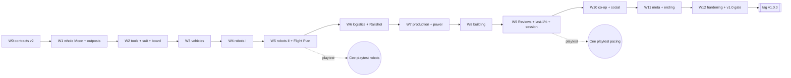

# M2 — v1.0 mechanics parity (`v1.0.0`)

Owner: lead (structure) · Agents edit only their own status row ([README §5](README.md#5-how-an-agent-updates-its-own-row)).
Scope: [scope-tiers.md §2](../design/scope-tiers.md#2-v10-v100--mechanics-parity--improvements) (canonical) · Parity list: [mechanics-parity-matrix.md](../research/mechanics-parity-matrix.md) · Numbers: [progression-and-economy.md](../design/progression-and-economy.md) · Visual: [visual-target §4.3](../design/visual-target.md#43-m2-v10-v100-mechanics-parity).

Cards here are **compact**: every field of the brief template is present, but "Read first" is reduced to the key sections. `/plan-wave` expands each card into a full brief and may split a card (`T03a/T03b`) if it exceeds ~90 min of agent time.

## 1. Goal

Full parity with the genre reference's systems plus our ★ improvements: the whole Moon playable with 4 outposts, all tools/suit/vehicles, robots, logistics, production and power, building, Performance Reviews, the last-1 % toolkit, Open Shifts with roles, the meta layer, and the Contract Fulfilled ending — inside the free-tier budgets.

## 2. Exit criteria

| # | Criterion | Verified by |
| --- | --- | --- |
| E1 | Every scope-tiers §2 row implemented; mechanics-parity-matrix rows marked v1.0 = done | qa parity pass (W12-T04) |
| E2 | `tools/balance-sim` meets every `pacing-targets.json` row (solo contract 30–35 h, milestones to 75 %) | `/balance-check` |
| E3 | 16 bots + 64 robots: room tick p95 ≤ 3.5 ms, CPU ≤ 60 % of 0.1 quota, ≤ 6.5 KB/s/client on staging Render Free | `/bot-test` |
| E4 | 400 robots + 4 bots, 30 min: dust ≤ 10 % of 0.1 CPU, RSS ≤ 300 MB (world-and-dust §10 S5) | qa scenario |
| E5 | Save size and DB growth fit the 1 GB plan (data-model §4) with 4,000 structures and max permits | backend report |
| E6 | VT-M2-01…22: all V1 pass, ≤ 3 V2 open; Safari 26 gating (VT-M2-20); Ultra preset (VT-M2-17) | `/visual-check M2` |
| E7 | Performance budgets hold in S1–S5 reference scenes (performance-budgets §9) incl. S3 factory late game | `/perf-check` |
| E8 | Accessibility per GDD §13 | ui + qa checklist |
| E9 | 1 h soak with churn + restart: zero unrecovered desync, ≤ 30 s loss | `/bot-test` soak |
| E10 | M2 closing integration PASS; `/release-checklist` go | `M2-W12-integration.md` |

## 3. Stage plan

| Wave | Theme | Stage A | Stage B |
| --- | --- | --- | --- |
| W0 | Installs, then contracts v2 | **M2-S1**: T03 (installs) first; T01 launches when T03 reports | **M2-S2**: T02, T04 (integ) |
| W1 | Whole Moon + outposts | **M2-S3**: T01, T02, T04 | **M2-S4**: T03, T05, T06 (integ) |
| W2 | Tools T5–T6, suit gear, full board | **M2-S5**: T01, T02, T03 | **M2-S6**: T04, T05, T06 (integ) |
| W3 | Vehicles: Carryall, Bulldust, Behemoth | **M2-S7**: T01, T02, T04 | **M2-S8**: T03, T05, T06 (integ) |
| W4 | Robots I: Roost, Sandpiper, Plover | **M2-S9**: T01, T03, T04 | **M2-S10**: T02, T05, T06 (integ) |
| W5 | Robots II + Flight Plan | **M2-S11**: T01, T02, T05 | **M2-S12**: T03, T04, T06 (integ) |
| W6 | Logistics + Railshot away | **M2-S13**: T01, T03, T05 | **M2-S14**: T02, T04, T06 (integ) |
| W7 | Production & power | **M2-S15**: T01, T02, T05 | **M2-S16**: T03, T04, T06 (integ) |
| W8 | Building (Assembly Gun) | **M2-S17**: T01, T02, T05 | **M2-S18**: T03, T04, T06 (integ) |
| W9 | Reviews, economy completion, last-1 %, session | **M2-S19**: T01, T02, T04 | **M2-S20**: T03, T05, T06 (integ) |
| W10 | Co-op & social (Open Shifts, roles, chat) | **M2-S21**: T01, T02, T03 | **M2-S22**: T04, T05, T06 (integ) |
| W11 | Meta layer + ending | **M2-S23**: T01, T02, T05 | **M2-S24**: T03, T04, T06 (integ) |
| W12 | Parity hardening + v1.0 gate | **M2-S25**: T01, T02, T03 | **M2-S26**: T04, T05, T06 (integ, close) |

**Estimate:** 26 usage windows (+5 for fix cycles). Cee gates: commit after every wave; playtest after W5 (robots) and W9 (Reviews pacing); staging soak in W12; tag `v1.0.0`.

## 4. Status table

| ID | Stage | Role | Goal | Depends on | Port | Status |
| --- | --- | --- | --- | --- | --- | --- |
| M2-W0-T01 | M2-S1 | contracts-architect | Protocol/sim/component contracts v2 (vehicles, robots, structures, logistics, power, roles, chat, meta) | M2-W0-T03 | 0 | todo |
| M2-W0-T02 | M2-S2 | contracts-architect | Config schemas, events, UI store, audio cues, save format v2 + root barrel | M2-W0-T01 | 0 | todo |
| M2-W0-T03 | M2-S1 | devops-engineer | Installs from M1 requests, CI updates | M1 done | 1 | todo |
| M2-W0-T04 | M2-S2 | integrator | M2-W0 integration: compile against v2, consumer list | M2-W0-T01, M2-W0-T02, M2-W0-T03 | 9 | todo |
| M2-W1-T01 | M2-S3 | terrain-dust-engineer | Release bake: 4 outpost pads, Relay/Railshot sites, Steep plots; remove Pilot Fence | M2-W0-T04 | 1 | todo |
| M2-W1-T02 | M2-S3 | gameplay-systems-engineer | Outpost Recall, Relay Pad travel + fees, Steep rules, Stray Cargo 150, Survey Points 24 | M2-W0-T04 | 2 | todo |
| M2-W1-T03 | M2-S4 | technical-artist | Outposts Austral/Dawnside/Duskside kits, Relay Pad, Break Room, Flare Beacon pillars (moved from M1) | M2-W1-T01 | 3 | todo |
| M2-W1-T04 | M2-S3 | game-designer | World content data: outposts, cargo, survey memos, fees | M2-W0-T04 | 4 | todo |
| M2-W1-T05 | M2-S4 | terrain-dust-engineer | Whole-moon streaming: server interest at scale, client residency, far side; orbit/mid-field coverage + Survey Globe render (moved from M1) | M2-W1-T01 | 5 | todo |
| M2-W1-T06 | M2-S4 | integrator | M2-W1 integration | M2-W1-T01, M2-W1-T02, M2-W1-T03, M2-W1-T04, M2-W1-T05 | 9 | todo |
| M2-W2-T01 | M2-S5 | gameplay-systems-engineer | Tools T5-T6 + traits, 18 Dust Cell levels, Promotions 23 nodes + Review gates | M2-W1-T06 | 1 | todo |
| M2-W2-T02 | M2-S5 | gameplay-systems-engineer | Suit gear: Hop Pack, Ballast Soles, Lowlight Visor (5 lines, 14 levels) | M2-W1-T06 | 2 | todo |
| M2-W2-T03 | M2-S5 | technical-artist | T5-T6 models, Hop Pack plumes, Lowlight Visor grade | M2-W1-T06 | 3 | todo |
| M2-W2-T04 | M2-S6 | ui-ux-motion-designer | Full Promotions Board + suit UI | M2-W2-T01, M2-W2-T02 | 4 | todo |
| M2-W2-T05 | M2-S6 | animation-engineer | Hop Pack/Ballast Soles motion, T5-T6 tool layers | M2-W2-T03 | 5 | todo |
| M2-W2-T06 | M2-S6 | integrator | M2-W2 integration | M2-W2-T01, M2-W2-T02, M2-W2-T03, M2-W2-T04, M2-W2-T05 | 9 | todo |
| M2-W3-T01 | M2-S7 | gameplay-systems-engineer | Skiff (moved from M1), Carryall, Bulldust, Behemoth, 7 upgrade lines, Dust Vault, tricks with capped payout | M2-W2-T06 | 1 | todo |
| M2-W3-T02 | M2-S7 | technical-artist | Four vehicle models (Skiff moved from M1), rooster tails, tracks | M2-W2-T06 | 2 | todo |
| M2-W3-T03 | M2-S8 | animation-engineer | Low-g suspension for 5 vehicles, seats, tricks | M2-W3-T02 | 3 | todo |
| M2-W3-T04 | M2-S7 | netcode-engineer | Multi-seat vehicle sync, interest tuning for fast vehicles | M2-W2-T06 | 4 | todo |
| M2-W3-T05 | M2-S8 | ui-ux-motion-designer | Motor Pool UI full, trick callouts | M2-W3-T01 | 5 | todo |
| M2-W3-T06 | M2-S8 | integrator | M2-W3 integration | M2-W3-T01, M2-W3-T02, M2-W3-T03, M2-W3-T04, M2-W3-T05 | 9 | todo |
| M2-W4-T01 | M2-S9 | gameplay-systems-engineer | Robot behaviour: Roost, Sandpiper, Plover, states, Permits | M2-W3-T06 | 1 | todo |
| M2-W4-T02 | M2-S10 | gameplay-systems-engineer | Server robot scheduling budget + shedding | M2-W4-T01 | 2 | todo |
| M2-W4-T03 | M2-S9 | terrain-dust-engineer | Robots as ledger operations + lane math | M2-W3-T06 | 3 | todo |
| M2-W4-T04 | M2-S9 | technical-artist | Sandpiper, Plover, Roost models + state lights | M2-W3-T06 | 4 | todo |
| M2-W4-T05 | M2-S10 | animation-engineer | Shorebird-motif robot motion | M2-W4-T04 | 5 | todo |
| M2-W4-T06 | M2-S10 | integrator | M2-W4 integration (bot-test with 64 robots) | M2-W4-T01, M2-W4-T02, M2-W4-T03, M2-W4-T04, M2-W4-T05 | 9 | todo |
| M2-W5-T01 | M2-S11 | gameplay-systems-engineer | Albatross, Nests, Bale Chute, Flight Plan (5 lines/15 levels), On-Shift Bonus | M2-W4-T06 | 1 | todo |
| M2-W5-T02 | M2-S11 | netcode-engineer | Robot intent stream (150 m), bandwidth caps | M2-W4-T06 | 2 | todo |
| M2-W5-T03 | M2-S12 | ui-ux-motion-designer | Equipment Cards, Survey Globe overlay + robot layer, Permits UI | M2-W5-T01 | 3 | todo |
| M2-W5-T04 | M2-S12 | qa-test-engineer | 400-robot server scenario + robot soak | M2-W5-T01, M2-W5-T02 | 4 | todo |
| M2-W5-T05 | M2-S11 | animation-engineer | Albatross ballistic hop + wing fold | M2-W4-T06 | 5 | todo |
| M2-W5-T06 | M2-S12 | integrator | M2-W5 integration | M2-W5-T01, M2-W5-T02, M2-W5-T03, M2-W5-T04, M2-W5-T05 | 9 | todo |
| M2-W6-T01 | M2-S13 | gameplay-systems-engineer | Puck Former, Glide Rail family, Fork/Join/Stop, Receiving Gates, Field Gate, Remote Assay | M2-W5-T06 | 1 | todo |
| M2-W6-T02 | M2-S14 | technical-artist | Logistics models, rail pucks, Railshot away sequence | M2-W6-T01 | 2 | todo |
| M2-W6-T03 | M2-S13 | rendering-engineer | Instancing for thousands of pucks/structures (S3 factory budget) | M2-W5-T06 | 3 | todo |
| M2-W6-T04 | M2-S14 | ui-ux-motion-designer | Logistics placement + status UI | M2-W6-T01 | 4 | todo |
| M2-W6-T05 | M2-S13 | game-designer | Logistics tables + balance rows | M2-W5-T06 | 5 | todo |
| M2-W6-T06 | M2-S14 | integrator | M2-W6 integration | M2-W6-T01, M2-W6-T02, M2-W6-T03, M2-W6-T04, M2-W6-T05 | 9 | todo |
| M2-W7-T01 | M2-S15 | gameplay-systems-engineer | Bead Kiln, Tile Sinterer, Grades I-III, Sun Sprig/Fan, Heliostat, Night Cell, power radius | M2-W6-T06 | 1 | todo |
| M2-W7-T02 | M2-S15 | technical-artist | Machine models + Bead Kiln glow, power visuals | M2-W6-T06 | 2 | todo |
| M2-W7-T03 | M2-S16 | animation-engineer | Machine motion (Sun Fan tracking, press, kiln) | M2-W7-T02 | 3 | todo |
| M2-W7-T04 | M2-S16 | ui-ux-motion-designer | Machine status panels, power overlay | M2-W7-T01 | 4 | todo |
| M2-W7-T05 | M2-S15 | game-designer | Production/power tables + balance rows | M2-W6-T06 | 5 | todo |
| M2-W7-T06 | M2-S16 | integrator | M2-W7 integration | M2-W7-T01, M2-W7-T02, M2-W7-T03, M2-W7-T04, M2-W7-T05 | 9 | todo |
| M2-W8-T01 | M2-S17 | gameplay-systems-engineer | Assembly Gun: place/shift/reclaim, snapping, build on dust, author tags, Revert | M2-W7-T06 | 1 | todo |
| M2-W8-T02 | M2-S17 | technical-artist | Build pieces A: Deck Plates + Gantries in 5 finishes | M2-W7-T06 | 2 | todo |
| M2-W8-T03 | M2-S18 | technical-artist | Build pieces B: Rails & Railings + Panels in 5 finishes | M2-W8-T02 | 3 | todo |
| M2-W8-T04 | M2-S18 | ui-ux-motion-designer | Build menu: palette, finishes, placement feedback | M2-W8-T01 | 4 | todo |
| M2-W8-T05 | M2-S17 | rendering-engineer | Structure batching + build-piece LOD | M2-W7-T06 | 5 | todo |
| M2-W8-T06 | M2-S18 | integrator | M2-W8 integration | M2-W8-T01, M2-W8-T02, M2-W8-T03, M2-W8-T04, M2-W8-T05 | 9 | todo |
| M2-W9-T01 | M2-S19 | gameplay-systems-engineer | 6 Performance Reviews, Final Walkthrough, Closing Bonus, economy completion | M2-W8-T06 | 1 | todo |
| M2-W9-T02 | M2-S19 | gameplay-systems-engineer | Last-1% toolkit + session (Briefing, Docket, Next Requisition, Report) | M2-W8-T06 | 2 | todo |
| M2-W9-T03 | M2-S20 | ui-ux-motion-designer | Reviews, Punch List, Docket/Briefing/Report, tracker UI, compass Flare Beacons + Spot Check (moved from M1) | M2-W9-T01, M2-W9-T02 | 3 | todo |
| M2-W9-T04 | M2-S19 | game-designer | Reviews + full pacing tables; balance-sim all pacing-targets rows | M2-W8-T06 | 4 | todo |
| M2-W9-T05 | M2-S20 | audio-engineer | Music layers per Review, vehicle/robot/machine SFX | M2-W8-T06 | 5 | todo |
| M2-W9-T06 | M2-S20 | integrator | M2-W9 integration | M2-W9-T01, M2-W9-T02, M2-W9-T03, M2-W9-T04, M2-W9-T05 | 9 | todo |
| M2-W10-T01 | M2-S21 | netcode-engineer | Open Shifts, Shift Board, role enforcement, vote-kick, AFK, quick-chat + moderation | M2-W9-T06 | 1 | todo |
| M2-W10-T02 | M2-S21 | backend-data-engineer | Persisted bans, abuse_events, contracts hold 3, Loaner Kit persistence, save-size check | M2-W9-T06 | 2 | todo |
| M2-W10-T03 | M2-S21 | gameplay-systems-engineer | Loaner Kit rules, Incident Report to Revert, permission checks in sim | M2-W9-T06 | 3 | todo |
| M2-W10-T04 | M2-S22 | ui-ux-motion-designer | Shift Board, roles UI, chat, Read Aloud, report flows | M2-W10-T01 | 4 | todo |
| M2-W10-T05 | M2-S22 | qa-test-engineer | Griefing/abuse bots, Open Shift churn soak | M2-W10-T01, M2-W10-T03 | 5 | todo |
| M2-W10-T06 | M2-S22 | integrator | M2-W10 integration | M2-W10-T01, M2-W10-T02, M2-W10-T03, M2-W10-T04, M2-W10-T05 | 9 | todo |
| M2-W11-T01 | M2-S23 | gameplay-systems-engineer | Tenure 1-50, Commendations, Certifications, Benefits, 33 achievements | M2-W10-T06 | 1 | todo |
| M2-W11-T02 | M2-S23 | backend-data-engineer | Profile meta persistence, achievements tables, Locker | M2-W10-T06 | 2 | todo |
| M2-W11-T03 | M2-S24 | ui-ux-motion-designer | Locker, Tenure, Commendations, Contracts list, ending UI | M2-W11-T01, M2-W11-T02 | 3 | todo |
| M2-W11-T04 | M2-S24 | technical-artist | Liveries, suit patina, Contract Fulfilled sequence, Showcase Moon | M2-W10-T06 | 4 | todo |
| M2-W11-T05 | M2-S23 | game-designer | Meta tables, achievements, Commendations | M2-W10-T06 | 5 | todo |
| M2-W11-T06 | M2-S24 | integrator | M2-W11 integration | M2-W11-T01, M2-W11-T02, M2-W11-T03, M2-W11-T04, M2-W11-T05 | 9 | todo |
| M2-W12-T01 | M2-S25 | performance-profiler | Full capture suite incl. S3 factory, Ultra, Safari 26, 30-min memory | M2-W11-T06 | 1 | todo |
| M2-W12-T02 | M2-S25 | rendering-engineer | Perf fixes, Ultra preset | M2-W11-T06 | 2 | todo |
| M2-W12-T03 | M2-S25 | ui-ux-motion-designer | Accessibility per GDD §13 complete | M2-W11-T06 | 3 | todo |
| M2-W12-T04 | M2-S26 | qa-test-engineer | Parity pass vs matrix, 1 h soak + restart | M2-W12-T01, M2-W12-T02 | 4 | todo |
| M2-W12-T05 | M2-S26 | technical-artist | VT-M2 V1 fixes + full comparator | M2-W12-T01 | 5 | todo |
| M2-W12-T06 | M2-S26 | integrator | M2 closing integration, release checklist v1.0.0 | M2-W12-T01, M2-W12-T02, M2-W12-T03, M2-W12-T04, M2-W12-T05 | 9 | todo |

## 5. Wave DAG

Every wave's stage B ends with the integrator task and the wave's review gate. W1 → W2 order is fixed (tool tiers need whole-moon plots); W6–W8 could be reordered if pacing play needs building earlier (lead decision via `/plan-wave`).

## 6. Task cards (compact)

Field order: **Stage · Role · Port · Status · Depends** / Owned / Inputs / Acceptance / Visual / Reviewers / DoD.

### M2-W0 — Contracts v2 + installs

#### M2-W0-T01 — Protocol/sim/component contracts v2
M2-S1 · `contracts-architect` · 0 · `todo` · M2-W0-T03 (installs finished)
- **Owned:** `packages/shared/src/protocol/**`, `sim/**`, `api/**`, `ids/**`, `units/**`.
- **Inputs:** batched M1 contract proposals; netcode §4 full catalog; GDD §7.5 roles; scope-tiers §2.
- **Acceptance:** components for 5 vehicles, robots, structures, logistics, machines, power nodes; input/intents for building, robots, chat quick-phrases, votes; role enum Holder/Supervisor/Staff/Temp; `PROTOCOL_VERSION = 2` with migration note; zod validation + tests.
- **Visual:** n/a · **Reviewers:** code-reviewer, netcode-security-reviewer · **DoD:** Standard.

#### M2-W0-T02 — Config, events, UI, audio, save v2 + root barrel
M2-S2 · `contracts-architect` · 0 · `todo` · M2-W0-T01
- **Owned:** `packages/shared/src/config/**`, `events/**`, `ui/**`, `audio/**`, `render/**`, `client/**`, `world/**`, `save/**`, `index.ts`.
- **Inputs:** progression-and-economy §21 (all tables); data-model §6; world-and-dust §4.8.
- **Acceptance:** schemas for every v1.0 table; event catalog v2; UI store v2; cue IDs v2; save format v2 (`SAVE_FORMAT_VERSION = 2`, structures + robots + meta) with v1→v2 migration spec; tests.
- **Visual:** n/a · **Reviewers:** code-reviewer, netcode-security-reviewer, balance-reviewer · **DoD:** Standard.

#### M2-W0-T03 — Installs + CI updates
M2-S1 · `devops-engineer` · 1 · `todo` · M1 done (runs **first and alone** in M2-S1; **Installer: yes**, the between-waves install for M2; the lead writes the dependency ADRs beforehand)
- **Owned:** root `package.json`, lockfile, `.github/**`, `packages/config/**`, workspace dependency fields, root config files; prototype-folder `package.json` + local lockfiles only inside `prototypes/*/*` (isolated installs, not workspace packages).
- **Inputs:** M1 reports' dependency requests + ADRs (e.g. optional client-only Rapier per ADR-0010).
- **Acceptance:** ADR-backed installs only; CI matrix incl. Safari/WebKit smoke lane; `/verify` green.
- **Visual:** n/a · **Reviewers:** code-reviewer, netcode-security-reviewer · **DoD:** Standard.

#### M2-W0-T04 — M2-W0 integration
M2-S2 · `integrator` · 9 · `todo` · T01–T03
- **Owned:** `apps/*/src/app/**`, integration report. **Inputs:** shared v2.
- **Acceptance:** `/verify` PASS; consumer adoption plan per wave; save v1→v2 migration test plan handed to backend (W10-T02).
- **Visual:** n/a · **Reviewers:** code-reviewer · **DoD:** Standard + `/commit-plan`.

### M2-W1 — Whole Moon + outposts

#### M2-W1-T01 — Release bake for the whole Moon
M2-S3 · `terrain-dust-engineer` · 1 · `todo` · M2-W0-T04
- **Owned:** `tools/terrain-bake/**`, `assets/terrain/**`, `apps/client/src/terrain/**` except `dust/`, `marks/`, `orbit/` (fence removal only).
- **Inputs:** world-and-dust §3.2 step 5, §3.3; outpost sites from game-data.
- **Acceptance:** 4 outpost pads, Relay Pad/Railshot sites ≤ 5°, Steep plot classification, per-plot dust multiplier; manifest/bakeHash updated with save migration note; Pilot Fence removed.
- **Visual:** VT-M2-11 (polar low sun read) · **Reviewers:** code-reviewer, performance-reviewer, visual-qa-reviewer · **DoD:** Standard.

#### M2-W1-T02 — Recall, Relay Pad, Steep rules, Stray Cargo, Survey Points
M2-S3 · `gameplay-systems-engineer` · 2 · `todo` · M2-W0-T04
- **Owned:** `packages/sim/src/world-travel/**`, `packages/sim/src/exploration/**`, `packages/sim/src/index.ts`.
- **Inputs:** progression-and-economy (fees, cargo); scope-tiers §2 World/Exploration rows.
- **Acceptance:** Outpost Recall + Relay Pad travel with fees; Steep plot rules; 150 Stray Cargo (Parcel/Crate/Pallet) and 24 Survey Points with DOT memos; deterministic tests. **Barrel prep:** root `packages/sim/src/index.ts` re-exports placeholder sub-barrels for every M2 sim folder (`suit`, `robots`, `logistics`, `production`, `power`, `building`, `reviews`, `survey`, `session`, `permissions`, `meta`) so later waves edit only their own sub-barrel.
- **Visual:** n/a · **Reviewers:** code-reviewer, balance-reviewer, netcode-security-reviewer · **DoD:** Standard.

#### M2-W1-T03 — Outpost kits: Austral, Dawnside, Duskside, Relay Pad, Break Room
M2-S4 · `technical-artist` · 3 · `todo` · M2-W1-T01
- **Owned:** `assets/models/outpost/**`, `apps/client/public/assets/outpost/**`, `apps/client/src/visuals/outpost/**`.
- **Inputs:** art-direction §5–§6; naming-bible.
- **Acceptance:** each outpost distinct yet on-palette; within asset budgets; ASSET_LICENSES rows.
- **Visual:** VT-M2-11, 22 · **Reviewers:** code-reviewer, visual-qa-reviewer, performance-reviewer · **DoD:** Standard.

#### M2-W1-T04 — World content data
M2-S3 · `game-designer` · 4 · `todo` · M2-W0-T04
- **Owned:** `packages/game-data/**`, `tools/balance-sim/**`.
- **Acceptance:** outposts, fees, cargo placements, Survey Point memos (naming bible); tables validate.
- **Visual:** n/a · **Reviewers:** code-reviewer, balance-reviewer · **DoD:** Standard.

#### M2-W1-T05 — Whole-moon streaming, interest at scale, orbit coverage + Survey Globe render
M2-S4 · `terrain-dust-engineer` · 5 · `todo` · M2-W1-T01
- **Owned:** `apps/server/src/world/**`, `apps/client/src/terrain/dust/**`, `apps/client/src/terrain/orbit/**`.
- **Inputs:** world-and-dust §5.2, §7.2, §9; netcode §7.
- **Acceptance:** players spread across the Moon stay within dust CPU/RAM/bandwidth budgets; atlas eviction far side/poles; tests. Moved from M1-W7-T04: orbit coverage from per-plot values on the level-k icosphere (hex mode lazy, not on Low, +16 MiB); P6 surface-to-orbit transition without pops.
- **Visual:** VT-M2-10 (far-side night ground read); VM-08, VT-M1-23 (Survey Globe render) · **Reviewers:** code-reviewer, performance-reviewer, netcode-security-reviewer · **DoD:** Standard.

#### M2-W1-T06 — M2-W1 integration
M2-S4 · `integrator` · 9 · `todo` · T01–T05
- **Acceptance:** `/verify`, `/bot-test` (bots spread over 4 outposts), `/visual-check` (S07, S18), `/perf-check` PASS.
- **Reviewers:** code-reviewer, visual-qa-reviewer, performance-reviewer · **DoD:** Standard + `/commit-plan`.

### M2-W2 — Tools T5–T6, suit gear, full board

#### M2-W2-T01 — Tools T5–T6, 18 Dust Cell levels, 23 board nodes
M2-S5 · `gameplay-systems-engineer` · 1 · `todo` · M2-W1-T06
- **Owned:** `packages/sim/src/tools/**`, `packages/sim/src/economy/promotions/**`.
- **Acceptance:** Static Rake, Ion Curtain + traits; all 18 Cell levels; 23 Promotions nodes with prerequisites and Review gates; server race resolution.
- **Visual:** n/a · **Reviewers:** code-reviewer, balance-reviewer, performance-reviewer · **DoD:** Standard.

#### M2-W2-T02 — Suit gear lines
M2-S5 · `gameplay-systems-engineer` · 2 · `todo` · M2-W1-T06
- **Owned:** `packages/sim/src/suit/**`, `apps/client/src/gameplay/suit/**`.
- **Acceptance:** Holster Rig, Hop Pack, Ballast Soles, Crown Lamp, Lowlight Visor — 5 lines, 14 levels; Hop Pack in kinematics; determinism tests.
- **Visual:** n/a · **Reviewers:** code-reviewer, balance-reviewer, performance-reviewer · **DoD:** Standard.

#### M2-W2-T03 — T5–T6 models, Hop Pack plumes, Lowlight Visor grade
M2-S5 · `technical-artist` · 3 · `todo` · M2-W1-T06
- **Owned:** `assets/models/tools/**`, `apps/client/src/visuals/vfx/suit/**`, `apps/client/src/visuals/post/visor/**`, `apps/client/public/assets/tools/**`.
- **Acceptance:** two tool models; plumes ≤ 0.3 s; visor grade keeps HUD readable and ratio ≥ 1.5.
- **Visual:** VT-M2-15, 16; VT-M1-20 (all 6 tools) · **Reviewers:** code-reviewer, visual-qa-reviewer, performance-reviewer · **DoD:** Standard.

#### M2-W2-T04 — Full Promotions Board + suit UI
M2-S6 · `ui-ux-motion-designer` · 4 · `todo` · M2-W2-T01, M2-W2-T02
- **Owned:** `apps/client/src/ui/**`, `assets/ui/**`.
- **Acceptance:** 23-node board with prerequisites/gates; suit gear screens; KBM + gamepad.
- **Visual:** VT-M1-24/25 on new screens · **Reviewers:** code-reviewer, visual-qa-reviewer · **DoD:** Standard.

#### M2-W2-T05 — Suit and T5–T6 animation
M2-S6 · `animation-engineer` · 5 · `todo` · M2-W2-T03
- **Owned:** `apps/client/src/animation/**`, `assets/animations/**`.
- **Acceptance:** Hop Pack burst/landing, Ballast Soles gait, Static Rake + Ion Curtain tool layers.
- **Visual:** VT-M2-15 (timing with plumes) · **Reviewers:** code-reviewer, visual-qa-reviewer, performance-reviewer · **DoD:** Standard.

#### M2-W2-T06 — M2-W2 integration
M2-S6 · `integrator` · 9 · `todo` · T01–T05
- **Acceptance:** `/verify`, `/bot-test`, `/visual-check` (S07, S08), `/perf-check`, `/balance-check` PASS.
- **Reviewers:** code-reviewer, visual-qa-reviewer, performance-reviewer, balance-reviewer · **DoD:** Standard + `/commit-plan`.

### M2-W3 — Vehicles

#### M2-W3-T01 — Skiff, Carryall, Bulldust, Behemoth, upgrade lines, tricks
M2-S7 · `gameplay-systems-engineer` · 1 · `todo` · M2-W2-T06
- **Owned:** `packages/sim/src/vehicles/**`, `apps/client/src/gameplay/vehicles/**`.
- **Acceptance:** 4 vehicles (Skiff gated by Pilot Review, moved from M1; Carryall 8 seats); all 7 upgrade lines; Dust Vault; tricks (Hang Time, Moonshot!, Lunar Loop, Corkscrew, Faceplant) with capped payout; vehicle step ≤ 10 µs.
- **Visual:** n/a · **Reviewers:** code-reviewer, balance-reviewer, performance-reviewer, netcode-security-reviewer · **DoD:** Standard.

#### M2-W3-T02 — Vehicle models (Skiff + 3), rooster tails, tracks
M2-S7 · `technical-artist` · 2 · `todo` · M2-W2-T06
- **Owned:** `assets/models/vehicles/**`, `apps/client/public/assets/vehicles/**`, `apps/client/src/visuals/vfx/vehicles/**`.
- **Acceptance:** 4 models (Skiff, Carryall, Bulldust, Behemoth) distinct at 60 m, VT-M1-35 turntables; rooster-tail parabolas 2.5–10 m; track hooks.
- **Visual:** VT-M2-02, 03 · **Reviewers:** code-reviewer, visual-qa-reviewer, performance-reviewer · **DoD:** Standard.

#### M2-W3-T03 — Low-g suspension for 5 vehicles, seats, tricks
M2-S8 · `animation-engineer` · 3 · `todo` · M2-W3-T02
- **Owned:** `apps/client/src/animation/**`.
- **Acceptance:** compression + ≤ 2 rebounds over ≥ 0.8 s; seated poses (8 in Carryall); trick body motion.
- **Visual:** VT-M2-04 · **Reviewers:** code-reviewer, visual-qa-reviewer, performance-reviewer · **DoD:** Standard.

#### M2-W3-T04 — Multi-seat vehicle sync + fast-vehicle interest
M2-S7 · `netcode-engineer` · 4 · `todo` · M2-W2-T06
- **Owned:** `packages/protocol/**`, `apps/server/src/net/**`, `apps/client/src/net/**`.
- **Acceptance:** seat ownership/handover authoritative; interest radii for 20 m/s vehicles; bandwidth within §14 at 16 players.
- **Visual:** n/a · **Reviewers:** code-reviewer, netcode-security-reviewer, performance-reviewer · **DoD:** Standard.

#### M2-W3-T05 — Motor Pool UI, trick callouts
M2-S8 · `ui-ux-motion-designer` · 5 · `todo` · M2-W3-T01
- **Owned:** `apps/client/src/ui/**`.
- **Acceptance:** all vehicles/lines purchasable; callouts with motion presets; reduced-motion respected.
- **Visual:** VT-M1-24/25 on new screens · **Reviewers:** code-reviewer, visual-qa-reviewer · **DoD:** Standard.

#### M2-W3-T06 — M2-W3 integration
M2-S8 · `integrator` · 9 · `todo` · T01–T05
- **Acceptance:** `/verify`, `/bot-test` (16 drivers), `/visual-check` (S09), `/perf-check`, `/balance-check` PASS.
- **Reviewers:** code-reviewer, visual-qa-reviewer, performance-reviewer · **DoD:** Standard + `/commit-plan`.

### M2-W4 — Robots I

#### M2-W4-T01 — Robot behaviour: Roost, Sandpiper, Plover, Permits
M2-S9 · `gameplay-systems-engineer` · 1 · `todo` · M2-W3-T06
- **Owned:** `packages/sim/src/robots/**`.
- **Acceptance:** states and AI per GDD; Permits cap counts; deterministic; AI ≤ 15 µs/decision.
- **Visual:** n/a · **Reviewers:** code-reviewer, performance-reviewer, balance-reviewer · **DoD:** Standard.

#### M2-W4-T02 — Server robot scheduling budget
M2-S10 · `gameplay-systems-engineer` · 2 · `todo` · M2-W4-T01
- **Owned:** `apps/server/src/sim/**`.
- **Acceptance:** robot decisions time-sliced; shedding on CPU overload (world-and-dust §11); tick p95 holds with 64 robots.
- **Visual:** n/a · **Reviewers:** code-reviewer, performance-reviewer, netcode-security-reviewer · **DoD:** Standard.

#### M2-W4-T03 — Robots as ledger operations + lane math
M2-S9 · `terrain-dust-engineer` · 3 · `todo` · M2-W3-T06
- **Owned:** `packages/world/**`, `apps/server/src/world/**`.
- **Acceptance:** world-and-dust §4.8 ops; deterministic lane math; robot intents within 150 m only.
- **Visual:** n/a · **Reviewers:** code-reviewer, performance-reviewer, netcode-security-reviewer · **DoD:** Standard.

#### M2-W4-T04 — Sandpiper, Plover, Roost models + state lights
M2-S9 · `technical-artist` · 4 · `todo` · M2-W3-T06
- **Owned:** `assets/models/robots/**`, `apps/client/public/assets/robots/**`, `apps/client/src/visuals/robots/**`.
- **Acceptance:** shorebird motifs recognisable at 20 m; state light colours per art-direction §6.3; instancing-ready.
- **Visual:** VT-M2-05 · **Reviewers:** code-reviewer, visual-qa-reviewer, performance-reviewer · **DoD:** Standard.

#### M2-W4-T05 — Robot motion
M2-S10 · `animation-engineer` · 5 · `todo` · M2-W4-T04
- **Owned:** `apps/client/src/animation/**`.
- **Acceptance:** gait/peck/scan cycles via instanced animation (vertex animation or bone textures); 64 robots ≤ 0.5 ms CPU A.
- **Visual:** VT-M2-05 · **Reviewers:** code-reviewer, visual-qa-reviewer, performance-reviewer · **DoD:** Standard.

#### M2-W4-T06 — M2-W4 integration
M2-S10 · `integrator` · 9 · `todo` · T01–T05
- **Acceptance:** `/verify`, `/bot-test` with 64 robots on staging, `/visual-check` (S15), `/perf-check` (S2) PASS.
- **Reviewers:** code-reviewer, visual-qa-reviewer, performance-reviewer, netcode-security-reviewer · **DoD:** Standard + `/commit-plan`.

### M2-W5 — Robots II + Flight Plan

#### M2-W5-T01 — Albatross, Nests, Bale Chute, Flight Plan, On-Shift Bonus
M2-S11 · `gameplay-systems-engineer` · 1 · `todo` · M2-W4-T06
- **Owned:** `packages/sim/src/robots/**`.
- **Acceptance:** Albatross hop logic, Nests, Bale Chute; Flight Plan 5 lines/15 levels incl. Auto-Relocate and Homing; ★ On-Shift Bonus; tests.
- **Visual:** n/a · **Reviewers:** code-reviewer, balance-reviewer, performance-reviewer · **DoD:** Standard.

#### M2-W5-T02 — Robot intent stream + bandwidth caps
M2-S11 · `netcode-engineer` · 2 · `todo` · M2-W4-T06
- **Owned:** `packages/protocol/**`, `apps/server/src/net/**`, `apps/client/src/net/**`.
- **Acceptance:** compact robot intents within 150 m; per-client bytes within §14 with 400 robots.
- **Visual:** n/a · **Reviewers:** code-reviewer, netcode-security-reviewer, performance-reviewer · **DoD:** Standard.

#### M2-W5-T03 — Equipment Cards, Survey Globe overlay + robot layer, Permits UI
M2-S12 · `ui-ux-motion-designer` · 3 · `todo` · M2-W5-T01
- **Owned:** `apps/client/src/ui/**`.
- **Acceptance:** Equipment Cards with robot states, Survey Globe overlay (plot-state legend, heat toggle, zoom; moved from M1) with robot layer, Permits and Flight Plan screens.
- **Visual:** VT-M1-24/25 on new screens · **Reviewers:** code-reviewer, visual-qa-reviewer · **DoD:** Standard.

#### M2-W5-T04 — 400-robot server scenario + robot soak
M2-S12 · `qa-test-engineer` · 4 · `todo` · M2-W5-T01, M2-W5-T02
- **Owned:** `tools/bots/**`.
- **Acceptance:** world-and-dust §10 S5 (400 robots + 4 bots, 30 min): dust ≤ 10 % of 0.1 CPU, RSS ≤ 300 MB; report.
- **Visual:** n/a · **Reviewers:** code-reviewer, performance-reviewer · **DoD:** Standard.

#### M2-W5-T05 — Albatross hop animation
M2-S11 · `animation-engineer` · 5 · `todo` · M2-W4-T06
- **Owned:** `apps/client/src/animation/**`.
- **Acceptance:** ballistic hop arc; wings fold in flight, unfold as panels on landing; no gliding.
- **Visual:** VT-M2-06 · **Reviewers:** code-reviewer, visual-qa-reviewer, performance-reviewer · **DoD:** Standard.

#### M2-W5-T06 — M2-W5 integration
M2-S12 · `integrator` · 9 · `todo` · T01–T05
- **Acceptance:** `/verify`, `/bot-test`, `/visual-check` (S15), `/perf-check`, `/balance-check` PASS; build for Cee robot playtest.
- **Reviewers:** code-reviewer, visual-qa-reviewer, performance-reviewer, balance-reviewer · **DoD:** Standard + `/commit-plan`.

### M2-W6 — Logistics + Railshot away

#### M2-W6-T01 — Puck Former, Glide Rails, Fork/Join/Stop, Receiving Gates, Field Gate, Remote Assay
M2-S13 · `gameplay-systems-engineer` · 1 · `todo` · M2-W5-T06
- **Owned:** `packages/sim/src/logistics/**`.
- **Acceptance:** rail graph sim with 200+ pucks cheap per tick (≤ 0.1 ms); ★ Field Gate, ★ Remote Assay; tests.
- **Visual:** n/a · **Reviewers:** code-reviewer, performance-reviewer, balance-reviewer · **DoD:** Standard.

#### M2-W6-T02 — Logistics models, rail pucks, Railshot away
M2-S14 · `technical-artist` · 2 · `todo` · M2-W6-T01
- **Owned:** `assets/models/logistics/**`, `apps/client/public/assets/logistics/**`, `apps/client/src/visuals/logistics/**`, `apps/client/src/visuals/vfx/railshot/**`.
- **Acceptance:** readable from 15 m; pucks no z-fight; Railshot charge 1.5–2.5 s, sled streak ≥ 1 s, ballistic ring.
- **Visual:** VT-M2-07, 09; VM-10 · **Reviewers:** code-reviewer, visual-qa-reviewer, performance-reviewer · **DoD:** Standard.

#### M2-W6-T03 — Instancing for thousands of pucks/structures
M2-S13 · `rendering-engineer` · 3 · `todo` · M2-W5-T06
- **Owned:** `apps/client/src/render/**`.
- **Acceptance:** S3 factory scene (4,000 structures, 64 robots, rails) within ≤ 600/350 draws; render bundles for static sets.
- **Visual:** VT-M2-07 (no pop) · **Reviewers:** code-reviewer, performance-reviewer, visual-qa-reviewer · **DoD:** Standard.

#### M2-W6-T04 — Logistics placement + status UI
M2-S14 · `ui-ux-motion-designer` · 4 · `todo` · M2-W6-T01
- **Owned:** `apps/client/src/ui/**`.
- **Acceptance:** place/rotate rails, Gate/Assay status; gamepad support.
- **Visual:** VT-M1-24 on new screens · **Reviewers:** code-reviewer, visual-qa-reviewer · **DoD:** Standard.

#### M2-W6-T05 — Logistics tables + balance rows
M2-S13 · `game-designer` · 5 · `todo` · M2-W5-T06
- **Owned:** `packages/game-data/**`, `tools/balance-sim/**`.
- **Acceptance:** tables validate; balance-sim logistics phase within targets.
- **Visual:** n/a · **Reviewers:** code-reviewer, balance-reviewer · **DoD:** Standard.

#### M2-W6-T06 — M2-W6 integration
M2-S14 · `integrator` · 9 · `todo` · T01–T05
- **Acceptance:** `/verify`, `/bot-test`, `/visual-check` (S16, S17), `/perf-check` (S1, S3), `/balance-check` PASS.
- **Reviewers:** code-reviewer, visual-qa-reviewer, performance-reviewer, balance-reviewer · **DoD:** Standard + `/commit-plan`.

### M2-W7 — Production & power

#### M2-W7-T01 — Machines + power
M2-S15 · `gameplay-systems-engineer` · 1 · `todo` · M2-W6-T06
- **Owned:** `packages/sim/src/production/**`, `packages/sim/src/power/**`.
- **Acceptance:** Bead Kiln, Tile Sinterer, ★ Grades I–III, Sun Sprig, Sun Fan, Heliostat, Night Cell; wireless power radius; status lines; ≤ 0.1 ms/tick for a full farm.
- **Visual:** n/a · **Reviewers:** code-reviewer, performance-reviewer, balance-reviewer · **DoD:** Standard.

#### M2-W7-T02 — Machine models + power visuals
M2-S15 · `technical-artist` · 2 · `todo` · M2-W6-T06
- **Owned:** `assets/models/machines/**`, `apps/client/public/assets/machines/**`, `apps/client/src/visuals/machines/**`.
- **Acceptance:** Bead Kiln orange-glass glow (bloom-disciplined), Tile Sinterer, solar set; power radius display.
- **Visual:** VT-M2-07 · **Reviewers:** code-reviewer, visual-qa-reviewer, performance-reviewer · **DoD:** Standard.

#### M2-W7-T03 — Machine motion
M2-S16 · `animation-engineer` · 3 · `todo` · M2-W7-T02
- **Owned:** `apps/client/src/animation/**`.
- **Acceptance:** Sun Fan sun-tracking, press cycle, kiln door; instanced, cheap.
- **Visual:** VT-M2-07 · **Reviewers:** code-reviewer, visual-qa-reviewer, performance-reviewer · **DoD:** Standard.

#### M2-W7-T04 — Machine status panels + power overlay
M2-S16 · `ui-ux-motion-designer` · 4 · `todo` · M2-W7-T01
- **Owned:** `apps/client/src/ui/**`.
- **Acceptance:** per-machine panels, power overlay toggle, status line legends.
- **Visual:** VT-M1-24 on new screens · **Reviewers:** code-reviewer, visual-qa-reviewer · **DoD:** Standard.

#### M2-W7-T05 — Production/power tables + balance rows
M2-S15 · `game-designer` · 5 · `todo` · M2-W6-T06
- **Owned:** `packages/game-data/**`, `tools/balance-sim/**`.
- **Acceptance:** tables validate; balance-sim production phase within targets.
- **Visual:** n/a · **Reviewers:** code-reviewer, balance-reviewer · **DoD:** Standard.

#### M2-W7-T06 — M2-W7 integration
M2-S16 · `integrator` · 9 · `todo` · T01–T05
- **Acceptance:** `/verify`, `/bot-test`, `/visual-check` (S16), `/perf-check` (S3), `/balance-check` PASS.
- **Reviewers:** code-reviewer, visual-qa-reviewer, performance-reviewer, balance-reviewer · **DoD:** Standard + `/commit-plan`.

### M2-W8 — Building

#### M2-W8-T01 — Assembly Gun core
M2-S17 · `gameplay-systems-engineer` · 1 · `todo` · M2-W7-T06
- **Owned:** `packages/sim/src/building/**`, `apps/client/src/gameplay/building/**`.
- **Acceptance:** Place/Shift/Reclaim (100 % refund), snapping, build on dust, author tags, Revert; server validation; 4,000 structures within tick budget.
- **Visual:** n/a · **Reviewers:** code-reviewer, performance-reviewer, balance-reviewer, netcode-security-reviewer · **DoD:** Standard.

#### M2-W8-T02 — Build pieces A: Deck Plates + Gantries
M2-S17 · `technical-artist` · 2 · `todo` · M2-W7-T06
- **Owned:** `assets/models/build/decks/**`, `assets/models/build/gantries/**`, `apps/client/public/assets/build/decks/**`, `apps/client/public/assets/build/gantries/**`, `apps/client/src/visuals/build/**` (finish materials).
- **Acceptance:** pieces per piece list in 5 finishes (Brushed, Tread, Mesh, Glow, Chevron); snapped seams no gaps > 1 px.
- **Visual:** VT-M2-08 · **Reviewers:** code-reviewer, visual-qa-reviewer, performance-reviewer · **DoD:** Standard.

#### M2-W8-T03 — Build pieces B: Rails & Railings + Panels
M2-S18 · `technical-artist` · 3 · `todo` · M2-W8-T02
- **Owned:** `assets/models/build/rails/**`, `assets/models/build/panels/**`, `apps/client/public/assets/build/rails/**`, `apps/client/public/assets/build/panels/**`.
- **Acceptance:** remaining pieces (98 total with A) using the finish materials from T02.
- **Visual:** VT-M2-08 · **Reviewers:** code-reviewer, visual-qa-reviewer, performance-reviewer · **DoD:** Standard.

#### M2-W8-T04 — Build menu UI
M2-S18 · `ui-ux-motion-designer` · 4 · `todo` · M2-W8-T01
- **Owned:** `apps/client/src/ui/**`.
- **Acceptance:** palette, finishes, ghost/placement feedback, Revert UI.
- **Visual:** VT-M1-24 on new screens · **Reviewers:** code-reviewer, visual-qa-reviewer · **DoD:** Standard.

#### M2-W8-T05 — Structure batching + build-piece LOD
M2-S17 · `rendering-engineer` · 5 · `todo` · M2-W7-T06
- **Owned:** `apps/client/src/render/**`.
- **Acceptance:** dynamic BatchedMesh for placed pieces; LODs; S3 budget holds while building.
- **Visual:** no pops (VT-M1-26 limits) · **Reviewers:** code-reviewer, performance-reviewer, visual-qa-reviewer · **DoD:** Standard.

#### M2-W8-T06 — M2-W8 integration
M2-S18 · `integrator` · 9 · `todo` · T01–T05
- **Acceptance:** `/verify`, `/bot-test` (builders), `/visual-check` (S16), `/perf-check` (S3), save-size check PASS.
- **Reviewers:** code-reviewer, visual-qa-reviewer, performance-reviewer, netcode-security-reviewer · **DoD:** Standard + `/commit-plan`.

### M2-W9 — Reviews, economy completion, last-1 %, session

#### M2-W9-T01 — Performance Reviews + economy completion
M2-S19 · `gameplay-systems-engineer` · 1 · `todo` · M2-W8-T06
- **Owned:** `packages/sim/src/economy/**`, `packages/sim/src/reviews/**`.
- **Acceptance:** 6 Reviews with unlocks/bonuses/permits, Final Walkthrough, Closing Bonus; Bulk Rate, Stamp Premium, Golden Handshake, Repeat Requisition, Standard Issue, Relay/Recall fees.
- **Visual:** n/a · **Reviewers:** code-reviewer, balance-reviewer, netcode-security-reviewer · **DoD:** Standard.

#### M2-W9-T02 — Last-1 % toolkit + session flow
M2-S19 · `gameplay-systems-engineer` · 2 · `todo` · M2-W8-T06
- **Owned:** `packages/sim/src/survey/**`, `packages/sim/src/session/**`.
- **Acceptance:** heat layer data anywhere, Spot Check, Punch List, Homing I/II, Clean-up Orders; Shift Briefing, Docket, Next Requisition tracker, Shift Report data.
- **Visual:** n/a · **Reviewers:** code-reviewer, balance-reviewer, performance-reviewer · **DoD:** Standard.

#### M2-W9-T03 — Reviews, Punch List, Docket/Briefing/Report UI
M2-S20 · `ui-ux-motion-designer` · 3 · `todo` · M2-W9-T01, M2-W9-T02
- **Owned:** `apps/client/src/ui/**`.
- **Acceptance:** all screens; compass with 12 shared Flare Beacons and Spot Check (moved from M1-W7-T03); tracker in HUD; celebratory Review moment with motion presets.
- **Visual:** VT-M1-24/25 on new screens · **Reviewers:** code-reviewer, visual-qa-reviewer · **DoD:** Standard.

#### M2-W9-T04 — Full pacing tables, balance-sim all rows
M2-S19 · `game-designer` · 4 · `todo` · M2-W8-T06
- **Owned:** `packages/game-data/**`, `tools/balance-sim/**`.
- **Acceptance:** balance-sim meets every `pacing-targets.json` row (30–35 h solo; milestones to 75 %; co-op scaling 1–16).
- **Visual:** n/a · **Reviewers:** code-reviewer, balance-reviewer · **DoD:** Standard.

#### M2-W9-T05 — Music layers per Review, new SFX
M2-S20 · `audio-engineer` · 5 · `todo` · M2-W8-T06
- **Owned:** `apps/client/src/audio/**`, `assets/audio/**`.
- **Acceptance:** music layer system per Review; SFX for 5 vehicles, robots, machines, building, Railshot; download size within budget.
- **Visual:** n/a · **Reviewers:** code-reviewer, performance-reviewer · **DoD:** Standard.

#### M2-W9-T06 — M2-W9 integration
M2-S20 · `integrator` · 9 · `todo` · T01–T05
- **Acceptance:** `/verify`, `/bot-test`, `/visual-check` (S11, S12), `/perf-check`, `/balance-check` PASS; build for Cee pacing playtest.
- **Reviewers:** code-reviewer, visual-qa-reviewer, performance-reviewer, balance-reviewer · **DoD:** Standard + `/commit-plan`.

### M2-W10 — Co-op & social

#### M2-W10-T01 — Open Shifts, Shift Board, roles, vote-kick, AFK, quick-chat
M2-S21 · `netcode-engineer` · 1 · `todo` · M2-W9-T06
- **Owned:** `packages/protocol/**`, `apps/server/src/net/**`, `apps/client/src/net/**`.
- **Acceptance:** Open rooms + lobby listing; Holder/Supervisor/Staff/Temp enforcement server-side; vote-kick; On Break/AFK rules; quick-chat with rate limit, mute, report (free-text per netcode §18 item 4 decision).
- **Visual:** n/a · **Reviewers:** code-reviewer, netcode-security-reviewer, performance-reviewer · **DoD:** Standard.

#### M2-W10-T02 — Bans, abuse events, contracts hold 3, Loaner Kit persistence, save size
M2-S21 · `backend-data-engineer` · 2 · `todo` · M2-W9-T06
- **Owned:** `packages/db/**`, `apps/server/src/api/**`, `apps/server/src/persistence/**`.
- **Acceptance:** persisted bans, `abuse_events`, Incident Report records, contracts list (hold 3), save v1→v2 migration tested; save size with 4,000 structures fits data-model §4 plan.
- **Visual:** n/a · **Reviewers:** code-reviewer, netcode-security-reviewer, performance-reviewer · **DoD:** Standard.

#### M2-W10-T03 — Loaner Kit, Incident Report → Revert, permissions in sim
M2-S21 · `gameplay-systems-engineer` · 3 · `todo` · M2-W9-T06
- **Owned:** `packages/sim/src/permissions/**`, `packages/sim/src/economy/petty-cash/**`.
- **Acceptance:** permission checks on every intent; Loaner Kit rules; Revert of a player's builds from an Incident Report.
- **Visual:** n/a · **Reviewers:** code-reviewer, netcode-security-reviewer, balance-reviewer · **DoD:** Standard.

#### M2-W10-T04 — Shift Board, roles UI, chat, Read Aloud, report flows
M2-S22 · `ui-ux-motion-designer` · 4 · `todo` · M2-W10-T01
- **Owned:** `apps/client/src/ui/**`.
- **Acceptance:** all social screens; Read Aloud via browser TTS (OPEN_QUESTIONS Q14); accessible.
- **Visual:** VT-M1-24 on new screens · **Reviewers:** code-reviewer, visual-qa-reviewer · **DoD:** Standard.

#### M2-W10-T05 — Griefing bots + Open Shift churn soak
M2-S22 · `qa-test-engineer` · 5 · `todo` · M2-W10-T01, M2-W10-T03
- **Owned:** `tools/bots/**`, `tests/e2e/**`.
- **Acceptance:** abuse scenarios (spam, unauthorised build, vote-kick abuse) blocked; join/leave every 30 s for 1 h without desync.
- **Visual:** n/a · **Reviewers:** code-reviewer, netcode-security-reviewer · **DoD:** Standard.

#### M2-W10-T06 — M2-W10 integration
M2-S22 · `integrator` · 9 · `todo` · T01–T05
- **Acceptance:** `/verify`, `/bot-test` (churn), `/visual-check` (S12), `/perf-check` PASS.
- **Reviewers:** code-reviewer, netcode-security-reviewer, visual-qa-reviewer · **DoD:** Standard + `/commit-plan`.

### M2-W11 — Meta layer + ending

#### M2-W11-T01 — Tenure, Commendations, Certifications, Benefits, 33 achievements
M2-S23 · `gameplay-systems-engineer` · 1 · `todo` · M2-W10-T06
- **Owned:** `packages/sim/src/meta/**`.
- **Acceptance:** Tenure 1–50 with ranks, Commendations, 7 Certifications with slots, 7 Benefits, all 33 achievements; no AFK-only achievements.
- **Visual:** n/a · **Reviewers:** code-reviewer, balance-reviewer · **DoD:** Standard.

#### M2-W11-T02 — Profile meta persistence + Locker
M2-S23 · `backend-data-engineer` · 2 · `todo` · M2-W10-T06
- **Owned:** `packages/db/**`, `apps/server/src/api/**`, `apps/server/src/persistence/**`.
- **Acceptance:** profiles/achievements tables per data-model §3.4, §3.8–§3.9; Locker cosmetics; profile flush ≤ 60 s.
- **Visual:** n/a · **Reviewers:** code-reviewer, netcode-security-reviewer · **DoD:** Standard.

#### M2-W11-T03 — Locker, Tenure, Commendations, Contracts list, ending UI
M2-S24 · `ui-ux-motion-designer` · 3 · `todo` · M2-W11-T01, M2-W11-T02
- **Owned:** `apps/client/src/ui/**`.
- **Acceptance:** all meta screens; Contract Fulfilled banner per art-direction §8.
- **Visual:** VT-M2-18 (UI part) · **Reviewers:** code-reviewer, visual-qa-reviewer · **DoD:** Standard.

#### M2-W11-T04 — Liveries, suit patina, Contract Fulfilled sequence, Showcase Moon
M2-S24 · `technical-artist` · 4 · `todo` · M2-W10-T06
- **Owned:** `apps/client/src/visuals/**`, `assets/models/characters/**`, `assets/textures/**`.
- **Acceptance:** rank liveries never override player colours; patina accumulation; ~60 s ending with whole-moon ivory glow; Showcase free-roam look.
- **Visual:** VT-M2-13, 14, 18, 19 · **Reviewers:** code-reviewer, visual-qa-reviewer, performance-reviewer · **DoD:** Standard.

#### M2-W11-T05 — Meta tables
M2-S23 · `game-designer` · 5 · `todo` · M2-W10-T06
- **Owned:** `packages/game-data/**`, `tools/balance-sim/**`.
- **Acceptance:** Tenure curve, Commendations, Certifications, Benefits, 33 achievements data; balance-sim meta rows.
- **Visual:** n/a · **Reviewers:** code-reviewer, balance-reviewer · **DoD:** Standard.

#### M2-W11-T06 — M2-W11 integration
M2-S24 · `integrator` · 9 · `todo` · T01–T05
- **Acceptance:** `/verify`, `/bot-test`, `/visual-check` (S10, S11), `/perf-check`, `/balance-check` PASS.
- **Reviewers:** code-reviewer, visual-qa-reviewer, balance-reviewer · **DoD:** Standard + `/commit-plan`.

### M2-W12 — Parity hardening + v1.0 gate

#### M2-W12-T01 — Full capture suite
M2-S25 · `performance-profiler` · 1 · `todo` · M2-W11-T06
- **Owned:** `tools/perf/**`, `apps/client/src/debug/**`.
- **Acceptance:** S1–S5 on A/B/C, Ultra on U, Safari 26 (M), 30-min memory run; results `tools/perf/results/M2/`.
- **Visual:** VT-M2-17, 20, 21 · **Reviewers:** code-reviewer, performance-reviewer · **DoD:** Standard.

#### M2-W12-T02 — Perf fixes + Ultra preset
M2-S25 · `rendering-engineer` · 2 · `todo` · M2-W11-T06
- **Owned:** `apps/client/src/render/**`.
- **Acceptance:** budgets hold in S1–S5; Ultra passes High thresholds at ≥ 1440p internal.
- **Visual:** VT-M2-17 · **Reviewers:** code-reviewer, performance-reviewer, visual-qa-reviewer · **DoD:** Standard.

#### M2-W12-T03 — Accessibility complete
M2-S25 · `ui-ux-motion-designer` · 3 · `todo` · M2-W11-T06
- **Owned:** `apps/client/src/ui/**`.
- **Acceptance:** every GDD §13 item implemented and checklisted.
- **Visual:** VT-M1-24 regression · **Reviewers:** code-reviewer, visual-qa-reviewer · **DoD:** Standard.

#### M2-W12-T04 — Parity pass + 1 h soak + restart
M2-S26 · `qa-test-engineer` · 4 · `todo` · M2-W12-T01, M2-W12-T02
- **Owned:** `tools/bots/**`, `tests/e2e/**`.
- **Acceptance:** E1, E3, E4, E9 evidence; parity matrix checklist with owner per gap.
- **Visual:** n/a · **Reviewers:** code-reviewer, performance-reviewer · **DoD:** Standard.

#### M2-W12-T05 — VT-M2 V1 fixes + full comparator
M2-S26 · `technical-artist` · 5 · `todo` · M2-W12-T01
- **Owned:** `apps/client/src/visuals/**`, `assets/models/**`, `assets/textures/**`, `apps/client/public/assets/**`.
- **Acceptance:** zero open V1; all CMP-xx pass (§2.6).
- **Visual:** VT-M2-01, 09, 10, 11, 12, 22 · **Reviewers:** code-reviewer, visual-qa-reviewer, performance-reviewer · **DoD:** Standard.

#### M2-W12-T06 — M2 closing integration
M2-S26 · `integrator` · 9 · `todo` · T01–T05
- **Acceptance:** `/verify`, `/bot-test` (staging), `/visual-check M2` (full §6.5 matrix), `/perf-check`, `/balance-check` PASS; `/release-checklist` go for `v1.0.0`.
- **Reviewers:** code-reviewer, visual-qa-reviewer, performance-reviewer, netcode-security-reviewer, balance-reviewer · **DoD:** Standard + `/commit-plan` proposing tag `v1.0.0`.

## 7. Notes

1. **Offline Solo (Web Worker host)**: OPEN_QUESTIONS Q16 plans it for v1.0, scope-tiers lists it post-launch. This roadmap follows scope-tiers (M4). If Cee picks v1.0, add a W13 (gameplay-systems-engineer + netcode-engineer + backend-data-engineer upload path).
2. Free-text chat vs quick-chat (netcode §18 item 4) must be decided before M2-W10.
3. Robot catch-up while the room is idle (world-and-dust §12 item 11): v1.0 default = none; Night Shift is M4.
