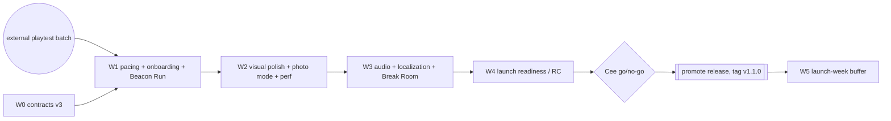

# M3 — Polish & launch (`v1.1.0`, proposed)

Direction: `docs/design/REFERENCE_TARGET.md` overrides retired naming/style/custom-gate rules.

Execution: `docs/handoff/MODEL_POLICY.md`; stages are checkpoints, not usage-window promises.

Owner: lead (structure) · Lead alone maintains task rows from actual progress ([backlog rules](README.md)).
Scope: [scope-tiers.md §3](../design/scope-tiers.md#3-polish-between-v10-and-wide-release-no-new-systems) — **no new systems, only quality** (photo mode and Beacon Run reuse existing systems) · Visual: [visual-target §4.4](../design/visual-target.md#44-m3-polish-post-v10).

Use compact cards directly; split large tasks with short scoped messages as needed.

## 1. Goal

Retention and readiness for wider sharing: pacing tuned from real playtests, the first night and Probation polished, photo mode and Beacon Run for shareable moments, VT-M3 visual polish, audio and localization pipeline, and a launch with production ops in place on the $0 stack.

## 2. Exit criteria

| # | Criterion | Verified by |
| --- | --- | --- |
| E1 | Pacing at P50 inside target bands; P10–P90 within ± 20 % (playtest telemetry + balance-sim) | `/balance-check` + playtest report |
| E2 | No achievement requires AFK grinding | balance-reviewer |
| E3 | VT-M3-01…13: V2 items pass (≤ 3 open), V3 best effort | `/visual-check M3` (A-High, B-Medium) |
| E4 | Tier A/B budgets with max permits, 16 players and a full solar farm; 2 h long-session stable | `/perf-check` |
| E5 | Localization pipeline: every player-facing string in tables; English complete; no machine-translated shipping text | ui + game-designer |
| E6 | Launch checklist: production on `main` (ADR-0029), Sentry alerts, usage logging, uptime policy (Q11) decided, credits/licences complete | `/release-checklist` |
| E7 | Launch-week stability: no unrecovered P1 incident open | M3-W5 report |

## 3. Stage plan

| Wave | Theme | Stage A | Stage B |
| --- | --- | --- | --- |
| W0 | Installs, then contracts v3 | **M3-S1**: T02 (installs) first, then T01, then T03 (integ) | — |
| W1 | Pacing, onboarding, Beacon Run | **M3-S2**: T01, T03, T05 | **M3-S3**: T02, T04, T06 (integ) |
| W2 | Visual polish + photo mode + perf | **M3-S4**: T01, T02, T04 | **M3-S5**: T03, T05, T06 (integ) |
| W3 | Audio, localization, Break Room | **M3-S6**: T01, T02, T04 | **M3-S7**: T03, T05, T06 (integ) |
| W4 | Launch readiness | **M3-S8**: T01, T02, T04 | **M3-S9**: T03, T05, T06 (integ, RC) |
| W5 | Launch week buffer | **M3-S10**: T01, T02 (+ lead-planned hotfix tasks) | **M3-S11**: T03 (integ, close) |

Stage labels express dependencies, not token budgets, usage windows or stopping points.

## 4. Status table

| ID | Stage | Role | Goal | Depends on | Port | Status |
| --- | --- | --- | --- | --- | --- | --- |
| M3-W0-T01 | M3-S1 | contracts-architect | Contracts v3: photo mode settings, string-table schema, Beacon Run records, telemetry events | M3-W0-T02 | 0 | todo |
| M3-W0-T02 | M3-S1 | devops-engineer | Installs from M2 requests; CI string-table lint; prod alert config | M2 done | 1 | todo |
| M3-W0-T03 | M3-S1 | integrator | M3-W0 integration | M3-W0-T01, M3-W0-T02 | 9 | todo |
| M3-W1-T01 | M3-S2 | game-designer | Pacing tuning from playtests; achievement + Tenure balance | M3-W0-T03 | 1 | todo |
| M3-W1-T02 | M3-S3 | ui-ux-motion-designer | Tutorial polish: Probation pacing, DOT barks, first night | M3-W1-T01 | 2 | todo |
| M3-W1-T03 | M3-S2 | gameplay-systems-engineer | Beacon Run time trials on existing beacons/vehicles | M3-W0-T03 | 3 | todo |
| M3-W1-T04 | M3-S3 | ui-ux-motion-designer | Beacon Run UI + Survey Globe/Punch List UX (filters, Plot ID search, route export) | M3-W1-T03 | 4 | todo |
| M3-W1-T05 | M3-S2 | backend-data-engineer | Beacon Run records + Puck Toss board per contract | M3-W0-T03 | 5 | todo |
| M3-W1-T06 | M3-S3 | integrator | M3-W1 integration | M3-W1-T01, M3-W1-T02, M3-W1-T03, M3-W1-T04, M3-W1-T05 | 9 | todo |
| M3-W2-T01 | M3-S4 | technical-artist | Heiligenschein, Milky Way, Earth detail, thermal-glint sunrise | M3-W1-T06 | 1 | todo |
| M3-W2-T02 | M3-S4 | rendering-engineer | Photo mode camera + native-DPR capture, Cinematic preset | M3-W1-T06 | 2 | todo |
| M3-W2-T03 | M3-S5 | ui-ux-motion-designer | Photo mode UI, HUD scale 80-150%, colour-blind modes, menus polish | M3-W2-T02 | 3 | todo |
| M3-W2-T04 | M3-S4 | terrain-dust-engineer | Footprint persistence bake, shift-graffiti readability | M3-W1-T06 | 4 | todo |
| M3-W2-T05 | M3-S5 | performance-profiler | Perf pass: max permits + 16 players + full farm; 2 h session capture | M3-W1-T06 | 5 | todo |
| M3-W2-T06 | M3-S5 | integrator | M3-W2 integration | M3-W2-T01, M3-W2-T02, M3-W2-T03, M3-W2-T04, M3-W2-T05 | 9 | todo |
| M3-W3-T01 | M3-S6 | audio-engineer | Full music layers, Brightside FM tracks, mix pass | M3-W2-T06 | 1 | todo |
| M3-W3-T02 | M3-S6 | ui-ux-motion-designer | Localization pipeline: string extraction, runtime tables, pseudo-locale | M3-W2-T06 | 2 | todo |
| M3-W3-T03 | M3-S7 | game-designer | English string tables + glossary; no MT shipping text | M3-W3-T02 | 3 | todo |
| M3-W3-T04 | M3-S6 | gameplay-systems-engineer | Break Room: Puck Toss rules, Notice Board messages | M3-W2-T06 | 4 | todo |
| M3-W3-T05 | M3-S7 | rendering-engineer | Perf fixes from M3-W2-T05 | M3-W2-T06 | 5 | todo |
| M3-W3-T06 | M3-S7 | integrator | M3-W3 integration | M3-W3-T01, M3-W3-T02, M3-W3-T03, M3-W3-T04, M3-W3-T05 | 9 | todo |
| M3-W4-T01 | M3-S8 | devops-engineer | Production hardening: alerts, usage review, uptime policy, hub kit | M3-W3-T06 | 1 | todo |
| M3-W4-T02 | M3-S8 | qa-test-engineer | Launch load test (multi-room admission, cold start) + full regression | M3-W3-T06 | 2 | todo |
| M3-W4-T03 | M3-S9 | technical-artist | Store-capsule shot set + hub art | M3-W3-T06 | 3 | todo |
| M3-W4-T04 | M3-S8 | backend-data-engineer | DB retention/compaction vs 1 GB, export/backup script | M3-W3-T06 | 4 | todo |
| M3-W4-T05 | M3-S9 | docs-keeper | Credits, ASSET_LICENSES audit, player-facing README/FAQ | M3-W3-T06 | 5 | todo |
| M3-W4-T06 | M3-S9 | integrator | Launch release candidate + release checklist | M3-W4-T01, M3-W4-T02, M3-W4-T03, M3-W4-T04, M3-W4-T05 | 9 | todo |
| M3-W5-T01 | M3-S10 | qa-test-engineer | Launch-week telemetry triage + repro bots | M3-W4-T06 | 1 | todo |
| M3-W5-T02 | M3-S10 | devops-engineer | Launch-week ops review (egress, hours, DB size, errors) | M3-W4-T06 | 2 | todo |
| M3-W5-T03 | M3-S11 | integrator | M3 closing integration (hotfixes), close milestone | M3-W5-T01, M3-W5-T02 | 9 | todo |

## 5. Wave DAG

## 6. Task cards (compact)

Field order: **Stage · Role · Port · Status · Depends** / Owned / Acceptance / Visual / Reviewers / DoD (Standard unless stated).

#### M3-W0-T01 — Contracts v3
M3-S1 · `contracts-architect` · 0 · `todo` · M3-W0-T02 (installs finished)
- **Owned:** `packages/shared/**`. **Acceptance:** photo-mode settings, string-table key schema (zod), Beacon Run record DTOs, telemetry event names for pacing; versions bumped; tests. **Visual:** n/a. **Review lenses:** code-reviewer, netcode-security-reviewer.

#### M3-W0-T02 — Installs, CI string lint, prod alerts config
M3-S1 · `devops-engineer` · 1 · `todo` · M2 done (runs **first and alone** in M3-S1; **Installer: yes**; lead writes dependency ADRs beforehand)
- **Owned:** root `package.json`, lockfile, root config files, `.github/**`, `packages/config/**`. **Acceptance:** ADR-backed installs; CI fails on hard-coded player-facing strings outside tables (lint rule); Sentry alert rules documented. **Visual:** n/a. **Review lenses:** code-reviewer, netcode-security-reviewer.

#### M3-W0-T03 — M3-W0 integration
M3-S1 · `integrator` · 9 · `todo` · T01, T02
- **Owned:** `apps/*/src/app/**`, report. **Acceptance:** `/verify` PASS; consumer list. **Review lenses:** code-reviewer.

#### M3-W1-T01 — Pacing tuning, achievement + Tenure balance
M3-S2 · `game-designer` · 1 · `todo` · M3-W0-T03
- **Owned:** `packages/game-data/**`, `tools/balance-sim/**`. **Acceptance:** E1 bands from playtest telemetry; E2; balance-sim updated with observed distributions. **Visual:** n/a. **Review lenses:** code-reviewer, balance-reviewer.

#### M3-W1-T02 — Tutorial polish
M3-S3 · `ui-ux-motion-designer` · 2 · `todo` · M3-W1-T01
- **Owned:** `apps/client/src/ui/onboarding/**`, `apps/client/src/ui/dot/**` (T04 owns `ui/beacon-run/**` and `ui/survey/**` this wave). **Acceptance:** Probation Checklist pacing, DOT barks, first-night guidance; new-tester flow unaided ≤ 10 min to Crescent Squeegee still holds. **Visual:** VT-M3-11 (menus part). **Review lenses:** code-reviewer, visual-qa-reviewer.

#### M3-W1-T03 — Beacon Run time trials
M3-S2 · `gameplay-systems-engineer` · 3 · `todo` · M3-W0-T03
- **Owned:** `packages/sim/src/beacon-run/**`. **Acceptance:** course from existing Flare Beacons; server-timed; cosmetic rewards only; tests. **Visual:** n/a. **Review lenses:** code-reviewer, netcode-security-reviewer, balance-reviewer.

#### M3-W1-T04 — Beacon Run UI + Survey Globe / Punch List UX
M3-S3 · `ui-ux-motion-designer` · 4 · `todo` · M3-W1-T03
- **Owned:** `apps/client/src/ui/beacon-run/**`, `apps/client/src/ui/survey/**`. **Acceptance:** run HUD + results; globe filters, Plot ID search, Flare Beacon route export. **Visual:** VT-M1-24 regression. **Review lenses:** code-reviewer, visual-qa-reviewer.

#### M3-W1-T05 — Beacon Run records + Puck Toss board
M3-S2 · `backend-data-engineer` · 5 · `todo` · M3-W0-T03
- **Owned:** `packages/db/**`, `apps/server/src/api/**`. **Acceptance:** per-contract records; anti-cheat via server timing; storage within data-model §4. **Visual:** n/a. **Review lenses:** code-reviewer, netcode-security-reviewer.

#### M3-W1-T06 — M3-W1 integration
M3-S3 · `integrator` · 9 · `todo` · T01–T05
- **Acceptance:** `/verify`, `/bot-test`, `/visual-check` (S12), `/balance-check` PASS. **Review lenses:** code-reviewer, balance-reviewer, visual-qa-reviewer.

#### M3-W2-T01 — Sky and light polish
M3-S4 · `technical-artist` · 1 · `todo` · M3-W1-T06
- **Owned:** `apps/client/src/visuals/**`, `assets/textures/sky/**`. **Acceptance:** opposition surge/heiligenschein, Milky Way band (no Gaia data), Earth city lights + clouds + libration, sunrise glints. **Visual:** VT-M3-01, 02, 03, 09. **Review lenses:** code-reviewer, visual-qa-reviewer, performance-reviewer.

#### M3-W2-T02 — Photo mode camera + capture, Cinematic preset
M3-S4 · `rendering-engineer` · 2 · `todo` · M3-W1-T06
- **Owned:** `apps/client/src/render/**`. **Acceptance:** free camera, exposure ± 2 EV, telephoto to 15° vFOV, native-DPR capture; optional Cinematic preset (SSR on Glow/Brushed, DOF in photo mode), never default. **Visual:** VT-M3-04, 05. **Review lenses:** code-reviewer, visual-qa-reviewer, performance-reviewer.

#### M3-W2-T03 — Photo mode UI, HUD scale, colour-blind modes, menus
M3-S5 · `ui-ux-motion-designer` · 3 · `todo` · M3-W2-T02
- **Owned:** `apps/client/src/ui/**`. **Acceptance:** photo UI (hide HUD, grid, filters, Earthrise presets); HUD scale 80–150 % without clipping at 1280×720; deuteranopia/protanopia/tritanopia modes; Clock In/Contracts/Locker/Settings/Credits polish (CLS ≤ 0.1). **Visual:** VT-M3-06, 07, 11. **Review lenses:** code-reviewer, visual-qa-reviewer.

#### M3-W2-T04 — Footprint persistence, shift graffiti
M3-S4 · `terrain-dust-engineer` · 4 · `todo` · M3-W1-T06
- **Owned:** `apps/client/src/terrain/**`. **Acceptance:** old prints bake into plot-tile "trampled" detail with no ring boundary; freehand cleaned shapes readable from 30 m. **Visual:** VT-M3-08, 10. **Review lenses:** code-reviewer, visual-qa-reviewer, performance-reviewer.

#### M3-W2-T05 — Perf pass + long-session capture
M3-S5 · `performance-profiler` · 5 · `todo` · M3-W1-T06
- **Owned:** `tools/perf/**`, `apps/client/src/debug/**`. **Acceptance:** E4 scenes on A/B; 2 h capture with no degradation; findings assigned to owners. **Visual:** VT-M3-13. **Review lenses:** code-reviewer, performance-reviewer.

#### M3-W2-T06 — M3-W2 integration
M3-S5 · `integrator` · 9 · `todo` · T01–T05
- **Acceptance:** `/verify`, `/visual-check M3` (changed scenes + VT-M3 list), `/perf-check` PASS. **Review lenses:** code-reviewer, visual-qa-reviewer, performance-reviewer.

#### M3-W3-T01 — Music + mix pass
M3-S6 · `audio-engineer` · 1 · `todo` · M3-W2-T06
- **Owned:** `apps/client/src/audio/**`, `assets/audio/**`. **Acceptance:** full layers per Review, Brightside FM track list (licences in ledger), loudness-normalised mix; download budget held. **Visual:** n/a. **Review lenses:** code-reviewer, performance-reviewer.

#### M3-W3-T02 — Localization pipeline
M3-S6 · `ui-ux-motion-designer` · 2 · `todo` · M3-W2-T06
- **Owned:** `apps/client/src/ui/i18n/**`, `apps/client/src/ui/**` (string call sites). **Acceptance:** all UI strings via tables; pseudo-locale (+40 % length) shows no clipping; locale switch at runtime. **Visual:** VT-M3-07 regression with pseudo-locale. **Review lenses:** code-reviewer, visual-qa-reviewer.

#### M3-W3-T03 — English string tables + glossary
M3-S7 · `game-designer` · 3 · `todo` · M3-W3-T02
- **Owned:** `packages/game-data/**` (string tables), `docs/design/naming-bible.md`. **Acceptance:** every key filled; glossary for translators; human-review rule for any non-English table. **Visual:** n/a. **Review lenses:** code-reviewer, balance-reviewer (economy strings consistency).

#### M3-W3-T04 — Break Room activities
M3-S6 · `gameplay-systems-engineer` · 4 · `todo` · M3-W2-T06
- **Owned:** `packages/sim/src/break-room/**`. **Acceptance:** Puck Toss rules + per-contract leaderboard events; Notice Board messages (quick-phrase based). **Visual:** n/a. **Review lenses:** code-reviewer, netcode-security-reviewer, balance-reviewer.

#### M3-W3-T05 — Perf fixes
M3-S7 · `rendering-engineer` · 5 · `todo` · M3-W2-T06
- **Owned:** `apps/client/src/render/**`. **Acceptance:** M3-W2-T05 render findings closed; E4 holds. **Visual:** VT-M3-13. **Review lenses:** code-reviewer, performance-reviewer.

#### M3-W3-T06 — M3-W3 integration
M3-S7 · `integrator` · 9 · `todo` · T01–T05
- **Acceptance:** `/verify`, `/bot-test`, `/visual-check`, `/perf-check` PASS. **Review lenses:** code-reviewer, visual-qa-reviewer, performance-reviewer.

#### M3-W4-T01 — Production hardening + hub kit
M3-S8 · `devops-engineer` · 1 · `todo` · M3-W3-T06
- **Owned:** `apps/server/src/ops/**`, `apps/client/public/hub/**`, `.github/**` (one designated writer), `render.yaml`, `vercel.json`. **Acceptance:** Sentry alerts live; weekly usage review procedure (egress, instance hours, DB size); Q11 uptime policy implemented as decided; hub metadata. **Visual:** n/a. **Review lenses:** code-reviewer, netcode-security-reviewer.

#### M3-W4-T02 — Launch load test + regression
M3-S8 · `qa-test-engineer` · 2 · `todo` · M3-W3-T06
- **Owned:** `tools/bots/**`, `tests/e2e/**`. **Acceptance:** multiple rooms to admission limits (4105 path), cold start during load, full e2e regression green. **Visual:** n/a. **Review lenses:** code-reviewer, performance-reviewer, netcode-security-reviewer.

#### M3-W4-T03 — Store-capsule shot set + hub art
M3-S9 · `technical-artist` · 3 · `todo` · M3-W3-T06
- **Owned:** `apps/client/src/visuals/lookdev/**`, `assets/textures/hub/**`. **Acceptance:** 6 shots (VM-01, 02, 05, 06, 08, 10) at 1920×1080 composed via photo mode; hub icons. **Visual:** VT-M3-12. **Review lenses:** code-reviewer, visual-qa-reviewer.

#### M3-W4-T04 — DB retention + compaction
M3-S8 · `backend-data-engineer` · 4 · `todo` · M3-W3-T06
- **Owned:** `packages/db/**`, `apps/server/src/persistence/**`. **Acceptance:** retention per data-model §5; idle-contract compaction; refuse new contracts above quota; export script for Cee. **Visual:** n/a. **Review lenses:** code-reviewer, netcode-security-reviewer.

#### M3-W4-T05 — Credits, licence audit, player-facing docs
M3-S9 · `docs-keeper` · 5 · `todo` · M3-W3-T06
- **Owned:** `docs/ASSET_LICENSES.md`, `README.md`, `docs/README.md`, credits data hand-off note for ui. **Acceptance:** every asset row complete (NASA LOLA, HYG, Blue Marble, fonts, audio); FAQ; exact title Clean The Moon!; flexible common item names; no copied proprietary text/assets. **Visual:** n/a. **Review lenses:** code-reviewer (consistency), netcode-security-reviewer (no secrets/URLs leaked).

#### M3-W4-T06 — Launch release candidate
M3-S9 · `integrator` · 9 · `todo` · T01–T05
- **Acceptance:** all gates PASS; `/release-checklist` go; Cee go/no-go. **Review lenses:** code-reviewer, visual-qa-reviewer, performance-reviewer, netcode-security-reviewer, balance-reviewer. **DoD:** implemented and meaningfully verified; continue ready work.

#### M3-W5-T01 — Launch-week triage + repro bots
M3-S10 · `qa-test-engineer` · 1 · `todo` · M3-W4-T06
- **Owned:** `tools/bots/**`, report. **Acceptance:** Sentry + room-stats triage list with severity and owner; bot repro for each P1. **Visual:** n/a. **Review lenses:** code-reviewer.

#### M3-W5-T02 — Launch-week ops review
M3-S10 · `devops-engineer` · 2 · `todo` · M3-W4-T06
- **Owned:** `apps/server/src/ops/**`, report. **Acceptance:** month-to-date egress vs 5 GB projection, instance hours vs 750, DB size vs 1 GB, recommendations (Cee decisions logged in OPEN_QUESTIONS). **Visual:** n/a. **Review lenses:** code-reviewer, netcode-security-reviewer.

#### M3-W5-T03 — M3 closing integration
M3-S11 · `integrator` · 9 · `todo` · M3-W5-T01, M3-W5-T02 (+ any hotfix tasks)
- **Acceptance:** hotfixes integrated; E7 met; milestone closed; M4 ideas retained as optional backlog. **Review lenses:** code-reviewer.
